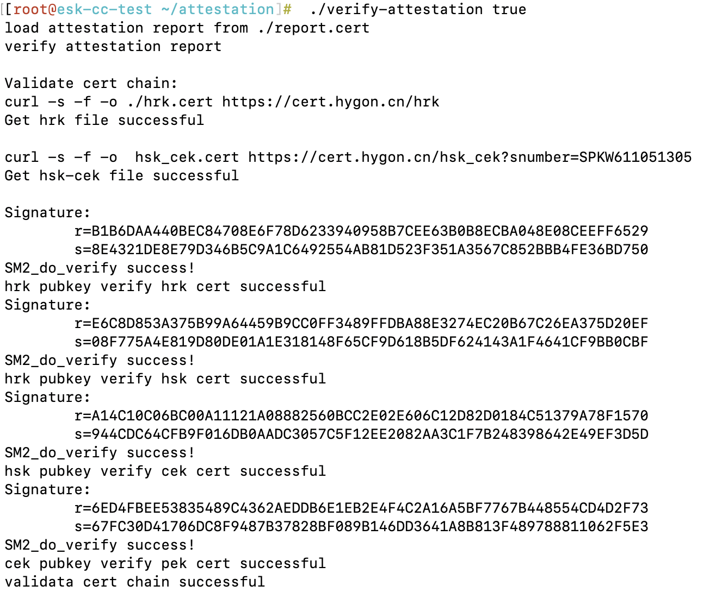
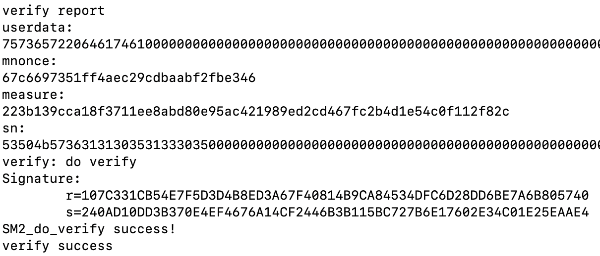

# CSV机密容器的基本特性测试

## 参考文档

[2-测试CSV机密容器](https://openanolis.cn/sig/Hygon-Arch/doc/865622237679327018)

## 验证CSV已使能

按照文档[创建基于CSV的kata Pod](./单节点机密容器环境搭建.md#创建基于csv的kata-pod)。

确认Pod正在运行：
```bash
# kubectl get po
NAME    READY   STATUS    RESTARTS   AGE
nginx   1/1     Running   0          5h52m
```

在容器中执行`dmesg`命令，查看容器内核启动信息，确认CSV/CSV2已使能：
```bash
# kubectl exec -it nginx -- dmesg | grep CSV  
[    0.086720]  HYGON CSV
[    0.086721]  HYGON CSV2
```

## 验证CSV容器内存加密

使用海光提供的脚本[dump-kata-memory.sh](https://gitee.com/anolis/hygon-devkit/blob/master/csv/dump-kata-memory.sh)，找到容器所在虚拟机的进程，并dump虚拟机内存的第一页：

```bash
./dump-kata-memory.sh crictl nginx
```

运行结果如下图：


作为对比，创建普通的kata容器，并dump虚拟机内存，结果如下图：


可以看到，CSV容器的内存页被加密，而普通容器的内存页没有被加密。

## 测试CSV的Runtime Attestation功能

CSV支持Attestation，可以在CSV机密容器中生成认证报告，然后在可联网环境用海光的通用证书验证报告。

需要先编译相关的binary工具。

首先，编译`GmSSL`，这是CSV底层依赖的加密算法：
```bash
git clone -b master https://github.com/guanzhi/GmSSL.git
cd GmSSL
git checkout GmSSL-v2
git checkout 5b904768
sed -i "s/qw\/glob/qw\/:glob/g" Configure
sed -i "s/qw\/glob/qw\/:glob/g" test/build.info
./config --prefix=/opt/gmssl
make
make install
```

然后，clone海光的[hygon-devkit](https://gitee.com/anolis/hygon-devkit.git)，找到目录`csv/attestation`，拷贝到主机目录`/opt/hygon/csv/attestation`。进入目录进行编译：
```bash
cd /opt/hygon/csv/attestation
make
```

重新创建nginx Pod，把`/opt/hygon/csv/attestation`目录和虚拟机的`/dev`mount到容器中：
```yaml
cat <<-EOF | kubectl apply -f -
apiVersion: v1
kind: Pod
metadata:
  labels:
    run: nginx
  name: nginx
spec:
  containers:
  - image: local.cmecloud.cn/test/nginx:latest
    name: nginx
    volumeMounts:
    - mountPath: /root/attestation
      name: attestation
    - mountPath: /dev
      name: dev
  dnsPolicy: ClusterFirst
  runtimeClassName: kata-qemu-csv
  volumes:
  - name: attestation
    hostPath:
      path: /opt/hygon/csv/attestation
  - name: dev
    hostPath:
      path: /dev
EOF
```

等Pod running后，进入容器执行命令
```
kubectl exec -it test-attestation -- bash
cd /root/attestation/
./ioctl-get-attestation
# 退出pod
exit
```
生成认证报告`report.crt`。结果如下图所示：


将报告拷贝到可以联网的Linux主机。按上面的步骤在该主机上编译`attestation`目录下的binaries。然后用`verify-attestation`验证报告。
```
cd /opt/hygon/csv/attestation
sudo chmod 666 report.cert
sudo ./verify-attestation true
```
verify-attestation会使用PEK公钥验证认证报告的签名，并且从证书服务器下载证书链验证HRK->HSK->CEK->PEK证书的签名，mnonce、userdata 获取报告和验证报告过程都会输出打印，请认证方检查确认两者是否一致
结果如下图所示：



