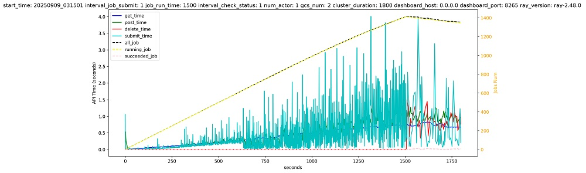
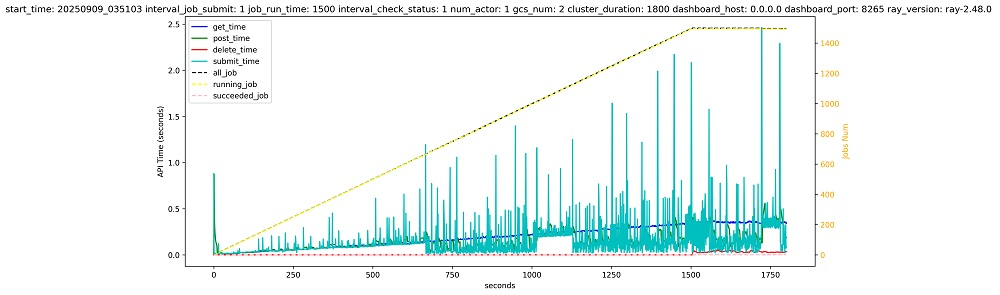

## Project Introduction

openFuyao/ray is a "parallel universe" project forked from [ray-project/ray](https://github.com/ray-project/ray). It is committed to providing Ray users and operators with a stable, reliable, and domestically hardware-friendly LTS (Long-Term Support) version. openFuyao/ray is a unified distributed computing framework for scaling AI and Python applications. Users can refer to the upstream community to learn more about [Ray AI Libraries](https://docs.ray.io/en/latest/ray-air/getting-started.html) or the [Ray Core](https://docs.ray.io/en/latest/ray-core/walkthrough.html).

## How does openFuyao/ray differ from ray-project/ray?

1.  **Focus on LTS versions**: Ensures that users or critical systems can continuously receive security patches and critical bug fixes without frequent upgrades, guaranteeing stability and reliability in production environments.
2.  **Earlier release of domestic hardware-friendly features**: Supports testing of new hardware and collects user feedback to prepare for upstream community integration.
3.  **Focus on stability of large-scale, long-running Ray clusters**: Implements key optimizations tailored for production environments.
4.  **Provides a Chinese-friendly community for communication and collaboration**.

## Version Introduction

### openFuyao/ray 2.48.0

Based on ray-project/ray-2.48.0, openFuyao/ray-2.48.0 comprehensively enhances the stability of long-running clusters and addresses known issues.

#### Ray Cluster Job Management Performance Comparison

*   Comparison Date: 2025/09/19
*   Test Description: Simulates a long-running cluster continuously submitting and processing jobs, followed by job deletion upon completion.

**ray-project/ray-2.48.0**

**openFuyao/ray-2.48.0**

> Comparison Result: Compared to ray-project/ray-2.48.0, openFuyao/ray-2.48.0 demonstrates superior job management performance. Under high load, it ensures stable job submission and deletion latency, maintaining sustainable high resource utilization in the cluster.

#### Core Function Performance Comparison

*   Comparison Date: 2025/09/19
*   Test Description: Analyzes performance changes in Ray's core scheduling functions based on stability improvements.

| Test Item | ray-project/ray-2.48.0 Duration | openFuyao/ray-2.48.0 Duration | Performance Change (Larger is Better) |
| :--- | :--- | :--- | :--- |
| Cluster Startup/Shutdown Speed (s) | 13.08 | 14.81 | -13% |
| Actor Creation Latency (us) | 229921.21 | 234612.41 | -2% |
| Actor Call Latency (us) | 1000.40 | 942.36 | 6% |
| Get Job from GCS Latency (ms) | 18.02 | 18.11 | -1% |
| Get Task from GCS Latency (ms) | 6870.13 | 6725.78 | 2% |
| Dashboard Create Job Latency (10 Running Jobs) (ms) | 3506.41 | 3587.42 | -2% |
| Dashboard Create Job Latency (100 Running Jobs) (ms) | 5704.69 | 5875.83 | -3% |
| Dashboard Get Job Latency (10 Running Jobs) (ms) | 10.64 | 8.28 | 22% |
| Dashboard Get Job Latency (100 Running Jobs) (ms) | 73.90 | 32.51 | 56% |
| ray.data.map_batches Latency (100 records) (s) | 1.68 | 1.89 | -12% |
| ray.data.map_batches Latency (500 records) (s) | 3.64 | 4.03 | -11% |
| ray.data.map_batches Latency (1000 records) (s) | 5.17 | 5.43 | -5% |
| ray.data.map_batches Latency (1500 records) (s) | 6.56 | 6.89 | -5% |
| ray.Serve 1000 Requests Duration (s) | 4.57 | 4.62 | -1% |

#### New Feature Control Instructions

| PR | Control Variable | Default Value | Configuration Method | Description |
| :--- | :--- | :--- | :--- | :--- |
| [[Data] Fix slow datasetid allocation in \_StatsActor #48](https://gitcode.com/openFuyao/ray/pull/48) | Env Var: `RAY_USE_UUID_DATASETID` | `True` | Head Node reads env var | Under high cluster load and frequent task launches, requesting `dataset_id` from `_StatsActor` can be very slow, causing high task startup latency. Analysis shows this ID currently has no significant purpose. Furthermore, if obtaining this ID fails, it falls back to `uuid4`. This PR adds support for switching the ID generation method, defaulting to fallback to `uuid4` to reduce data task startup latency. |
| [[Core] Add automatic Worker data cleanup #53](https://gitcode.com/openFuyao/ray/pull/53) | Env Var: `RAY_maximum_gcs_dead_worker_cached_count` | `100000` | Head Node reads env var | For long-running Ray clusters, Worker data accumulates continuously without cleanup, leading to increasing memory or Redis data usage, potentially affecting long-term cluster operation. This PR adds automatic cleanup of Worker information. |
| [[RuntimeEnv] Add limit for job_logger_cache count #58](https://gitcode.com/openFuyao/ray/pull/58) | Env Var: `RAY_RUNTIME_MAX_JOB_LOGGER_CACHE_COUNT` | `5000` | All nodes' env var | The `job_logger` cache in `runtime_env` currently lacks a cleanup mechanism. As the number of Jobs increases, the number of log files opened by the `runtime_env` process can reach the system limit, affecting long-term Ray cluster stability. This PR adds a `job_logger` cache cleanup mechanism. |
| [[Core] Allow Ray to override KubeRay resource config #62](https://gitcode.com/openFuyao/ray/pull/62) | Env Vars: `RAY_DETECT_OVERWRITE_RESOUCES` `RAY_OVERWRITE_CPU_PERCENT` `RAY_OVERWRITE_MEM_PERCENT` | `true`/`100`/`100` | Head Node reads env var | In KubeRay scenarios, Ray Node available resources are currently injected via `kuberay resources limits`. When using a deployment strategy with one worker pod per physical node, especially with diverse physical node specs (e.g., CPU=2/4/8/10/12), even with node affinity ensuring one pod per node, multiple resource templates are needed to match `resources limits` to node specs. This cannot auto-adjust based on actual node specs like bare-metal deployments. To reduce resource template configuration cost and ease adaptation to heterogeneous physical nodes, this feature allows Ray to skip `kuberay resources limits` injection, auto-discover all host CPU and mem, and supports configuring maximum usage percentage. Note: This is a customized feature and must be used with K8s affinity configurations. |
| [[Dashboard] Add Job Log deletion API & Worker Log auto-cleanup #61](https://gitcode.com/openFuyao/ray/pull/61) | Env Vars: `RAY_last_modified_time_threshold` `RAY_worker_log_cleanup_interval` | `3600`/`3600` | All nodes' env var | 1. Add a Job Log deletion API for cleaning up expired Job Logs. 2. Jobs generate large amounts of Worker Logs during execution, consuming significant storage. Adds automatic Worker Log cleanup functionality to reduce cluster storage pressure. Note: Worker log expiration is determined by last modification time. This feature targets long-running clusters constantly executing jobs (jobs end and are resubmitted), not long-running jobs where logs are continuously written. Future consideration for worker log rotation. |
| [[Core] Allow increasing max worker process count per node #72](https://gitcode.com/openFuyao/ray/pull/72) | Env Var: `RAYLET_WORKER_PROCESS_COUNT_FACTOR` | `True` | All nodes' env var | Allows users to modify configuration to increase the Raylet worker process count, better utilizing node computing power (e.g., multi-accelerator hosts with high VRAM, where worker processes use XPU instead of CPU, suggesting more worker processes than CPU cores). |
| [[Core] Support disabling raylet log broadcast #66](https://gitcode.com/openFuyao/ray/pull/66) | Env Var: `RAY_DISABLE_RAYLET_LOG_BROADCAST` | `0` | All nodes' env var | Some Raylet error logs are broadcast to alert users about cluster status. However, all Jobs receive these error logs, which might interfere with automated job processing for some users. This adds the `RAY_DISABLE_RAYLET_LOG_BROADCAST` environment variable to disable raylet log broadcasting. |
| [[Data] Map actor affinity scheduling #69](https://gitcode.com/openFuyao/ray/pull/69) | Add before ray.data execution: `from ray.data._internal.execution.interfaces import ExecutionOptions`  `from ray.data.context import DataContext`  `DataContext.get_current().execution_options = ExecutionOptions(actor_locality_enabled=True)`  `DataContext.get_current().data_centralized_scheduling = True` | N/A | Add to user script | In ray data, the map operator uses a spread scheduling strategy for actors. Actors are distributed across various cluster nodes, potentially causing data transfer between nodes and high network throughput. Using affinity scheduling, actors are preferentially scheduled onto the same node as their upstream class actor (if resources permit), avoiding significant inter-node data transfer. |
| [[Worker] Add orphan process monitoring & auto-termination #70](https://gitcode.com/openFuyao/ray/pull/70) | Env Var: `RAY_FORK_MONITOR_AGENT` | `0` | All nodes' env var | This feature implements a monitoring agent primarily for real-time tracking and management of all child processes under a specified parent process. Its core function is detecting and automatically terminating orphan processes to prevent leftover child processes caused by abnormal parent process exits. It starts with the dashboard agent, scans the target process tree every 5 seconds, adds new child processes to the monitoring list, and logs them. If a process's parent becomes 1 (taken over by system init) and its original parent wasn't 1 (avoiding killing system processes), it is judged an orphan process. The orphan process is terminated immediately, and the monitoring record is cleaned up. |
| [[RuntimeEnv] Add upgrade parameter for pip #71](https://gitcode.com/openFuyao/ray/pull/71) | N/A | N/A | N/A | RuntimeEnv supports `latest` to specify upgrading certain libraries to the latest version. `runtime_env = {"pip": {"packages":["torch==latest"]}}` `ray.init(runtime_env=runtime_env)` |
| [[Core] Add bin-pack scheduling strategy #68](https://gitcode.com/openFuyao/ray/pull/68) | Can be used like other scheduling strategies by setting `"scheduling_strategy"` to `"BINPACK"` in options: `func.options(scheduling_strategy="BINPACK").remote()` Alternatively, use the `--bin-pack` flag when submitting a ray job: `ray job submit --bin-pack -- python3 test.py` If the user script doesn't specify a scheduling strategy, the default strategy for this job becomes BinPack (applies to Ray Core and Ray Data). | N/A | N/A | Adds a new BinPack scheduling strategy. This strategy schedules tasks or actors preferentially onto nodes with the highest resource utilization (based on the highest utilization among CPU, Memory, Object Store Memory) that also have sufficient remaining resources. This aims to reduce the number of nodes used, enabling faster scaling down. |
| [[Core] Support hardware topology-aware scheduling for Ascend 310duo chips #73](https://gitcode.com/openFuyao/ray/pull/73) | Env Vars: `RAY_npu_310duo_topology_aware` `RAY_npu_310duo_topology_aware` | `0` | All nodes' env var | In the Ascend 310duo scenario, users can enable topology-aware scheduling via environment variables. 1. For 2, 4, or 8 device requirements, Huawei-Ray will strictly allocate within chip groups {0,1}, {2,3}, {4,5}, {6,7}. If quantity is sufficient but topology is not, pending occurs. 2. For 1, 3, 5, 7, etc., device requirements, while no affinity scheduling exists, priority is given to chip groups already occupying 1 device, ensuring more complete chip groups remain available. |
| [[Data] Shield部分 \_StatsActor metrics collection to avoid memory leak #59](https://gitcode.com/openFuyao/ray/pull/59) | Env Var: `RAY_DATA_METRICS_ENABLE` | `True` | All nodes' env var | `_StatsActor`, as an observer of data tasks, continuously collects metrics related to data tasks. Since `_StatsActor` is a detached actor, its lifecycle matches the cluster's. Memory leaks have been observed, potentially causing OOM exceptions on the node hosting `_StatsActor`, suspected to be related to frequent gRPC communication or data management. This fix workarounds the issue pending further optimization. |
| [[Dashboard] Adding the TimeTable Function and Resource Profile #65](https://gitcode.com/openFuyao/ray/pull/65) | To run the profile function, you need to use the job submit command of ray and add the --profile option. ray job submit --profile -- python3 test.py | N/A | N/A | The Time Table (beta) is added to the Dashboard Job page to collect statistics on the CPU and NPU resources occupied by a job. Collects statistics on the CPU, memory, NPU AIcore, and HBM usage during the running of the actor in real time, calculates the average, maximum, and Q3 points of each indicator after the running of the actor, and displays the statistics on the dashboard. This feature enables users to obtain more actual actor resource usage and adjust actor resource settings in user scripts. |
## More Information

-   [Documentation](http://docs.ray.io/en/latest/index.html)
-   [Building](BUILD.md)
-   [Ray Architecture Whitepaper](https://docs.google.com/document/d/1tBw9A4j62ruI5omIJbMxly-la5w4q_TjyJgJL_jN2fI/preview)
-   [Exoshuffle: Large-Scale Data Shuffling in Ray](https://arxiv.org/abs/2203.05072)
-   [Ownership: A Distributed Futures System for Fine-Grained Tasks](https://www.usenix.org/system/files/nsdi21-wang.pdf)
-   [RLlib Paper](https://arxiv.org/abs/1712.09381)
-   [Tune Paper](https://arxiv.org/abs/1807.05118)
