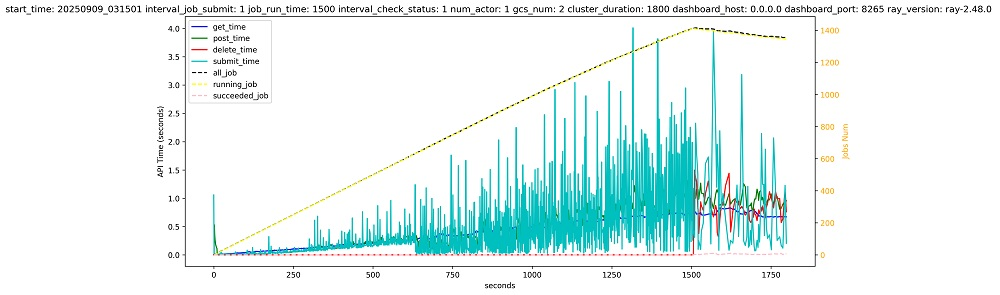
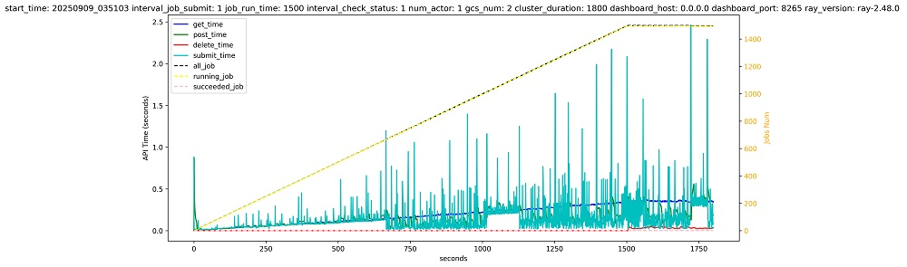

## 项目简介

openFuyao/ray 是源自于 [ray-project/ray](https://github.com/ray-project/ray) 的 “平行宇宙” 项目，致力于面向 Ray 的使用者、运维者，提供稳定可靠、国产硬件亲和的 LTS (Long-Term Support) 版本。openFuyao/ray 是一个用于扩展 AI 和 Python 应用程序的统一分布式计算框架，用户可参考上游社区了解更多关于 [Ray AI 库](https://docs.ray.io/en/latest/ray-air/getting-started.html)，或更多关于 [Ray 内核](https://docs.ray.io/en/latest/ray-core/walkthrough.html) 的信息。

## openFuyao/ray 与 ray-project/ray 有何区别？

1. 专注 LTS 版本，确保用户或关键系统能在不频繁升级的前提下，持续获得安全补丁与关键缺陷修复，保障生产环境稳定可靠；
2. 更早发布的国产硬件亲和特性，支撑新硬件的测试，收集用户意见，为上游社区合入做准备；
3. 关注大规模、常驻 Ray 集群的稳定性，针对生产环境进行关键优化；
4. 提供中文友好的社区交流与协作。

## 版本介绍

### openFuyao/ray 2.48.0

openFuyao/ray-2.48.0 以 ray-project/ray-2.48.0 为基础，全面提升常驻集群稳定性，并解决已知问题。

#### Ray Cluster 作业管理性能对比

* 对比日期：2025/09/19
* 测试说明：模拟常驻集群持续提交、消化作业，并在作业完成后进行删除。

**ray-project/ray-2.48.0**

**openFuyao/ray-2.48.0**

> 对比结果：相比于 ray-project/ray-2.48.0，openFuyao/ray-2.48.0 具备良好的作业管理表现。高负载情况下，确保了稳定的作业提交、删除时延，保障集群资源可持续高负载占用。

#### 核心功能性能对比

* 对比日期：2025/09/19
* 测试说明：在稳定性提升的基础上，分析 Ray 核心调度功能的性能变化。

| 测试项                                      | ray-project/ray-2.48.0 耗时 | openFuyao/ray-2.48.0 耗时 | 性能表现变化（越大越好） |
|---------------------------------------------|-----------------------------|----------------------------|--------------------------|
| 集群启停速度 (s)                            | 13.08                       | 14.81                      | -13%                     |
| Actor创建时延 (us)                          | 229921.21                   | 234612.41                  | -2%                      |
| Actor调用时延 (us)                          | 1000.40                     | 942.36                     | 6%                       |
| 从GCS获取Job时延 (ms)                       | 18.02                       | 18.11                      | -1%                      |
| 从GCS获取Task时延 (ms)                      | 6870.13                     | 6725.78                    | 2%                       |
| Dashboard创建Job时延（正在运行10个Job）(ms) | 3506.41                     | 3587.42                    | -2%                      |
| Dashboard创建Job时延（正在运行100个Job）(ms)| 5704.69                     | 5875.83                    | -3%                      |
| Dashboard获取Job时延（正在运行10个Job）(ms) | 10.64                       | 8.28                       | 22%                      |
| Dashboard获取Job时延（正在运行100个Job）(ms)| 73.90                       | 32.51                      | 56%                      |
| ray.data.map_batches时延（100条数据）(s)    | 1.68                        | 1.89                       | -12%                     |
| ray.data.map_batches时延（500条数据）(s)    | 3.64                        | 4.03                       | -11%                     |
| ray.data.map_batches时延（1000条数据）(s)   | 5.17                        | 5.43                       | -5%                      |
| ray.data.map_batches时延（1500条数据）(s)   | 6.56                        | 6.89                       | -5%                      |
| ray.Serve 1000次请求耗时 (s)                | 4.57                        | 4.62                       | -1%                      |

#### 版本新增特性控制说明

| PR | 控制变量 | 默认值 | 配置方式 | 说明 |
| -- | ------- | ------ | ------- | ---- |
| [[Data] 修复 _StatsActor 分配 datasetid 过慢的问题 #48](https://gitcode.com/openFuyao/ray/pull/48)        | 环境变量：RAY_USE_UUID_DATASETID                             | True         | Head Node 读取环境变量 | 集群压力高、任务启动频繁时，向 _StatsActor 请求 dataset_id 可能非常缓慢，导致任务启动延时较高。经分析，该 id 目前没有显著作用。且该 ID 在获取异常时，会 fall back to uuind4。  综上，支持调整 id 获取方式，默认为 fall back to uuid4，减少 data 任务启动延时。 |
| [[Core] 添加 Worker 数据自动清理功能 #53](https://gitcode.com/openFuyao/ray/pull/53)                   | 环境变量：RAY_maximum_gcs_dead_worker_cached_count           | 100000       | Head Node 读取环境变量 | 对于常驻 Ray 集群，Worker 数据会不断积累，不支持清理，这就导致内存或Redis里的数据越来越多，影响Ray集群的长久运行。此 PR 添加 Worker 信息的自动清理功能。 |
| [[RuntimeEnv] 为 job_logger_cache 添加数量限制 #58](https://gitcode.com/openFuyao/ray/pull/58)            | 环境变量：RAY_RUNTIME_MAX_JOB_LOGGER_CACHE_COUNT             | 5000         | 所有节点环境变量       | runtime_env 的 job_logger 缓存目前没有清理机制。随着 Job 的增多，runtime_env 进程打开的日志文件数会达到系统允许的上限，影响 Ray 集群长稳运行。此 PR 增加 job_logger 缓存清理机制。 |
| [[Core] 允许 Ray 覆盖 KubeRay 资源配置 #62](https://gitcode.com/openFuyao/ray/pull/62)                    | 环境变量：RAY_DETECT_OVERWRITE_RESOUCES RAY_OVERWRITE_CPU_PERCENT RAY_OVERWRITE_MEM_PERCENT | true/100/100 | Head Node 读取环境变量 | KubeRay 场景中，Ray Node 可用资源目前通过 kuberay resources limits 注入。 当采用单个物理节点放置单个 worker pod 的部署策略时，如遇到物理节点规格多样（如 CPU=2/4/8/10/12）等等，及时使用了节点亲和保证每个节点仅放置一个 worker pod，也需要增加多种模板配置，使 resources limits 能匹配节点规格，无法类似裸金属部署时，实现根据节点实际规格自行调整。 因此，为减少资源模板配置成本，方便适配异构物理节点，该特性允许 ray 跳过 kuberay resources limits 注入，自动发现宿主机所有 cpu 和 mem，并支持配置最大使用比例。请注意：该特性为定制需求，需配合 k8s 亲和性配置使用。 |
| [[Dashboard] 添加 Job Log 删除接口及 Worker Log 自动清理功能 #61](https://gitcode.com/openFuyao/ray/pull/61)  | 环境变量： RAY_last_modified_time_threshold RAY_worker_log_cleanup_interval | 3600/3600    | 所有节点环境变量       | 1. 添加 Job Log 删除接口，方便清理过期的 Job Log。  2. Job 运行过程中会产生大量的 Worker Log，占用大量存储空间，添加 Worker Log 自动清理功能，降低集群的存储压力。注意：Worker log 按照最后一次修改时间判断过期。  此特性针对常驻集群，不断执行 job（job 会结束，并不断提交）的场景，不适合常驻 job 的场景，即 worker log 一直在被写入，无法直接删除 log。后续考虑增加 worker log 的 rotation。 |
| [[Core] 允许增加节点最大 worker process 数量 #72](https://gitcode.com/openFuyao/ray/pull/72)               | 环境变量：RAYLET_WORKER_PROCESS_COUNT_FACTOR                 | True         | 所有节点环境变量       | 允许用户修改配置项，增大 Raylet worker process 数量，充分利用节点算力（例如包含高显存加速卡的多算力主机，worker process 占用 XPU 而非 CPU，因此建议使用比 CPU 核数更多的 worker process 数量）。 |
| [[Core] 支持禁用 raylet 日志广播 #66](https://gitcode.com/openFuyao/ray/pull/66)                           | 环境变量：RAY_DISABLE_RAYLET_LOG_BROADCAST                   | 0            | 所有节点环境变量       | Raylet 的一些错误日志会进行广播，用于提醒用户集群的状态。但所有 Job 都会接收到错误日志，这会影响一些用户的 Job 自动化处理流程。因此添加 RAY_DISABLE_RAYLET_LOG_BROADCAST 环境变量，用于禁用 raylet 日志广播功能。 |
| [[Data] map actor 亲和性调度 #69](https://gitcode.com/openFuyao/ray/pull/69)                               | ray.data执行代码行前加入: from ray.data._internal.execution.interfaces import ExecutionOptions   from ray.data.context import DataContext   DataContext.get_current().execution_options = ExecutionOptions(actor_locality_enabled=True)   DataContext.get_current().data_centralized_scheduling = True | 无           | 添加到用户脚本中       | 在ray data中，map operator对于actor的调度使用的是spread调度策略。所有actor会分布到集群的各个节点中，使得数据可能会在不同的节点中不断传输，造成大量的网络吞吐。 使用亲和性调度特性后，actor调度时，会优先调度到它的上游class的actor所在的节点上（只要资源满足需求），避免了大量的节点间数据传输 |
| [[Worker] 添加孤儿进程监控及自动终止 #70](https://gitcode.com/openFuyao/ray/pull/70)                           | 环境变量：RAY_FORK_MONITOR_AGENT                             | 0            | 所有节点环境变量       | 该功能实现了一个监控代理，主要用于实时追踪并管理指定父进程下的所有子进程。其核心功能是检测并自动终止孤儿进程，防止因父进程异常退出导致的子进程残留。 该功能随dashboardagent启动，每5秒扫描一次目标进程树，发现新创建的子进程时，将其加入监控列表并记录日志。 果某进程的父进程变为 1（系统 init 进程接管），且其原始父进程不是 1（避免误杀系统进程），则判定为孤儿进程。 立即终止该孤儿进程并清理监控记录。 |
| [[RuntimeEnv] pip 添加 upgrade 升级参数 #71](https://gitcode.com/openFuyao/ray/pull/71)                        | nan                                                          | nan          | nan                    | RuntimeEnv 支持 latest ，用来指定某些库升级到最新版本   runtime_env = {"pip": {"packages":["torch==latest"]}}   ray.init(runtime_env=runtime_env) |
| [[Core] 添加 bin-pack 调度策略 #68](https://gitcode.com/openFuyao/ray/pull/68)                             | 可以像其他调度策略的使用方法一样，在option中设置“scheduling_strategy”为“BINPACK”来使用   func.options(scheduling_strategy="BINPACK").remote()   除此之外，也可以在ray job提交时，添加“--bin-pack”标签来使用 ray job submit --bin-pack -- python3 test.py 此时，如果用户脚本里没有特别设置调度策略，那么该 job 的默认调度策略会变成 BinPack，包括 ray core 和 ray data | nan          | nan                    | 增加一种新的调度策略 BinPack，该策略可以使 task 或者 actor 优先往资源利用率最高（CPU、Memory、Object store memory 三者中利用率最高值为准）且剩余资源满足需求的节点上调度，以便减少占用的节点个数，实现快速缩容。 |
| [[Core] 针对昇腾 310duo 芯片支持硬件拓扑亲和的调度 #73](https://gitcode.com/openFuyao/ray/pull/73)         | 环境变量：RAY_npu_310duo_topology_aware RAY_npu_310duo_topology_aware | 0            | 所有节点环境变量       | 在 Ascend 310duo 场景中，用户可通过环境变量开启拓扑感知调度。   1. 针对 2、4、8 卡（devices）需求，Huawei-Ray 将严格在 {0, 1}, {2, 3}, {4, 5}, {6, 7} 芯片组内进行分配，若数量满足但拓扑不满足，则将 pending；   2. 针对 1、3、5、7 等卡需求，虽无亲和性调度，但会优先使用已占用 1 卡的芯片组，确保更多完整的芯片组可用。 |
| [[Data] 屏蔽 _StatsActor 部分 metrics 采集，规避内存泄漏 #59](https://gitcode.com/openFuyao/ray/pull/59)       | 环境变量：RAY_DATA_METRICS_ENABLE                            | True         | 所有节点环境变量       | _StatsActor 作为 data 任务的观测者，会持续采集 data 任务相关的 metrics。由于 _StatsActor 是一个 detached actor，因此生命周期与集群存活时间一直，已观测到可能出现内存泄漏，导致_StatsActor 所在节点出现 OOM 异常，目前怀疑与频繁的 gRPC 通信或数据管理有关。该修复特性对此问题进行规避，以便后续优化处理。 |
| [[Dashboard] 添加 TimeTable 功能及资源 Profile #65](https://gitcode.com/openFuyao/ray/pull/65) | 运行Profile功能，需要使用ray的job submit命令，添加--profile选项 ray job submit --profile -- python3 test.py | | | 在 Dashboard Job 页面添加了 Time Table (beta)，用于统计 Job 占用了多少 CPU、NPU 等资源。实时统计收集 actor 运行过程中的 cpu、内存、npu AIcore 和 HBM 的使用情况，并计算整个运行过程结束后，各个指标的平均数、最大值和 Q3 点，并显示在 dashboard 上。让用户能够获取更加真实的 actor 资源使用情况，方便去调整用户脚本里 actor 的资源设置。 |

## 更多信息

- [文档](http://docs.ray.io/en/latest/index.html)
- [构建](BUILD.md)
- [Ray 架构白皮书](https://docs.google.com/document/d/1tBw9A4j62ruI5omIJbMxly-la5w4q_TjyJgJL_jN2fI/preview)
- [Exoshuffle：Ray 中的大规模数据洗牌](https://arxiv.org/abs/2203.05072)
- [所有权：用于细粒度任务的分布式未来系统](https://www.usenix.org/system/files/nsdi21-wang.pdf)
- [RLlib 论文](https://arxiv.org/abs/1712.09381)
- [Tune 论文](https://arxiv.org/abs/1807.05118)
