# Quickstart：10分钟完成第一个UB开发小demo


# 动机和目的

## 动机

APP的灵衢UB化改造存在较高的门槛，主要有：

* **多语言混合开发**​：UB库的语言是C/C++，APP语言有C/C++、Java、Python等等，因此开发环境的配置相对复杂。
* **灵衢硬件获得性低**​：灵衢UB硬件当前还在开发阶段，而且价格昂贵，长期会存在可获得性较低的境况。

## 目的

本文档为UB快速体验指南（本处是指灵衢），通过我们构建的基于Docker的一站式开发环境，加上UB仿真，一定程度上解决上述的两大痛点。

* 当前并没有包含完整的灵衢UB开发依赖，仅包含gcc、cmake、git、memfabric开发包，仅做体验用。
* **当前仿真环境未开放，客户暂时无法完整体验，sig组正在积极推进仿真开放。**


## 开发环境安装和配置

参考：[开发环境安装和配置](./UB开发环境安装和配置.md)


## 下载样例代码工程

下载本开源项目，找到`examples/spark_broadcastjoin_by_shared_memory`，这是为UB在大数据应用的一个简单示例：

> Spark处理两张表的Join时，如果一张表较小，可以通过Broadcast Join方式（将小表发送到工作节点来减少Shuffle次数）优化性能，借助UB超节点的内存共享能力，可以进一步提升性能，简化编程。
>

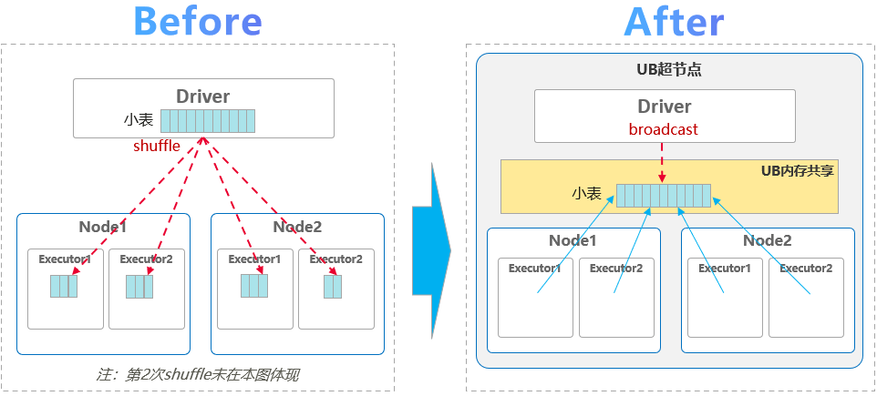

- 常规方式需要将2张表做切片和shuffle，本方案将小表放入UB共享内存，避免大量shuffle
- 支持更大的小表，可以突破到1GB（一般建议512MB），且小表只占用一份内存
- 相比常规方式Join性能提升50%+(内部HCCS环境验证实测)

Demo简化流程

```
// STEP1: 小表存入共享内存
SparkDriver::broadcastSmallTable()
  调用：RackMemShmCreate()
  调用：RackMemShmMmap()
// STEP2: 从共享内存读小表执行Join
SparkBroadcastJoin::join ()
  调用：RackMemShmMmap()
// STEP3: 结束并退出
SparkBroadcastJoin::done ()
  调用：RackMemShmUnmmap()
  调用：RackMemShmDelete()
```

Demo目录结构：

```
spark_broadcastjoin_by_shared_memory
├── CMakeLists.txt
├── include
│   ├── SharedMemoryManager.h
│   ├── SparkBroadcastJoin.h
│   ├── SparkDriver.h
│   ├── SparkUBMemShare.h
│   ├── utils.h
└── src
    ├── main.cpp
    ├── SharedMemoryManager.cpp
    ├── SparkBroadcastJoin.cpp
    ├── SparkDriver.cpp
    ├── SparkUBMemShare.cpp
    └── utils.cpp
```

内存共享核心代码在工程`src/SharedMemoryManager.cpp`文件中。创建共享内存函数`CreateShm()`。大家可根据自己业务需要修改Demo代码：

```std::string
std::string SharedMemoryManager::CreateShm() {
    std::lock_guard<std::mutex> lock(shmMutex);
    if (shmCreated) {
        return shmName;
    }

    // 1. 查找共享区域
    SHMRegions  regions{};
    const char* baseNid = "";
    int         ret     = RackMemShmLookupShareRegions(baseNid, ShmRegionType::ALL2ALL_SHARE, &regions);
    if (ret != 0 || regions.num <= 0 || regions.region[0].num < 0) {
        std::cerr << "[SharedMemoryManager] 查找共享区域失败, ret=" << ret << std::endl;
        return "";
    }

    // 2. 获取区域信息
    SHMRegionInfo* regionInfo =
        static_cast<SHMRegionInfo*>(malloc(sizeof(SHMRegionInfo) + sizeof(int64_t) * regions.region[0].num));
    if (!regionInfo) {
        std::cerr << "[SharedMemoryManager] 分配区域信息内存失败, errno=" << errno << std::endl;
        return "";
    }
    regionInfo->num = regions.region[0].num;
    ret             = RackMemShmLookupRegionInfo(&regions.region[0], regionInfo);
    if (ret != 0) {
        std::cerr << "[SharedMemoryManager] 查询区域信息失败, ret=" << ret << std::endl;
        free(regionInfo);
        return "";
    }
    free(regionInfo);

    // 3. 重试创建共享内存
    const int MAX_RETRY    = 3;
    int       affinity[16] = {1, 1, 1, 1, 1, 1, 1, 1, 1, 1, 1, 1, 1, 1, 1, 1};
    for (int i = 0; i < MAX_RETRY; i++) {
        ret = RackMemShmCreate(shmName.c_str(), shmSize, baseNid, &regions.region[0], affinity);
        if (ret == 0) {
            shmCreated = true;
            return shmName;
        }
    }

    std::cerr << "[SharedMemoryManager] " << MAX_RETRY << "次创建失败, 请检查系统资源" << std::endl;
    return "";
}

```


## 格式化代码（按需）

* 代码编写完后，可以右键选择格式化。
  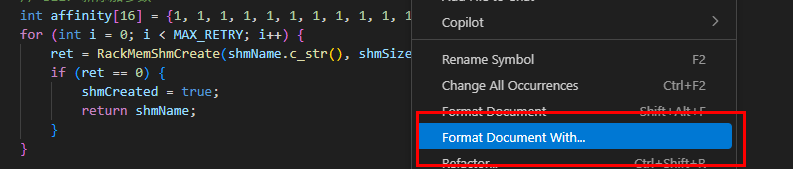
* 选择Clang-Format
  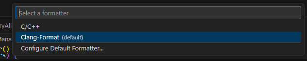


## 编译代码

通过点击VS Code底部菜单栏的Build按钮，即可对工程进行编译构建。

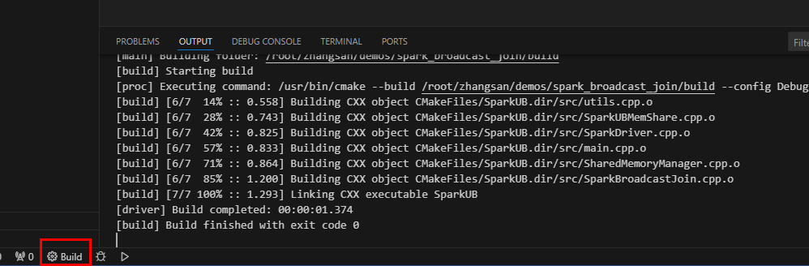

若第一次执行，可以选择`Scan for kits扫描工具包。
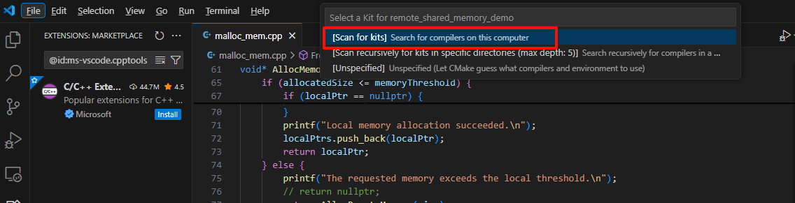

再次执行选择扫描出来的GCC工具：

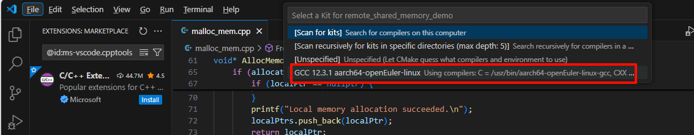

再次执行生成，即可对代码工程进行编译。

生成后二进制文件在build文件夹下。

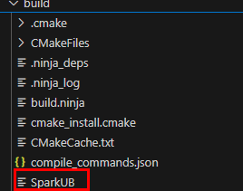

## 运行程序看看

我们先试试能否将样例程序跑起来，点击新的三角形按钮，看看结果
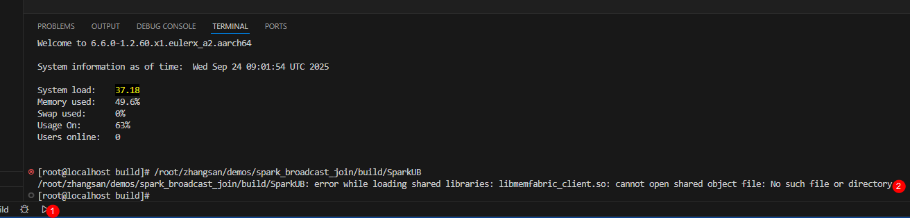
你会发现，个人的Docker开发环境执行失败了，原因是这个Docker不具备UB测试能力，我们需要在灵衢UB物理机器上或者UB仿真上次才能跑起来。显然，我们这里需要到UB仿真环境上去跑。

## 在UB仿真上运行程序

在VS Code上，打开一个新的Terminal终端，登录到此节点任何一台UB仿真机器上（如5101端口的computer02节点；UB仿真节点对应端口号为5100~5103）。

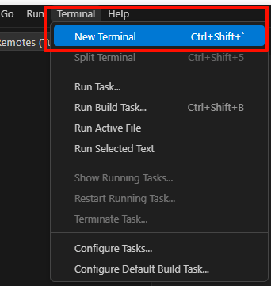

在终端输入`ssh localhost -p 5101`并回车。

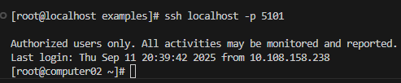

> 机器已配置免密登录，若自己搭建环境没有配置免密登录，此处需要输入灵衢仿真节点root密码。或者将附件中的公钥内容添加到灵衢仿真节点机器上的`/root/.ssh/authorized_keys`文件中。

进入到二进制文件所在目录，请注意路径修改为自己的名称。

```
cd /ko/zhangsan/examples/spark_ub_shared_memory_demo/build/
```

执行程序：`./SparkUB`

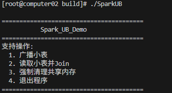

此时我们将computer02节点作为广播小表节点和Join节点1。根据程序提示先输入`1`:

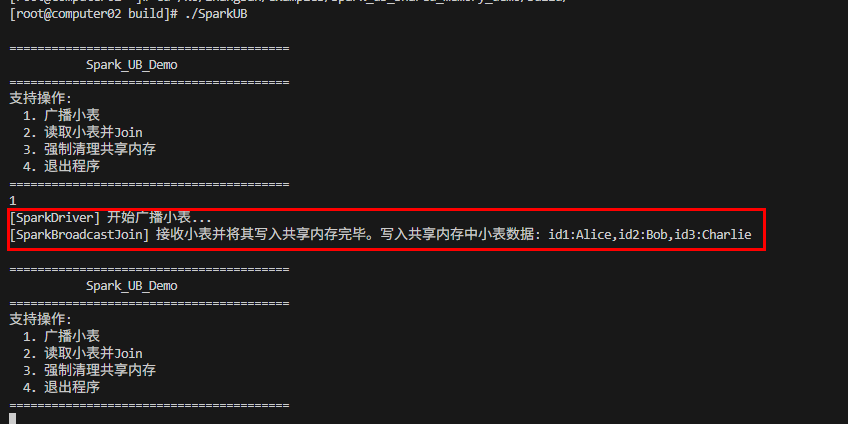

可以看到已经将模拟小表数据`id1:Alice,id2:Bob,id3:Charlie`写入到共享内存。
再次输入2进行Join：

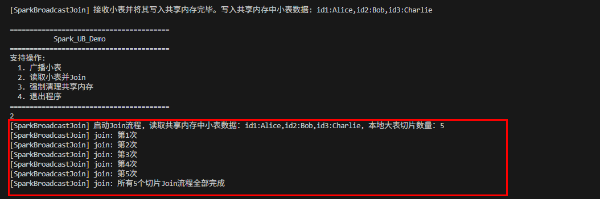

可以看到computer02节点读取了正确的小表数据并进行了5次Join模拟操作。

我们再登录一个仿真节点来看一下跨节点读取共享内存并Join的能力。
打开一个新的Terminal终端，在终端输入`ssh localhost -p 5102`并回车登录computer03节点。

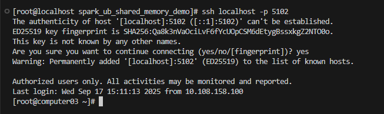

进入到二进制文件所在目录，请注意路径修改为自己的名称。

```
cd /ko/zhangsan/examples/spark_ub_shared_memory_demo/build/
```

执行程序：`./SparkUB`并输入2：

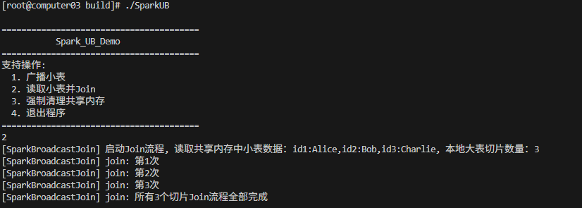

可以看到computer03节点读取了正确的小表数据并进行了3次Join模拟操作。

最后让我们在2个节点上（两个Terminal终端窗口）都输入`4`来退出程序，退出程序会执行清理共享内存的操作，请勿直接`Ctrl+C`终止程序。

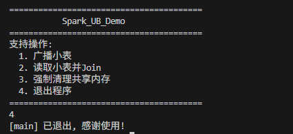

可在右侧进行窗口切换：

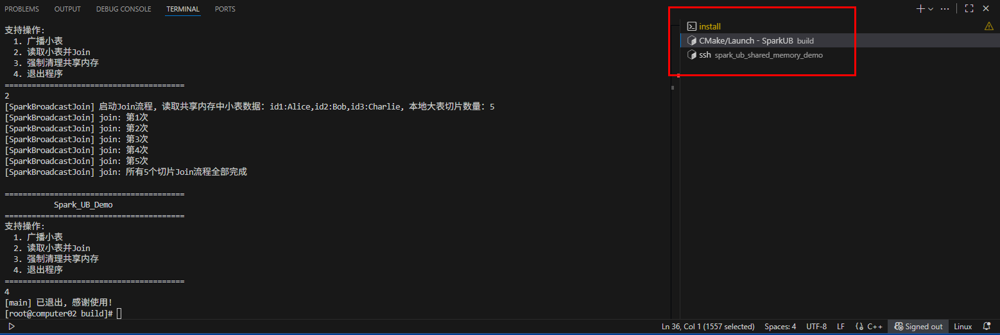

> 仿真环境已设置好动态链接库，若执行时报错没有找到`***.so`，请设置环境变量。
>
> ```
> export LD_LIBRARY_PATH=/usr/local/softbus/ctrlbus/lib/:$LD_LIBRARY_PATH
> ```

