# 前提说明

* 当前Docker开发镜像仅包含gcc、cmake、git、memfabric开发包。附件中有构建环境的源码和执行脚本，大家可根据自己情况修改定制使用。
* 当前提供的镜像中内置公、私钥，仅限体验开发，实际开发者请替换成自己的。
* 附件Dockerfile中提供的网络代理请根据情况自行配置替换，当前只适用于部分环境。

# 动机和目的

## 动机

APP的灵衢UB化改造存在较高的门槛，主要有：

* **多语言混合开发**​：UB库的语言是C/C++，APP语言有C/C++、Java、Python等等，因此开发环境的配置相对复杂。
* **灵衢硬件获得性低**​：灵衢UB硬件当前还在开发阶段，而且价格昂贵，长期会存在可获得性较低的境况。

## 目的

本文档为灵衢UB快速体验指南，通过我们构建的基于Docker的一站式开发环境，加上UB仿真，一定程度上解决上述的两大痛点。

* 说明：当前并没有包含完整的灵衢UB开发依赖，仅包含gcc、cmake、git、memfabric开发包，仅做体验用。

## 开发模式

在使用本文档之前，需要了解本文的开发模式。

* **在本地个人PC接入**​：一般为开发者的个人桌面，可以安装vscode和terminal工具。
  
  * 注意：由于UB库是基于C/C++语言开发，且是基于ARM架构的，当前没法做到在个人PC完成端到端开发。
* **在远程ARM服务器开发和测试**​：由于UB库和UB仿真当前基于鲲鹏ARM架构开发，因此需要远程服务器，提供Runtime和测试环境。
* **代码提交后跑流水线**​：通过大家的熟悉远程git仓库和流水线完成CICD。
  
  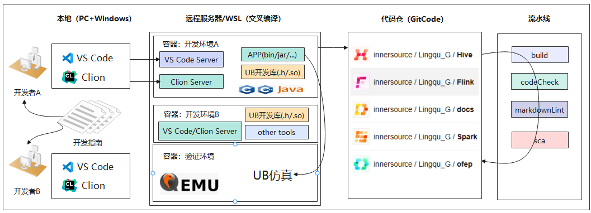

# 准备工作

## 准备共享秘钥

下载附件中的私钥文件`id_rsa`到你的windows的一个目录中，确保路径是英文的，比如我的路径是`D:\lingqu\id_rsa`

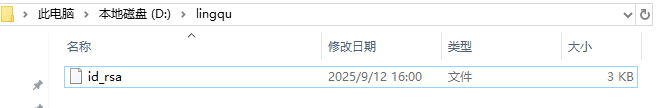

设置所有者权限

1. 在id_rsa文件右键打开属性。
2. 选择安全，打开高级属性。
3. **更改`所有者`为自己账号（公司内部为自己域账号的用户），随后点击`禁止继承`(从此对象中删除所有已继承的权限)。**
   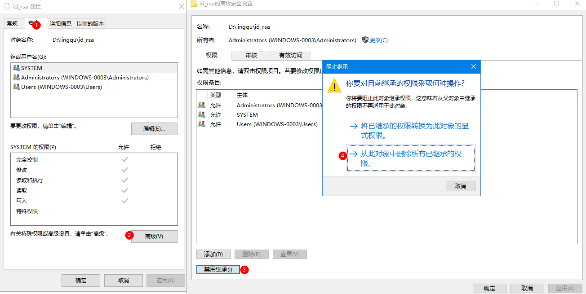
4. 添加当前用户, 并设置访问类型为完全控制。然后点击确定。
   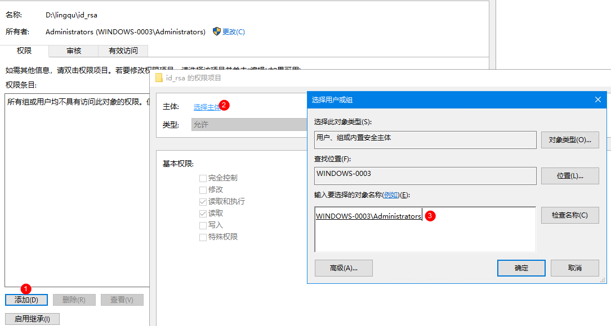

# 安装开发环境

## 创建个人开发Docker

首先，通过Xshell、MobaXterm等工具登录到灵衢仿真服务器节点（本文以x.x.x.x为例）。

然后使用`/opt/ub_env_tools/start_build_env.sh`脚本创建个人开发Docker环境

* 创建方法：`./start_build_env.sh -name 你的id`（公司内部建议用工号区分）

具体命令如下：

```
[root@localhost ~]# cd /opt/ub_env_tools/
[root@localhost ub_env_tools]# ./start_build_env.sh -name zhangsan
19f0c8cb89f21517d5237a09fb3c983967671cf9f247a5e62ec4a05223ef4d28
Docker is ready: docker-name: lingqu-zhangsan, docker-ssh-port: 6600
[root@localhost ub_env_tools]#
```

可以看到，我成功创建了一个属于自己的docker，并且已经启动：

* docker名字：lingqu-zhangsan
* docker-ssh端口：6600

可通过如下命令查看镜像运行情况：

```
[root@localhost ~]# docker ps | grep lingqu-zhangsan
3c6b4c4dcc20    lingqu-cpp:1.0.0    "/opt/tools/start_ss…"    5 hours ago    Up 5 hours    lingqu-zhangsan
```

> 若你想在新的环境中使用，则需要先构建编译镜像，将附件中的文件上传到服务器，然后进入目录执行如下命令构建编译镜像：
> 
> ````
> docker build -t lingqu-cpp:1.0.0 .
> ````
> 

## 安装配置VS Code

选择一个常用C/C++开发工具安装，本文以VS Code工具讲解。工具下载链接：

* VS Code：[官方网站](https://code.visualstudio.com/)

选择适配自己当前操作系统的版本下载后安装。

### 安装Remote SSH插件

打开VS Code，选择“扩展Extentions”，搜索“Remote-SSH”扩展并安装。

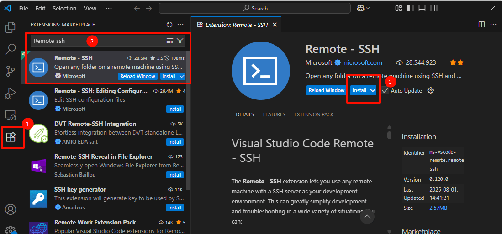

### 配置远程连接

安装后，VS Code左侧菜单栏会出现“Remote Explorer 远程资源管理器”，输入user@host-ip -p port 创建远程连接。其中

* user：用户名
* host-ip：服务器ip地址
* port：开发Docker分配的端口号
* 因此，本人的输入就是：`root@x.x.x.x -p 6600`

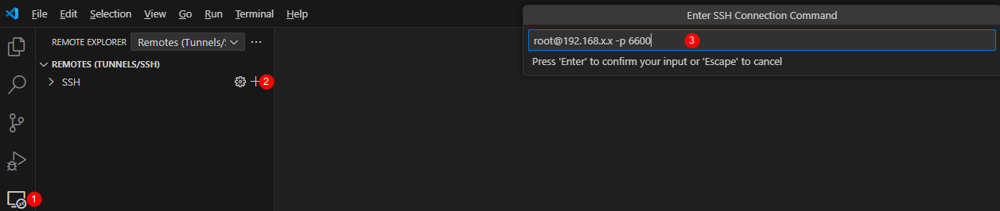

回车后，需要选择一个配置文件，默认我们选第一个`C:\Users\Administrator\.ssh\config`（请根据自己电脑用户选择，公司PC一般为`C:\Users\你的工号\.ssh\config`），然后打开配置。

增加我们的免密设置，`IdentityFile "D:\lingqu\id_rsa"`（注意你在准备工作中放置的路径），配置样例（根据实际IP和端口号填写）：。

```
Host x.x.y.y			#连接名称自行修改默认是IP
    HostName x.x.y.y		#服务器IP
    User root				#登录用户名
    Port 6600				#链接端口号
    IdentityFile "D:\lingqu\id_rsa"	#附件中id_rsa文件在你本地的路径
```

### 打开远程开发窗口

远程连接配置修改完成后，保存配置文件，在远程连接界面选择刚才配置好的远端链接，点击按钮打开远端机器。

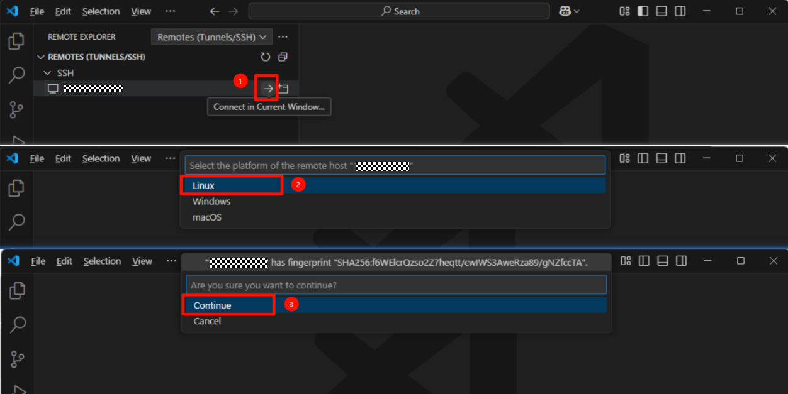

### 安装VS Code远端开发插件

个人开发Docker中已包含`C/C++`，`CMake tools`，`Clang-format`插件装文件，在`/opt/tools/`下。将3个vsix插件安装后即可开启开发之旅。

* 点击`Extentions`按钮，在点击下图所示的`...`，然后再点击`Install from VSIX`
  
  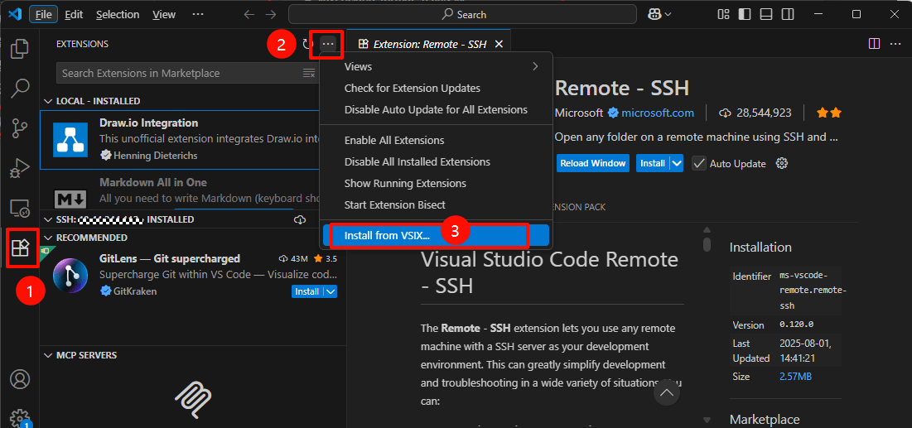
* 输入插件包所在的位置`/opt/tools`，会展示出所有的.vsix插件，如下图看到的3个，我们依次点击完成安装
  
  * 注意：安装3个vsix插件，需要重复上一步骤3次，vscode就是这样，体验不太友好
    
    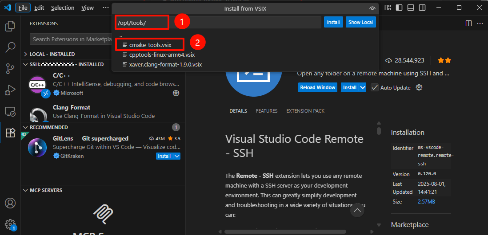

### 配置Code Format插件

Code Format为代码格式化插件，可根据情况按需配置。

* 查找格式化配置所在的位置，我们点击VS Code菜单栏上`Terminal`->`New Terminal`打开一个Terminal终端，在打开的终端窗口输入`find / -name clang-format` 查找：
  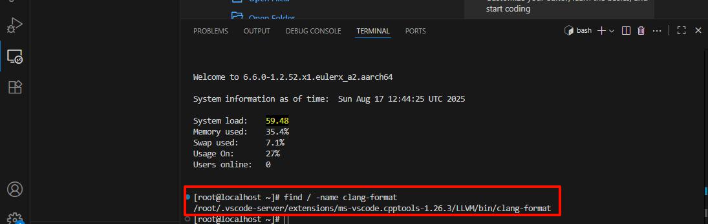
* 把位置找到的位置复制一下（请根据实际搜索出的值复制）：`/root/.vscode-server/extensions/ms-vscode.cpptools-1.26.3/LLVM/bin/clang-format`
  然后选择Clang-Format插件，再进行如下设置，然后关闭即生效
  
  * Assume Filename：`/opt/tools/.clang-format`，表示此文件为格式控制文件
  * Executable：为刚才找到的路径`/root/.vscode-server/extensions/ms-vscode.cpptools-1.26.3/LLVM/bin/clang-format`
    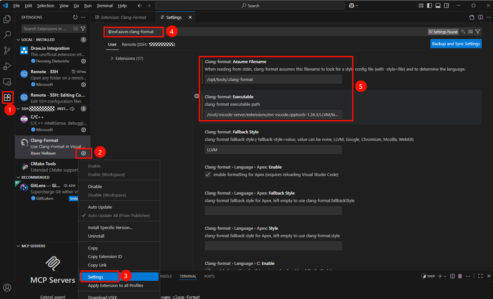
    
    > 建议User和Remote都设置一下，避免不生效。

# 体验基于UB的Demo开发

大家应该可以知道了，我们有几种方式登录个人Docker开发环境，任选其一。

* **VS Code的Remote SSH插件连接**​：通过VS Code登录后，直接打开Terminal窗口即可
* **外部Terminal工具直连**​：比如本例中连接`x.x.y.y`的端口`6600`
* **在服务器内部登录**​：登录服务器后，使用命令docker exec -it 容器名 bash

## 下载样例代码工程

我们点击VS Code菜单栏上`Terminal`->`New Terminal`打开一个Terminal终端。

启动脚本已给大家设置好共享目录，在`/root/{name}/`路径下。{name}为启动脚本时输入的`-name`参数值。在VS Code上打开一个中端，进入到该共享目录。

下载开源社区上的examples仓代码，直接查看、修改、运行。命令如下：

```
cd /root/{name}/
git clone ssh://git@xxxx/examples.git
```

VSCode打开上代码仓，选择其中的一个样例工程。
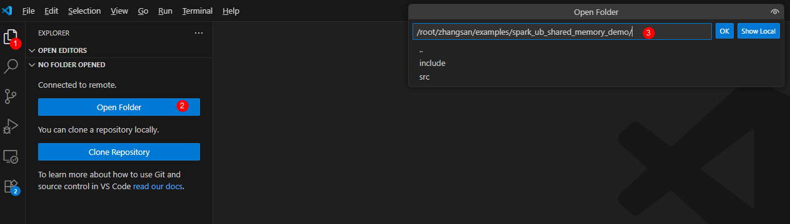

其中`spark_ub_shared_memory_demo`为UB在大数据应用的一个简单示例。
Spark处理两张表的Join时，如果一张表较小，可以通过Broadcast Join方式（将小表发送到工作节点来减少Shuffle次数）优化性能，借助UB超节点的内存共享能力，可以进一步提升性能，简化编程。

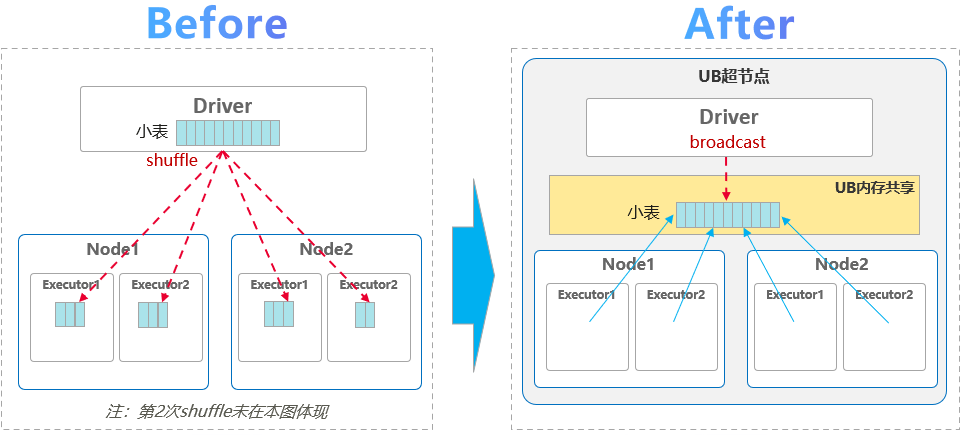

- 常规方式需要将2张表做切片和shuffle，本方案将小表放入UB共享内存，避免大量shuffle
- 支持更大的小表，可以突破到1GB（一般建议512MB），且小表只占用一份内存
- 相比常规方式Join性能提升50%+(内部HCCS环境验证实测)

Demo简化流程

```
// STEP1: 小表存入共享内存
SparkDriver::broadcastSmallTable()
  调用：RackMemShmCreate()
  调用：RackMemShmMmap()
// STEP2: 从共享内存读小表执行Join
SparkBroadcastJoin::join ()
  调用：RackMemShmMmap()
// STEP3: 结束并退出
SparkBroadcastJoin::done ()
  调用：RackMemShmUnmmap()
  调用：RackMemShmDelete()
```

Demo目录结构：

```
spark_broadcast_join
├── CMakeLists.txt
├── include
│   ├── SharedMemoryManager.h
│   ├── SparkBroadcastJoin.h
│   ├── SparkDriver.h
│   ├── SparkUBMemShare.h
│   ├── utils.h
└── src
    ├── main.cpp
    ├── SharedMemoryManager.cpp
    ├── SparkBroadcastJoin.cpp
    ├── SparkDriver.cpp
    ├── SparkUBMemShare.cpp
    └── utils.cpp
```

内存共享核心代码在工程`src/SharedMemoryManager.cpp`文件中。创建共享内存函数`CreateShm()`。大家可根据自己业务需要修改Demo代码：

```std::string


```

## 格式化代码（按需）

* 代码编写完后，可以右键选择格式化。
  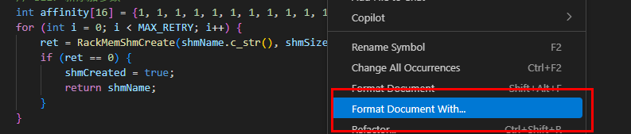
* 选择Clang-Format
  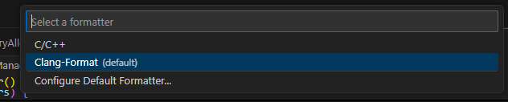

## 编译代码

通过Cmkae命令或点击VS Code底部菜单栏的生成按钮，即可对工程进行编译构建。

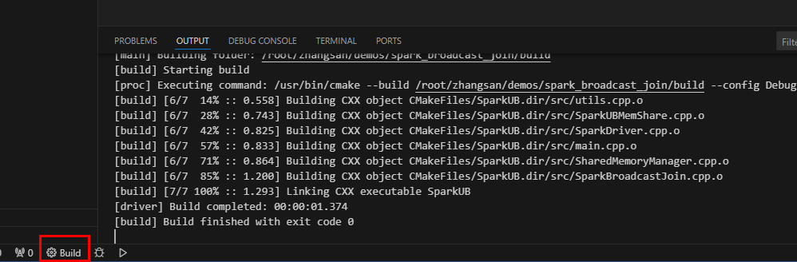

若第一次执行，可以选择`Scan for kits扫描工具包。


再次执行选择扫描出来的GCC工具：


再次执行生成，即可对代码工程进行编译。

生成后二进制文件在build文件夹下。

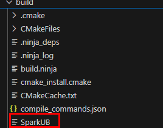

## 运行程序看看

我们先试试能否将样例程序跑起来，点击新的三角形按钮，看看结果
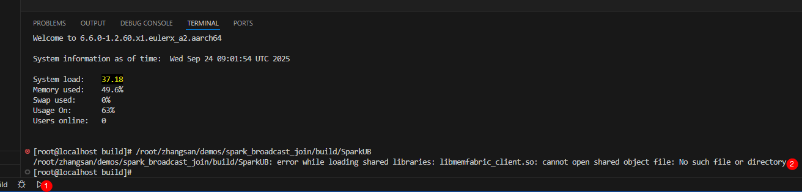
你会发现，个人的Docker开发环境执行失败了，原因是这个Docker不具备UB测试能力，我们需要在灵衢UB物理机器上或者UB仿真上次才能跑起来。显然，我们这里需要到UB仿真环境上去跑。

## 在UB仿真上运行程序

在VS Code上，打开一个新的Terminal终端，登录到此节点任何一台UB仿真机器上（如5101端口的computer02节点；UB仿真节点对应端口号为5100~5103）。

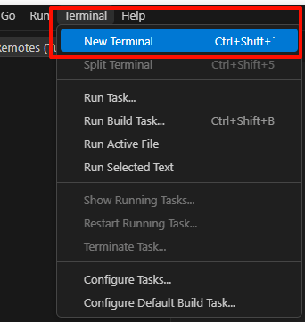

在终端输入`ssh localhost -p 5101`并回车。

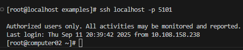

> 机器已配置免密登录，若自己搭建环境没有配置免密登录，此处需要输入灵衢仿真节点root密码。或者将附件中的公钥内容添加到灵衢仿真节点机器上的`/root/.ssh/authorized_keys`文件中。

进入到二进制文件所在目录，请注意路径修改为自己的名称。

```
cd /ko/zhangsan/examples/spark_ub_shared_memory_demo/build/
```

执行程序：`./SparkUB`

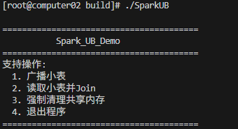

此时我们将computer02节点作为广播小表节点和Join节点1。根据程序提示先输入`1`:

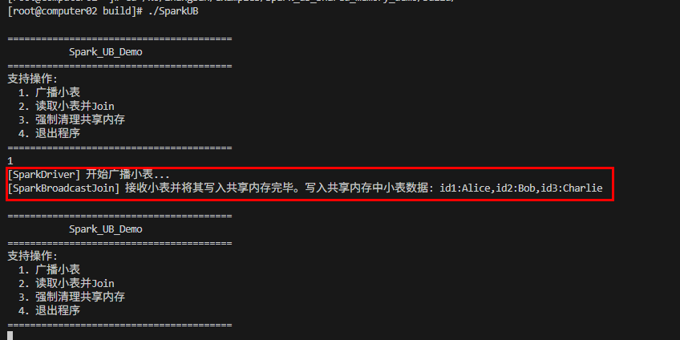

可以看到已经将模拟小表数据`id1:Alice,id2:Bob,id3:Charlie`写入到共享内存。
再次输入2进行Join：

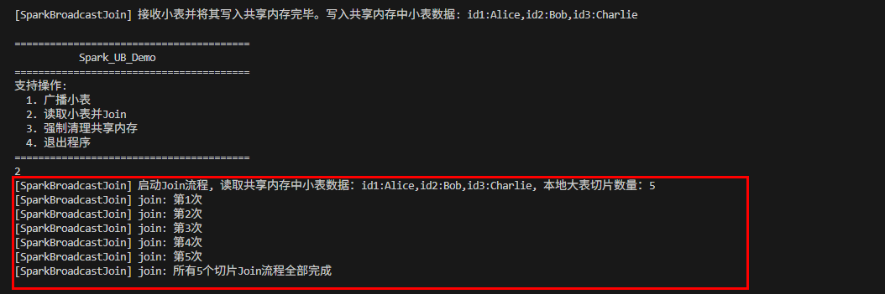

可以看到computer02节点读取了正确的小表数据并进行了5次Join模拟操作。

我们再登录一个仿真节点来看一下跨节点读取共享内存并Join的能力。
打开一个新的Terminal终端，在终端输入`ssh localhost -p 5102`并回车登录computer03节点。

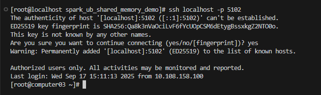

进入到二进制文件所在目录，请注意路径修改为自己的名称。

```
cd /ko/zhangsan/examples/spark_ub_shared_memory_demo/build/
```

执行程序：`./SparkUB`并输入2：

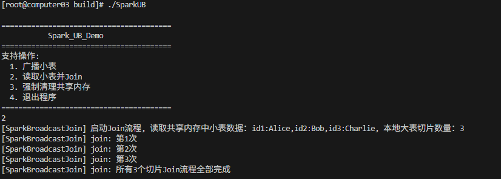

可以看到computer03节点读取了正确的小表数据并进行了3次Join模拟操作。

最后让我们在2个节点上（两个Terminal终端窗口）都输入`4`来退出程序，退出程序会执行清理共享内存的操作，请勿直接`Ctrl+C`终止程序。

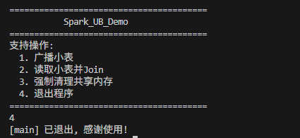

可在右侧进行窗口切换：

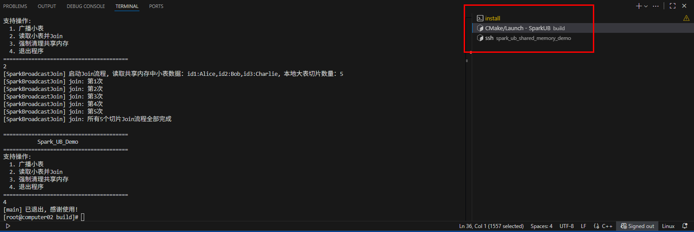

> 仿真环境已设置好动态链接库，若执行时报错没有找到`***.so`，请设置环境变量。
> 
> ```
> export LD_LIBRARY_PATH=/usr/local/softbus/ctrlbus/lib/:$LD_LIBRARY_PATH
> ```

## 提交代码

程序验证无问题后，回到VS Code界面，在终端进入到工程根目录。

* 执行 `git mm version` 查看版本并激活git mm工具
  
  ```
  git mm version
  # 输出版本号
  git-mm version: 3.2.0
  git version: 2.43.0
  ```
* 执行`git status`查看修改。
* 执行`git add file...`添加文件。
* 执行`git commit -m "message"`提交修改。
* 执行`git mr` 创建MR请求合入主仓。

# 备注

## 大页配置

在UB仿真环境中创建共享内存，需要至少在一个仿真节点上开启大页功能。登录UB仿真节点执行命令`numastat -cvm`查看numa情况：

```
[root@computer01 conf]# numastat -cvm

Per-node system memory usage (in MBs):
……
Token RemoteMemPreonline not in hash table.
                 Node 0 Node 1 Total
                 ------ ------ -----
MemTotal          48126  47839 95965
MemFree           44993  45567 90559
MemUsed            3134   2272  5406
Active              241    214   455
Inactive           2016   1028  3045
Active(anon)         98     76   174
Inactive(anon)     1112    815  1926
Active(file)        143    138   281
Inactive(file)      905    214  1118
……
HugePages_Total       0      0     0
HugePages_Free        0      0     0
HugePages_Surp        0      0     0
KReclaimable         43     35    77

```

可以看到这个节点上有2个numa，node0和node1，大页配置为空(HugePages_Free : 0)。业务根据自己需求情况设置大页的大小，所有numa节点都要配置。如上每个numa配置2G大页（单页为2M）为如下命令：

```
echo 1024 > /sys/devices/system/node/node0/hugepages/hugepages-2048kB/nr_hugepages
echo 1024 > /sys/devices/system/node/node1/hugepages/hugepages-2048kB/nr_hugepages
```

## 环境重置后登录相同端口号报错

当使用某一端口如5555创建环境后，由于其他原因（如环境重置）又再次创建5555端口的环境，VSCode连接时会报错：

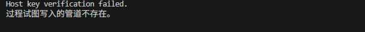

这是因为本地PC保存了连接信息，所以我们打开`C:\Users\userName\.ssh\known_hosts`文件删除环境IP和对应端口号的记录即可。


# 附件

- 依赖的UB组件UBS_MEM模块和仿真服务还未开放，附件会随依赖一起开放发布。请耐心等待。

