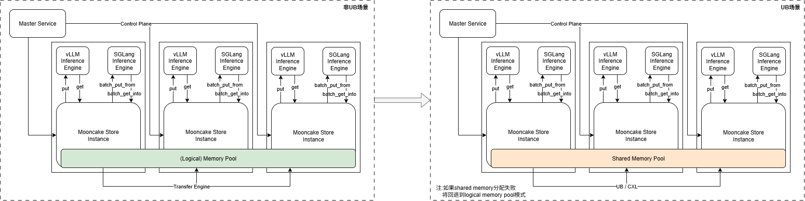
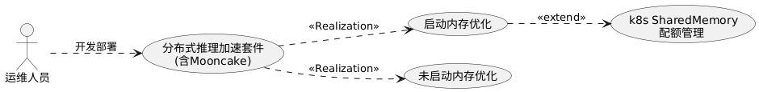
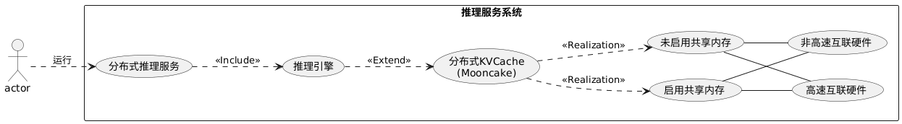
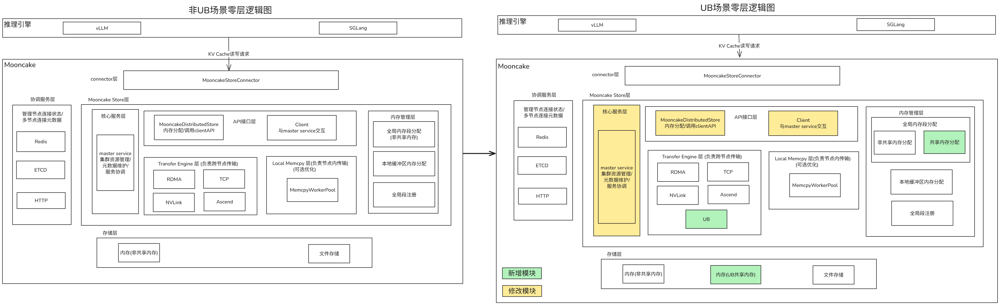
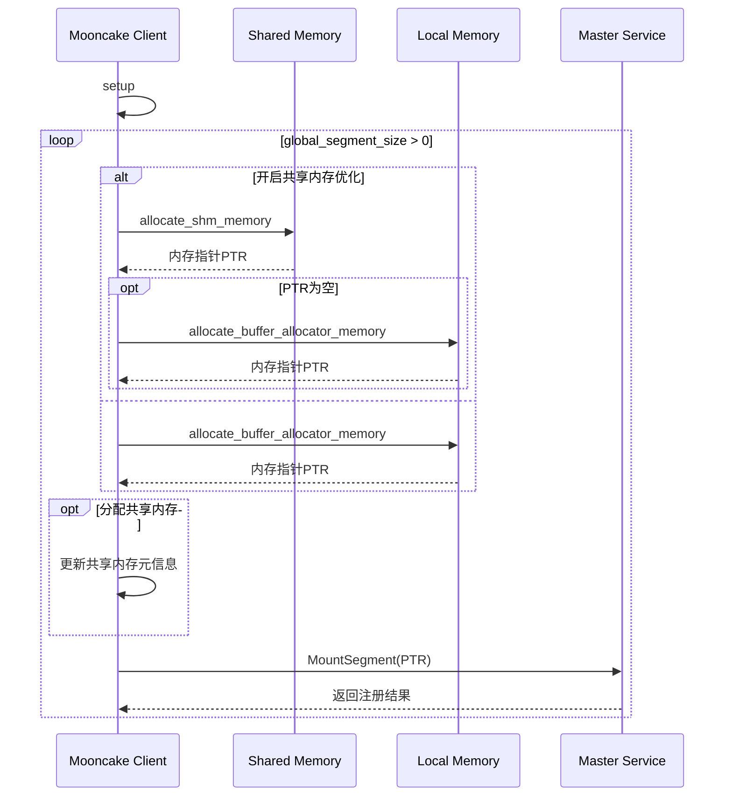
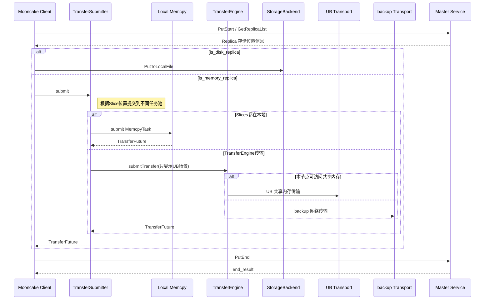
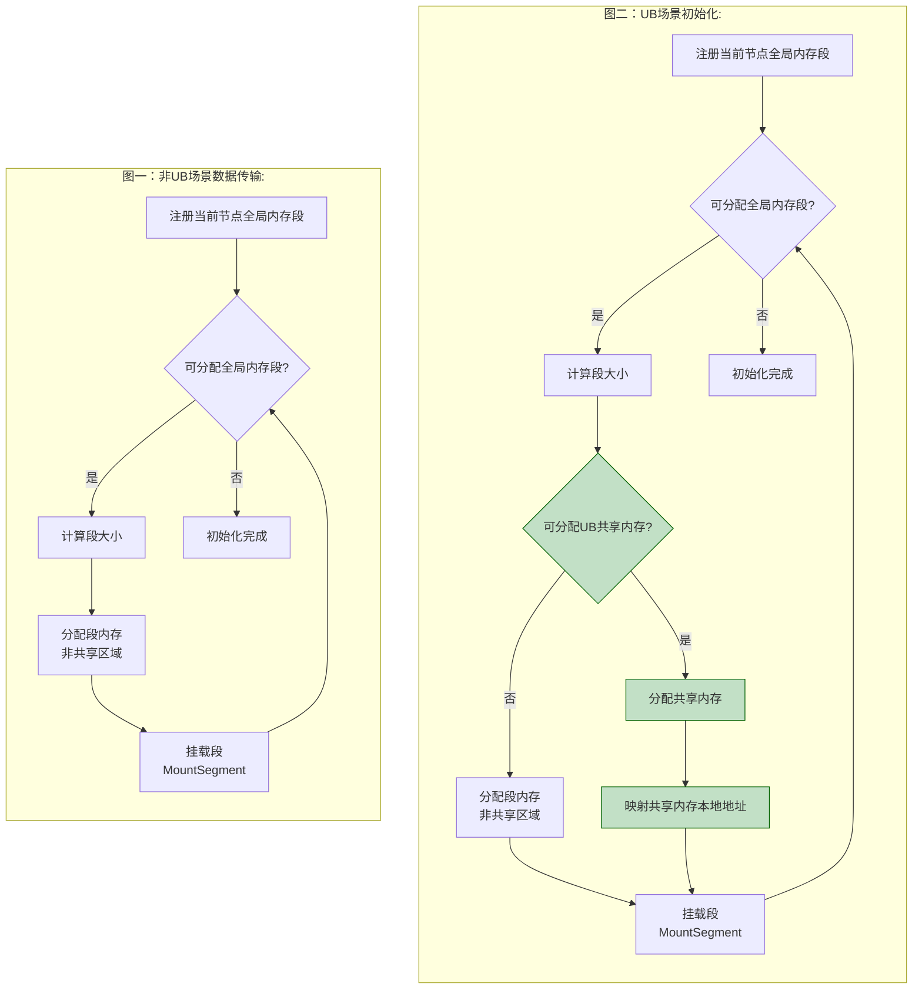
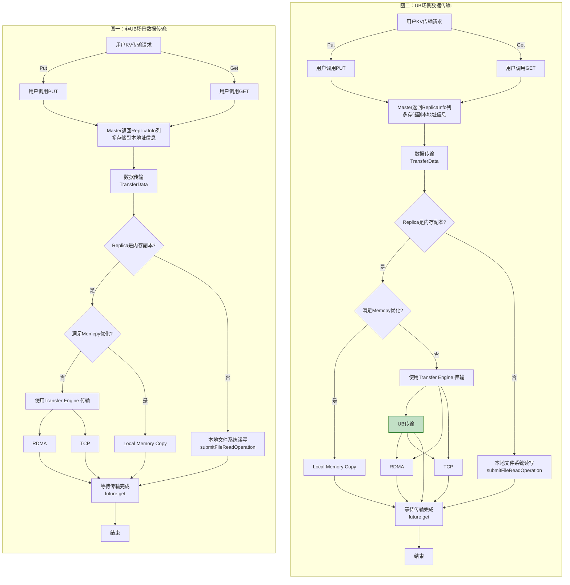
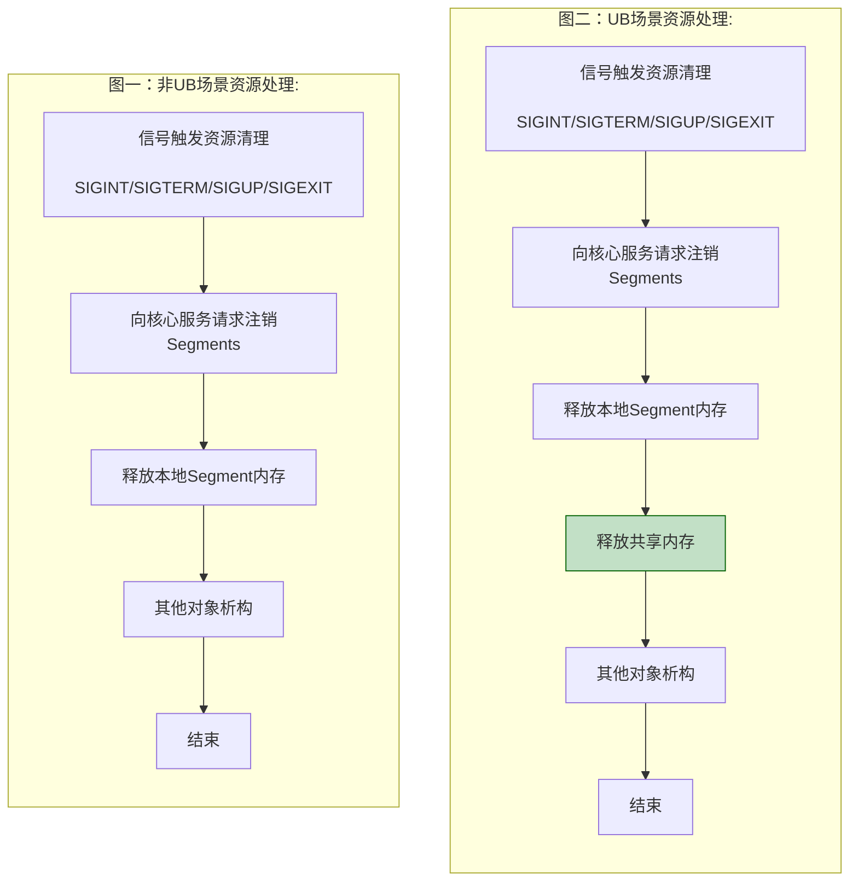

# 基于Mooncake实现共享内存语义池化改造
## 功能概述
随着模型上下文窗口的持续扩大，KVCache 存储需求呈指数级增长. 现有如 Mooncake 等分布式 KVCache 服务在一定程度上缓解了存储压力，但是跨节点数据传输仍然是主要性能瓶颈之一。


Mooncake 是面向 LLM 推理场景的高性能分布式 KVCache 引擎，通过中心化服务对多节点内容块进行统一管理，构建逻辑内存池；推理引擎与逻辑内存池的交互涉及大量跨节点数据传输，其传输效率对TTFT等关键性能指标影响显著.

新一代互联设备(如 UB, CXL)通过硬件级缓存一致性协议，扩展了处理器与设备之间的一致性域, 提供高效跨节点内存访问能力. 与传统网络通信相比, 这类硬件在底层提供缓存一致性支持，减少了软件层数据拷贝与同步的开销, 从而有效提升跨节点数据访问效率.

这一特性与 KVCache 在推理场景下高频，小粒度，跨节点访问模式天然契合。

在 Mooncake 中新增基于共享内存的逻辑内存池, 通过UB设备实现跨节点内存访问，替代原有的网络数据传输；使 Mooncake 可利用下一代硬件的数据访问能力优化 KVCache 读写性能.

## 实现思路
### 用户故事
**开发部署态** 开发部署态用户按需配置是否启动组件UB使能开关



用例1：用户部署基于 Mooncake 的分布式LLM推理加速套件，并配置启动共享内存优化(编译设置`USE_UB_SHM=ON`)

用例2：用户部署基于 Mooncake 的分布式LLM推理加速套件，并配置关闭共享内存优化(编译设置`USE_UB_SHM=OFF`)


**运行态** 运行态用户主要与分布式推理服务交互, 推理服务基于部署配置和硬件设施使能应用加速


用例3：使用分布式推理服务，服务运行在高速互联硬件上，配置共享内存优化实现推理加速

用例4：使用分布式推理服务，服务运行在高速互联硬件上，配置未启动共享内存优化，使用传统传输协议

用例5：使用分布式推理服务，服务运行在非高速互联硬件上，无论是否配置共享内存优化，均使用传统传输协议

### 整体架构图


常见的推理引擎与Mooncake Store的部署关系为：推理引擎作为应用层，通过调用Mooncake Store提供的上层API使用其功能.

Mooncake部署系统主要分为四个组成部分:
1. Connector层：LLM推理系统集成的MooncakeStore接口
2. 协调服务层：管理节点连接状态，节点元数据
3. 存储层：实际物理存储kv Cache位置
4. Mooncake Store层：负责KVCache管理和传输，是Mooncake的核心逻辑

在存储层引入UB共享内存; Mooncake Store层扩展新存储资源管理能力, 支持共享内存分配, 并在TransferEngine层增加UB传输协议，用于跨节点传输; 核心服务层与MooncakeDistributedStore层增加适配逻辑；整体保持对外接口兼容，应用层推理引擎可无感使用升级后的Mooncake.

### 时序图
Mooncake Store初始化，逻辑内存池创建注册流程:

Put-KV Cache存储流程 / Get-KV Cache读取流程:


### 开发详解
**全局共享内存分配**

在运维人员拉起推理引擎时，推理引擎会对分布式存储(mooncake store)进行初始化, 如果该节点被配置为可存储全局KV Cache(global_segment_size>0), 则进行挂载内存分配.


1. 尝试从共享内存分配，如果分配失败则回退到非共享内存分配模式
    * 创建共享域，并查询域信息 (后续规划，当前使用`default`共享域)
    * 创建共享内存
      * 使用当前的segment_id作为共享域ID
      * 调用 *AllocateSharedMemory* 分配共享内存
    * 映射共享内存本地地址: 调用 *SharedMemMap* 将共享内存映射到本地地址空间.

**KVCache读写**

生成的KV Cache会通过put请求存入(逻辑)全局共享内存; get请求从(逻辑)全局共享内存获取KV Cache记录.



1. 如果数据传输不满足内存复制优化条件，使用TransferEngine进行传输，如果用户编译时启动USE_UB_SHM:
    * 所有的buffer都属共享内存，即 `shm_id` 非空
    * 本节点可访问(本机共享内存表有记录)
    * 如果上述不满足, 使用backup TE(RDMA/TCP)进行传输
2. 如果满足共享内存传输条件
    * 则先从MemoryDescriptor中获取共享内存ID
    * 调用 *GetSharedMemoryAddr* 映射本地内存存储地址
    * 进行内存读写，与普通内存拷贝不同，共享内存读写需要手动刷新
    ```C++
    //shm 读写示例
    shared_memory_set_ownership(shm_id, shm_addr, shm_size,PROT_READ | PROT_WRITE)；
    std::memcpy(shm_addr, src, shm_size);
    shared_memory_set_ownership(shm_id, shm_addr, shm_size,PROT_READ | PROT_NONE)；
    ```

**共享内存释放**

推理引擎退出时，会触发相关资源的释放，其中共享内存释放同普通资源释放需要分别处理.

对于分配的共享内存区域，先调用 *unmapSHMMem* 进行解映射，调用 *SharedMemDelete* 删除共享内存区域.

**核心服务层/元数据管理层适配**

同非共享区域内存不同，共享内存块在不同节点上拥有相同的共享内存ID, 但是映射的本地地址不同；因此核心服务存储的描述符同时需要保留共享内存ID.
```C++
struct Descriptor {
  std::string segment_name_;
  uint64_t size_;
  uintptr_t buffer_address_;
  BufStatus status_;
  
  std::string shm_id_;      // UB: SHM unique ID
}
```

在元数据服务挂载信息中，增加 backup_protocol 字段, 用于共享内存不可达时选择网络传输协议; 同时 shm_id_to_ptr 用于记录本地共享内存的ID和起始地址, 支持跨节点计算读写区域偏移量。
```c++
struct SegmentDesc {
  ...
  // this is for UB
  std::string backup_protocol;
  std::unordered_map<std::string, uintptr_t> shm_id_to_ptr;
}
```

### 核心代码

**mooncake-store/src/utils.cpp**

```c++
#ifdef USE_UB_SHM
void* allocate_shm_memory(const size_t total_size, std::string& shm_id, void *&ub_actual_ptr) {
    const size_t alignment = facebook::cachelib::Slab::kSize;
    // Ensure total_size is a multiple of alignment
    if (total_size < alignment) {
        LOG(ERROR) << "Total size must be at least " << alignment;
        return nullptr;
    }

    std::string regionName = g_shm_region;
    mode_t mode = static_cast<mode_t>(g_shm_mode);
    ubsmem_options_t options{};
    int ret = ubsmem_initialize(&options);
    if (ret != 0) {
        LOG(ERROR) << "Failed to initialize ubs memory ";
        return nullptr;
    }
    for (size_t i = 0; i < g_shm_retry_times; ++i) {
        ret = ubsmem_shmem_allocate(ub_utils::ConvertNullEmptyID(regionName.c_str()),
                                     ub_utils::ConvertNullEmptyID(shm_id.c_str()), total_size + alignment, mode, 0);
        if (ret != 0) {
            LOG(WARNING) << "Failed to allocate shared memory, attempt " << (i + 1)
                        << " of " << g_shm_retry_times << ", error: " << ret;
            continue;
        }
        ret = ubsmem_shmem_map(nullptr, total_size + alignment, PROT_READ | PROT_WRITE, MAP_SHARED,
                                ub_utils::ConvertNullEmptyID(shm_id.c_str()), 0, &ub_actual_ptr);
        if (ret != 0) {
            LOG(WARNING) << "Failed to map shared memory, attempt " << (i + 1)
                        << " of " << g_shm_retry_times << ", error: " << ret;
            ubsmem_shmem_deallocate(ub_utils::ConvertNullEmptyID(shm_id.c_str()));
            continue;
        }

        uintptr_t addr = reinterpret_cast<uintptr_t>(ub_actual_ptr);
        uintptr_t aligned = (addr + alignment - 1) & ~(alignment - 1);

        LOG(INFO) << "Successfully allocated shared memory after " << (i + 1) << " attempts";
        return reinterpret_cast<void*>(aligned);
    }

    LOG(ERROR) << "Failed to allocate shared memory after " << g_shm_retry_times << " attempts";
    return nullptr;
}

void delete_shm(void* ptr, std::string shm_id, size_t size) {
    auto ret = ubsmem_shmem_unmap(ptr, size);
    if (ret != 0) {
        LOG(ERROR) << "OPERATOR_RUNTIME_ERROR: unmap shared memory " << shm_id << " failed";
    }
    ubsmem_shmem_deallocate(ub_utils::ConvertNullEmptyID(shm_id.c_str()));
}
```

**mooncake-transfer-engine/src/transport/ub_transport/ub_transport.cpp**

```c++
void* UbTransport::transferSHM(std::string shm_id, size_t size, uint64_t offset) {
    {
        std::shared_lock<std::shared_mutex> lock(mutex_);
        auto it = shm_id_to_ptr_.find(shm_id);
        if (it != shm_id_to_ptr_.end()) {
            return reinterpret_cast<void*>(static_cast<uintptr_t>(it->second.first + offset));
        }
    }
    
    // Map shared memory (without lock to avoid blocking other operations)
    void *ret_ptr = nullptr;
    auto ret = ubsmem_shmem_map(nullptr, size, PROT_READ | PROT_WRITE, MAP_SHARED,
                                ub_utils::ConvertNullEmptyID(shm_id.c_str()), 0, &ret_ptr);
    
    if (ret != 0) {
        // Map failed, check if another thread has already mapped it
        // (Since a process can only map once, if map fails, another thread might have succeeded)
        std::shared_lock<std::shared_mutex> lock(mutex_);
        auto it = shm_id_to_ptr_.find(shm_id);
        if (it != shm_id_to_ptr_.end()) {
            // Another thread has already mapped it, use the existing mapping
            return reinterpret_cast<void*>(static_cast<uintptr_t>(it->second.first + offset));
        }
        // Map failed and no existing mapping
        LOG(ERROR) << "Fail to map shared memory: " << shm_id << ", error: " << ret;
        return nullptr;
    }
    uint64_t ptr = static_cast<uint64_t>(reinterpret_cast<uintptr_t>(ret_ptr));
    {
        std::lock_guard<std::shared_mutex> lock(mutex_);
        shm_id_to_ptr_[shm_id] = std::make_pair(ptr, size);
    }

    return reinterpret_cast<void*>(static_cast<uintptr_t>(ptr + offset));
}

int UbTransport::ubMemcpy(std::string shm_id, void* source_addr, void* target_addr, size_t length, bool isRead) {
    if (source_addr == nullptr || target_addr == nullptr || length <= 0) {
        return -1;
    }
    int ret;
    constexpr size_t flushAlignment = 1 << 12;
    size_t flushSize = (length + flushAlignment - 1) & ~(flushAlignment - 1);
    ret = ubsmem_shmem_set_ownership(ub_utils::ConvertNullEmptyID(shm_id.c_str()),
                                target_addr, flushSize, PROT_READ | PROT_WRITE);
    if (ret != 0) {
        LOG(ERROR)<<"Fail to set ownership before shared memory write/read";
        return -1;
    }
    if (isRead) {
        std::memcpy(source_addr, target_addr, length);
    } else {
        std::memcpy(target_addr, source_addr, length);
    }
    ret = ubsmem_shmem_set_ownership(ub_utils::ConvertNullEmptyID(shm_id.c_str()),
                                target_addr, flushSize, PROT_NONE);
    if (ret != 0) {
        LOG(ERROR)<<"Fail to set ownership before shared memory write/read";
        return -1;
    }
    return 0;
}
```

