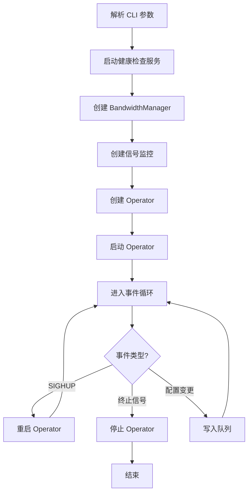
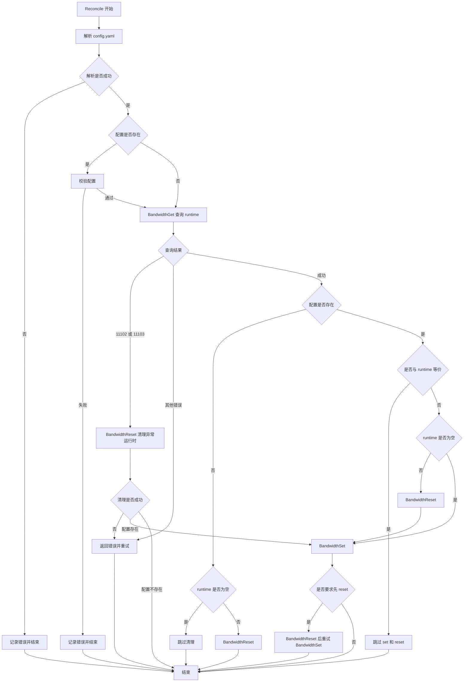
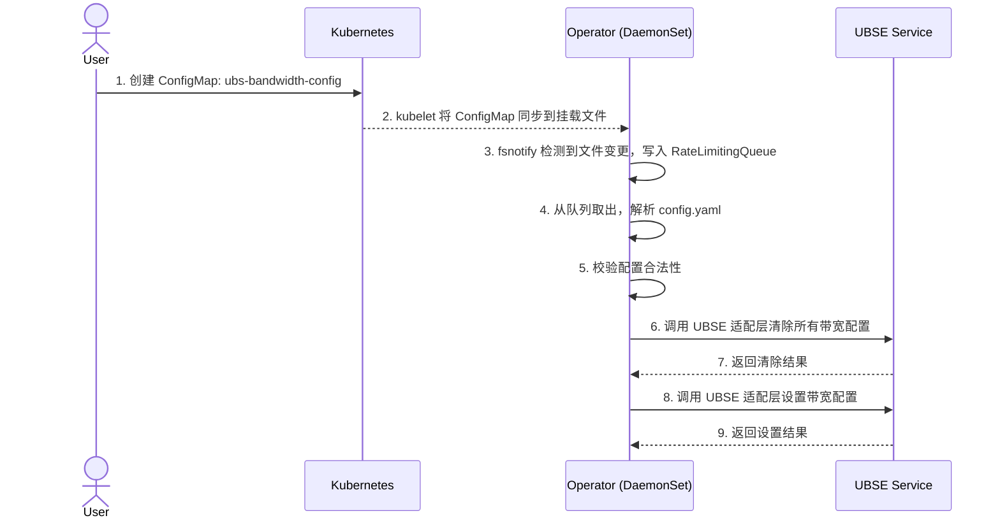
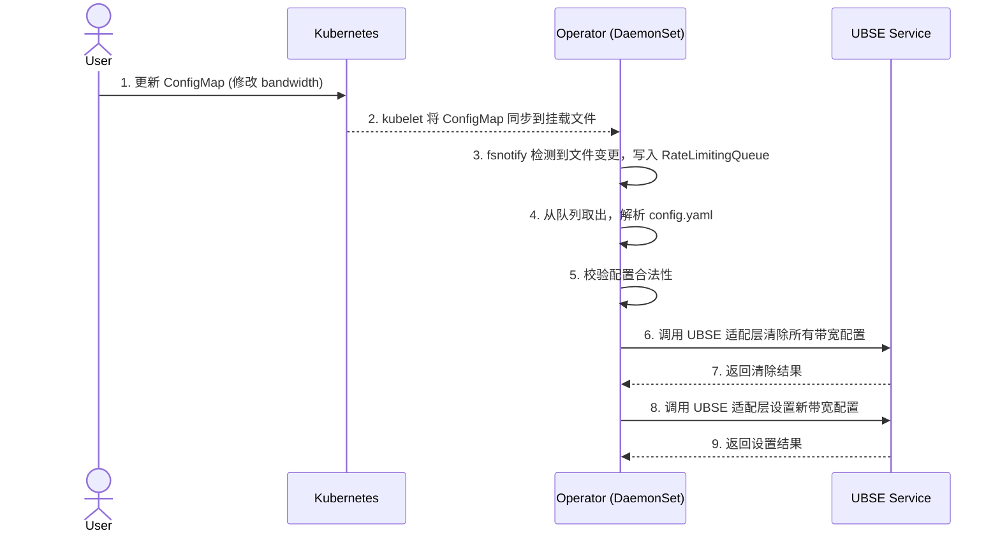
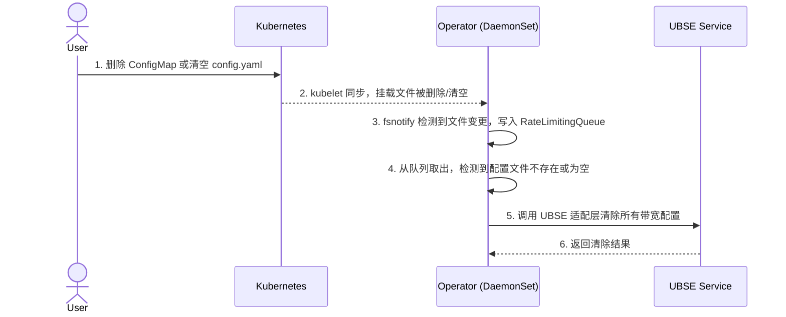

# UB Network Bandwidth Operator 设计文档

## Summary

本服务为 UB (Unified Bus) 网络设备提供端口带宽 QoS 配置管理能力。外部输入为 ConfigMap 中定义的端口带宽 priority（优先级）和 bandwidth（带宽，单位 GBps）值数组，Operator 服务以 DaemonSet 形态部署在每个节点上，通过挂载 ConfigMap 方式读取配置，检测到配置变更后对每节点的 UBSE 服务下发设置命令，同时支持配置的删除和更新。所有节点应用相同的带宽策略。

## Motivation

UB 体系中，URMA 网络设备在多业务共享同一物理设备的场景下，缺乏流量带宽隔离与优先级调度机制。通过本服务，运维人员可声明式地定义带宽 QoS 策略，Operator 自动下发到各节点 UBSE，实现带宽配置的自动化管理。

## Goals

- 通过 ConfigMap 定义带宽 QoS 策略配置（priority + bandwidth 数组），所有节点应用相同策略
- 实现 Operator 服务，以 DaemonSet 部署，通过挂载 ConfigMap 读取配置
- Operator 检测配置变更后通过本仓内置 UBSE 适配层下发配置
- 支持带宽配置的创建、更新、删除全生命周期管理
- 保证配置下发的幂等性，支持重试和故障恢复
- 支持配置规格验证：bandwidths 至少配置 1 个、至多 2 个，priority 只能为 0 或 1；bandwidth 必须为正整数且不能为 0；配置 1 个时要求 bandwidth <= 25，未配置项默认 bandwidth 为 50；配置 2 个时要求其中一个 bandwidth ≤ 25 且另一个 ≤ 50（不限定具体优先级）

| 配置类型 | priority0带宽配置 | priority1带宽配置 | 场景 | 实际分配带宽 | 约束 |
|---|---|---|---|---|---|
| 配置1个bandwidth | priority0: 20GB/s | priority1: 未配置（默认50GB/s） | priority0流量 x < 20GB/s 时 | priority0带宽：x<br>priority1带宽：[0,50-x] | 配置的bandwidth ≤ 25GB/s |
| 配置1个bandwidth | priority0: 20GB/s | priority1: 未配置（默认50GB/s） | priority0流量 x >= 20GB/s 时 | priority0带宽：20<br>priority1带宽：[0,30] | 配置的bandwidth ≤ 25GB/s |
| 配置2个bandwidth | priority0: 20GB/s | priority1: 30GB/s | priority0流量 x < 20GB/s 时 | priority0带宽：x<br>priority1带宽：[0,30] | 其中一个bandwidth ≤ 25GB/s且另一个 ≤ 50GB/s |
| 配置2个bandwidth | priority0: 20GB/s | priority1: 30GB/s | priority0流量 x >= 20GB/s 时 | priority0带宽：20<br>priority1带宽：[0,30] | 其中一个bandwidth ≤ 25GB/s且另一个 ≤ 50GB/s |
## Non-Goals

- 不保证配置下发的毫秒级时效性（受 kubelet 同步周期影响，端到端时延 <= 60 秒）
- 不支持节点级差异化带宽配置
- 不支持按 Pod / 容器粒度的带宽限速

## Proposal

### 系统架构

```
┌──────────────────────────────────────────────────────────┐
│                    Kubernetes API Server                  │
│                                                          │
│  ┌────────────────────────────────────────────────────┐  │
│  │  ConfigMap: ubs-bandwidth-config                   │  │
│  │  (ub-network-system)                               │  │
│  │                                                     │  │
│  │  data:                                              │  │
│  │    config.yaml: |                                   │  │
│  │      bandwidths:                                    │  │
│  │        - priority: 0                                │  │
│  │          bandwidth: 25                              │  │
│  └────────────────────────────────────────────────────┘  │
└──────────────────────────────────────────────────────────┘
                           │
                           │ 挂载为文件
                           ▼
┌──────────────────────────────────────────────────────────┐
│              Operator (DaemonSet, per-node)               │
│                                                          │
│  ┌────────────────────────────────────────────────────┐  │
│  │  Config Watcher                                    │  │
│  │  - fsnotify 监听挂载目录变更                       │  │
│  │  - 将文件变更事件通知 Operator                     │  │
│  └──────────────────────┬─────────────────────────────┘  │
│                         │                                │
│                         ▼                                │
│  ┌────────────────────────────────────────────────────┐  │
│  │  Reconciler                                        │  │
│  │  - 查询当前 UBSE runtime 配置                      │  │
│  │  - 按 ConfigMap 与 runtime 的等价比较结果决策      │  │
│  │  - 调用 UBSE 适配层执行配置下发                    │  │
│  └──────────────────────┬─────────────────────────────┘  │
│                         │                                │
│                         ▼                                │
│  ┌────────────────────────────────────────────────────┐  │
│  │  UBSE 适配层 (sdk/ubse)                            │  │
│  │  - 通过 Unix Socket 调用 UBSE daemon               │  │
│  │  - 设置/清除带宽配置                               │  │
│  └──────────────────────┬─────────────────────────────┘  │
└─────────────────────────┼────────────────────────────────┘
                          │
                          ▼
┌──────────────────────────────────────────────────────────┐
│                    UBSE Service                           │
│                                                          │
│  - 设置带宽配置                                          │
│  - 清除所有带宽配置                                      │
└──────────────────────────────────────────────────────────┘
```

### 模块职责

| 模块 | 职责 |
|------|------|
| Config Watcher | fsnotify 监听挂载目录变更，将文件变更事件通知 Operator |
| Reconciler | 每轮查询 UBSE runtime，按 ConfigMap 与 runtime 的等价比较结果决策跳过、清理或下发 |
| UBSE 适配层 | 位于 `sdk/ubse`，内置 UBSE IPC 协议打包和 Unix Socket 调用，设置/清除带宽配置 |
| Health Server | 健康检查与就绪探针 |

### 架构层级

```
Config Layer     : ConfigMap 挂载文件解析与校验
Reconcile Layer  : 配置编排（初始化、等价比较、清理、下发）
Runtime Layer    : UBSE 适配层 (查询/设置/清除带宽配置)
```

依赖方向：Config → Reconcile → Runtime，禁止反向依赖。

### 配置模型

ConfigMap 中的 `bandwidths` 数组定义了全局带宽策略，**每个物理端口应用同样的配置**。Operator 仅将 priority 和 bandwidth 传递给 UBSE 接口，UBSE 负责将配置应用到所有物理端口。

- 配置中的 priority 和 bandwidth 是全局级别的 QoS 参数
- 约束：
  - 至少配置 1 个 bandwidths，至多可配 2 个
  - bandwidth 必须为正整数，不能为 0；不支持小数或字符串
  - priority 值与 bandwidth 值校验无关，只需满足其中一个 bandwidth ≤ 25 且另一个 ≤ 50
  - 配置 1 个时：未配置的优先级带宽默认为 50

## API Design

### ConfigMap 定义

```yaml
apiVersion: v1
kind: ConfigMap
metadata:
  name: ubs-bandwidth-config
  namespace: ub-network-system
data:
  config.yaml: |
    # 每个物理端口同样的配置
    #
    # 约束：
    #   至少配置 1 个 bandwidths，至多 2 个
    #   bandwidth 必须为正整数，不能为 0
    #   只需满足其中一个 bandwidth ≤ 25，另一个 ≤ 50
    #   只配置 1 个时，未配置的优先级带宽默认为 50
    #
    bandwidths:
      - priority: 0
        bandwidth: 25
      - priority: 1
        bandwidth: 50
```

### Validation 规则

| 字段 | 规则 |
|------|------|
| bandwidths[*].priority | 必填，只能是 0 或 1，不可重复 |
| bandwidths[*].bandwidth | 必填，必须为正整数且不能为 0；只需满足其中一个 ≤ 25 且另一个 ≤ 50；不支持小数或字符串 |
| bandwidths | 至少 1 个，至多 2 个；只配置 1 个时未配置项默认 50 |

### 配置数据结构

```go
type BandwidthItem struct {
    Priority  uint32 `yaml:"priority"`
    Bandwidth uint32 `yaml:"bandwidth"`
}

type BandwidthConfig struct {
    Bandwidths []BandwidthItem `yaml:"bandwidths"`
}
```

### UBSE 接口定义

本仓库在 `sdk/ubse` 中内置 UBSE 调用适配层，提供以下接口：

```go
BandwidthSet(items []BandwidthItem) error
BandwidthReset() error
BandwidthGet() ([]BandwidthItem, error)
```

Operator 每轮 reconcile 在 ConfigMap 解析和校验通过后，通过 `BandwidthGet()` 查询 UBSE 当前 QoS 配置，并只以本次查询到的 runtime 状态作为等价比较依据。若 ConfigMap 与 runtime 等价，则跳过 `BandwidthSet()` 和 `BandwidthReset()`；若不等价，则按 runtime 是否存在决定是否先清理再下发。若 `BandwidthGet()` 返回 `11102` 或 `11103`，表示 UBSE/OVS 侧存在异常运行时残留，Operator 先调用 `BandwidthReset()` 清理；清理成功后若 ConfigMap 存在则继续本轮下发以重建配置，若 ConfigMap 不存在或为空则结束本轮处理。若清理失败，或查询返回其他错误，本轮 reconcile 返回错误并通过 RateLimitingQueue 退避重试。

### ConfigMap 命名与命名空间

| 属性 | 值 | 说明 |
|------|-----|------|
| name | `ubs-bandwidth-config` | 固定名称 |
| namespace | `ub-network-system` | 固定命名空间 |
| data key | `config.yaml` | 固定 key |
| 挂载路径 | `/etc/ub-network-bandwidth/config.yaml` | Operator 容器内路径 |

## Design Details

### 启动流程

#### CLI 参数

使用 `github.com/urfave/cli/v2` 框架，支持以下参数：

| 参数 | 默认值 | 说明 |
|------|--------|------|
| `--config-path` | `/etc/ub-network-bandwidth/config.yaml` | ConfigMap 挂载的配置文件路径 |
| `--health-port` | `8089` | 健康检查 HTTP 端口 |



### 配置变更处理

#### Reconcile 流程



Reconcile 只描述单次配置决策。fsnotify 事件入队、执行成功后的 `queue.Forget`、执行失败后的 `queue.AddRateLimited` 属于 Operator 外层调度逻辑；当 `BandwidthGet()` 返回普通错误、`BandwidthReset()` 返回错误或 `BandwidthSet()` 返回错误时，本轮 Reconcile 返回错误，由 RateLimitingQueue 负责退避重试。`BandwidthGet()` 返回 `11102` 或 `11103` 时属于可恢复的异常运行时残留，先执行 `BandwidthReset()`，reset 成功且 ConfigMap 存在时继续本轮配置下发；reset 成功但 ConfigMap 不存在或为空时直接结束。配置解析失败或校验失败属于用户配置错误，只记录错误日志并结束，不触发重试，也不会查询 UBSE runtime。

#### 配置变更检测

Operator 通过 fsnotify 监听 ConfigMap 挂载目录的文件变更事件，实时感知配置变化。Reconciler 不维护本地历史配置状态，每轮 reconcile 都以 `BandwidthGet()` 查询到的当前 UBSE 配置为准；若查询返回 `11102` 或 `11103`，先清理异常运行时残留并继续按 ConfigMap 重建；若查询返回其他错误，本轮 reconcile 返回错误并通过 RateLimitingQueue 退避重试，后续重试会再次调用 `BandwidthGet()` 查询。

后续处理规则如下：

- ConfigMap 不存在或为空，且 `BandwidthGet()` 未查询到现有配置时，直接跳过清理。
- ConfigMap 不存在或为空，但 `BandwidthGet()` 查询到现有配置时，调用 `BandwidthReset()` 清除运行时配置。
- ConfigMap 存在且校验通过时，先与 `BandwidthGet()` 查询到的当前配置做语义等价比较；若等价，则跳过 `BandwidthSet()` 和 `BandwidthReset()`。
- ConfigMap 与 `BandwidthGet()` 查询到的当前配置不等价，且查询结果非空时，先调用 `BandwidthReset()` 清除旧配置，再调用 `BandwidthSet()` 下发新配置。
- ConfigMap 与 `BandwidthGet()` 查询到的当前配置不等价，且查询结果为空时，直接调用 `BandwidthSet()` 下发新配置。
- 单条 priority 配置会按未配置 priority 默认 `bandwidth=50` 参与等价比较，避免 ConfigMap 单条配置与 UBSE 查询返回两条配置时被误判为变化。

ConfigMap 挂载机制说明：Kubernetes 将 ConfigMap 挂载为文件时，更新 ConfigMap 后 kubelet 会自动更新挂载文件（通过 symlink 原子切换），fsnotify 可以检测到该事件。

#### 时序图 - 带宽配置创建



#### 时序图 - 带宽配置更新



#### ConfigMap 删除 / 清空处理

当 ConfigMap 被删除或 `config.yaml` 被清空时：

1. Operator 检测到配置文件不存在或内容为空
2. 调用 UBSE 适配层清除所有带宽配置



#### 更新时效

| 场景 | 时延 | 说明 |
|------|------|------|
| ConfigMap 更新 → Operator 感知 | <= 60 秒 | kubelet 同步 ConfigMap 到节点文件系统的周期，默认 60 秒 |
| Operator 感知 → 调用 UBSE | <= 1 秒 | fsnotify 事件触发后立即执行 reconcile |
| UBSE 调用 → 配置生效 | 取决于 UBSE | UBSE 内部执行时延 |
| **端到端时延** | **<= 61 秒** | ConfigMap 更新到带宽配置生效的总时延 |

> **注意**：kubelet 的 ConfigMap 同步周期由 `--sync-frequency` 参数控制，默认 60 秒。如果集群配置了更短的同步周期，端到端时延会相应缩短。

### 并发与重试

#### 并发模型

- Operator: 每节点一个 Pod，单 goroutine 处理配置变更
- fsnotify 事件写入 RateLimitingQueue，Reconciler 从队列消费，串行执行
- UBSE 调用在 Reconciler 中顺序执行，不使用额外 goroutine
- 不需要锁，无 map 并发读写风险

#### Watch 模型

```
┌─────────────────┐     ┌──────────────────────┐     ┌──────────────┐
│  fsnotify       │────▶│  RateLimitingQueue   │────▶│  Reconciler  │
│  (挂载目录)      │     │  (client-go/util)    │     │  (消费处理)   │
└─────────────────┘     └──────────────────────┘     └──────────────┘
```

- fsnotify: 监听 ConfigMap 挂载目录的文件变更，将事件写入 RateLimitingQueue
- RateLimitingQueue: 基于 `k8s.io/client-go/util/workqueue` 的 RateLimitingQueue，内置 exponential backoff 限速，支持失败重入队（AddRateLimited）和延迟入队（AddAfter）
- Reconciler: 从 RateLimitingQueue 取出事件，串行执行 reconcile

#### RateLimitingQueue 配置

使用 `k8s.io/client-go/util/workqueue` 提供的 `NewRateLimitingQueue`，配置如下：

| 参数 | 值 | 说明 |
|------|-----|------|
| BaseRate (BucketRateLimiter) | 10 QPS | 基础令牌桶限速，每秒最多处理 10 个事件 |
| Burst (BucketRateLimiter) | 100 | 令牌桶突发容量 |
| BaseDelay (ItemExponentialFailureRateLimiter) | 1s | 失败重试初始延迟 |
| MaxDelay (ItemExponentialFailureRateLimiter) | 30s | 失败重试最大延迟 |

#### Retry 策略

- UBSE 调用失败时，调用 `queue.AddRateLimited(key)` 将事件重新入队，RateLimitingQueue 自动按 exponential backoff 延迟处理
- backoff 序列：1s → 2s → 4s → 8s → 16s → 30s → 30s → ...（上限 30s）
- 处理成功时调用 `queue.Forget(key)` 清除重试计数
- 不在 reconcile 中 sleep 或 busy loop，由 RateLimitingQueue 控制重试节奏

### 故障恢复

| 故障场景 | 恢复策略 |
|----------|----------|
| UBSE 短暂不可达 | RateLimitingQueue 持续重试，exponential backoff |
| Operator 重启 | 重新读取配置文件，全量下发 |
| 节点重启 | Operator Pod 重建，全量下发 |
| ConfigMap 被误删 | 调用 UBSE 适配层清除所有带宽配置 |

## Scalability

### API Server 压力

Operator 通过挂载 ConfigMap 读取配置，不直接与 API Server 交互，API Server 压力为零。

### 资源预估

| 组件 | CPU | Memory |
|------|-----|--------|
| Operator (per node) | 100m | 200Mi |

## Security

### 安全设计

1. Operator 以 root 运行
2. Operator 使用容器网络，通过挂载 UBSE socket 文件与 UBSE 通信
3. 不在日志中打印敏感信息

### 主机目录挂载

| hostpath | 类型 | 说明 |
|----------|------|------|
| /run/ubse | Directory | 访问 UBSE socket 文件 |

## Observability

### Structured Logging

所有日志使用 klog/v2 结构化日志，包含：

- priority
- bandwidth
- 操作类型 (set/reset)
- UBSE 返回码

### 健康检查

提供以下 HTTP 端点进行健康检查：

| 端点 | 逻辑 | 说明 |
|------|------|------|
| `/healthz` | 检查 UBSE socket 文件 (`/var/run/ubse/ubse.sock`, `/var/run/ubse/ubse_ubm.socket`) 是否存在 | 全部存在返回 200，任一不存在返回 503 |
| `/readyz` | 始终返回 200 | Operator 已启动即就绪 |

DaemonSet 探针配置：

| 探针 | 端点 | initialDelaySeconds | periodSeconds | failureThreshold |
|------|------|---------------------|---------------|------------------|
| livenessProbe | `/healthz` | 5 | 10 | 3 |
| readinessProbe | `/healthz` | 5 | 10 | 3 |

## Upgrade & Compatibility

### Kubernetes 版本兼容

- 目标版本: Kubernetes 1.19+

### ConfigMap 兼容

- ConfigMap 格式为 YAML，天然向前兼容
- 新增字段时旧版本 Operator 忽略未知字段

### 升级策略

- Operator: 采用冷升级，所有节点同时升级
  - 更新 DaemonSet 的镜像版本后，所有节点的 Operator Pod 同时重启
  - Operator 重启后重新读取配置文件，全量下发，保证配置一致
- ConfigMap: 格式变更需保证向后兼容

### Rollback

- 回滚 Operator: 回退 DaemonSet 镜像版本，所有节点同时回退
- 回滚 ConfigMap: 恢复旧配置即可

## Testing Plan

### 单元测试

| 模块 | 覆盖范围 | 目标覆盖率 |
|------|----------|-----------|
| Config Parser | YAML 解析/校验/边界值 | >= 90% |
| Reconciler | 创建/更新/删除/部分失败/配置校验失败 | >= 80% |

### 集成测试

- ConfigMap 创建后，验证 Operator 正确下发配置到 UBSE
- ConfigMap 更新后，验证 Operator 正确清除并重新设置配置
- ConfigMap 删除后，验证 Operator 正确清除配置
- Operator 重启后，验证配置自动恢复

### 测试 Mock 策略

- UBSE 适配层: 位于 `sdk/ubse`，上层通过 interface 抽象，支持 mock
- 文件系统: 使用临时目录

## Risks and Mitigations

| 风险 | 影响 | 缓解策略 |
|------|------|----------|
| UBSE 服务不可达 | 配置无法下发 | RateLimitingQueue 持续重试 + exponential backoff |
| Operator 在配置过程中崩溃 | 配置不一致 | 重启后全量重新下发 |
| fsnotify 事件丢失 | 配置不同步 | Operator 重启后全量重新下发 |
| ConfigMap 被误删 | 所有节点配置被清除 | 审计日志 |
| kubelet 同步延迟 | 配置更新不及时 | 端到端时延 <= 61 秒 |

## 工程目录规范

采用扁平包结构的目录组织方式：

```
ub-network-bandwidth/
├── cmd/
│   ├── ub-network-bandwidth/
│   │   ├── main.go                # CLI 参数解析 + 启动/重启/停止流程
│   │   └── main_test.go
│   └── ub-network-bandwidth-operator/
│       └── Dockerfile             # 流水线镜像构建入口
├── operator/
│   ├── api.go                     # Interface 接口定义 (Start/Stop)
│   ├── bandwidth_operator.go      # bandwidthOperator 核心实现 (reconcile 循环)
│   ├── health.go                  # 健康检查 HTTP 服务 (/healthz, /readyz)
│   ├── health_test.go
│   ├── options.go                 # StartOpts 启动选项 + Option 函数式选项
│   └── options_test.go
├── config/
│   ├── config.go                  # BandwidthItem / BandwidthConfig 数据结构
│   ├── config_test.go
│   ├── parser.go                  # YAML 解析
│   ├── parser_test.go
│   ├── validate.go                # 配置校验规则
│   ├── validate_test.go
│   ├── watcher.go                 # fsnotify 文件监听
│   └── watcher_test.go
├── reconciler/
│   ├── bandwidth_manager.go       # BandwidthManager 接口与实现
│   ├── bandwidth_manager_test.go
│   ├── reconciler.go              # 配置编排（初始化、等价比较、清理、下发）
│   └── reconciler_test.go
├── sdk/
│   └── ubse/
│       ├── ubse.go                # UBSE IPC 协议打包与 Unix Socket 调用
│       └── ubse_test.go
├── watch/
│   ├── watchers.go                # fsnotify + signal 封装
│   └── watchers_test.go
├── charts/
│   └── ub-network-bandwidth-operator/  # Helm Chart
├── example/
│   ├── ub-network-bandwidth-operator.yaml
│   └── ubs-bandwidth-config.yaml
├── hack/
│   ├── build.sh
│   └── build_image.sh
├── docs/
│   └── design-ub-network-bandwidth.md
├── go.mod
├── go.sum
├── Makefile
└── .gitignore
```

### 包组织说明

| 包 | 职责 | 关键类型/函数 |
|---|---|---|
| `operator/` | Operator 生命周期管理 | `Interface`, `bandwidthOperator`, `StartOpts`, `Option` |
| `config/` | ConfigMap 挂载文件解析与校验 | `BandwidthItem`, `BandwidthConfig`, `Watcher`, `ParseConfig`, `Validate` |
| `reconciler/` | 配置编排（初始化、等价比较、清理、下发） | `BandwidthManager`, `Reconciler`, `NewReconciler` |
| `sdk/ubse` | UBSE IPC 协议打包与 Unix Socket 调用 | `BandwidthSet`, `BandwidthReset`, `BandwidthGet` |
| `watch/` | 文件系统与信号监控封装 | `Files`, `Signals` |
