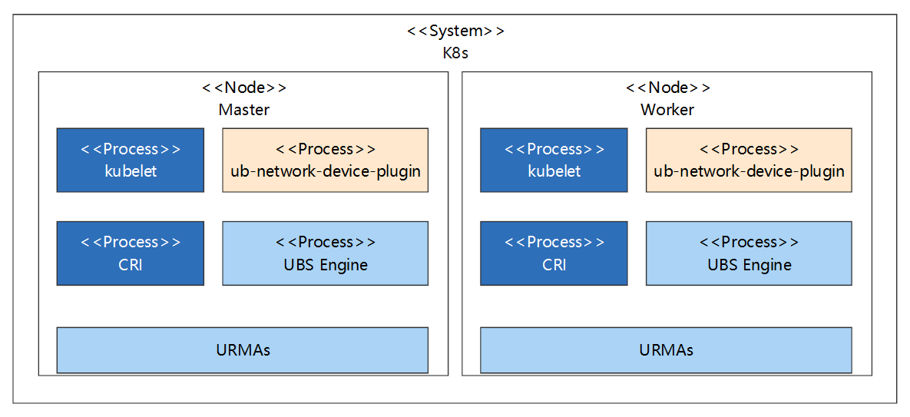
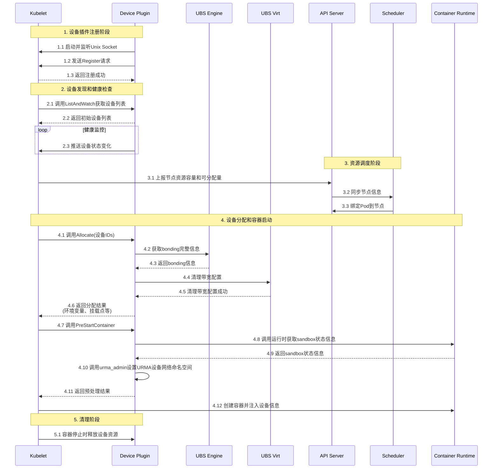

## Summary

UB支持URMA网络设备，在容器业务场景，使用URMA设备进行通信，降低通信时延，提升业务性能。

## Motivation

业务容器需要使用URMA设备通过RPC框架进行通信，因此我们需要在容器设备就绪之后，构建URMA设备按需挂载挂在到容器内能力。

### Goals  (目标)

- 支持URMA设备的管理与按需分配
- 支持设置URMA设备的网络命名空间
- 支持设置URMA设备的网络带宽QoS配置 -- TODO

### Non-Goals  (非目标，澄清特性范围)

## Proposal

### User Stories (Optional)

#### Story 1

用户通过在Pod中声明使用URMA网络设备，在容器中可以访问对应的设备进行通信。

#### Story 2

用户通过声明网络设备的带宽QoS配置，达到限制业务流量带宽的目的。 -- TODO

### Notes/Constraints/Caveats (Optional)


### Risks and Mitigations

## Design Details（设计细节）

### 容器使能URMA通信

当前UB环境中的URMA设备是在节点就绪时就直接创建好，使用共享模式。

在使能业务使用URMA设备进行通信时，我们需要**将URMA设备暴露给容器**，并**设置设备的网络命名空间为容器的网络命名空间**，然后容器中的业务就可以使用相关的brpc框架进行通信。由上述设备创建的模式可以确定，使用DevicePlugin能力来管理URMA设备是非常合适的，因此我们需要构建对应的DevicePlugin插件，负责管理和分配设备，与kubelet进行交互，并在分配之后，将设备的网络命名空间修改为容器的命名空间。

#### 部署视图

新增ub-network-device-plugin组件，以daemonset部署，与kubelet、容器运行时和ubs engine进行交互。



#### 设备发现与分配

设备插件的注入与设备管理部分，实现deviceplugin的标准接口即可，在注册时，需要指定此deviceplugin需要进行`PreStartContainer`，因为需要在插件的`PreStartContainer`接口中修改网络命名空间。设备信息在接口中已传递，设备与Pod的对应关系在设备分配之后就会存储在当前节点的`/var/lib/kubelet/device-plugins/kubelet_internal_checkpoint`文件中，可根据对应的设备信息匹配对应的Pod信息，然后通过PodID信息进行获取网络命名空间，之后执行命名空间修改动作即可。Pod的生命周期结束之后，对应的网络命名空间会自动释放，URMA在监控到对应的网络命令空间消亡后，会自动清理逻辑设备，并释放EID到外部，保证下次网络设备的可正常分配。



获取网络命名空间，主要是获取Pod的Sandbox容器的进程ID信息，即pause进程的ID；在Pod启动流程中，先创建并启动Pod的Sandbox，然后再创建和启动容器，在启动容器之前，kubelet会调用`PreStartContainer`接口，此时pause已启动，可进行获取。流程如下：

1. 通过设备ID获取PodUID，可在`/var/lib/kubelet/device-plugins/kubelet_internal_checkpoint`中获取；需要将kubelet的deviceplugin目录挂载到deviceplugin，hostpath挂载，默认为：`/var/lib/kubelet/device-plugins`，这也是deviceplugin默认要求挂载的内容；
2. 通过PodUID调用运行时获取对应的Sandbox的信息，再通过SandboxID获取Sandbox的状态信息，在扩展信息中有pid信息；需要挂载容器运行时的通信sock文件，hostpath挂载，以containerd为例，默认为：`/run/containerd/containerd.sock`。示例代码如下：
   ```go
   import (
   	"context"
   	"fmt"
   	"os"
   	"time"
   
   	"k8s.io/klog/v2"
   
   	runtimeapi "k8s.io/cri-api/pkg/apis/runtime/v1"
   	remote "k8s.io/cri-client/pkg"
   	"k8s.io/kubelet/pkg/types"
   )
   
   func main() {
   	logger := klog.Background()
   	runtimeSockPath := "/run/containerd/containerd.sock"
   	client, err := remote.NewRemoteRuntimeService(runtimeSockPath, 30 * time.Second, nil, &logger)
   	if err != nil {
   		// handle err
   		return
   	}
   	podUid := os.Getenv("podUID")  // 根据实际情况获取
   	filter := &runtimeapi.PodSandboxFilter{
   		LabelSelector: map[string]string{types.KubernetesPodUIDLabel: podUid},
   	}
   	sandboxes, err := client.ListPodSandbox(context.Background(), filter)
   	if err != nil {
   		// handle err
   		return
   	}
   	for _, sandbox := range sandboxes {
   		status, err := client.PodSandboxStatus(context.Background(), sandbox.Id, true)
   		if err != nil {
   			// handle err
   			return
   		}
   		// get pid from SandboxStatus.Info info为json字符串，需要解析获取pid
   		fmt.Println(status.Info["info"])
   	}
   }
   ```

#### 共享模式分配策略
当前一个VFE可以创建出多个bonding设备，如果不同的容器使用的设备是同一个VFE虚拟出来的，那他们的流量是走同一个物理设备的，我们希望使用设备的容器，优先分配在不同的VFE上，尽可能的减少流量聚集，提高在少量Pod场景下业务Pod能使用的带宽。

分配思路：类似Pod调度打分逻辑，当前一个VFE默认的虚拟设备是3个，按照VFE分组缓存，对未分配设备的VFE打较高的分数，对已分配了设备的，打较低的分数，在 GetPreferredAllocation 接口中返回评分最高的设备即可。

#### 资源定义

* 业务中配置使用URMA设备

```yaml
apiVersion: v1
kind: Pod
metadata:
  name: busybox
  namespace: kube-system
spec:
  containers:
  - name: busybox
    image: registry.k8s.io/busybox:1.29-2
    resources:
      limits:
        memory: 1000Mi
        cpu: 1000m
        unifiedbus.com/ub_net_device: "1"
      requests:
        memory: 10Mi
        cpu: 10m
        unifiedbus.com/ub_net_device: "1"
```


#### 接口依赖

* 设备发现 (go sdk)

  由ubse提供
  
* bonding激活 (go sdk)

  由ubse提供
  
* 网络命名空间设置（命令行）
  
  ```bash
  urma_admin agg expose <bondingEid> <nsPath>
  ```
  

#### 交付件

最终交付件为一个Pod，DaemonSet部署，Pod中包含deviceplugin容器，需要提供Pod对应的Chart包，以及构建、部署指导。

#### 可靠性

1. deviceplugin 配置探针，避免异常场景无法自动恢复；
2. deviceplugin 与 UBS Engine 和 UBS Virt 交互中异常需要记录关键日志，支撑故障定位定界；
3. 设备状态需要定时（30s）从 UBS Engine 获取，并打印相关日志，支持故障设备隔离，不分配给业务；
4. 已分配设备在节点重启之后，根据Pod重启情况进行重新分配。

#### 安全设计

1. deviceplugin 运行用户为 root，需要与 kubelet 交互上报设备与分配设备，需要与 CRI 进行交互获取容器网络命名空间；
2. deviceplugin 需要使用主机网络，因为设置网络命名空间时需要获取主机上的 EID；
3. deviceplugin 需要使用特权：CAP_NET_ADMIN，在设置网络命名空间时需要此权限；
   风险说明：该权限将使容器获取宿主机网络配置能力，异常时可能导致网络配置更改、流量劫持等中间人攻击，对集群网络环境造成安全风险；
4. 对外端口：健康检查默认监听8088端口，可根据环境实际情况进行替换；
5. 主机目录挂载列表
   | hostpath | 类型 | 说明 |
   | -- | -- | -- |
   | /var/lib/kubelet/device-plugins | Directory | 设备插件标准挂载目录，注册设备插件地址，访问kubelet |
   | /run/containerd/containerd.sock | Socket | 以 containerd 为例，访问 CRI 获取 Sandbox 状态信息 |
   | /proc | Directory | urma_admin 设置网络命名空间时需要访问此目录 |
   | /run/ubse | Directory | 访问 UBS Engine 的 sock 文件所在目录 |
   | /usr/lib64 | Directory | 访问 UBS Engine 所需要的 lib 库路径，可在制作镜像时安装，可以去除此目录挂载 |
   | /usr/bin/urma_admin | File | 设置网络命名空间的二进制命令，可在制作镜像时安装，可以去除此目录挂载 |
   | /dev/ummu/tid | File | 数据面通信建链访问内核，需要 deviceplugin 设置合理权限 |
   | /sys/class/ubcore | Directory | 设置网络命名空间时查找拓扑、设备、EID间的关系时需要访问此目录下文件 |
   | /sys/devices | Directory | 设置网络命名空间时查找拓扑、设备、EID间的关系时需要访问此目录下文件 |


#### 资源基线

CPU 500m

MEM 300Mi

## Testcase

### Test Plan

#### 功能用例

- DevicePlugin Pod正常启动，容器状态正常
- URMA设备发现成功，节点信息中正常展示
- 构建Pod使用独享URMA设备，正常分配，业务可正常通信
- 删除Pod，资源正常释放，节点设备数量展示正确


#### Prerequisite testing updates

## Production Readiness Review Questionnaire

### Feature Enablement and Rollback

#### Prerequisite testing updates

## Production Readiness Review Questionnaire

### Feature Enablement and Rollback

###### How can this feature be enabled / disabled in a live cluster?

不涉及

###### Does enabling the feature change any default behavior?

不涉及

###### Can the feature be disabled once it has been enabled (i.e. can we roll back the enablement)?

支持

###### What happens if we reenable the feature if it was previously rolled back?

支持

###### Are there any tests for feature enablement/disablement?

不涉及

### Rollout, Upgrade and Rollback Planning

###### How can a rollout or rollback fail? Can it impact already running workloads?

不涉及

###### What specific metrics should inform a rollback?

不涉及

###### Were upgrade and rollback tested? Was the upgrade->downgrade->upgrade path tested?

不涉及

###### Is the rollout accompanied by any deprecations and/or removals of features, APIs, fields of API types, flags, etc.?

不涉及

### Monitoring Requirements

###### How can an operator determine if the feature is in use by workloads?

不涉及

###### How can someone using this feature know that it is working for their instance?

不涉及

###### What are the reasonable SLOs (Service Level Objectives) for the enhancement?

不涉及

###### What are the SLIs (Service Level Indicators) an operator can use to determine the health of the service?

不涉及

###### Are there any missing metrics that would be useful to have to improve observability of this feature?

不涉及

### Dependencies

###### Does this feature depend on any specific services running in the cluster?

否

### Scalability

###### Will enabling / using this feature result in any new API calls?

不涉及

###### Will enabling / using this feature result in introducing new API types?

不涉及

###### Will enabling / using this feature result in any new calls to the cloud provider?

不涉及

###### Will enabling / using this feature result in increasing size or count of the existing API objects?

不涉及

###### Will enabling / using this feature result in increasing time taken by any operations covered by existing SLIs/SLOs?

不涉及

###### Will enabling / using this feature result in non-negligible increase of resource usage (CPU, RAM, disk, IO, ...) in any components?

不涉及

### Troubleshooting

###### How does this feature react if the API server and/or etcd is unavailable?

不涉及

###### What are other known failure modes?

不涉及

###### What steps should be taken if SLOs are not being met to determine the problem?

不涉及

## Implementation History

## Drawbacks　

不涉及

## Alternatives

不涉及


