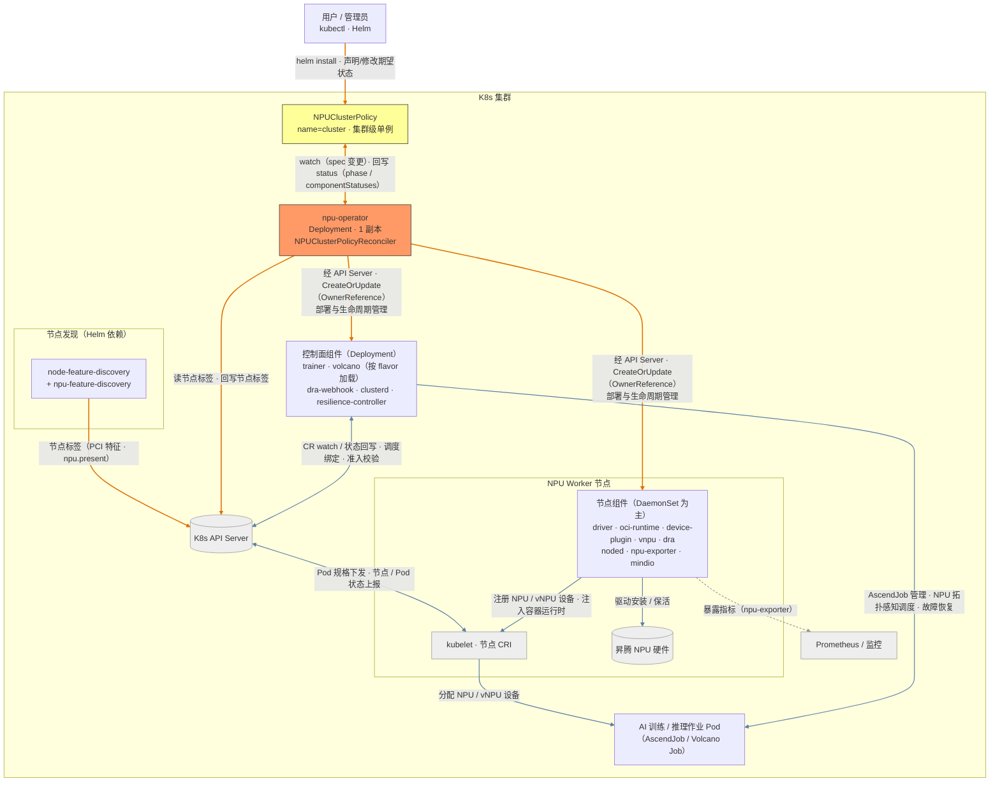

# NPU Operator 架构设计

> NPU Operator 是一个「**CR 驱动 + 静态清单渲染 + 调和循环**」的 Kubernetes Operator。它监听集群级单例 CR `NPUClusterPolicy`，将内嵌在镜像中的组件 YAML 清单按 CR Spec 渲染后应用到集群，并持续保证 20 余个昇腾（Ascend）NPU 相关组件处于期望状态。
>
> 本文给出系统级架构与相关组件；配置字段见 [crd-reference.md](crd-reference.md)，调和循环与渲染管线的实现细节见 [reconcile.md](reconcile.md)。

---

## 1. 设计目标

- **一键部署昇腾训练/推理全栈**：驱动、容器运行时、设备插件、调度器（Volcano）、训练算子、监控、故障恢复、vNPU、DRA 等组件统一由一个 CR 声明式管理。
- **声明式 + 可调和**：所有组件的期望状态集中在 `NPUClusterPolicy`（单例、集群级），operator 负责收敛实际状态。
- **不可变清单 + 可编程渲染**：组件清单（manifest）打进 operator 镜像，版本与 operator 强绑定；通过类型安全的 transformer 链把 CR Spec 注入清单，而非使用 Helm/Go template。
- **职责单一**：硬件发现交给 Node Feature Discovery（NFD）+ npu-feature-discovery，operator 只消费节点标签。

## 2. 总体架构




> 图例：橙色实线 = 管理面（operator 驱动，经 API Server）；灰色实线 = 运行面（组件协作 / K8s 平台机制）；灰色虚线 = 监控（npu-exporter 暴露指标）。
> 运行面的直连箭头表达**业务因果**，协作双方实际多经 K8s API 对象（Pod/CR/ConfigMap/Node）介导；与 API Server 本身的交互（ResourceSlice 发布、准入校验、CR watch / 状态回写、kubelet 的 Pod 规格获取与状态上报）显式画向 API 节点。
> 本图为系统级总览；组件级完整交互（26 个组件、准入校验、故障恢复链路、CDI 设备注入等）见 [reconcile.md §3.1 组件交互详图](reconcile.md#31-组件交互详图)。

与上方总览图对应的，NPU Operator、NPU节点组件、和k8s集群基础设施的交互可以大体上分为两组：

1. **NPU Operator ↔ 组件**：用户在 `NPUClusterPolicy` 中声明期望状态；operator watch CR / 节点 / 拥有的工作负载，经 API Server 以 `CreateOrUpdate` + OwnerReference 部署、更新并回收全部组件，并把就绪状态回写 CR Status（机制见 [reconcile.md](reconcile.md)）。
2. **组件 ↔ kubelet / CRI / API / 彼此**：device-plugin / vNPU device-plugin 向 kubelet 注册设备资源（并经 nodes/status patch 上报设备健康状态），DRA kubelet-plugin 向 API Server 发布 ResourceSlice、处理 ResourceClaim 并经 CDI 注入设备；oci-runtime 向节点 CRI（containerd）注入 ascend-docker-runtime；trainer 管理 AscendJob、Volcano 执行 NPU 感知调度；noded → clusterd → resilience-controller 构成「故障检测 → 汇聚 → 动态缩扩容恢复」链路；mindio 提供断点续训与 UCE 在线修复；npu-exporter 暴露指标供监控抓取；volcano admission（vnpu flavor）与 dra-webhook 分别对 volcano 资源（Job/Queue/PodGroup 等）与 ResourceClaim 执行准入校验。

组件级逐边交互见 [reconcile.md §3.1](reconcile.md#31-组件交互详图)

以下为 NPU Operator 所实现纳管的k8s集群管理职责，按照集群管理的抽象层级进行划分：

| 层级 | 职责 | 载体 |
|---|---|---|
| 期望状态 | 用户声明的组件开关与参数 | `NPUClusterPolicy` CR（Helm 由 `values.yaml` 渲染生成） |
| 调和引擎 | 加载组件清单 → 节点发现 → 冲突检测 → 渲染并应用资源 → 回写状态 | `internal/controller`（详见 [reconcile.md](reconcile.md)） |
| 实际状态 | DaemonSet / Deployment / ConfigMap / CRD / RBAC 等 26 种资源类型 | K8s API Server |

## 3. 组件清单

组件以「镜像内目录」为单位组织（源码 `assets/` → 镜像内 `/var/lib/npu-operator/components`）。是否被管理由各组件 `managed` 开关与 `volcano.flavor` 决定；被加载但不被管理的组件会被回收（机制见 [reconcile.md §3/§8](reconcile.md)）。组件目录与实际工作负载名称、管理判定条件的完整映射见 [reconcile.md §3](reconcile.md#3-组件加载loadcomponents)。

### 3.1 基础组件（始终加载，5 个）

| 组件目录 | 职责 |
|---|---|
| `driver` | 在 NPU 节点安装并保活昇腾驱动（init 容器执行安装） |
| `oci-runtime` | 向节点 CRI 注入 ascend-docker-runtime / npu-container-toolkit |
| `device-plugin` | 向 kubelet 暴露 NPU 设备（MindCluster 设备插件） |
| `trainer` | AscendJob 训练算子（CRD 控制器） |
| `noded` | 节点心跳上报与硬件故障检测 |

基础组件默认全部启用（`managed: true`）；各组件字段与默认值见 [crd-reference.md §4](crd-reference.md#4-各组件-spec-详解)。

### 3.2 Volcano 组件（按 flavor 加载，5–7 个）

`spec.volcano.flavor`（枚举 `mindcluster` / `vnpu` / `external`，**缺省视为 mindcluster**）决定加载与管理哪一组 Volcano 资产：

| 组件目录 | 主要资源 | mindcluster | vnpu | external |
|---|---|---|---|---|
| `volcano/volcano-controller` | Deployment（标准 Volcano controller） | 管理 | 管理 | 加载但不管理 |
| `volcano/volcano-scheduler` | Deployment（标准 Volcano scheduler） | 管理 | 管理 | 加载但不管理 |
| `volcano/vnpu-controller` | Deployment（vNPU 版 controller） | 加载但不管理 | 管理 | 加载但不管理 |
| `volcano/vnpu-scheduler` | Deployment（vNPU 版 scheduler） | 加载但不管理 | 管理 | 加载但不管理 |
| `volcano/vnpu-crds` | Volcano CRD（Job/PodGroup/Queue 等） | 不加载 | 管理 | 加载但不管理 |
| `volcano/vnpu-namespaces` | Namespace（`volcano-system`、monitoring） | 不加载 | 管理 | 不加载 |
| `volcano/vnpu-admission` | Deployment + init Job + Secret + Webhook 配置 | 加载但不管理 | 管理* | 加载但不管理 |

> \* vnpu-admission 还受 `spec.volcano.admission.enabled` 控制（vnpu flavor 缺省视为开启），详见 [crd-reference.md §4.8](crd-reference.md#4-各组件-spec-详解)。

三种 flavor 的定位：

- **mindcluster**：使用 MindCluster 版 Volcano 资产，只管理标准 volcano-controller/scheduler。
- **vnpu**：额外管理 vNPU 兼容版 controller/scheduler/CRD/namespace/admission。
- **external**：Volcano 由外部自行管理，operator 只回收本 CR 创建过的资源，此后不再触碰。

### 3.3 扩展组件（始终加载，15 个）

| 组件目录 | 职责 |
|---|---|
| `clusterd` | 集群级 NPU 状态汇聚 |
| `resilience-controller` | 训练任务故障恢复 |
| `npu-exporter` | NPU 指标导出 |
| `mindio/mindiotft` | MindIO 训练容错组件安装 |
| `mindio/mindioacp` | MindIO 异步 Checkpoint 持久化组件安装 |
| `vnpu/*` | vNPU 切分栈（client 更新、设备插件、指标导出 + 可选 ServiceMonitor） |
| `dra/*` | DRA 栈（kubelet 插件、DeviceClass、软 vNPU 配置、vCANN-RT 安装、校验 webhook） |

`vnpu` / `dra` 为父子开关（组开关默认 false、子组件默认 true——例外：`vnpu.exporter` 默认 false；需同时开启），详见 [crd-reference.md §4.16–§4.17](crd-reference.md#4-各组件-spec-详解)。

随 flavor 不同，每次调和实际加载 **25（mindcluster）/ 26（external）/ 27（vnpu）** 个组件；状态项名称映射见 [crd-reference.md §5.3](crd-reference.md#53-componentstatuses-名称映射)。

## 4. 节点发现与标签

NPU 节点识别依赖两条**相互独立**的标签链路，两者必须都正常工作：

1. **operator 侧发现（状态与闸门）**：NFD 通过 PCI 设备特征打标签 `feature.node.kubernetes.io/pci-1200_19e5_{d100,d500,d801,d802,d803}.present=true`（vendor `19e5` = 华为，class `1200` = 加速器），operator 据此判定 NPU 节点。芯片映射：d100→Ascend 310，d500→Ascend 310P，d801/d802/d803→Ascend 910。
2. **调度侧选择（Pod 落位）**：npu-feature-discovery（Helm 依赖）负责打 `openfuyao.com/npu.present` 标签，driver / oci-runtime / device-plugin / noded / npu-exporter 等 DaemonSet 清单以此为 nodeSelector。

operator 维护的节点标签与注解（标签契约，探测机制见 [reconcile.md §4](reconcile.md#4-节点发现与-cri-探测labelnpunodes)）：

| 键 | 值 | 写入条件 |
|---|---|---|
| `nodeDEnable` | `on` | 所有节点，当 `spec.nodeD.managed=true`（关闭时删除） |
| `huawei.com/vnpu` | `ready` | NPU 节点，当 `spec.vnpu.managed=true`（否则删除） |
| `openfuyao.com/container.runtime.version` | 如 `1.7` | 受支持 CRI 的节点（解析自 `containerRuntimeVersion`；不受支持的节点清除该注解） |
| `openfuyao.com/container.runtime.endpoint` | CRI socket 路径 | 受支持 CRI 的节点（探测自 kubelet configz；不受支持的节点清除该注解） |

**CRI 支持白名单目前仅 containerd**；不受支持的节点不计入 NPU 节点（探测细节见 [reconcile.md §4](reconcile.md#4-节点发现与-cri-探测labelnpunodes)）。

## 5. 调和管线概览

`Reconcile` 按固定顺序执行五个阶段——获取 CR → 加载组件清单 → 节点发现 → 冲突检测 → 组件调和与状态回写——任一阶段失败即终止并回写 `Error` 条件。触发源为 CR spec 变更、operator 拥有的 DaemonSet/Deployment 状态变化、节点标签变化。阶段语义、触发谓词、速率限制与重排队策略见 [reconcile.md](reconcile.md)。

## 6. 资源渲染与生命周期

- **清单来源**：组件 YAML 打进 operator 镜像（`assets/` → `/var/lib/npu-operator/components`），版本与 operator 强绑定。
- **渲染**：清单占位符由类型安全的 transformer 链按 CR Spec 替换（不使用 Helm/Go template），渲染结果以注解哈希留痕。
- **生命周期**：`CreateOrUpdate` 应用，资源以 `NPUClusterPolicy` 实例为 owner（controller=true）；`managed=false` 或 flavor 切换后回收 owner 匹配的残留资源；**无 finalizer**，不做集群外清理（如节点上已安装的驱动）。

各资源类型的 hook（transform / inspect / canDelete）与专用 transformer（oci-runtime、Volcano admission 生命周期、调度器插件名改写、DRA DeviceClass 模板与回收）详见 [reconcile.md §7](reconcile.md#7-transformer-与-hook-机制)。

## 7. 组件冲突检测

MindCluster device-plugin、vNPU device-plugin 与 DRA kubelet-plugin 三种设备暴露方式两两互斥，vnpu-client-update 与 dra-vcannrt-installer 亦互斥。operator 在任何组件调和之前检查受管理组件的 `placement.nodeSelector` 是否选中重叠节点；发现重叠即置 `NotReady`、reason=`ComponentConflict`，且**不自动重试**——需通过 placement 将互斥组件隔离到不同节点组。规则与判定算法见 [reconcile.md §5](reconcile.md#5-组件冲突检测detectcomponentconflicts)。

## 8. 状态与可观测性

- **CR Status**：`phase`（Ready/NotReady）、互斥的 `Ready`/`Error` 条件、逐组件 `componentStatuses`；字段语义与 reason 表见 [crd-reference.md §5](crd-reference.md#5-status-结构)。
- **监控**：`npu-exporter` / vNPU exporter / clusterd 组件暴露指标，vNPU exporter 可选创建 Prometheus ServiceMonitor。

## 9. 部署形态

生产部署使用 Helm Chart `charts/npu-operator`：

- **CRD**：`crds/` 内置 `npuclusterpolicies` 与 `ascendjobs`（trainer 组件即 AscendJob 训练算子）两份 CRD，与 `config/crd/bases/` 保持一致。
- **依赖**：`node-feature-discovery`（0.16.4，`nfd.enabled` 控制）与 `npu-feature-discovery`（`npu-feature-discovery.enabled` 控制）。Chart 另内置备用 NodeFeatureRule（`nfd.nodefeaturerules`，默认关闭，仅覆盖 d100/d500/d801/d802）。
- **模板**：operator Deployment（1 副本，`masterselector: dls-master-node` 选择 master 节点，可经 `operator.nodeSelector` 配置；注入 `OPERATOR_NAMESPACE` 与 `NPU_OPERATOR_RELEASE_TAG` 环境变量）、由 `values.yaml` 渲染的 `NPUClusterPolicy`、RBAC、日志配置及可选 NodeFeatureRule。
- **operator 运行参数**：健康/就绪探针 `:8081`；metrics 可经 `--metrics-bind-address` 启用（默认关闭，支持 HTTPS + 认证鉴权）；leader election 可选（默认关闭）。
- **开发清单**：`config/` 为 kubebuilder/kustomize 生成，`Makefile` 提供 `manifests` / `generate` / `test` / `build` / `docker-build` 等目标。

## 10. 代码地图

```
npu-operator/
├── cmd/main.go                          # 入口：Manager 装配、scheme 注册、健康检查
├── api/v1/
│   ├── npuclusterpolicy_types.go        # CRD 类型（Spec/Status/各组件 Spec）
│   ├── groupversion_info.go             # GroupVersion 注册（npu.openfuyao.com/v1）
│   └── zz_generated.deepcopy.go         # controller-gen 生成
├── internal/controller/
│   ├── npuclusterpolicy_controller.go   # Reconcile 主循环、Watch/RBAC 声明
│   ├── components.go                    # 组件清单、加载/解析、组件级调和、状态合并
│   ├── resources.go                     # 26 种 GVK 的 hook 注册表、typedComponentResource、
│   │                                    #   DRA DeviceClass 模板/改写/GC、各类专用 transformer
│   ├── resources_workload.go            # DaemonSet/Deployment transformer 工厂、哈希注解
│   ├── resources_basic_hooks.go         # RBAC/ConfigMap/Webhook/Job 等 hook、Volcano admission 编排
│   ├── resources_getters.go             # Spec → 组件配置的 getter（含 flavor/默认值解析）
│   ├── component_conflict.go            # 组件冲突检测
│   ├── labels.go                        # 节点标签/CRI 探测（configz）
│   ├── status.go                        # Ready/Error 条件与 status 更新
│   └── utils.go                         # ignoreError 等工具
├── assets/                              # 组件 YAML 清单（打进镜像 /var/lib/npu-operator/components）
│   ├── driver/ oci-runtime/ device-plugin/ noded/ npu-exporter/
│   ├── trainer/ clusterd/ resilience-controller/ mindio/
│   ├── volcano/（volcano-* 与 vnpu-* 两套资产）
│   ├── vnpu/（namespace/ client-update/ device-plugin/ exporter[+servicemonitor]）
│   └── dra/（kubelet-plugin/ deviceclasses/ soft-vnpu/ vcannrt-installer/ webhook）
├── charts/npu-operator/                 # Helm Chart（crds/ + templates/ + values.yaml + NFD 依赖）
├── config/                              # kubebuilder/kustomize 开发清单
├── build/ Makefile PROJECT              # 构建与工程元数据
```

## 11. 关键设计取舍

| 取舍 | 选择 | 原因 / 影响 |
|---|---|---|
| CR 作用域 | 集群级（非命名空间） | 组件跨命名空间部署（volcano-system 等），语义更清晰；要求集群级 RBAC |
| 单例实现 | CEL 校验 `metadata.name == 'cluster'` | API Server 侧拒绝非法实例，无需 operator 加锁；CR 名固定 |
| 资源清理 | OwnerReference 主动删除 + 级联 GC，**无 finalizer** | 实现简单；不做集群外清理；UID 匹配防止误删同名资源 |
| manifest 存储 | 打进镜像 | 版本与 operator 强绑定、不可被用户篡改；改清单必须发新镜像 |
| 模板渲染 | 自定义类型安全 transformer 链 + 占位符 | 泛型可组合、可测试；新增字段需新增 transformer |
| 组件判定 | 每组件一个 `isComponentManaged` 函数 | 新增组件成本低；需与 CRD 字段同步维护 |
| NPU 节点识别 | 只读 NFD/npu-feature-discovery 标签 | 职责单一；两条标签链路（NFD PCI 标签 + npu.present）任一故障都会影响部署 |
| CRI 支持 | 白名单仅 containerd | 昇腾生态只验证了 containerd；扩展需修改 `supportedRuntimes` |
| Volcano 管理 | flavor 三态（mindcluster/vnpu/external） | 兼容存量 MindCluster 集群与 vNPU 集群；external 模式只回收不管理 |
| 冲突防护 | 调和前的 nodeSelector 重叠检测 | 设备插件/DRA 互斥冲突在部署前拦截，代价是要求用户正确划分节点组 |
