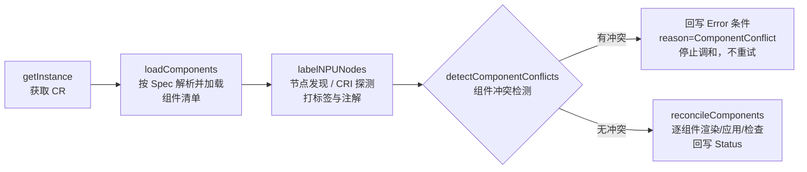
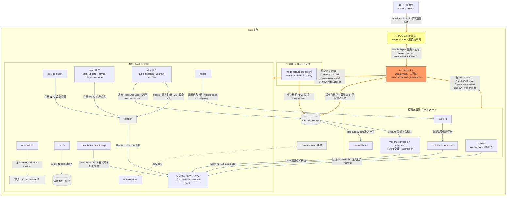
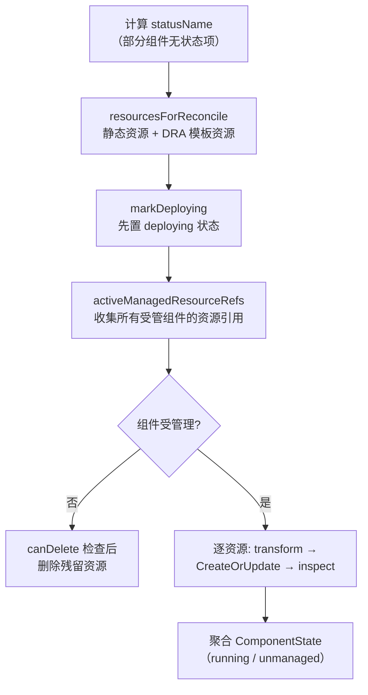

# NPU Operator Reconcile 逻辑说明

> 本文说明 `NPUClusterPolicyReconciler` 如何把一份 `NPUClusterPolicy` CR 收敛为集群中真实运行的 20 余个组件——调和循环的五个阶段、资源渲染管线、删除/回收语义与状态回写的实现细节。
>
> 系统级视角（组件清单、节点发现契约、部署形态）见 [architecture.md](architecture.md)，字段语义见 [crd-reference.md](crd-reference.md)。代码均位于 `internal/controller/`。

---

## 1. 调和循环总览

`Reconcile`（`npuclusterpolicy_controller.go`）按固定顺序执行五个阶段，任一阶段失败即终止本次调和并回写 `Error` 条件：

| 阶段 | 函数 | 失败时的行为 |
|---|---|---|
| 1. 获取实例 | `getInstance` | NotFound 视为正常结束（CR 已删除）；其他错误回写 `Error/ReconcileFailed` |
| 2. 加载组件 | `loadComponents` | 回写 `Error/ReconcileFailed` |
| 3. 节点发现 | `labelNPUNodes` | 回写 `Error/ReconcileFailed` |
| 4. 冲突检测 | `detectComponentConflicts` | 出错回写 `Error/ReconcileFailed`；有冲突回写 `Error/ComponentConflict` 并**正常返回（不重试）** |
| 5. 组件调和 | `reconcileComponents` | 逐组件调和；单个组件失败即停止后续组件并回写 `Error/ComponentNotReady` |

`getInstance` 获取失败时错误链被保留以支持 `errors.IsNotFound` 判断；每次 `updateStatus` 前都会重新 `getInstance` 拿最新版本（见 §9）。

## 2. 触发源与排队

`SetupWithManager`（`npuclusterpolicy_controller.go`）注册三个 Watch 源：

| Watch 源 | 谓词/映射 | 说明 |
|---|---|---|
| `For(NPUClusterPolicy)` | `GenerationChangedPredicate` | 只在 `metadata.generation` 变化（即 spec 变更）时触发，纯 status 更新不会引发重调和 |
| `Owns(DaemonSet)` / `Owns(Deployment)` | — | operator 拥有的工作负载变化（如 Pod 就绪）触发重调和，驱动状态收敛 |
| `Watches(Node)` | `nodeEventFilter` | 节点 Create/Delete 总是触发；Update 仅在**标签变化**时触发。映射函数 `getReferrerToNode` 列出所有 NPUClusterPolicy 并逐个入队 |

启动前置条件：环境变量 `OPERATOR_NAMESPACE` 必须设置（否则 `SetupWithManager` 报错退出）；该值用于命名空间占位符替换与 status 回写。

**速率限制**（controller.Options）：全局令牌桶 100 QPS / burst 1000，叠加按条目的指数退避失败限速（50ms–3s 封顶）。

**重排队**（`reconcileComponents` 尾部）：

| 条件 | 结果 |
|---|---|
| 存在未就绪组件 | `RequeueAfter = 5s`，`Error/ComponentNotReady` |
| 集群缺 NFD 标签（`hasNFDLabels=false`） | `RequeueAfter = 30s`，**Ready**/`NoNFDLabels` |
| 无 NPU 节点（`hasNPUNodes=false`） | **Ready**/`NoNPUNodes` |
| 全部就绪 | **Ready**/`Reconciled` |

## 3. 组件加载（loadComponents）

1. **解析组件路径**：`resolveComponentPaths(spec)` 按 Spec 计算本次需要的组件目录列表（5 基础 + 按 `spec.volcano.flavor` 选择的 Volcano 集合 + 15 扩展；矩阵见 [architecture.md §3](architecture.md#3-组件清单)）。
2. **缓存判断**：`componentPathsLoaded` 比较已加载组件与期望路径列表；一致则跳过重新加载（组件清单在同一进程生命周期内通常只加载一次）。
3. **读取清单**：`loadComponent` → `readManifests` 递归读取镜像内目录（`/var/lib/npu-operator/components/<组件>`）下所有文件。
4. **解码**：优先用 JSON serializer（YAML 模式）解码为 scheme 内的类型化对象；失败则转 JSON 后走 `unstructured.Unstructured` 兜底。解码结果按 GVK 查 `resourceCreators` 注册表（26 种：K8s 核心/RBAC/admission/ServiceMonitor/Volcano CRD/DRA DeviceClass 等）构造 `componentResource`。
5. **状态重置**：首次（重新）加载后立即把 `phase` 置 `NotReady` 并按新组件列表重建 `componentStatuses`（全部 `pending/Reconciling`），随后由调和过程逐步收敛。

**加载 ≠ 管理**：组件是否真正被管理由 `isComponentManaged[路径](reconciler)` 谓词决定（对应 CR 中各 `managed` 开关与 Volcano flavor）。未被管理的组件同样参与调和——但走的是资源回收路径（见 §8）。

组件目录 → 实际工作负载 → 管理判定条件的完整映射（架构文档的组件职责总览见 [architecture.md §3](architecture.md#3-组件清单)）：

| 组件目录 | 实际工作负载 | 管理判定 |
|---|---|---|
| `driver` | DaemonSet `npu-driver` | `spec.driver.managed`（默认 true） |
| `oci-runtime` | DaemonSet `ascend-runtime-<cri>`（如 containerd） | `spec.ociRuntime.managed`（true） |
| `device-plugin` | DaemonSet `ascend-device-plugin` | `spec.devicePlugin.managed`（true） |
| `trainer` | Deployment `ascend-operator-manager` | `spec.trainer.managed`（true） |
| `noded` | DaemonSet `noded` | `spec.nodeD.managed`（true） |
| `volcano/volcano-controller` | Deployment `volcano-controllers` | `spec.vccontroller.managed` && flavor 为 mindcluster |
| `volcano/volcano-scheduler` | Deployment `volcano-scheduler` | `spec.vcscheduler.managed` && flavor 为 mindcluster |
| `volcano/vnpu-controller` | Deployment（镜像 `cr.openfuyao.cn/openfuyao/vnpu/vc-controller-manager`） | `spec.vccontroller.managed` && flavor 为 vnpu |
| `volcano/vnpu-scheduler` | Deployment（镜像 `…/vnpu/vc-scheduler`） | `spec.vcscheduler.managed` && flavor 为 vnpu |
| `volcano/vnpu-crds` | Volcano CRD（Job/PodGroup/Queue 等） | flavor 为 vnpu |
| `volcano/vnpu-namespaces` | Namespace（`volcano-system`、monitoring） | flavor 为 vnpu |
| `volcano/vnpu-admission` | Deployment `volcano-admission` + init Job + Secret + Webhook 配置 | flavor 为 vnpu && `spec.volcano.admission.enabled` |
| `clusterd` | Deployment `clusterd` | `spec.clusterd.managed`（true） |
| `resilience-controller` | Deployment `resilience-controller` | `spec.rscontroller.managed`（true） |
| `npu-exporter` | DaemonSet `npu-exporter` | `spec.exporter.managed`（true） |
| `mindio/mindiotft` | DaemonSet `mindio-tft` | `spec.mindiotft.managed`（true） |
| `mindio/mindioacp` | DaemonSet `mindio-acp` | `spec.mindioacp.managed`（true） |
| `vnpu/namespace` | Namespace | `spec.vnpu.managed`（false） |
| `vnpu/client-update` | DaemonSet `npu-client-update-daemonset` | `spec.vnpu.managed && clientUpdate.managed` |
| `vnpu/device-plugin` | DaemonSet `npu-device-plugin-daemonset` | `spec.vnpu.managed && devicePlugin.managed` |
| `vnpu/exporter` | DaemonSet `xpu-exporter-daemonset` + Service `xpu-exporter-svc` | `spec.vnpu.managed && exporter.managed`（子开关默认 false） |
| `vnpu/exporter-servicemonitor` | ServiceMonitor | 上一行 && `serviceMonitor.enabled` |
| `dra/kubelet-plugin` | DaemonSet `npu-dra-kubeletplugin` | `spec.dra.managed && kubeletPlugin.managed` |
| `dra/deviceclasses` | 5 个内置 DRA DeviceClass + 自定义模板 | `spec.dra.managed && deviceClasses.managed` |
| `dra/soft-vnpu` | ConfigMap（dra.config / capabilities.yaml） | `spec.dra.managed && softVNPU.managed` |
| `dra/vcannrt-installer` | DaemonSet `vcannrt-installer` | `spec.dra.managed && softVNPU.managed && vcannrtInstaller.managed` |
| `dra/webhook` | Deployment `dra-webhook` + Service + ValidatingWebhookConfiguration | `spec.dra.managed && webhook.managed` |

### 3.1 组件交互详图

下图为组件级完整交互视图，与 [architecture.md §2](architecture.md#2-总体架构) 的系统级总览图对应。

> 图例：橙色实线 = 管理面（operator 驱动，经 API Server）；灰色实线 = 运行面（组件协作）；灰色虚线 = 监控抓取。
> 运行面的直连箭头表达**业务因果**，协作双方实际多经 K8s API 对象（Pod/CR/ConfigMap/Node）介导；仅与 API Server 本身的交互（发布、准入校验）显式画向 API 节点。

## 4. 节点发现与 CRI 探测（labelNPUNodes）

每次调和全量遍历 Node 列表，产出 reconciler 内部状态（`r.runtimes`、`r.nodeRuntimeEndpoints`、`r.hasNFDLabels`、`r.hasNPUNodes`）并维护节点标签/注解（`labels.go`）：

1. **NFD 检查**：任一节点带 `feature.node.kubernetes.io/` 前缀标签即认为 NFD 在工作（`hasNFDLabels`）。
2. **CRI 解析**：从 `node.status.nodeInfo.containerRuntimeVersion`（形如 `containerd://1.7.x`）解析 runtime 名与版本；不在白名单 `supportedRuntimes`（**仅 containerd**）的节点视为不支持，并**清除**其 runtime 注解。
3. **endpoint 探测**：对受支持节点通过 `nodes/proxy` 子资源的 `configz` 端点读取 kubelet 的 `containerRuntimeEndpoint`（CRI socket 路径），记录到 `nodeRuntimeEndpoints`。
4. **注解回写**：`openfuyao.com/container.runtime.version` 与 `openfuyao.com/container.runtime.endpoint` 写到节点注解。
5. **NPU 判定**：节点带 NFD PCI 标签（`pci-1200_19e5_{d100,d500,d801,d802,d803}.present=true`）**且** runtime 受支持，才算 NPU 节点（`hasNPUNodes`）。
6. **标签维护**：`nodeDEnable=on`（所有节点，`spec.nodeD.managed`）与 `huawei.com/vnpu=ready`（NPU 节点，`spec.vnpu.managed`），关闭时删除。节点对象仅在确实变化时 Update。

节点标签/注解的完整契约表见 [architecture.md §4](architecture.md#4-节点发现与标签)。

## 5. 组件冲突检测（detectComponentConflicts）

在任何组件被调和之前运行（`component_conflict.go`），防止互斥的设备暴露组件落在同一节点：

- **受监控工作负载**（5 个）：mindcluster-device-plugin、vnpu-device-plugin、dra-kubelet-plugin、vnpu-client-update、dra-vcannrt-installer，各自的启用条件与 nodeSelector 取自对应 Spec 段。
- **冲突规则**（4 条，成对检查且双方都被管理时才生效）：
  1. mindcluster-device-plugin ↔ vnpu-device-plugin
  2. mindcluster-device-plugin ↔ dra-kubelet-plugin
  3. vnpu-device-plugin ↔ dra-kubelet-plugin
  4. vnpu-client-update ↔ dra-vcannrt-installer
- **重叠判定**：先做静态判断（两 selector 存在同键不同值 → 必不相交），否则用较大的 selector 做 List 过滤、较小的做匹配；**空 selector 视为选中全部节点**。
- **后果**：发现重叠即把冲突对与节点列表格式化进 message，回写 `NotReady` + `Error/ComponentConflict` 后**正常返回（不重排队）**——需用户修改各组件 `placement.nodeSelector` 解除冲突。

## 6. 资源调和（component.reconcile / reconcileComponents）

`reconcileComponents` 按加载顺序逐组件调和，任一组件出错即中断（后续组件顺延到下次调和）。单个组件的调和流程（`components.go`）：

要点：

- **markDeploying**：调和开始时先把该组件状态置 `deploying/Reconciling`（已 running/unmanaged 或无状态项时跳过），让用户能看到进行中的变化。
- **resourcesForReconcile**：静态清单资源之外，`dra/deviceclasses` 组件还会把 `spec.dra.deviceClasses.templates` 渲染成额外的 DeviceClass 对象（name 与 selectorCEL 必填，缺一报错）。
- **activeManagedResourceRefs**：预先收集**所有仍受管理组件**的资源引用（GVK+namespace+name）。未管理组件调和时，其资源若出现在该集合中则跳过删除——保护 RBAC/ConfigMap 等被多个组件共享的资源。
- **DRA DeviceClass 垃圾回收**：`dra/deviceclasses` 组件调和前执行 `reconcileDRADeviceClassGarbage`：列出全部 DeviceClass，删除带 `openfuyao.com/dra-deviceclass-managed=true` 注解、OwnerReference 匹配本实例、且不在期望集合（5 个内置 + templates）中的条目，并连带删除其驱动名对应的 ResourceSlice。

单个资源（`typedComponentResource.reconcile`，`resources.go`）的三种结局：

| 分支 | 行为 |
|---|---|
| 组件未管理 | `canDelete` 通过则 Delete（见 §8）；返回 nil 状态 |
| transform 返回 `errSkipReconciliation` | 跳过创建与更新（如集群无 NPU 节点时的 DaemonSet、runtime 不存在时的 oci-runtime DS）；返回 nil 状态 |
| 正常 | `CreateOrUpdate`（存在则按渲染结果更新，不存在则创建）后 `inspect` 检查就绪 |

`errSkipCreation`（transform 阶段）表示"不需要写 API 但仍要 inspect"。命名空间占位符 `FILLED_BY_OPERATOR` 在此时替换为 `OPERATOR_NAMESPACE`。

## 7. Transformer 与 Hook 机制

### 7.1 Hook 接口

每种资源类型绑定 `componentResourceReconcileHooks`：

- **canDelete**：判定资源是否可删（必须实际存在且 OwnerReference 与本实例 kind+name+UID 匹配；Namespace 永远不可删）。
- **transform**：注入 OwnerReference（`SetControllerReference`）+ 执行 transformer 链。
- **inspect**：检查就绪并产出 `ComponentState`。

DaemonSet / Deployment 的 transform 会先应用 `spec.daemonsets` 公共配置（labels/annotations 合并、tolerations 追加、nodeSelector 复制合并），再跑 transformer 链；inspect 检查 `NumberUnavailable`/`UnavailableReplicas` 与 Pod Phase（非 Running → `pending/PodNotRunning`；DesiredNumberScheduled=0 视为正常）。

### 7.2 Transformer 链

DaemonSet / Deployment 的 transformer 链按**工作负载名称**组装（`newDaemonSetReconcileHooks` / `newDeploymentReconcileHooks`），典型顺序：placement → 日志轮转 → 镜像 → 命令参数 → 资源配额 → 卷 → env，链尾统一追加：

- **workloadHashTransformer**：对渲染后的对象做 FNV-32a 哈希（spew 序列化，禁用方法/指针地址、排序 key），写入注解 `openfuyao.com/last-applied-hash`，便于对比"上次应用的内容"。

占位符替换贯穿各 transformer：

| 占位符 | 替换为 |
|---|---|
| `FILLED_BY_OPERATOR`（镜像字段） | `ImageSpec.Name()` 拼接结果（空串则保留清单默认） |
| `FILLED_BY_OPERATOR`（namespace/name） | `OPERATOR_NAMESPACE` / `spec.operator.runtimeClass` |
| `__NPU_OPERATOR_RELEASE_TAG__` | 环境变量 `NPU_OPERATOR_RELEASE_TAG`（默认 `latest`） |

### 7.3 专用流程

- **oci-runtime**：DaemonSet 名为 `ascend-runtime-<cri>`；transform 阶段若集群中不存在对应 runtime 的节点则返回 `errSkipReconciliation`；nodeSelector 注入 `openfuyao.com/container.runtime=<cri>`；**inspect 阶段**把每个已调度 Pod 所在节点的 CRI endpoint 注入 Pod 注解（`openfuyao.com/container.runtime.endpoint`），供 sidecar 感知。
- **Volcano 镜像防串扰**：切换 flavor 后，若 CR 中残留**旧 flavor 的默认镜像地址**（如 mindcluster 的 `ascendhub/vc-*` 或 vnpu 的 `cr.openfuyao.cn/openfuyao/vnpu/*`），`newVolcanoWorkloadImageTransformer` 拒绝应用（`isInactiveVolcanoFlavorDefaultImage`），避免旧 values 覆盖新 flavor 的资产默认镜像。
- **Volcano admission 生命周期**（vnpu flavor）：init Job `volcano-admission-init` 生成 TLS 证书到 `volcano-system` 的 Secret `volcano-admission-secret`；transform 前置校验 init Job 已完成（`ensureVolcanoAdmissionInitComplete`），随后把 Secret 中的 CA bundle 注入 Mutating/ValidatingWebhookConfiguration，并把 Secret 哈希写入 Deployment 注解 `openfuyao.com/volcano-admission-secret-hash`（证书变化 → 滚动重启）。init 镜像缺省取 busybox（`NPU_OPERATOR_BUSYBOX_IMAGE_{REPOSITORY,TAG,PULL_POLICY}` 环境变量可覆盖）。admission 日志参数（`--log_dir/--log_file/-v`）由 `spec.volcano.admission.log` 注入。
- **Volcano 调度器配置改写**：`spec.vcscheduler.schedulerConfigMap` 写入 ConfigMap `volcano-scheduler-configmap`（key `volcano-scheduler.conf`）。mindcluster flavor 下若配置含 `volcano-npu` 插件，operator 依据 vcscheduler 镜像 tag 解析版本号、依据 `OPERATOR_NODE_NAME` 节点的架构（映射为 `linux-x86_64`/`linux-aarch64`），把插件名改写为 `volcano-npu_<version>_<arch>`。
- **Volcano 运行身份**：`spec.volcano.runAsUser/runAsGroup` 应用到 volcano 工作负载 Pod 及全部（init）容器；uid=0 时同时设置 `runAsNonRoot=false`。
- **DRA kubelet-plugin**：注入默认参数（`--driver-name`、`--device-profile`、CDI/kubelet 目录、healthcheck 端口、soft-vNPU 参数等，用户 commandSpec 优先）；按 Spec 改写 kubelet 插件/registrar/CDI 卷路径；softVNPU 开启时确保 enpu/shared/dra-config 卷存在。
- **DRA DeviceClass 改写**：`spec.dra.driverName` 非默认（`npu.huawei.com`）时，对内置 DeviceClass 的名称与 CEL selector 中的驱动名做字符串替换；所有托管 DeviceClass 加 `openfuyao.com/dra-deviceclass-managed=true` 注解。
- **DRA webhook**：按 `spec.dra.webhook.port` 改写容器端口；TLS/CA/failurePolicy 注入 ValidatingWebhookConfiguration `dra-webhook-resource-claim-parameters`。

## 8. 删除与回收语义

- **删除条件**：`canDelete` 要求资源实际存在，且其 ownerReferences 中存在与本 CR 实例（kind + name + **UID**）匹配的条目。UID 匹配保证 CR 删除重建后不会误删旧资源，也保证 operator 不会碰非自己创建的同名资源。
- **删除路径**：组件 `managed=false`（或 flavor 切换后不再管理）时，对该组件每个资源执行 canDelete → Delete（IgnoreNotFound）。Namespace 永不删除；与受管组件共享的资源被 `activeManagedResourceRefs` 保护（§6）。
- **无 finalizer**：CR 删除后，由 OwnerReference 级联 GC 回收全部资源；operator 不注册 finalizer，不做集群外清理（如节点上已安装的驱动）。
- **flavor 切换**：切到 external 或 mindcluster 后不再管理的 Volcano 组件（vnpu-controller/scheduler/crds/namespaces/admission）按上述路径回收。

## 9. 状态回写

所有 Status 更新经由 `updateStatus`（`status.go`）：

1. `RetryOnConflict` 内先重新 `getInstance` 拿最新对象；
2. 执行回调，回调返回"是否发生变化"——**无变化则不发 API 请求**（防抖）；
3. 变化时设置 `status.namespace` 并 `Status().Update`。

**条件（Conditions）**：`Ready` 与 `Error` 两个 condition 永远一真一假（`UpdateConditions` 同步翻转两者），配合 `phase`（Ready/NotReady）与 reason 表达调和结果。reason 全集见 [crd-reference.md §5.1](crd-reference.md#51-整体-phase-与-conditions)。

**组件状态**：每个组件调和结束后产出 `ComponentState`；`syncComponentStatuses` 按组件加载顺序**重建**状态列表（不在列表中的历史条目被清除），同一状态名多资源时按严重度合并：`pending > terminated > deploying > running > unmanaged`。状态名映射（vNPU/DRA 短名、无状态项组件）见 [crd-reference.md §5.3](crd-reference.md#53-componentstatuses-名称映射)。

## 10. 边界行为速查

| 场景 | 行为 |
|---|---|
| 集群无 NPU 节点 | 所有 DaemonSet transform 返回 `errSkipReconciliation`（不创建）；组件状态保持 `running`；`phase=Ready`、reason=`NoNPUNodes` |
| 集群缺 NFD 标签 | 组件正常调和；`phase=Ready`、reason=`NoNFDLabels`，每 30s 重排队等待 NFD |
| 节点 CRI 不受支持（非 containerd） | 节点不计入 NPU 节点；runtime 注解被清除 |
| CR 删除 | ownerReference 级联 GC 回收资源；operator 无 finalizer |
| CR 删除重建 | UID 变化，旧资源不再被 canDelete 匹配（残留需手动清理或靠 GC） |
| 组件冲突 | 调和终止，不重试；需修改 placement 后由下一次 spec 变更或事件触发 |
| 单组件调和失败 | 后续组件顺延；每 5s 重排队 |
