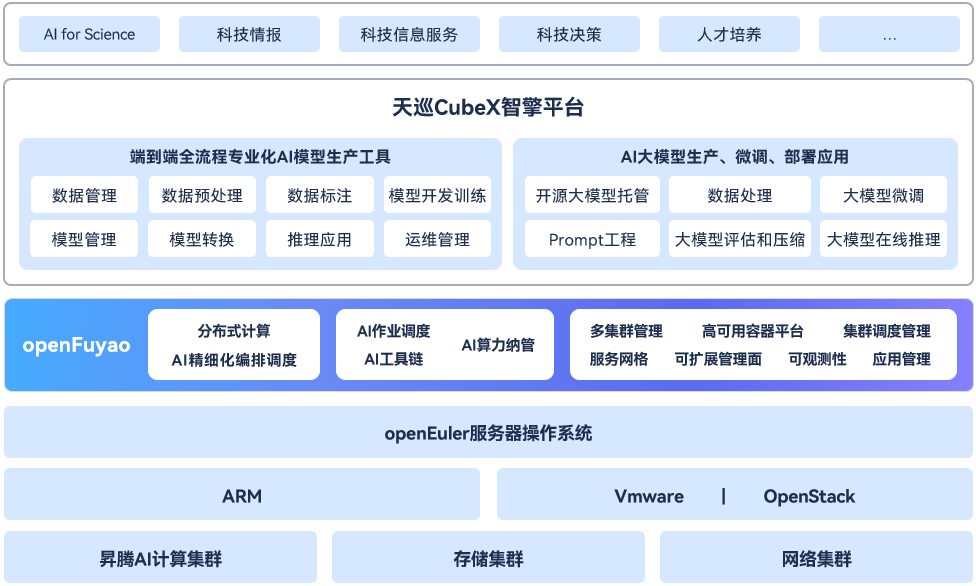

# 四川华鲲振宇智能科技有限责任公司

以openFuyao为底座的多样化算力AI一体机方案。

## 背景

客户为开展大模型的建设，保障训练质量与应用，需进行能够支撑大模型开发训练的人工智能平台建设，涵盖业务包括大规模数据采集接入及管理、数据标注，全流程AI模型训练及优化开发，并能够支撑智能应用在垂直领域的适配。

## 解决方案

## 应用价值

- 人工智能平台体系为客户提供了**端到端全流程专业化AI模型生产工具**，并且能够高效支撑**AI大模型部署、微调应用**。
- 通过平台的建设一方面使大模型项目更容易管理、部署和维护，大幅提高了资源的利用效率，为大模型研发与应用提供了可靠的管理基础平台；另一方面能够满足垂直领域的大模型研发需求，为客户开展科技情报相关服务提供**更高效、可控、安全的研究和开发环境**。

