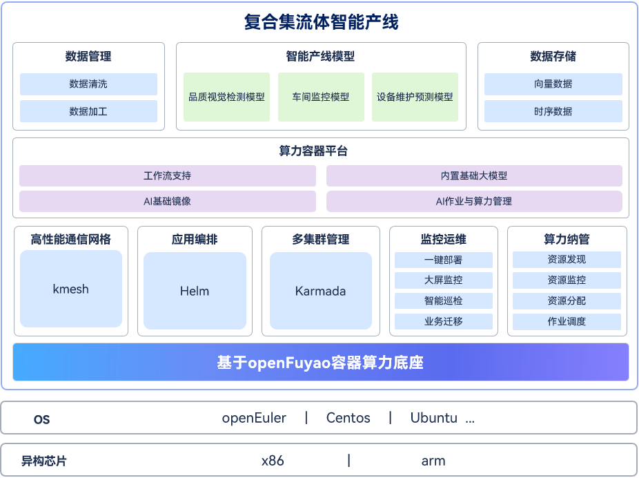

# 广州广电五舟科技股份有限公司

以openFuyao为算力底座，构建复合集流体智能产线系统，提升管理便捷性及算力效率。

## 背景

- 使用产线设备技术复杂
  1. 核心控制点多，流程繁杂。
  2. 识别核心控制因素和控制要求困难（从材料到工艺到设备等）。
- 识别问题困难
  1. 研发试验周期长，成本高。
  2. 开展创新的科学试验困难。

基于以上痛点，以openFuyao为底座，面向“以薄膜生产为代表”的先进制造产线行业，打造智能产线系统。

## 解决方案

基于openFuyao国产最强算力调度底座，算力，算法，数据三位一体，构建复合集流体智能产线系统。

- 聚合算力：集中管控，实现异地、异构资源池化。
- 运维智能化：一站式运维监控各种资源使用情况，集成Devops等。
- 调度算力：软件定义计算、网络、存储；实现算力统一调度与管理，智能调度。
- AI工具开箱即用：AI开发工具，AI大模型、算法以及AI工具开箱即用。

## 方案优势

通过容器平台的融合和管理能力，实现AI算力调度自动化、AI工具算法场景化，大大提升了构建复合集流体智能产线系统的便捷性，提升开发效率。

高效调度，一站式可视化管控：

- 支持x86、ARM、C86等通用CPU算力资源调度。
- 适配支持英伟达、华为昇腾、天数智芯等多个国内外主流厂家的GPU/NPU算力调度。
- 一卡多用，多元算力，GPU切分，满足训推一体的使用场景。
- 一站式异构资源以及可视化监控告警。

开发环境多样，生态开放：

- 基于生产级云原生容器openFuyao底座。
- 内置各种基础大模型，AI开发环境。

## 应用价值

- 基于国产架构训推一体化服务器，搭配基于openFuyao算力底座的解决方案，支撑产线大模型以及各种小模型，大大提升算力效率。
- 完美适配各种主流硬件，屏蔽多样性算力差异，加速/调度底层算力，使业务开发者更加关注业务开发，提升开发效率。