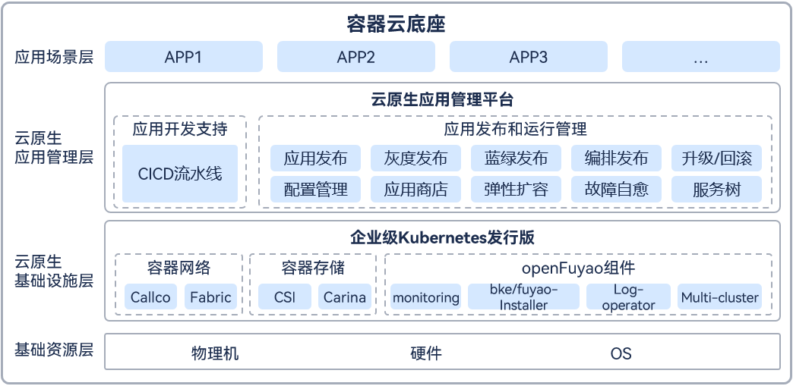
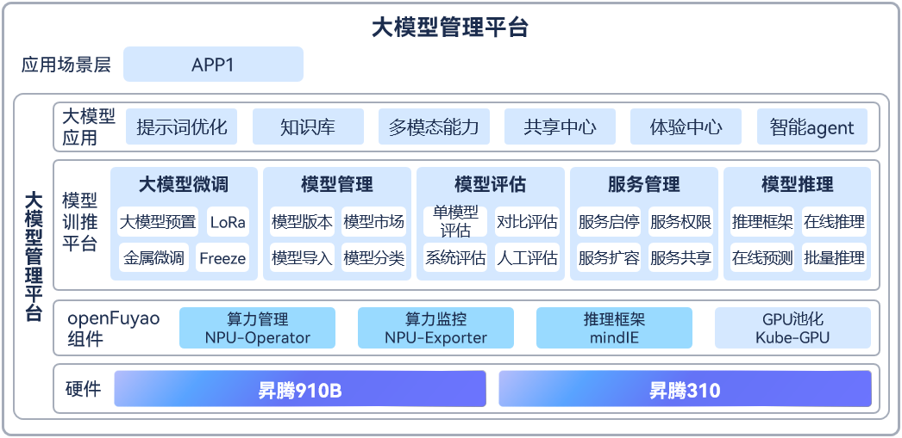

# 江苏博云科技股份有限公司

博云&openFuyao共建高性能算力容器平台，加速释放算力能力，实现应用快速落地。

## 背景

苏州农商行为应对不断升级的互联网业务系统，紧跟同行科技信息化建设的步伐，建设具有苏州农商银行特有金融架构特征的金融云平台变得尤为重要，需要建设能够稳定支撑金融级生产业务的高可用云平台，实现生产环境的业务迁云、应用快速迭代、业务高可用的需求，并为本行的大模型的微调、推理、管理、评估、服务等提供基础设施提供大模型管理服务能力支持。

## 解决方案

容器云底座

容器云平台，在易用性、容错性、弹性伸缩、负载均衡、监控告警等方面满足苏州农商行的生产标准，实现网络隔离、资源配额、日志收集、多租户、健康检查、监控告警等能力，保障来生产环境的高可用和安全性。加入CI/CD的流水线模块，加速应用持续化的部署和发布，满足应用快速迭代、快速发布上线的需求。

大模型管理平台

- 大模型管理服务平台，实现大模型的微调、推理、管理、评估、服务等。
- 构建昇腾NPU资源池，实现NPU资源按需动态调配。
- 910B训练，310卡推理，高低搭配。
- 统一的部署及运维，降低运维复杂度。

## 应用价值

- 降低人员技能要求，全面提升工作效率。
- 加速环境就绪，保证业务上线，将宝贵精力聚焦业务本身。
- 有效提升资源利用率，充分保障业务可用性。
- 多模型管理：统一管理多个不同类型、尺寸的大模型和小模型。
- 多NPU卡管理：统一管理和分配NPU卡。
- 模型微调：基于行内私有数据进行模型微调训练，支持多卡微调，提升训练效率。
- 模型部署：统一多模型部署上线流程，支持分布式推理和服务质量监测。