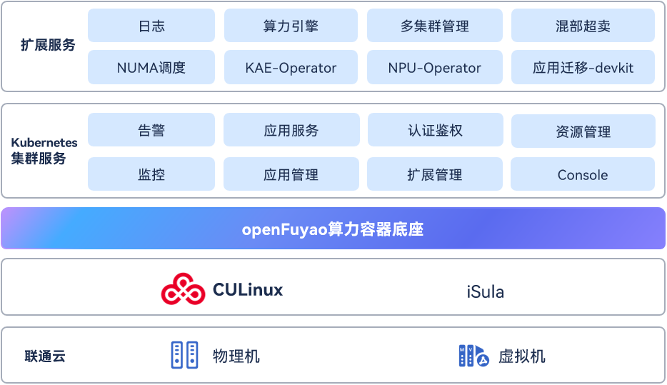

# 联通云

联通云&openFuyao共建在离线混部方案，显著提升资源利用率。

## 背景

在云原生场景下，企业面临两大核心挑战：

- 资源利用率低下：

在线业务（如Web服务、电商）存在显著的波峰波谷特征，波谷时段资源闲置率高达60%以上。

离线业务（如AI训练、大数据分析）资源需求持续高位，但服务质量（QoS）要求较低，资源预留与实际使用存在巨大差距。

- 业务隔离与时间聚合性矛盾：

传统Kubernetes集群采用业务分池部署策略，导致资源碎片化。

## 解决方案

CSK Turbo基于Rubik混部引擎和动态超卖技术，构建非侵入式资源优化体系：

1. 在离线混部架构：
   - 互补性调度：将离线业务填充至在线业务的波谷时段，实现集群CPU资源利用率提升30%， 内存资源利用率提升10%。
   - QoS保障机制：Rubik引擎通过单机资源编排、实时干扰检测、健康监控三大模块，抑制离线任务对在线业务的性能干扰。将Pod划分为在线（高QoS）、离线（低QoS）、超卖（动态复用）三级，通过准入控制器实现优先级隔离。
2. 动态资源超卖技术：
   - 预测算法驱动：基于历史数据构建资源画像，挖掘节点可超卖的CPU/内存资源，解决“资源时间聚合性”问题。
   - 定制调度器：根据超卖资源量调度低优先级Pod，突破传统静态资源分配限制。

## 应用价值

- 资源利用率跃升：CPU、内存利用率显著提升，降低硬件采购成本。
- 业务兼容性与稳定性：支持混合部署在线Web服务与离线AI训练，覆盖金融、AI推理等场景；通过实时健康检测与自动恢复机制，保障在线业务QoS抖动率低于1%。
- 运维效率优化：可插拔架构降低Kubernetes集群改造难度；动态超卖机制减少运维手动干预，降低运维成本 。
- 安全合规：通过内核级CPU/内存隔离、网络带宽压制等技术，满足金融级安全标准。