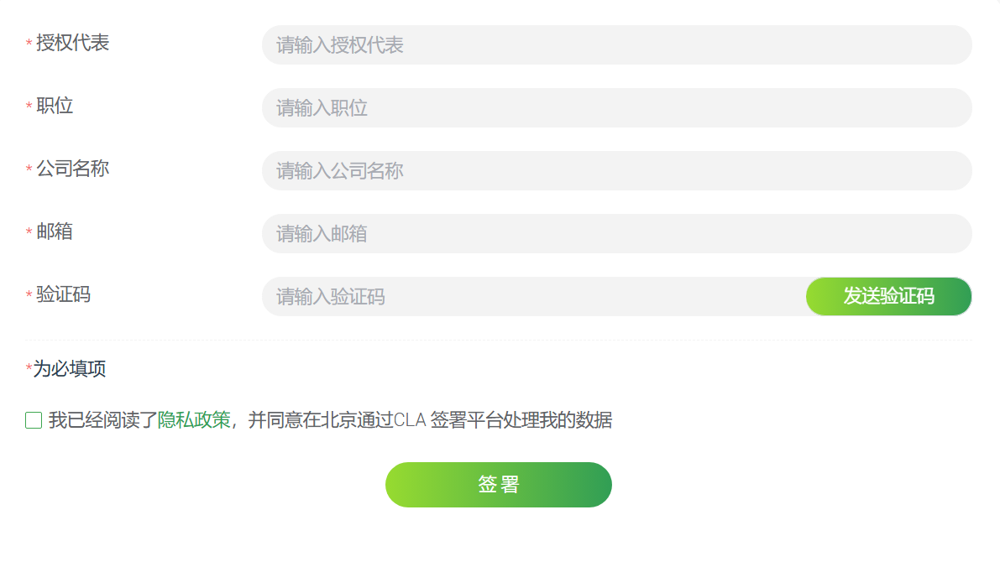
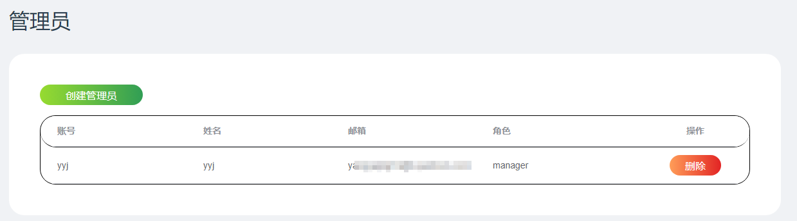
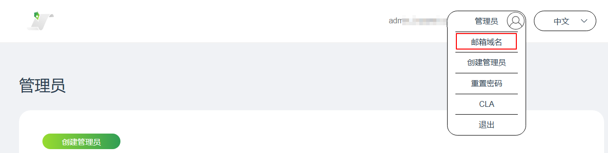
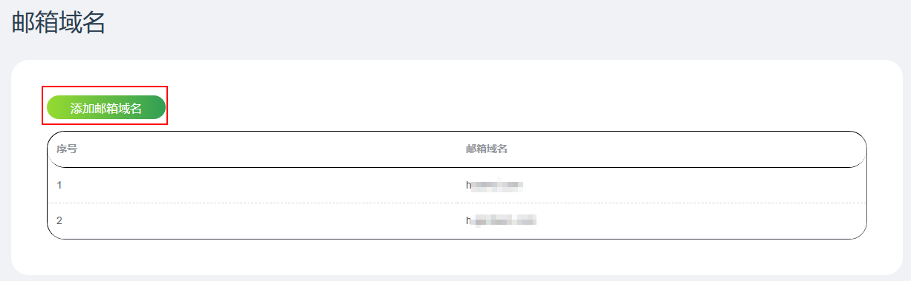
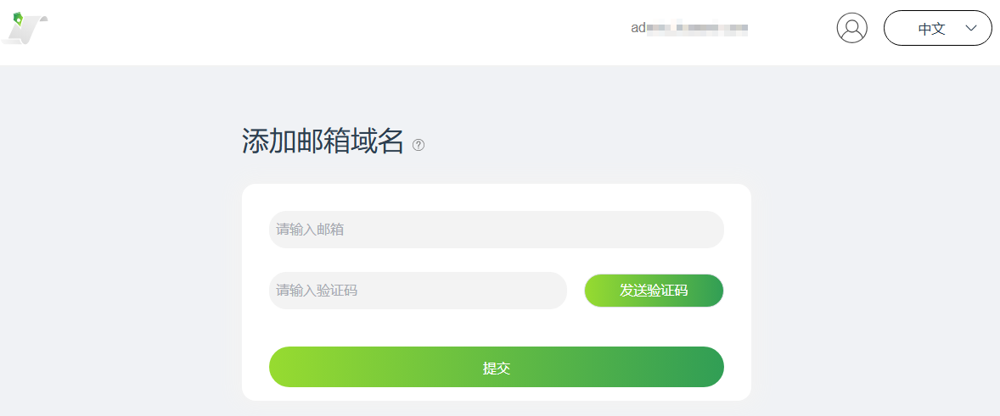
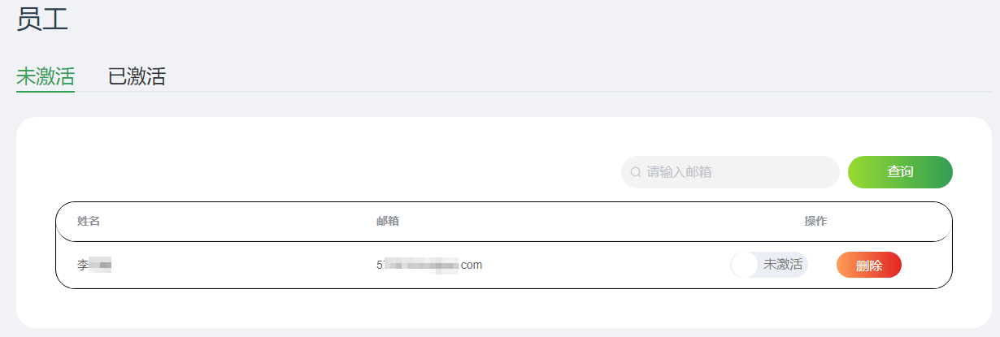
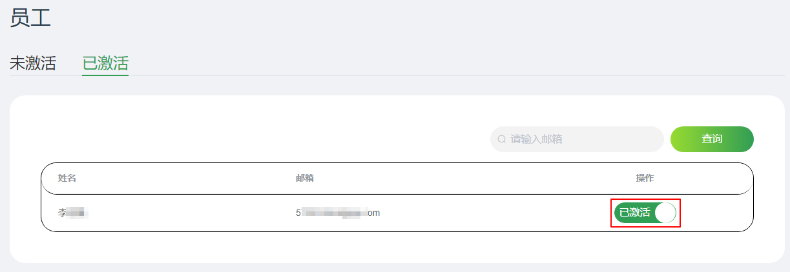
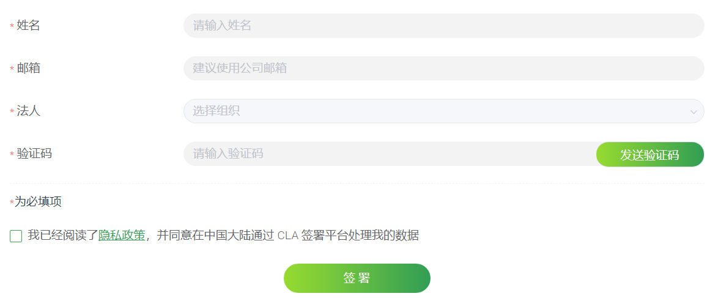

# 企业签署CLA，正式加入openFuyao社区

## 1 企业加入openFuyao社区为什么要签署CLA?

CLA，全称Contributor License Agreement，即贡献者许可协议。开发者向开源项目贡献时通常被要求需要签署CLA协议，声明对贡献内容拥有所有权（或开发者得到了正确的授权进行贡献），贡献内容在项目的License下进行再次分发，同时保留Copyright；如果贡献的内容包括了专利，开放这些专利给项目使用。

## 2 企业签署openFuyao社区CLA的流程

### 2.1 签署法人CLA

openFuyao社区CLA签署地址：<https://cla.openfuyao.cn/sign/67e7c745ea9ceaa8feb65567>

企业签署人在签署页面单击“**签署法人 CLA**”按钮进入到签署页面填写签署表单。填写完公司邮箱后，单击“发送验证码”，公司邮箱会受到一封包含验证码的邮件，填写完成后单击“签署”提交表单，此时已完成签署的第一步。

企业签署CLA的表单
 

### 2.2 上传CLA PDF文件

公司邮箱会收到一封带有PDF附件的邮件，PDF的内容包含了[步骤2.1](#签署企业CLA)签署法人CLA的内容。请打印PDF文件并加盖公司公章及骑缝章，将加盖公章的CLA协议文件扫描为PDF文件，作为邮件附件回复[cla@openfuyao.cn](mailto:cla@openfuyao.cn.cn)完成签署法人CLA。

### 2.3 登录超级管理员账号

openFuyao系统管理员收到邮件后，会对PDF进行核对检查。检查通过后开通企业员工CLA管理系统的超级管理员帐号，此时企业签署人会收到包含超级管理员的账号和密码的邮件。在签署页面单击“企业管理员”按钮，按照邮件信息登录成功即完成签署法人CLA（备注：初次登录时需要先修改密码）。

企业员工CLA贡献管理系统登录
 

### 2.4 创建CLA管理系统管理员账号

登录超级管理员后可以根据需要创建一个或多个CLA管理系统管理员账号。超级管理员账号可以管理CLA管理系统管理员账号，CLA管理系统管理员账号可以管理员工CLA的签署情况。当有员工签署CLA时，CLA管理系统管理员会收到邮件通知，届时可登录CLA管理系统通过或驳回员工的CLA签署。（备注：CLA管理系统超级管理员和CLA管理系统管理员都通过“企业管理员”入口登录，且初次登录时需要先修改密码。）

## 3 管理员在CLA管理系统管理企业员工

### 3.1 登录CLA管理系统

企业员工CLA管理系统登录地址为[https://cla.openfuyao.cn/sign/67e7c745ea9ceaa8feb65567](https://cla.openfuyao.cn/sign/67e7c745ea9ceaa8feb65567)，在该页面单击“企业管理员”。页面跳转至登录表单页，输入账号和密码，单击“登录”进入管理员页面。

### 3.2 超级管理员进入CLA管理系统

超级管理员进入系统后，需要创建系统管理员进行管理。超级管理员在CLA系统的主要工作是创建和删除系统管理员。当系统管理员被创建后，他会收到一封通知邮件。超级管理员和系统管理员的区别请参考[5.1](#openFuyao企业员工CLA管理系统的超级管理员和系统管理员的区别)。

超级管理员工作界面-创建或者删除系统管理员
 

### 3.3 超级管理员添加邮箱域名

超级管理员进入CLA系统后，可以添加不同的邮箱域名，方便员工使用与子邮箱域名相同的邮箱进行员工签署。

1. 右上角单击“邮箱域名”。
   
   

2. 邮箱域名列表左上角单击“添加邮箱域名”。
   
   

3. 输入邮箱地址并获取验证码，验证通过后即添加成功。
   
   

### 3.4 系统管理员进入CLA管理系统

系统管理员登录后会看到当前已经签署CLA且未激活的员工列表，根据实际情况选择激活员工向openFuyao社区贡献的权限或者删除员工的贡献请求。

企业员工未激活列表页面
 

在已经激活的员工列表界面，可以通过单击“操作”列的按钮将员工设为未激活的状态。

企业员工激活列表页面
 

## 4 企业员工贡献前要进行“法人贡献者登记”

### 4.1 法人贡献者登记

企业员工在该企业完成**签署法人CLA**后，正式贡献前需要进行**法人贡献者登记**。

openFuyao社区CLA签署地址：<https://cla.openfuyao.cn/sign/67e7c745ea9ceaa8feb65567>

企业签署人在签署页面单击“**法人贡献者登记**”按钮进入到签署页面填写签署表单。签署时需要使用企业邮箱。

企业员工签署CLA表单
 

### 4.2 CLA管理系统管理员激活员工贡献权限

企业员工签署后会自动通知企业的CLA管理系统管理员，由系统管理员决定该员工是否可以进行贡献。当激活或取消激活贡献权限时，员工会收到openFuyao系统的邮件通知。

## 5 openFuyao社区CLA系统相关问题

### 5.1 openFuyao企业员工CLA管理系统的超级管理员和系统管理员的区别

在openFuyao开源社区的企业员工CLA管理系统中存在两种管理员，分别是超级管理员和系统管理员。当企业CLA创建完成后，签署CLA使用的企业邮箱会收到超级系统管理员的帐号和初始密码，请尽快登录到系统修改初始化密码。

通常签署CLA的是公司的管理人员或者法务人员，通常并不进行开发者贡献管理工作。可以通过创建系统管理员来进行实际的管理工作。系统可以创建多名系统管理员，每名系统管理员都有相同的权限管理企业员工的贡献。

### 5.2 openFuyao社区对于Issue和CVE解决是否承诺SLA？

在openFuyao开源社区，所有的Issue和CVE解决都是由社区贡献者完成，是开源社区的贡献者共同解决，不存在商业行为，所以也不承诺SLA。

### 5.3 openFuyao企业CLA签署邮箱的使用

对于126.com、qq.com、gmail.com之类的通用个人邮箱是无法用于企业CLA的签署，但是对于个人开发者签署个人CLA是不受影响的。

### 5.4 是否需要法人签署企业CLA？

签署企业CLA的人是公司的授权代表，不一定使法人代表进行签字。
