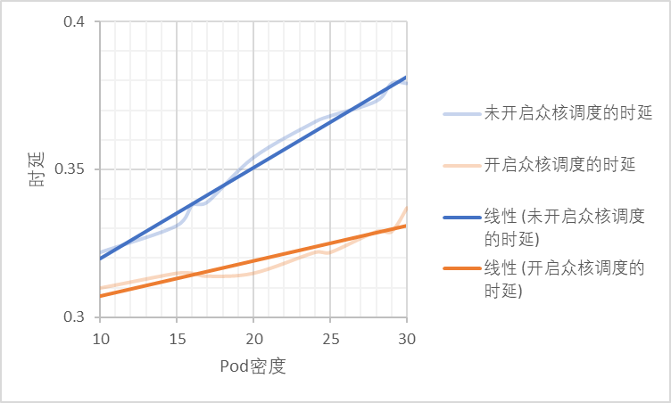
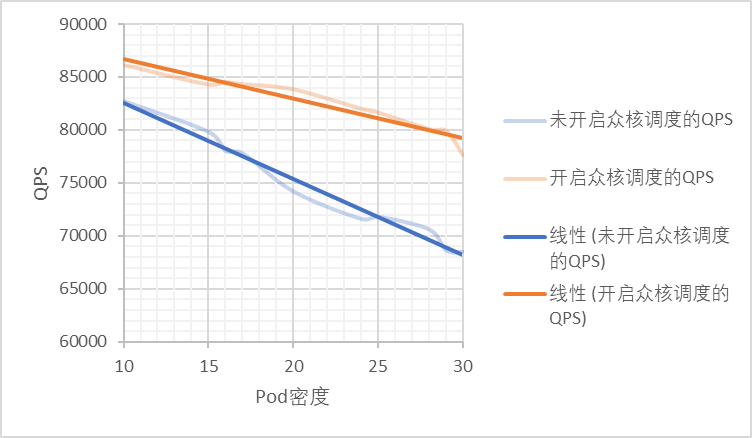

# openFuyao v25.06发布

## 众核高密调度新特性发布，两大存量特性重磅更新

2025年07月02日

openFuyao社区致力于构建面向多样化算力集群的开放软件生态，专注于推动云原生与AI原生技术的高效协同，促进有效算力的极致释放。社区发行版以模块化、轻量化、安全可靠为核心设计理念，基于开源的Kubernetes平台深度优化，提供开箱即用的容器化集群管理能力，涵盖资源编排、弹性伸缩、多维度监控等基础功能，满足企业级生产环境的运维需求。

发行版采用“核心平台+可插拔组件”架构，通过内置应用市场提供丰富的产业级高价值组件，覆盖智算/通算混合调度、异构资源统一管理、动态智能调度、端到端可观测性增强等关键能力。针对AI与大数据场景，集成算力亲和加速组件，显著提升数据密集型任务的执行效率。

openFuyao社区发行版通过“轻量核心+生态赋能”模式，助力企业快速构建高效、弹性、智能的算力基础设施，降低异构环境下的运维复杂度，为数字化转型提供敏捷支撑。

openFuyao社区发行版v25.06发布了众核高密调度这一新特性，同时对在离线混部与Cluster-API两大特性进行加强，以下介绍具体的特性新增与变动：

# 全新特性

## 众核高密集群层调度：256核及以上高密场景容器部署解决方案

面对众核高密场景下锁竞争激增、资源匹配失衡和部署密度瓶颈问题，支持在集群层感知业务类型，避免IO密集、内存敏感、算力敏感等同类业务部署在同一节点上。

众核高密集群层调度组件将感知众核拓扑，Pod资源调配策略优化，提升容器部署密度10%。

# 两大重磅更新

## 在离线混部：三级工作负载新定义，细粒度保障在线业务的同时优化资源利用率

在离线混部v25.06新增定义了HLS，LS，BE三级混部QoS保障服务质量，完善优先级抢占调度、在线业务的负载均衡调度、资源水位线驱逐等功能，并提供混部基础监控能力。

| QoS类型 |全称| 特点 | 场景 | 说明 |
|-------| --- | --- | ---- | --- |
| HLS   |High Latency Sensitive|对时延、稳定性有严格要求，不进行超卖，预留资源以获得更好的确定性|高要求在线业务|类似于社区的 Guaranteed，cpu核被绑定，在准入中要对cpu和mem的request和limit做检查，确保HLS标记的pod对应guarantee独占类型|
| LS    |LatencySensitive|共享资源，对突发流量有更好的弹性|在线业务|微服务工作负载的典型QoS级别，实现更好的资源弹性和更灵活的资源调整能力|
| BE    |Best Effort|共享资源，资源运行质量有限，在极端情况下被中断、驱逐|离线业务|批量作业的典型QoS水平，在一定时期内稳定的计算吞吐量，低成本资源，只使用超卖资源|

开启在离线混部，能够使QPS下降不超过5%的情况下，有效提升cpu与内存利用率**40%+**。

## Cluster-API：安装部署时间优化，操作系统兼容范围扩大

 - 安装效率上，Cluster-API v25.06优化安装部署工具，合并了引导节点与管理集群，提高openFuyao安装效率，开始安装至业务集群可用的耗时缩减40%；
 - 安装范围上，安装包及openFuyao最小集新增了对openEuler20.03 LTS、openEuler20.03 LTS SP3、openEuler24.03 LTS SP1的支持，大大扩展使用范围；
 - 易用性上，集群生命周期管理中新增了前置校验模块，对于已有集群的“新增节点”和新集群的“创建”，避免节点信息录入失误带来的安装失败，提升使用体验。

# 其他特性更新

 - openFuyao Ray：新增了Ray监控面板功能，方便用户查看集群健康信息
 - NPU Operator：新增了对离线场景下安装部署的支持

参考链接：[https://gitcode.com/openFuyao/docs/blob/openFuyao-v25.06/docs/2_%E5%8F%91%E8%A1%8C%E8%AF%B4%E6%98%8E/%E7%89%88%E6%9C%AC%E4%BB%8B%E7%BB%8D.md](https://gitcode.com/openFuyao/docs/blob/openFuyao-v25.06/docs/2_%E5%8F%91%E8%A1%8C%E8%AF%B4%E6%98%8E/%E7%89%88%E6%9C%AC%E4%BB%8B%E7%BB%8D.md)
