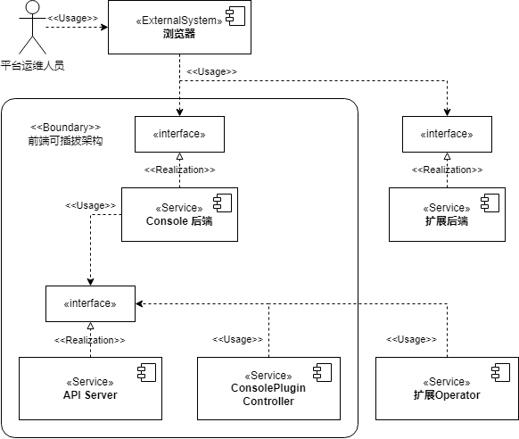
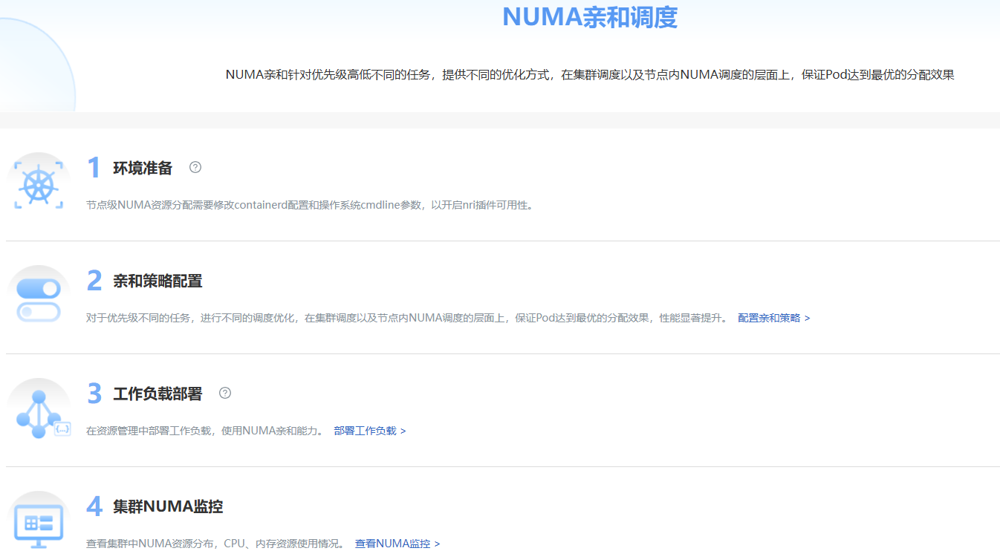
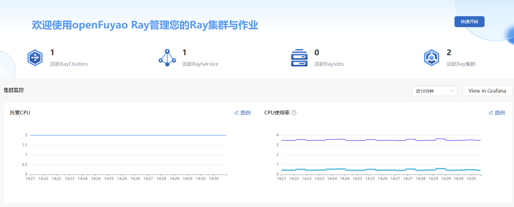
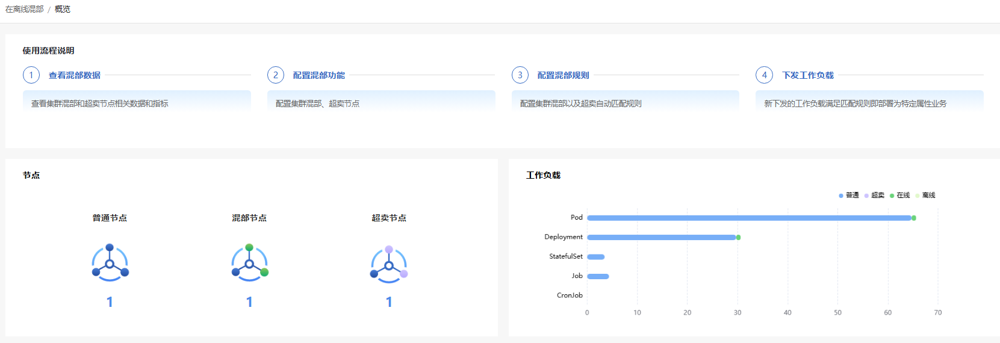

# **openFuyao正式发布，可插拔架构驱动云原生新生态**
## “核心+扩展”轻量化设计，从基础编排到异构算力调度
2025年05月23日

openFuyao社区致力于构建面向多样化算力集群的开放软件生态，专注于推动云原生与AI原生技术的高效协同，促进有效算力的极致释放。社区发行版以模块化、轻量化、安全可靠为核心设计理念，基于开源的Kubernetes平台深度优化，提供开箱即用的容器化集群管理能力，涵盖资源编排、弹性伸缩、多维度监控等基础功能，满足企业级生产环境的运维需求。

发行版采用“核心平台+可插拔组件”架构，通过内置应用市场提供丰富的产业级高价值组件，覆盖智算/通算混合调度、异构资源统一管理、动态智能调度、端到端可观测性增强等关键能力。针对AI与大数据场景，集成算力亲和加速组件，显著提升数据密集型任务的执行效率。

openFuyao社区发行版通过“轻量核心+生态赋能”模式，助力企业快速构建高效、弹性、智能的算力基础设施，降低异构环境下的运维复杂度，为数字化转型提供敏捷支撑。

openFuyao社区发行版v25.03作为openFuyao社区的首个版本,聚焦伙伴痛点，通过社区进行业务联创。下面就为大家详细解读openFuyao v25.03的关键特性.

## **可插拔架构：自由定义您的容器平台**
openFuyao社区发行版内置了资源编排、集群管理、应用管理、集群可观测性、用户权限管理等核心平台功能，在此基础上，openFuyao突破传统容器平台“大而全”的刚性设计，采用模块化架构：
- 能力插件化：除基础平台能力外，其余功能均通过扩展组件实现；
- 热插拔体验：无需重启集群，即可动态加载/卸载组件；
- 开放生态：上线应用市场，自由导入线上和本地应用；

## **NUMA亲和调度：让每一颗CPU都工作在最佳位置**
NUMA亲和调度让算力突破跨节点内存访问瓶颈，在集群级以及节点级实现硬件NUMA的拓扑感知，并基于NUMA亲和性对应用进行NUMA亲和调度，提升应用性能，平均吞吐率提升达30%
非统一内存访问（NUMA）架构减少了内存访问延迟，提高系统性能，同时增加了系统资源调度管理难度，openFuyao的NUMA亲和调度组件提供了调度器的统一管理能力。
NUMA资源监控可视化旨在通过直观的图形界面，实时展示系统中NUMA资源的分配和使用情况，多调度器兼容管理提供了统一的NUMA资源管理接口，支持Volcano等主流容器编排调度器。

## **openFuyao Ray：一站式Ray集群管理，提升算力利用率**
提供云原生场景下Ray的高易用、高性能、高算力利用率解决方案，支持Ray集群及作业的全生命周期管理，降低运维成本，并增强集群可观测性、故障定位与优化实践，实现高效的算力调度与管理。

## **NPU Operator：自动部署，云原生化管理**
实现分钟级昇腾NPU硬件的自动化管理能力，包含NPU硬件特征发现，驱动、固件、硬件设备插件、指标采集、集群调度等部件的自动化管理与安装能力，十分钟内完成NPU部署到可用。

## **在离线混部：提升集群资源利用率至30%~50%**
支持在线/离线业务混合部署，保障在线业务在使用高峰时期的调度与对离线业务的压制，同时使能离线业务在在线业务低谷时期使用超卖资源提升集群的资源利用率，利用率提高30%~50%，且QoS无明显影响，抖动低于5%。
在离线混部完整功能将于v25.06版本正式上线，敬请期待。

## **众核高密集群层调度：256核及以上高密场景容器部署解决方案**
面对众核高密场景下锁竞争激增、资源匹配失衡和部署密度瓶颈问题，支持在集群层感知业务类型，避免IO密集、内存敏感、算力敏感等同类业务部署在同一节点上。
众核高密集群层调度组件将感知众核拓扑，Pod资源调配策略优化，提升容器部署密度10%，完整功能同样将于v25.06版本正式上线。

参考链接：https://docs.openfuyao.cn/docs/%E5%8F%91%E8%A1%8C%E8%AF%B4%E6%98%8E/%E7%89%88%E6%9C%AC%E4%BB%8B%E7%BB%8D
