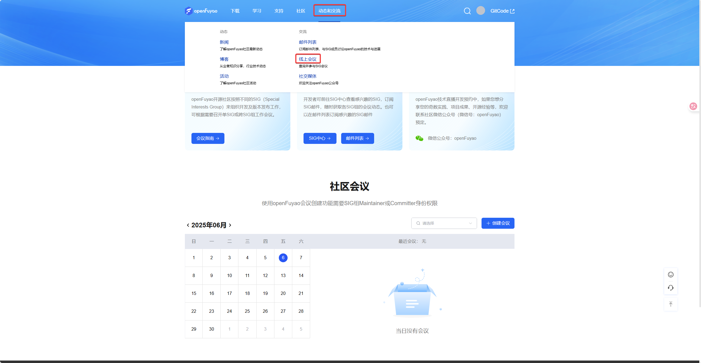
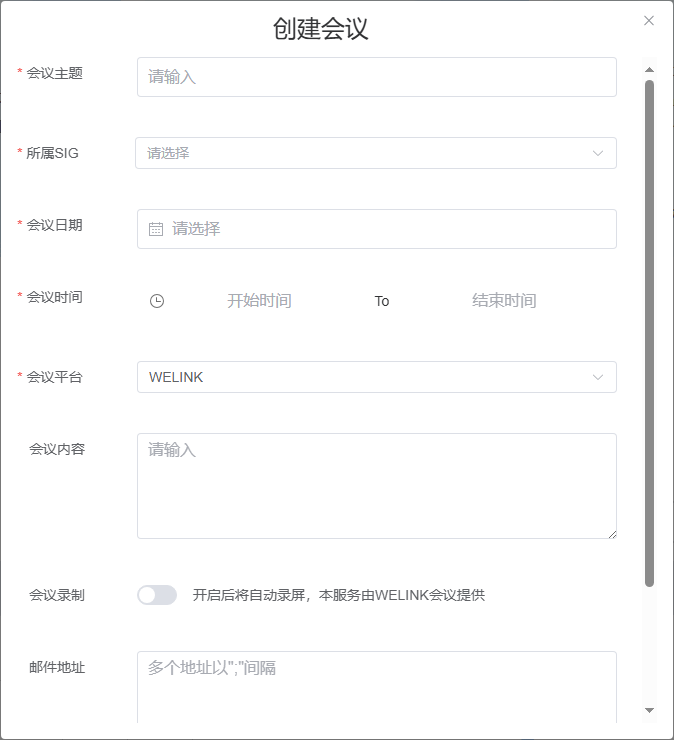
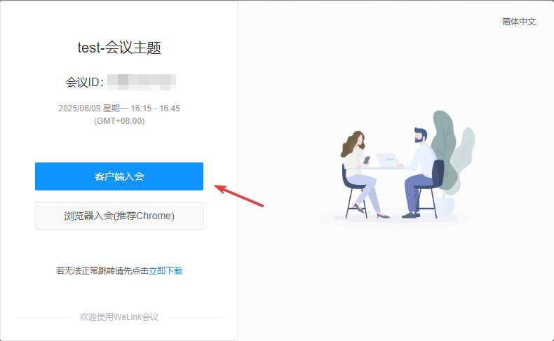

# openFuyao线上会议指南

openFuyao的线上会议功能位于官网的"动态和交流"选项卡中“线上会议”入口，也可在官网首页滚动至页面中部快速访问。

下面是会议模块的流程指引。

## 预定会议

如果您是openFuyao社区某个SIG的maintainer，并且有预定SIG会议的需求，您可以在openFuyao官网中预定该SIG的会议。在预定会议时，您可以选择是否自动录制会议，也可以选择要通知的邮箱或邮件列表（会议平台目前支持蓝版Welink）。预定会议后系统会自动为该会议生成一个便于会前交流和记录会议纪要etherpad（一款支持多人同时在线编辑文本的应用）地址。

## 加入会议

首先在加入会议前请确保您已在您的设备上安装了对应的第三方会议客户端。

为便于参会者快速进会，预定的会议会生成一个免密的参会地址，您可以快速地从openFuyao官网日历或会议邀请邮件中获取地址加入会议。

