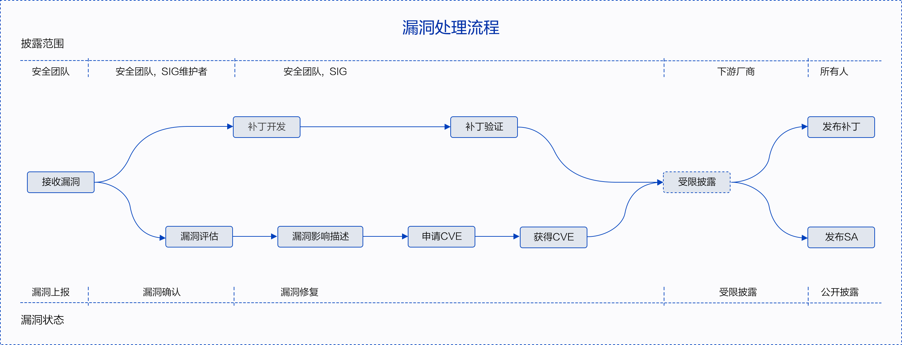

# 1 漏洞响应

openFuyao社区非常重视社区版本的安全性，openFuyao安全工作组负责接收、调查和披露openFuyao社区相关的安全漏洞。我们鼓励漏洞研究人员和行业组织主动将openFuyao社区的疑似安全漏洞报告给openFuyao社区安全工作组。我们会快速的响应、分析和解决上报的安全问题或安全漏洞。

## 1.1 支持版本

漏洞响应流程主要支持openFuyao社区官方发布的社区版本、LTS发行版本及其分支版本。

## 1.2 漏洞处理流程

每一个安全漏洞都会有一个指定的人员进行跟踪和处理，协调员是openFuyao安全工作组的成员，他将负责跟踪和推动漏洞的修复和披露。漏洞端到端的处理流程如下图。

漏洞处理流程图：

# 2 漏洞上报

如果您认为openFuyao产品存在一个疑似安全漏洞，我们希望您将漏洞上报给openFuyao社区，并与我们配合以负责人的方式修复和批露该问题。请参考疑似安全问题上报模板。

疑似安全问题上报模板：

| 内容     | 相关信息                                                     |
| -------- | ------------------------------------------------------------ |
| \* 上报人   |                                                              |
| \* 联系方式 |                                                              |
| &nbsp;&nbsp;组织信息 | 个人/团队/公司                                               |
| \* 版本信息 |                                                              |
| &nbsp;&nbsp;问题级别 | 致命问题/严重问题/一般问题                                   |
| \* 问题描述 |                                                              |
| &nbsp;&nbsp;发生场景 | 业务场景信息等                                               |
| &nbsp;&nbsp;影响范围 |                                                              |
| \* 详细信息 | 如果是已知公开漏洞，请提供CVE编号；如果是未公开问题，请提供攻击方法，攻击结果，并附上相关代码和日志说明等必要信息 |
| &nbsp;&nbsp;修复建议 |                                                              |

## 2.1 漏洞上报方式

您可以通过email将openFuyao产品的潜在安全漏洞发送到openFuyao安全团队邮箱。通用联系邮箱地址：[security-committee@list.openfuyao.cn](mailto:security-committee@list.openfuyao.cn)。因为漏洞信息比较敏感，为确保机密性，建议您使用[PGP公钥](https://gitcode.com/openFuyao/docs/blob/master/docs/docs/4_%E5%AE%89%E8%A3%85%E6%8C%87%E5%AF%BC/Installer%E8%84%9A%E6%9C%AC%E5%AE%89%E8%A3%85/%E5%AE%89%E8%A3%85%E5%8C%85%E5%AE%8C%E6%95%B4%E6%80%A7%E6%A0%A1%E9%AA%8C.md#前提条件)对邮件信息进行加密。

## 2.2 漏洞上报内容

为了便于快速的确认和验证疑似漏洞，请在漏洞上报邮件中包含但不限于以下内容：

- 基本信息：包括漏洞影响的模块、漏洞的触发条件和成功利用后对系统的影响等。
- 技术细节：包括系统配置、定位方法、Exploit的描述、POC、问题重现方法和步骤等。
- 修复方案建议。
- 上报者的组织和联系方式。
- 上报者可能的漏洞披露计划。

## 2.3 邮件响应时间

我们将在48小时内答复通过邮箱上报的疑似安全漏洞，并向上报者反馈漏洞处理的进展。

# 3 漏洞严重性评估

业界普遍使用CVSS标准评估漏洞的严重性，openFuyao在使用CVSS V3进行漏洞评估时，需要设定漏洞攻击场景，基于在该攻击场景下的实际影响进行评估。漏洞严重等级评估是指针对漏洞利用难易程度，以及利用后对机密性、完整性、可用性的影响进行评估，并生成一个评分值。

## 3.1 评估标准

openFuyao社区采用CVSS V3对漏洞进行评估，CVSS V3由通过对以下向量来评估一个漏洞的影响：

- 攻击向量（AV）-表示攻击的“远程性”以及如何利用此漏洞。
- 攻击复杂性（AC）-讲述攻击执行的难度以及成功进行攻击需要哪些因素。
- 用户交互（UI）-确定攻击是否需要用户参与。
- 所需的权限（PR）-记录成功进行攻击所需的用户身份验证级别。
- 范围（S）-确定攻击者是否可以影响具有不同权限级别的组件。
- 机密性（C）-衡量信息泄露给非授权方后导致的影响程度。
- 完整性（I）-衡量信息被篡改后导致的影响程度。
- 可用性（A）-衡量用户在需要访问数据或服务时受影响的程度。

## 3.2 评估原则

- 评估漏洞的严重等级，不是评估风险。
- 评估时必须基于攻击场景，且保证在该场景下，攻击者成功攻击后能对系统造成机密性、完整性、可用性影响。
- 当安全漏洞有多个攻击场景时，应以造成最大的影响，即CVSS评分最高的攻击场景为依据。
- 被嵌入调用的库存在漏洞，要根据该库在产品中的使用方式，确定漏洞的攻击场景后进行评估。
- 安全缺陷不能被触发或不影响CIA (机密性/完整性/可用性)，CVSS评分为 0 分。

## 3.3 评估步骤

对漏洞进行评估时，可根据下述步骤进行操作：

- 设定可能的攻击场景，基于攻击场景评分。
- 确定漏洞组件（Vulnerable Component）和受影响组件（Impact Component）。
- 选择基础评估指标的值：通过对可利用指标（攻击向量/攻击复杂度/所需权限/用户交互/范围）和受影响指标（机密性/完整性/可用性）给出漏洞影响评估。

## 3.4 严重等级划分

| **严重等级（Severity Rating）** | **CVSS评分（Score）** |
| ------------------------------- | --------------------- |
| 致命（Critical）                | 9.0 - 10.0            |
| 高（High）                      | 7.0 - 8.9             |
| 中（Medium）                    | 4.0 - 6.9             |
| 低（Low）                       | 0.1 - 3.9             |
| 无（None）                      | 0.0                   |

# 4 漏洞披露

为了保护openFuyao社区用户的安全，在进行调查、修复和发布安全公告之前， openFuyao社区不会公开披露、讨论或确认openFuyao产品的安全问题。安全漏洞修复后openFuyao社区会发布安全公告，安全公告内容包括该漏洞的技术细节、CVE编号、CVSS安全评分、严重性等级以及受到该漏洞影响的版本和修复版本等信息。安全公告提供邮件订阅功能，您可以订阅openFuyao社区的安全公告。我们也提供CVRF格式的安全公告。

