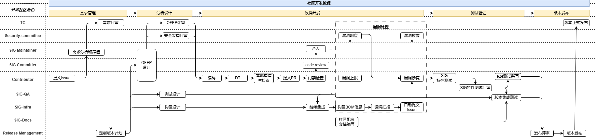

# openFuyao社区开发全流程

## 各阶段活动说明

| 阶段 | 活动          | 责任角色 | 操作指导 | 活动指导与流程 | 规范规则 | 质量出口要求 | 产出物及其模板 |
| --- |-------------| --- | --- | --- | --- | --- | --- |
| 需求管理 | 提交issue     | Contributor/SIG Committer | 社区建立工单机制，提供issue的基本功能讲解，并在代码托管平台中建设好相关的结构化模板填写内容，并说明配置项的用法： 1、社区Contributor依据社区规范将社区相关的需求、Bug、漏洞或问题与建议按照模板要求提交到对应的仓库； 2、社区Issue提交表单应包括负责人、标签、项目、里程碑、关联分支、计划开始/截止日期、置顶选项和优先级等内容； 3、基于社区Issue承载内容的分类（需求、Bug、漏洞、问题与建议）提供相应的模板，便于开发者准确的快速提交社区Issue； 4、社区Issue应支持多种标签，包括不限于Issue分类，处理状态、优先级等，便于基于标签进行任务跟踪和管理； 5、针对不同类型的Issue要制定相应的处理业务流程和个活动的检查点； 6、Issue要提供Issue规范性检查和自动将Issue派发给处理人等功能； 7、提供Issue状态管理的数字化看板功能； 8、提供Issue的操作说明文档和定制化模板； | [需求申请流程](https://gitcode.com/openFuyao/release-management/blob/main/Rules/%E9%9C%80%E6%B1%82%E7%94%B3%E8%AF%B7%E6%B5%81%E7%A8%8B.md) | [社区ISSUE规范](https://gitcode.com/openFuyao/community/blob/master/zh/openFuyao%E7%A4%BE%E5%8C%BAPR%E5%92%8CISSUE%E8%A7%84%E8%8C%83.md) | / | 社区issue |
| 需求管理 | 需求分析和筛选     | SIG Maintainer | 基于需求类issue的标签与社区bot的初始划分，SIG maintainer对issue进行审视： 1.确认issue的内容与当前SIG的责任田相关，若不相关，修改issue标签并移交至适当的SIG 2.对issue的原始需求进行分解，形成可以指导开发的需求列表，并在列表里与具体issue进行关联 3.对需求进行初步分析与评估，若需求类型为引入三方软件包/依赖，需参考第三方软件包/依赖引入评估规范。 4.修改issue标签，与issue提交者进行确认互动 5.组织会议提交需求列表、由TC进行需求评审 | / | / | / | [需求分解分配表（OFEP模板）](https://gitcode.com/openFuyao/ofep/blob/main/0000-ofep-template.md) |
| 需求管理 | 需求评审        | TC | TC组织需求评审会议，与Release Manager以及SIG Maintainer对分解的需求进行评审： 1.对需求的可行性、优先级、依赖性、关联风险等事项进行评审，给出评审意见 2.若需求未接纳，SIG Maintainer刷新关联issue状态，并就评审结果与意见与关联issue提交者进行传达沟通 3.若需求得到接纳，SIG Maintainer刷新关联issue状态，进行需求分配并整理设计文档，纳入版本计划 | [社区新开发功能流程（评审流程章节）](https://www.openfuyao.cn/zh/blogs/blogsList/openFuyao-community-new-function-development-process-specifications/) | / | / | 社区需求（OFEP）评审意见 |
| 分析设计 | OFEP(提案）设计  | SIG Maintainer/SIG Committer | SIG组长/Maintainer基于版本计划与需求列表，遵循社区设计原则设计： 1.软件架构设计方案，包含模块设计原则，支持的特性及演进路线、对外接口清单（ 包括API、命令行、配置文件、通信端口等内容） 2.在SIG内部通过会议、讨论版等社区共识机制达成共识 3.方案通过TC评审 | / | 架构/特性设计原则或规范（待建） [安全设计规范](https://gitcode.com/openFuyao/security-committee/blob/main/docs/zh/developer-guide/SecureDesign.md) [安全设计自检checklist](https://gitcode.com/openFuyao/security-committee/blob/main/docs/zh/developer-guide/secDesignCheck.md) 接口说明规范 | / | [设计方案（OFEP模板）](https://gitcode.com/openFuyao/ofep/blob/main/0000-ofep-template.md) |
| 分析设计 | OFEP评审      | TC | TC组织对OFEP设计方案进行评审。 评审基于社区设计原则，评审意见由SIG组修改优化后闭环 | [社区新开发功能流程（评审流程章节）](https://www.openfuyao.cn/zh/blogs/blogsList/openFuyao-community-new-function-development-process-specifications/) | / | / | 设计方案（OFEP）评审意见 |
| 分析设计 | 安全架构评审      | 安全SIG | 安全SIG组织对OFEP设计方案进行安全架构维度的评审 评审基于社区安全设计规范，评审意见由SIG组修改优化后闭环 | / | / | / | 安全架构评审意见 |
| 分析设计 | 测试设计        | SIG-QA | 在明确版本计划后，测试 SIG组长/Maintainer基于版本计划与需求列表，组织成员： 1.设计特性、版本测试策略，并设计特性、版本测试出口基线 2.设计开发特性、版本测试用例 3.测试策略通过TC评审 | 用例设计指导（待建）含用例级别、命名规范等 | [测试用例设计规范](https://gitcode.com/openFuyao/sig-qa/tree/master/docs/%E7%A4%BE%E5%8C%BA%E6%B5%8B%E8%AF%95%E7%94%A8%E4%BE%8B%E8%AE%BE%E8%AE%A1%E8%A7%84%E8%8C%83.md) [测试用例评审checklist](https://gitcode.com/openFuyao/sig-qa/blob/master/docs/%E6%B5%8B%E8%AF%95%E7%94%A8%E4%BE%8B%E8%AF%84%E5%AE%A1checklist.md) | / | [测试方案](https://gitcode.com/openFuyao/sig-qa/blob/master/Test_Template/v26.06-SIGXX-XX%E7%BB%84%E4%BB%B6-XX%E7%89%B9%E6%80%A7%E6%B5%8B%E8%AF%95%E6%96%B9%E6%A1%88%E6%A8%A1%E6%9D%BF.md) [测试用例](https://gitcode.com/openFuyao/sig-qa/blob/master/docs/%E6%B5%8B%E8%AF%95%E7%94%A8%E4%BE%8B%E6%A8%A1%E6%9D%BF.md) |
| 分析设计 | 构建设计        | SIG-Infra | 在明确版本计划后，SIG-infra组长/Maintainer基于版本计划与需求列表，组织成员： 1.审视现有构建环境及构建执行所需的软硬件资源是否满足版本需求，并设计修改构建环境 2.对构建工具、相关云服务进行选型 3.设计方案通过TC评审 | / | / | / | 社区构建环境 社区构建工具 |
| 软件开发与构建 | 编码          | Contributor | Contributor基于软件架构设计方案，遵循社区代码贡献规范进行代码贡献，通常包括： 1.参与issue讨论，在社区内通过社区共识机制设计特性实现方案 2.参考编码实践中社区开源合规规范章节，对license、copyright、片段引用等事项进行设计，并签署CLA(CCLA)/DCO（开源贡献者协议），确保源代码不存在开源合规风险 3.建立个人分支，遵循语言编码规范与安全编码原则完成代码开发 | / | 社区编码规范（2026待建） 软件工程质量要求最小集（待建） [安全编程指南](https://gitcode.com/openFuyao/security-committee/blob/main/docs/zh/developer-guide/SecurityCoding.md) [日志规范](https://gitcode.com/openFuyao/sig-qa/blob/master/docs/%E7%A4%BE%E5%8C%BA%E6%97%A5%E5%BF%97%E8%A7%84%E8%8C%83/%E7%A4%BE%E5%8C%BA%E6%97%A5%E5%BF%97%E8%A7%84%E8%8C%83.md) | / | 源代码 |
| 软件开发与构建 | DT          | Contributor | Contributor基于软件架构设计方案和代码实现，遵循开发者测试规范完成开发者测试用例设计且通过开发者测试。 | / | 软件工程质量要求最小集（待建） | / | DT测试用例 |
| 软件开发与构建 | 个人本地构建与检查   | Contributor | Contributor基于社区编译规范，完成： 1.本地编译与代码包构建，清理编译告警 2.进行代码检查，满足社区编码规范与安全编码原则 3.通过DT测试用例 4.进行代码开源合规检查，确保代码满足社区license规范与copyright遵循 | / | 编译规范（待建） | / | 软件目标程序 DT测试结果 |
| 软件开发与构建 | 提交PR        | Contributor | Contributor基于社区提交PR相关规范，完成： 1.（选择PR模板），基于代码实现目标，对提交代码关键信息（实现特性、bug修复、测试用例等）进行描述 2.关联对应issue 3.修改PR标签 4.（通过bot命令行），触发门禁检查 | [社区入门经验（提交PR章节）](https://www.openfuyao.cn/zh/blogs/blogsList/getting-started-with-openfuyao-open-source-community/) | [社区PR规范](https://gitcode.com/openFuyao/community/blob/master/zh/openFuyao%E7%A4%BE%E5%8C%BAPR%E5%92%8CISSUE%E8%A7%84%E8%8C%83.md) | / | 社区PR |
| 软件开发与构建 | 门禁检查        | Contributor | Contributor在PR触发门禁检查机制，完成： 1.检查PR里未通过门禁项细则，对代码进行修改 2.社区bot基于门禁检查进度，自动更新PR标签 3.CI/CD平台提供构建结果的反馈，并完成到对应PR/Commit的追溯 | [门禁机器人命令参考指导](https://gitcode.com/openFuyao/community/blob/master/zh/content/robot/%E7%A4%BE%E5%8C%BA%E5%91%BD%E4%BB%A4%E5%8F%82%E8%80%83%E6%96%87%E6%A1%A3.md) | [markdownlint检查规则](https://gitcode.com/openFuyao/docs/blob/master/contribute/zh/markdownlint-rules.md) 门禁说明（待建） 代码门禁要求（待建） | / | 门禁检查报告 |
| 软件开发与构建 | code review | SIG Committer | SIG Committer基于社区Code Review指南与架构设计方案，完成： 1.（同其他Contributor）完成对代码质量的检视，确认其达到社区代码贡献质量要求 2.审核代码设计是否满足架构设计方案，对DT测试报告、门禁检查报告进行确认 3.参考Maintainer、Committer操作指导书中代码贡献场景，对代码的License遵从风险进行评估确认 4.参考社区命令行，评论出具审核意见（例 /lgtm /approve），代码达到合入标准需要2个Committer出具审核意见 5.社区bot基于审核意见以及相关命令行驱动，合并代码进入代码仓主干，刷新PR及关联issue状态 | / | code review规范（待建） | / | 代码审核意见 |
| 软件开发与构建 | 合入          | SIG Maintainer/SIG Committer | 社区bot基于审核意见以及相关命令行驱动，合并代码进入代码仓主干，刷新PR及关联issue状态。代码达到合入标准需要2个Committer出具审核意见 | / | / | / | / |
| 软件开发与构建 | 持续集成        | SIG-Infra | 1. 根据发行时间表进行版本自动化构建、打包 2. 成功构建生成的版本放到版本服务器，可供测试SIG进行测试。 3. SIG-Infra组长/Maintainer负责将版本对应的代码、持续集成环境基线化，并验证一致性，跟踪管理构建规范的落地。 4. 持续集成报告包括：构建结果、静态检查结果（代码检查与代码度量）、DT结果、开源片段引用（scanoss）等。 5. 要求每日至少一次成功构建 | 构建系统配置&运行指导（待建） 流水线配置指导（待建） | [安全编译选项实施要求(Go)](https://gitcode.com/openFuyao/security-committee/blob/main/docs/zh/developer-guide/SecureCompile(Go).md) | / | 持续集成结果报告 |
| 软件开发与构建 | 构建BOM信息     | SIG-Infra | / | / | / | / | / |
| 软件开发与构建 | 漏洞扫描        | SIG-Infra | 1 选择业界常见的安全扫描引擎.如Trivy，Clair，Aqua Security等。 2 镜像扫描需要集成到持续集成/持续部署（CI/CD）流水线中，确保更新时都进行安全扫描。 3 定期的镜像安全扫描，并确保及时更新基础镜像和依赖项. 4 使用同一安全镜像作为base镜像，确保依赖一致，漏洞及时更新。 | / | / | / | 漏洞扫描结果 |
| 软件开发与构建 | 自动提交issue   | SIG-Infra | / | / | / | / | 社区issue |
| 软件开发与构建 | 漏洞上报        | Contributor | 1  内部上报：项目内成员提交ISSUE，添加“安全问题”标签。 2  外部上报：通过邮箱提交问题相关信息（openfuyao-security@list.openfuyao.cn） | [安全问题处理和发布流程（安全问题收集章节）](https://gitcode.com/openFuyao/security-committee/blob/main/docs/zh/vulnerability-management-process/security-process.md) [openFuyao安全和披露说明（漏洞上报要求章节）](https://gitcode.com/openFuyao/security-committee/blob/main/docs/zh/vulnerability-management-process/security-disclosure.md#%E4%B8%8A%E6%8A%A5%E6%BC%8F%E6%B4%9E) [CVE issue提交指导](https://gitcode.com/openFuyao/security-committee/blob/main/docs/zh/vulnerability-management-process/FAQ/%E5%A6%82%E4%BD%95%E6%8F%90%E4%BA%A4%E4%B8%80%E4%B8%AACVE%20issue.md) | / | / | [安全问题上报模板](https://gitcode.com/openFuyao/security-committee/blob/main/docs/zh/template/template-security-bug.md) [CVE上报模板](https://gitcode.com/openFuyao/security-committee/blob/main/docs/zh/template/template-cve-vulnerability.md) |
| 软件开发与构建 | 漏洞响应        | 安全SIG | 1  安全SIG联合特性SIG组，识别是否为新的安全问题。 2  提交安全ISSUE到对应的仓 3  对于外部上报的安全问题，确认后通知问题上报人。 | [安全问题处理和发布流程（安全问题确认章节）](https://gitcode.com/openFuyao/security-committee/blob/main/docs/zh/vulnerability-management-process/security-process.md) [openFuyao安全和披露说明（安全漏洞响应章节）](https://gitcode.com/openFuyao/security-committee/blob/main/docs/zh/vulnerability-management-process/security-disclosure.md#%E5%AE%89%E5%85%A8%E6%BC%8F%E6%B4%9E%E5%93%8D%E5%BA%94) | / | / | / |
| 软件开发与构建 | 漏洞修复        | Contributor | 1  成立问题修复团队人员，评估问题影响、制定问题响应说明、问题修复计划 2  申请CVE，并实施修复 | [安全问题处理和发布流程（修复团队/修复计划/修复开发章节）](https://gitcode.com/openFuyao/security-committee/blob/main/docs/zh/vulnerability-management-process/security-process.md) [漏洞严重性评估原则与步骤](https://gitcode.com/openFuyao/security-committee/blob/main/docs/zh/vulnerability-management-process/security-rating.md) | / | / | / |
| 软件开发与构建 | 漏洞披露        | 安全SIG | 1 （可选）联合release sig对发行商进行受限披露。 2  联合SIG-Docs将正式披露公告更新到社区页面。 | [安全问题处理和发布流程（修复披露章节）](https://gitcode.com/openFuyao/security-committee/blob/main/docs/zh/vulnerability-management-process/security-process.md) [进入受限披露列表标准](https://gitcode.com/openFuyao/security-committee/blob/main/docs/zh/vulnerability-management-process/private-distributors-list.md) | / | / | 漏洞公告 |
| 软件开发与构建 | 社区版本配套文档编写  | SIG-Docs | SIG-Docs组长/Maintainer基于版本计划，组织成员遵循社区文档编写规范，对版本配套文档进行编写及维护： 1.审视现有版本开发者文档与新增特性，维护刷新开发者文档 2.（运用工具）生成Release Notes，并基于社区文档编写规范进行修改完善 3.对历史文档进行版本管理 | [文档贡献指导](https://gitcode.com/openFuyao/docs/blob/master/contribute/zh/contributing_documents.md) [文档编写快速入门指导](https://gitcode.com/openFuyao/docs/blob/master/contribute/zh/quick_start.md) | [文档写作规范与门禁](https://gitcode.com/openFuyao/docs/blob/master/contribute/zh/writing_specifications_and_pr_checks.md) [markdownlint检查规则](https://gitcode.com/openFuyao/docs/blob/master/contribute/zh/markdownlint-rules.md) | / | 开源版本配套文档如： [OpenAPI 编写指南](https://gitcode.com/openFuyao/docs/blob/master/writing_template/API%E5%8F%82%E8%80%83%E5%86%99%E4%BD%9C%E6%A8%A1%E7%89%88.md) [开发指南](https://gitcode.com/openFuyao/docs/blob/master/writing_template/%E5%BC%80%E5%8F%91%E6%8C%87%E5%8D%97%E5%86%99%E4%BD%9C%E6%A8%A1%E6%9D%BF.md) [用户指南](https://gitcode.com/openFuyao/docs/blob/master/writing_template/%E7%94%A8%E6%88%B7%E6%8C%87%E5%8D%97%E5%86%99%E4%BD%9C%E6%A8%A1%E6%9D%BF.md) |
| 测试验证 | SIG特性测试     | Contributor | 特性SIG组长/Maintainer组织成员对持续集成构建版本进行特性测试： 1.对持续集成报告结果进行检视 2.基于版本发行计划与SIG计划，对特性进行测试验收 3.测试验收通过后，由特性/需求关联的SIG成员/社区bot与issue提交者进行沟通反馈，确认后修改issue标签，关闭对应issue | [社区协同测试指南](https://gitcode.com/openFuyao/sig-qa/blob/master/docs/%E7%A4%BE%E5%8C%BA%E5%8D%8F%E5%90%8C%E6%B5%8B%E8%AF%95%E6%8C%87%E5%8D%97.md) [缺陷类issue提交与处理流程](https://gitcode.com/openFuyao/sig-qa/blob/master/docs/%E7%A4%BE%E5%8C%BA%E7%89%88%E6%9C%ACissue%E5%88%9B%E5%BB%BA%E5%A4%84%E7%90%86%E6%B5%81%E7%A8%8B%E4%B8%8E%E8%A7%84%E8%8C%83/%E7%A4%BE%E5%8C%BA%E7%89%88%E6%9C%ACissue%E5%88%9B%E5%BB%BA%E5%A4%84%E7%90%86%E6%B5%81%E7%A8%8B%E4%B8%8E%E8%A7%84%E8%8C%83.md) [社区测试设计指南](https://gitcode.com/openFuyao/sig-qa/blob/master/docs/%E7%A4%BE%E5%8C%BA%E6%B5%8B%E8%AF%95%E8%AE%BE%E8%AE%A1%E6%8C%87%E5%8D%97.md) | / | [特性转测验收checklist](https://gitcode.com/openFuyao/sig-qa/blob/master/docs/%E8%BD%AC%E6%B5%8B%E9%AA%8C%E6%94%B6checklist.md) | [xx SIG组特性测试报告](https://gitcode.com/openFuyao/sig-qa/blob/master/Test_Template/XX%E7%89%88%E6%9C%ACXX%E7%89%B9%E6%80%A7%E6%B5%8B%E8%AF%95%E6%8A%A5%E5%91%8A%E6%A8%A1%E6%9D%BF.md) 社区issue |
| 测试验证 | SIG特性测试评审   | SIG-QA | SIG-QA组织审视SIG特性测试报告，重点关注测试充分性、特性质量和关键遗留问题。SIG的测试报告结论需要作为SIG-QA版本测试报告的输入 | / | / | / | / |
| 测试验证 | 版本集成测试      | SIG-QA | SIG-QA组长启动版本集成测试，重点验证系统级集成测试、跨SIG组的特性验证。 1.基于制定的版本测试策略，组织成员对构建成功版本软件以及配套文档进行质量评估，并综合SIG组的特性验证情况，输出版本测试报告。 2.Release Manager基于版本发布标准，确认版本质量达到质量、漏洞修复、病毒扫描、完整性、合规等各方面的发布标准 | [社区协同测试指南](https://gitcode.com/openFuyao/sig-qa/blob/master/docs/%E7%A4%BE%E5%8C%BA%E5%8D%8F%E5%90%8C%E6%B5%8B%E8%AF%95%E6%8C%87%E5%8D%97.md) [缺陷类issue提交与处理流程](https://gitcode.com/openFuyao/sig-qa/blob/master/docs/%E7%A4%BE%E5%8C%BA%E7%89%88%E6%9C%ACissue%E5%88%9B%E5%BB%BA%E5%A4%84%E7%90%86%E6%B5%81%E7%A8%8B%E4%B8%8E%E8%A7%84%E8%8C%83/%E7%A4%BE%E5%8C%BA%E7%89%88%E6%9C%ACissue%E5%88%9B%E5%BB%BA%E5%A4%84%E7%90%86%E6%B5%81%E7%A8%8B%E4%B8%8E%E8%A7%84%E8%8C%83.md) 一致性认证机制（待建） | 安全测试规范（待建） | / | 版本测试报告 社区issue |
| 版本发布 | 发布评审        | SIG-Release Management | Release Manager组织评审会议，与TC以及各SIG组长/Maintainer对版本发布进行评审： 1.参考版本测试报告，对质量、安全、合规各方面进行评审，确保其满足社区版本发布标准 2.出具发布评审意见 | 版本发布评审规范（待建） | / | / | 社区版本发布评审意见 |
| 版本发布 | 版本发布        | SIG-Release Management | Release Manager基于版本发行计划，参考发布流程指南： 1.对构建版本进行打tag标签 2.根据社区需求，上传二进制包、容器镜像等形式软件包，更新社区文档 3.在社区发布公告，开展后续运营活动 | / | 特性发布成熟度管理规范 | [社区版本发布质量标准](https://gitcode.com/openFuyao/sig-qa/blob/master/docs/%E7%A4%BE%E5%8C%BA%E8%B4%A8%E9%87%8F%E6%A0%87%E5%87%86.md) [版本发布网络安全质量要求](https://gitcode.com/openFuyao/security-committee/blob/main/docs/zh/developer-guide/SecureRelease.md) [特性上车质量要求](https://gitcode.com/openFuyao/sig-qa/blob/master/docs/%E7%BB%84%E4%BB%B6%E4%B8%8A%E8%BD%A6%E7%89%B9%E6%80%A7%E8%B4%A8%E9%87%8F%E8%A6%81%E6%B1%82.md) | 社区版本发布公告 软件目标程序 开源版本配套文档 |
| 其他 | 安全          | / | / | [社区安全保障策略总纲](https://gitcode.com/openFuyao/security-committee/blob/main/security-strategy-overview.md) [安全问题处理和发布流程](https://gitcode.com/openFuyao/security-committee/blob/main/docs/zh/vulnerability-management-process/security-process.md) [openFuyao安全和披露说明](https://gitcode.com/openFuyao/security-committee/blob/main/docs/zh/vulnerability-management-process/security-disclosure.md#%E4%B8%8A%E6%8A%A5%E6%BC%8F%E6%B4%9E) | / | / | / |
| 其他| 测试          | / | / | [社区开发者测试贡献指南](https://gitcode.com/openFuyao/sig-qa/blob/master/%E7%A4%BE%E5%8C%BA%E5%BC%80%E5%8F%91%E8%80%85%E6%B5%8B%E8%AF%95%E8%B4%A1%E7%8C%AE%E6%8C%87%E5%8D%97.md)  [测试体系说明](https://gitcode.com/openFuyao/sig-qa/blob/master/%E7%A4%BE%E5%8C%BA%E6%B5%8B%E8%AF%95%E4%BD%93%E7%B3%BB%E4%BB%8B%E7%BB%8D.md)| / | / | / |
| 其他 | 社区提案        | / | / | [oFEP 生命周期流程和状态说明](https://gitcode.com/openFuyao/ofep/blob/main/ofeps/sig-top/ofep-0001-%E7%A4%BE%E5%8C%BA%E5%88%9D%E5%A7%8B%E4%B8%9A%E5%8A%A1%E8%8C%83%E5%9B%B4%E4%BB%A5%E5%8F%8A%E4%BB%A5%E6%8F%90%E6%A1%88%E4%B8%BA%E8%BD%BD%E4%BD%93%E7%9A%84%E7%A4%BE%E5%8C%BA%E6%8A%80%E6%9C) | / | / | / |
