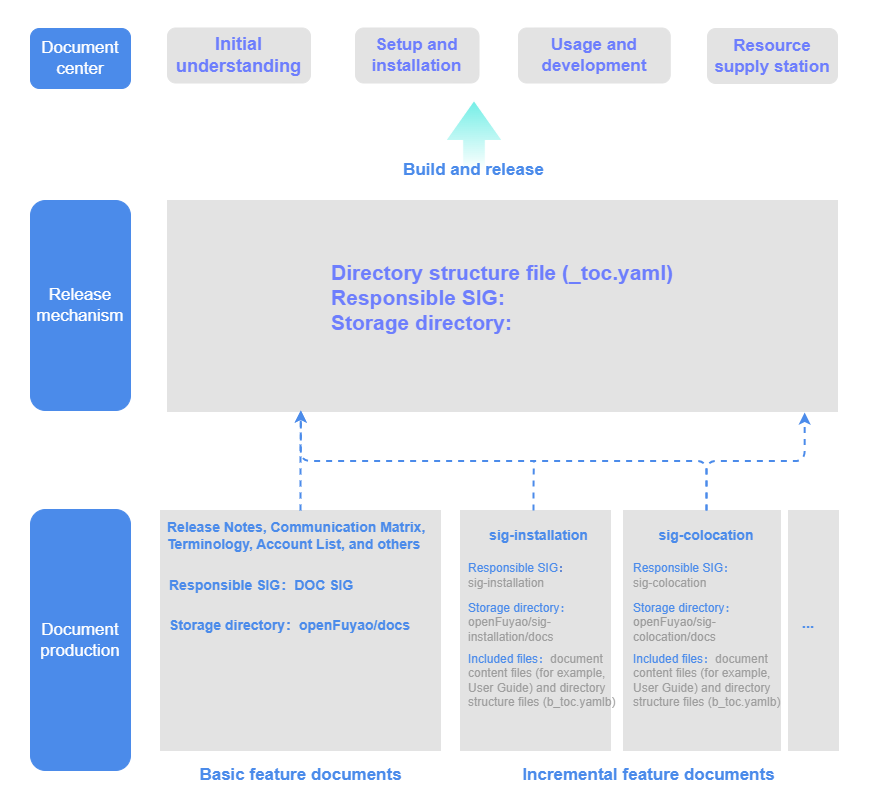

# Document Organization Structure

## Introduction

This document describes the production and release process of openFuyao documents and the organization structure of document repositories, and provides the specific storage location of each manual in a document repository.



The preceding figure shows the production and release mechanism of openFuyao documents.

- The official website categorizes community documents into: legal statement, release notes, quick start, installation and deployment management (cluster installation, application/component installation, cluster scaling, cluster upgrade, cluster uninstallation), management plane operations, feature user guide, feature developer guide, and reference.
- Release mechanism:
    - The official website configuration files are stored in the openFuyao/docs repository and centrally managed by the DOC SIG.
    - The responsible SIG of each document must add the document directory structure file reference to the corresponding directory structure file so that the document can be displayed on the official website document page.
- Document production:
    - openFuyao documents are produced in the openFuyao/docs repository and the docs repositories of each SIG.
    - Basic feature documents, such as release notes, appendix - communication matrix, appendix - resource acquisition, and appendix - account list, are stored in the openFuyao/docs repository and produced and maintained by the DOC SIG.
    - Incremental feature documents, such as sig-installation and sig-colocation, are the responsibility of the SIG that owns the feature and are stored in the docs repositories of each SIG.
    - Each SIG maintains the following files in its document repository: document content files and directory structure files (_toc.yaml). Document content files store the actual content of documents, and directory structure files maintain the chapter presentation structure of documents.


```text
├─docs     <!-- Documents released on the official website -->
│  ├─en    <!-- English documents -->
│  └─zh    <!-- Chinese documents -->
```

## Directory Structure Description of Document Repositories

### Directory Structure of docs Repositories

The directory structure of the document repository is planned by document category as shown in the following example:

```text
├─docs
│  ├─en
│  └─zh
│      ├─legal_statement                   <!-- Level-1 directory: Legal Statement -->
│      ├─release_note                      <!-- Level-1 directory: Release Notes -->
│      ├─getting_started                   <!-- Level-1 directory: Quick Start -->
|      ├─cluster_installation_guide        <!-- Level-1 directory: Cluster Installation -->
|      ├─app_installation_guide            <!-- Level-1 directory: Application/Component Installation -->
|      ├─cluster_scaling                   <!-- Level-1 directory: Cluster Scaling -->
|      ├─upgrade_guide                     <!-- Level-1 directory: Cluster Upgrade -->
|      ├─uninstallation_guide              <!-- Level-1 directory: Cluster Uninstallation -->
│      ├─management_plane_operations       <!-- Level-1 directory: Management Plane Operations -->
│      ├─user_guide                        <!-- Level-1 directory: Feature User Guide -->
│      ├─developer_guide                   <!-- Level-1 directory: Feature Developer Guide -->
│      ├─appendixes                        <!-- Level-1 directory: Reference -->
│      └─_toc.yaml          
```

Some level-1 directories are further divided into level-2 directories.

- Taking the "Cluster Installation" level-1 directory as an example, it is further divided into level-2 directories: cluster installation is divided into read before installation, environment preparation, bootstrap cluster custom configuration (optional), bootstrap cluster installation, management/business cluster custom configuration (optional), management cluster installation (not applicable for small-scale deployment), business cluster installation, appendix, etc.
  
- Taking the "Environment Preparation" level-2 directory as an example, it is further divided into specific .md documents, such as: installation notice, environment pre-check, and security tool download and verification.

The directory structure of cluster installation is as follows:

```text
├─docs
│  ├─en
│  └─zh
│     ├─cluster_installation_guide                                   <!-- Level-1 directory: Cluster Installation -->
│     │  ├─read_before_installation                                  <!-- Level-2 directory: Read Before Installation -->
│     │  │  ├─XX.md                                                  <!-- Manual: XX manual name -->
│     │  ├─environment_preparation                                   <!-- Level-2 directory: Environment Preparation -->
│     │  │  ├─before_you_start.md                                    <!-- Manual: Installation Notice -->
│     │  │  └─environment_pre_check_tool_guide.md                    <!-- Manual: Environment Pre-check -->
│     │  │  └─installation_package_integrity_verification.md         <!-- Manual: Installation Tool Download and Verification -->
│     │  ├─boostrap_cluster_configuration                            <!-- Level-2 directory: Bootstrap Cluster Custom Configuration (optional) -->
│     │  │  ├─XX.md                                                  <!-- Manual: XX manual name -->
│     │  ├─boostrap_cluster_installation                             <!-- Level-2 directory: Bootstrap Cluster Installation -->
│     │  │  ├─XX.md                                                  <!-- Manual: XX manual name -->
│     │  ├─service_management_cluster_configuration                  <!-- Level-2 directory: Management/Business Cluster Custom Configuration (optional) -->
│     │  │  ├─XX.md                                                  <!-- Manual: XX manual name -->
│     │  ├─management_cluster_installation                           <!-- Level-2 directory: Management Cluster Installation (not applicable for small-scale deployment) -->
│     │  │  ├─XX.md                                                  <!-- Manual: XX manual name -->
│     │  ├─service_cluster_installation                              <!-- Level-2 directory: Business Cluster Installation -->
│     │  │  ├─XX.md                                                  <!-- Manual: XX manual name -->
│     │  ├─appendix                                                  <!-- Level-2 directory: Appendix -->
│     │  │  ├─XX.md                                                  <!-- Manual: XX manual name -->
│     |  └─_toc.yaml
```

### Directory Structure of docs Repositories for SIGs

The directory structure of each SIG's document repository, using sig-colocation as an example, is as follows:

```text
├─docs
│  ├─en
│  └─zh
│     ├─user_guide                                           <!-- Level-1 directory: User Guide -->
│     │  ├─colocation.md                                     <!-- Manual: Colocation -->
│     │  ├─figures                                           <!-- Images: Storage location of images for User Guide -->
│     |  └─_toc.yaml 
│     ├─developer_guide                                      <!-- Level-1 directory: Developer Guide -->
│     │  ├─colocation_development_guide.md                   <!-- Manual: Colocation Development Guide -->
│     │  ├─figures                                           <!-- Images: Storage location of images for Developer Guide -->
│     |  └─_toc.yaml 
│     ├─api_reference                                        <!-- Level-1 directory: API Reference -->
│     │  ├─colocation_api_reference.yaml                     <!-- Manual: Colocation API Reference -->
│     |  └─_toc.yaml
```

### Document Directory Structure Specifications of SIGs

#### Constraints

- Documents are version-specific. Each version of openFuyao has its own dedicated documentation.
- After documents are released, they will be continuously updated, such as correcting basic errors and content omissions.
- Each SIG is responsible for maintaining feature documents and must clearly understand the distribution of features in each version.
- Each SIG independently plans documents and clearly distinguishes documents to be released on the official website from those to be displayed only in the code repository.
- Each SIG maintains documents with manuals as the minimum unit (for example, the "Colocation" manual under "User Guide"). A single manual cannot be split for storage. A single repository can contain multiple manuals.
- You can directly view the document content in the GitCode repository, and the display effect is the same as the final display.

#### Requirements

Regardless of how each SIG organizes documents, if the documents need to be released on the official website, the following conditions must be met:

- Create the docs directory in the root directory of the repository, and store the Chinese and English documents to be released on the official website in the zh/ and en/ directories under the docs directory. The structure is as follows:

    ```text
    ├─docs
    |  ├─zh
    |  └─en                                       
    ```
    
    > **Note:**<br>
    > - Documents stored in docs/zh and docs/en are documents to be released to the document center on the official website. They must pass through the documentation pipeline before being merged.
    >
    > - For documents that only need to be displayed in the repository and do not need to be released on the official website, they cannot be stored in the preceding directories. You can create other directories under docs/ to store them.

- In the openFuyao/docs repository, find the corresponding _toc.yaml file and add the document index address in the specified format:

   upstream: Enter the index address of the manual directory configuration file (_toc.yaml).
   path (optional, default value is "./repository name"): Set the URL access path of the manual.
    
- Documents must strictly correspond to the features of the current version. Unreleased features or functions must not be included.
- Long-term update and maintenance of documents must be supported to ensure that historical version documents remain accurate and complete after a new version of openFuyao is released.

## Formats of Directory Structure Files

### Document-Category Directory Structure File

A _toc.yaml file is configured for each directory level and each manual. The level-1 directory file is as follows:

```text
label: Document Home Page
sections:
  - label: Legal Statement
    href: ./legal_statement.md
  - label: Release Notes
    href: ./release_notes/_toc.yaml
  - label: Quick Start
    href: 
      upstream: https://gitcode.com/openFuyao/sig-installation/blob/master/docs/en/quick_start/quick_start.md
      path: ./
  - label: Cluster Installation
    href: 
      upstream: https://gitcode.com/openFuyao/sig-installation/blob/master/docs/en/cluster_installation_guide/_toc.yaml
      path: ./cluster_installation_guide
  - label: Application/Component Installation
    href: 
      upstream: https://gitcode.com/openFuyao/sig-installation/blob/master/docs/en/app_installation_guide/_toc.yaml
      path: ./app_installation_guide
  - label: Cluster Scaling
    href: 
      upstream: https://gitcode.com/openFuyao/sig-installation/blob/master/docs/en/cluster_scaling/_toc.yaml
      path: ./cluster_scaling
  - label: Cluster Upgrade
    href: 
      upstream: https://gitcode.com/openFuyao/sig-installation/blob/master/docs/en/upgrade_guide/_toc.yaml
      path: ./upgrade_guide
  - label: Cluster Uninstallation
    href: 
      upstream: https://gitcode.com/openFuyao/sig-installation/blob/master/docs/en/cluster_uninstallation/_toc.yaml
      path: ./cluster_uninstallation
  - label: Management Plane Operations
    href: ./management_plane_operations/_toc.yaml
  - label: Feature User Guide
    href: ./user_guide/_toc.yaml
  - label: Feature Developer Guide
    href: ./developer_guide/_toc.yaml
  - label: Reference
    href: ./appendixes/_toc.yaml
```

### Directory Structure Files of Manuals

Each level of directory needs to maintain a directory structure file _toc.yaml to maintain the logical relationship between directories and manuals.

1. The _toc.yaml file for the same repository, using the "Release Notes" level-1 directory as an example, is as follows:

   ```yaml
   label: Release Notes
   sections:
     - label: Release Notes
       href: ./release_notes.md
     - label: Introduction
       href: ./introduction.md
     - label: User Notice
       href: ./user_notice.md
   ```

   - sections:
       - label: manual name.
       - href: document content file address (relative path recommended).
    
2. The _toc.yaml file for cross-repository documents, using the "Feature User Guide" level-1 directory as an example, is as follows:
    
    ```yaml
    label: Feature User Guide
    sections:
        - label: KAE Operator
          href: ./kae_operator.md
        - label: NPU Operator
          href: ./npu_operator.md
        - label: AI Inference Hermes Routing
          href: 
            upstream: https://gitcode.com/openFuyao/sig-ai-inference/blob/main/docs/en/ai_inference_hermes_routing/user_guide/ai_inference_hermes_routing.md
            path: ./
    ```

      - label: level-1 directory name.
      - sections:
        - label: manual name.
        - href: directory configuration file reference of the manual.
          - upstream (only for incremental feature documents): directory configuration file reference of the incremental feature manual.

3. The _toc.yaml configuration file of a SIG docs repository, using the NUMA-aware Scheduling Development Guide of sig-numa-affinity as an example:
    
    ```yaml
    label: NUMA-aware Scheduling Development Guide
    href: ./numa-aware_scheduling_development_guide.md
    ```

## Document Storage Locations
 
 openFuyao documents are stored in the [openFuyao/docs](https://gitcode.com/openFuyao/docs) repository and the document/source code repositories of each SIG. The following provides the specific storage location of each type of manual in the document repository.

| Manual Category | Storage Location |
| --- | --- |
| Legal Statement | TBD |
| Release Notes | [openFuyao/docs/tree/master/docs/en/release_notes](../../docs/en/release_notes) |
| Quick Start | [openFuyao/sig-installation/tree/master/docs/en/quick_start](https://gitcode.com/openFuyao/sig-installation/blob/master/docs/en/quick_start/quick_start.md) |
| Cluster Installation | [openFuyao/sig-installation/tree/master/docs/en/cluster_installation_guide](https://gitcode.com/openFuyao/sig-installation/tree/master/docs/en/cluster_installation_guide) |
| Application/Component Installation | [openFuyao/sig-installation/tree/master/docs/en/app_installation_guide](https://gitcode.com/openFuyao/sig-installation/tree/master/docs/en/app_installation_guide) |
| Cluster Scaling | [openFuyao/sig-installation/tree/master/docs/en/cluster_scaling](https://gitcode.com/openFuyao/sig-installation/tree/master/docs/en/cluster_scaling) |
| Cluster Upgrade | [openFuyao/sig-installation/tree/master/docs/en/upgrade_guide](https://gitcode.com/openFuyao/sig-installation/tree/master/docs/en/upgrade_guide) |
| Cluster Uninstallation | [openFuyao/sig-installation/tree/master/docs/en/cluster_uninstallation](https://gitcode.com/openFuyao/sig-installation/tree/master/docs/en/cluster_uninstallation) |
| Management Plane Operations | [openFuyao/docs/tree/master/docs/en/management_plane_operations](../../docs/en/management_plane_operations) |
| Feature User Guide | [openFuyao/docs/tree/master/docs/en/user_guide](../../docs/en/user_guide/) |
| Feature Developer Guide | [openFuyao/docs/tree/master/docs/en/developer_guide](../../docs/en/developer_guide/) |
| Reference | [openFuyao/docs/tree/master/docs/en/appendixes](../../docs/en/appendixes/) |
