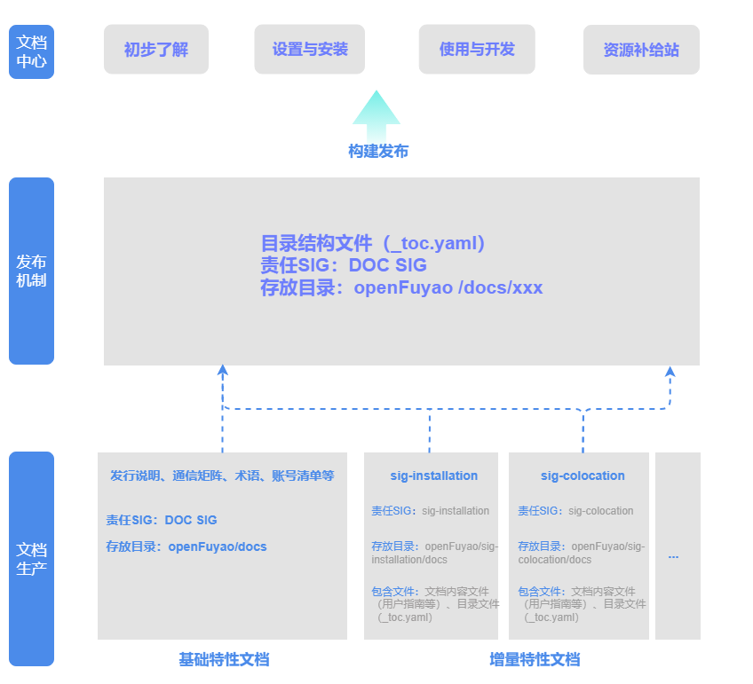

# 文档组织架构

## 介绍

本文介绍openFuyao文档的生产发布流程与文档仓的组织架构，同时提供每本手册在文档仓中的具体存放位置。



openFuyao文档的生产发布机制如上图所示。

- 官网将社区文档按法律声明、发行说明、快速入门、安装部署管理（集群安装、应用/组件安装、集群扩缩容、集群升级、集群卸载）、管理面操作、特性用户指南、特性开发指南、参考等进行划分。
- 发布机制：
    - 官网配置文件均存于openFuyao/docs仓，由DOC SIG集中管理。
    - 各文档的责任SIG需将文档目录结构文件引用，添加到对应的目录结构文件中，使文档可在官网文档页下呈现。
- 文档生产：
    - openFuyao的文档生产在openFuyao/docs仓以及各SIG组的docs仓中进行。
    - 基础特性文档，如发行说明、附录-通信矩阵、附录-资源获取、附录-账号清单等，均存在openFuyao/docs仓，由DOC SIG生产并维护。
    - 增量特性文档，如sig-installation、sig-colocation等，责任主体为特性所属的SIG组，分别存放在各SIG组的docs仓内。
    - 各SIG在文档仓中维护的文件包括：文档内容文件和目录结构文件（_toc.yaml）。其中，文档内容文件用来存放文档实际内容，文档目录结构文件用来维护文档章节呈现结构。


```text
├─docs     <!-- 在官网发布的文档 -->
│  ├─en    <!-- 英文文档 -->
│  └─zh    <!-- 中文文档 -->
```

## 文档仓目录结构说明

### DOCS仓目录

文档仓相关目录结构按照文档大类规划示例如下：

```text
├─docs
│  ├─en
│  └─zh
│      ├─legal_statement                   <!-- 一级目录：法律声明 -->
│      ├─release_note                      <!-- 一级目录：发行说明 -->
│      ├─getting_started                   <!-- 一级目录：快速入门 -->
|      ├─cluster_installation_guide        <!-- 一级目录：集群安装 -->
|      ├─app_installation_guide            <!-- 一级目录：应用/组件安装 -->
|      ├─cluster_scaling                   <!-- 一级目录：集群扩缩容 -->
|      ├─upgrade_guide                     <!-- 一级目录：集群升级 -->
|      ├─uninstallation_guide              <!-- 一级目录：集群卸载 -->
│      ├─management_plane_operations       <!-- 一级目录：管理面操作 -->
│      ├─user_guide                        <!-- 一级目录：特性用户指南 -->
│      ├─developer_guide                   <!-- 一级目录：特性开发指南 -->
│      ├─appendixes                        <!-- 一级目录：参考 -->
│      └─_toc.yaml          
```

部分一级目录会进一步细分出二级目录。

- 以“集群安装”一级目录为例，其下进一步划分出二级目录：如集群安装分为安装前必读、环境准备、引导集群自定义配置（可选）、安装引导集群、管理/业务集群自定义配置（可选）、安装管理集群（小规模部署不涉及）、安装业务集群、附录等。
  
- 以“环境准备”二级目录为例，其下进一步划分出具体md文档，如：安装须知、环境前置检查、安全工具下载及校验。

集群安装的目录结构示例如下：

```text
├─docs
│  ├─en
│  └─zh
│     ├─cluster_installation_guide                                   <!-- 一级目录：集群安装 -->
│     │  ├─read_before_installation                                  <!-- 二级目录：安装前必读 -->
│     │  │  ├─XX.md                                                  <!-- 手册：XX手册名称 -->
│     │  ├─environment_preparation                                   <!-- 二级目录：环境准备 -->
│     │  │  ├─before_you_start.md                                    <!-- 手册：安装须知 -->
│     │  │  └─environment_pre_check_tool_guide.md                    <!-- 手册：环境前置检查 -->
│     │  │  └─installation_package_integrity_verification.md         <!-- 手册：安装工具下载及校验 -->
│     │  ├─boostrap_cluster_configuration                            <!-- 二级目录：引导节点自定义配置（可选） -->
│     │  │  ├─XX.md                                                  <!-- 手册：XX手册名称 -->
│     │  ├─boostrap_cluster_installation                             <!-- 二级目录：安装引导集群 -->
│     │  │  ├─XX.md                                                  <!-- 手册：XX手册名称 -->
│     │  ├─service_management_cluster_configuration                  <!-- 二级目录：管理/业务集群自定义配置（可选） -->
│     │  │  ├─XX.md                                                  <!-- 手册：XX手册名称 -->
│     │  ├─management_cluster_installation                           <!-- 二级目录：安装管理集群（小规模部署不涉及） -->
│     │  │  ├─XX.md                                                  <!-- 手册：XX手册名称 -->
│     │  ├─service_cluster_installation                              <!-- 二级目录：安装业务集群 -->
│     │  │  ├─XX.md                                                  <!-- 手册：XX手册名称 -->
│     │  ├─appendix                                                  <!-- 二级目录：附录 -->
│     │  │  ├─XX.md                                                  <!-- 手册：XX手册名称 -->
│     |  └─_toc.yaml
```

### 各SIG组DOCS仓目录

文档仓各SIG组目录结构，以sig-colocation为例如下：

```text
├─docs
│  ├─en
│  └─zh
│     ├─user_guide                                           <!-- 一级目录：用户指南 -->
│     │  ├─colocation.md                                     <!-- 手册：在离线混部 -->
│     │  ├─figures                                           <!-- 图片：用户指南图片存放位置 -->
│     |  └─_toc.yaml 
│     ├─developer_guide                                      <!-- 一级目录：开发指南 -->
│     │  ├─colocation_development_guide.md                   <!-- 手册：在离线混部开发指南 -->
│     │  ├─figures                                           <!-- 图片：开发指南图片存放位置 -->
│     |  └─_toc.yaml 
│     ├─api_reference                                        <!-- 一级目录：API参考 -->
│     │  ├─colocation_api_reference.yaml                     <!-- 手册：在离线混部API参考 -->
│     |  └─_toc.yaml
```

### SIG组文档目录结构规范

#### 约束

- 分版本写文档，openFuyao各版本均有独立配套文档。
- 文档发布后仍会持续更新，如修正低级错误、内容错漏等问题。
- 各SIG组负责维护特性文档，要求各SIG清晰掌握特性在各版本中的分布情况。
- 各SIG组自主规划文档，明确区分发布至官网的文档和仅在代码仓展示的文档。
- SIG组维护文档以手册为最小单元（如用户指南《在离线混部用户指南》），单本手册不得拆分存储，同一仓库可容纳多本手册。
- 所见即所得，在GitCode仓库可直接查看文档内容，呈现效果与最终展示一致。

#### 要求

无论各SIG如何组织文档，如果文档要发布至官网，需要满足如下条件：

- 在仓库根目录下创建docs目录，并在docs目录下的zh/和en/目录中存放需发布至官网的中英文文档，结构如下：

    ```text
    ├─docs
    |  ├─zh
    |  └─en                                       
    ```
    
    > **说明：**<br/>
    > - 存放于docs/zh和docs/en下的文档均为发布至官网文档中心的文档，必须通过文档流水线，才能合入。
    >
    > - 若文档仅在仓库内展示、无需发布至官网，不可存放于上述目录，可在docs/下创建其他目录存放。

- 在openFuyao/docs仓库中，找到对应的 _toc.yaml 文件，并按照指定格式添加文档的索引地址：

   upstream：填写手册的目录配置文件（_toc.yaml）索引地址。
   path（可选，默认值是“./仓库名”）：设置手册的url访问路径。
   
- 文档须严格对应当前版本特性，禁止包含未发布的特性或功能。
- 支持文档的长期更新维护，确保openFuyao新版本发布后，历史版本文档仍保持准确完整。

## 目录结构文件格式

### 文档大类目录结构文件

各层级目录、每本手册均配置一个`_toc.yaml`文件，文档一级目录文件如下：

```text
label: 文档页
sections:
  - label: 法律声明
    href: ./legal_statement.md
  - label: 发行说明
    href: ./release_notes/_toc.yaml
  - label: 快速入门
    href: 
      upstream: https://gitcode.com/openFuyao/sig-installation/blob/master/docs/zh/quick_start/quick_start.md
      path: ./
  - label: 集群安装
    href: 
      upstream: https://gitcode.com/openFuyao/sig-installation/blob/master/docs/zh/cluster_installation_guide/_toc.yaml
      path: ./cluster_installation_guide
  - label: 应用/组件安装
    href: 
      upstream: https://gitcode.com/openFuyao/sig-installation/blob/master/docs/zh/app_installation_guide/_toc.yaml
      path: ./app_installation_guide
  - label: 集群扩缩容
    href: 
      upstream: https://gitcode.com/openFuyao/sig-installation/blob/master/docs/zh/cluster_scaling/_toc.yaml
      path: ./cluster_scaling
  - label: 集群升级
    href: 
      upstream: https://gitcode.com/openFuyao/sig-installation/blob/master/docs/zh/upgrade_guide/_toc.yaml
      path: ./upgrade_guide
  - label: 集群卸载
    href: 
      upstream: https://gitcode.com/openFuyao/sig-installation/blob/master/docs/zh/cluster_uninstallation/_toc.yaml
      path: ./cluster_uninstallation
  - label: 管理面操作
    href: ./management_plane_operations/_toc.yaml
  - label: 特性用户指南
    href: ./user_guide/_toc.yaml
  - label: 特性开发指南
    href: ./developer_guide/_toc.yaml
  - label: 参考
    href: ./appendixes/_toc.yaml
```

### 手册的目录结构文件

每一级目录都需要维护一个目录结构文件`_toc.yaml`来维护目录及手册间的逻辑关系。

1. 同一个仓库的文档以《发行说明》一级目录为例，`_toc.yaml`文件示例如下：

   ```yaml
   label: 发行说明
   sections:
     - label: 发行说明
       href: ./release_notes.md
     - label: 简介
       href: ./introduction.md
     - label: 用户须知
       href: ./user_notice.md
   ```

   - sections：
       - label：手册名称。
       - href：文档内容文件地址（建议使用相对路径）。
   
2. 跨仓库的文档以《特性用户指南》一级目录为例，`_toc.yaml`文件示例如下：
   
    ```yaml
    label: 特性用户指南
    sections:
        - label: KAE Operator
          href: ./kae_operator.md
        - label: NPU Operator
          href: ./npu_operator.md
        - label: AI推理赫尔墨斯路由
          href: 
            upstream: https://gitcode.com/openFuyao/sig-ai-inference/blob/main/docs/zh/ai_inference_hermes_routing/user_guide/ai_inference_hermes_routing.md
            path: ./
    ```

      - label：一级目录名称。
      - sections：
        - label：手册名称。
        - href：手册的目录配置文件引用。
          - upstream（仅增量特性文档）：增量特性手册的目录配置文件引用。

3. sig组docs仓的`_toc.yaml`配置文件，以sig-numa-affinity中NUMA亲和调度用户指南为例：
    
    ```yaml
    label: NUMA亲和调度开发指南
    href: ./numa-aware_scheduling_development_guide.md
    ```

## 文档存放地址
 
 openFuyao文档存储于[openFuyao/docs](https://gitcode.com/openFuyao/docs)仓和各SIG的文档/源码仓。以下为您提供每类手册在文档仓中的具体存放地址。

| 手册类别 | 存放地址 |
| --- | --- |
| 法律声明 | 内容2 |
| 发行说明 | [openFuyao/docs/tree/master/docs/zh/release_notes](../../docs/zh/release_notes) |
| 快速入门 | [openFuyao/sig-installation/tree/master/docs/zh/quick_start](https://gitcode.com/openFuyao/sig-installation/blob/master/docs/zh/quick_start/quick_start.md) |
| 集群安装 | [openFuyao/sig-installation/tree/master/docs/zh/cluster_installation_guide](https://gitcode.com/openFuyao/sig-installation/tree/master/docs/zh/cluster_installation_guide) |
| 应用/组件安装 | [openFuyao/sig-installation/tree/master/docs/zh/app_installation_guide](https://gitcode.com/openFuyao/sig-installation/tree/master/docs/zh/app_installation_guide) |
| 集群扩缩容 | [openFuyao/sig-installation/tree/master/docs/zh/cluster_scaling](https://gitcode.com/openFuyao/sig-installation/tree/master/docs/zh/cluster_scaling) |
| 集群升级 | [openFuyao/sig-installation/tree/master/docs/zh/upgrade_guide](https://gitcode.com/openFuyao/sig-installation/tree/master/docs/zh/upgrade_guide) |
| 集群卸载 | [openFuyao/sig-installation/tree/master/docs/zh/cluster_uninstallation](https://gitcode.com/openFuyao/sig-installation/tree/master/docs/zh/cluster_uninstallation) |
| 管理面操作 | [openFuyao/docs/tree/master/docs/zh/management_plane_operations](../../docs/zh/management_plane_operations) |
| 特性用户指南 | [openFuyao/docs/tree/master/docs/zh/user_guide](../../docs/zh/user_guide/) |
| 特性开发指南 | [openFuyao/docs/tree/master/docs/zh/developer_guide](../../docs/zh/developer_guide/) |
| 参考 | [openFuyao/docs/tree/master/docs/zh/appendixes](../../docs/zh/appendixes/) |

