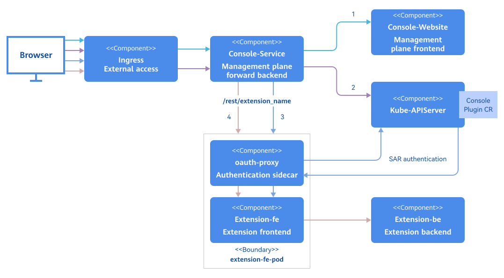

# Authentication and Authorization Development Guide

## Feature Overview

openFuyao provides a unified user login authentication service and supports the standard Open Authorization 2.0 (OAuth 2.0) login process. The current version uses an internal username and password identity provider for user authentication and authorization. In future versions, third-party authentication providers will be introduced to enable automatic user access. After a user logs in to openFuyao, the user's access to Kubernetes API server resources and openFuyao components depends on the Role-Based Access Control (RBAC) authorization mechanism of Kubernetes.

In addition, openFuyao can integrate frontend and backend applications developed by developers through the generic and easily extensible architecture. If developers want to integrate their applications into the entire authentication and authorization system of openFuyao, they can use the oauth-proxy component. As a sidecar container, oauth-proxy intercepts the requests sent to the frontend application of a user. The requests are allowed only after OAuth 2.0 authentication and RBAC authentication are successful, thereby enabling the authentication and authorization of the extension.

- Basic user login authentication

  - The initial password is generated after one-click installation and deployment.
  - The password needs to be changed upon the first login.
  - The user changes the password and logs out.

- User authorization

  - RBAC authorization is performed by the Kubernetes API server for accessing Kubernetes resources.
  - RBAC authorization is performed by the Kubernetes API server for accessing components based on oauth-proxy.

- Security verification

  - A user will be locked after multiple failed login attempts to prevent brute force attacks.
  - In OAuth 2.0 authentication, csrf_token is used to verify the user authorization operation to prevent cross-site request forgery attacks.

- Extensions

  - Extensions can be integrated into the OAuth 2.0 authentication process of openFuyao.
  - Extensions can be integrated into RBAC authorization of openFuyao based on the role of the user who uses the component.

## Constraints

The current version does not support third-party identity providers (for example, GitHub) in the OAuth 2.0 authentication process. Only the built-in fuyaoPasswordProvider can be used.

## Environment Preparation

The authentication and authorization system is installed with the platform. For details, see [Installation Guide](https://gitcode.com/openFuyao/sig-installation/blob/master/docs/en/cluster_installation_guide/read_before_installation/installation_process.md).

## Integrating Extensions into the openFuyao Authentication System

### Job Scenario Overview

After the frontend and backend of an extension are developed, the extension can be integrated into the openFuyao management plane through the openFuyao extension framework. If access to this extension should be allowed only for users with specific permissions, the OAuth-Proxy component can be used to integrate the extension frontend with openFuyao authentication and authorization system. Then, unauthorized users are restricted, protecting upstream applications of the extension user.

### System Architecture

From the perspective of deployment, to integrate the frontend of an extension into the authentication and authorization system, the oauth-proxy sidecar container is added to the Pod of the extension frontend to intercept and authenticate the requests for accessing the extension frontend. After the authentication is successful, SubjectAccessReview delegates authorization to the Kubernetes API server. If the authorization is successful, the requests are forwarded to the extension frontend in the Pod.

**Figure 1** Process of integrating the extension into the openFuyao authentication and authorization system<a id="figure12000" href="#" ></a>



[Figure 1](#figure12000)Four steps of the integration process

1. Line 1 indicates that users use a browser to access the basic information on the WebUI of the openFuyao management plane. The JavaScript on the WebUI requests the ConsolePlugin custom resource definition (CRD) mounted in the current cluster.
2. Line 2 indicates the process of requesting the ConsolePlugin CRD. Console-Service forwards the request to the Kubernetes API server to obtain all custom resources (CRs) and returns them to the browser.
3. Line 3 indicates that after the browser obtains the mounting information and extension prefix, the browser forwards the request to the oauth-proxy sidecar in the Pod of the extension frontend by using the extension route of Console-Service. oauth-proxy parses the user token to obtain the user information, and then authorization is delegated to the Kubernetes API server. The frontend page of the extension can be accessed only after the authorization is successful. Then, the browser receives the response.
4. Line 4 indicates that the frontend obtains the backend data of the browser extension through JavaScript. The frontend forwards the request to the oauth-proxy sidecar through the extension route of Console-Service. After the authentication and authorization operations are successful, the request is forwarded to the frontend service of the extension. Then, the frontend service forwards the request to the backend service through the configured **nginx.conf**.

### Development Process

Only the configuration file needs to be modified. Development process details are not required.

### API Description

Only the configuration file needs to be modified, and no interface needs to be introduced.

### Development Procedure

The following uses the log component as an example to describe how to integrate extensions into the openFuyao authentication system.

> **Note:**<br/>The following configurations can be performed using the **values.yaml** file in the oauth-proxy Helm chart. The involved configuration items are as follows:

 ```yaml
 # values.yaml
 ......
 service:
 containerPort: 9039  # containerPort of the service container, that is, the port exposed by the internal HTTP server in the container.
 backend: "http://logging-operator.openfuyao-system.svc" # Extension backend URL.
 enableOAuth: true   # Whether to enable oauth-proxy.
 oauthProxy:
 containerPort: 9093
 image:
  repository: "cr.openfuyao.cn/openfuyao/oauth-proxy"
  pullPolicy: Always
  tag: "v24.09"
 client:
  id: "oauth-proxy"
  secret: "SECRETTS"
 urls:
  host: "/"
  loginURI: "/oauth2/oauth/authorize"
  redeemURI: "/oauth2/oauth/token"
  rootPrefix: "/logging" # Enter the value of **.spec.pluginName** of the ConsolePlugin CR of the extension.
    
 ```

1. Prepare the original deployment file.

   Extensions are installed using Helm. Generally, there are two Helm packages, one for the frontend and the other for the backend of the extension. The backend service of the extension belongs to the cluster. All external requests are first routed through the frontend proxy of the extension before being sent to its backend. Therefore, you only need to implement authentication on the frontend of the extension to filter all incoming requests for accessing the extension on the page. The following uses the log extension as an example to describe the files to be prepared.

   ```yaml
   # Source: logging/templates/consoleplugin.yaml
   apiVersion: console.openfuyao.com/v1beta1
   kind: ConsolePlugin
   metadata:
     name: logging
   spec:
     pluginName: logging      # Name of the extension, which needs to be set and will be used when Ingress is configured.
     displayName: "Log"
     subPages:
       - pageName: logSearch
         displayName: "Log query"
       - pageName: logSet
         displayName: "Log configuration"
     entrypoint: /container_platform
     backend:
       type: Service
       service:
         name: logging  # {{ .Release.Name }}
         namespace: openfuyao-system   #  {{ .Release.Namespace }}
         port: 80  # {{ .Values.service.httpPort }}
     enabled: true
   ---
   # Source: logging/templates/fe-deployment.yaml
   apiVersion: apps/v1
   kind: Deployment
   metadata:
     name: logging
     namespace: openfuyao-system
     labels:
       app: logging
   spec:
     replicas: 1
     selector:
       matchLabels:
         app: logging
     template:
       metadata:
         labels:
           app: logging
       spec:
         containers:
           - name: frontend
             image: "cr.openfuyao.cn/openfuyao/logging-website:v24.09"
             imagePullPolicy: Always
             ports:
               - name: http
                 containerPort: 80
                 protocol: TCP
             volumeMounts:
               - name: host-time
                 mountPath: /etc/localtime
                 readOnly: true
               - name: nginx-config
                 mountPath: /etc/nginx/nginx.conf
                 subPath: nginx.conf
         volumes:
           - name: host-time
             hostPath:
               path: /etc/localtime
               type: ""
           - name: nginx-config
             configMap:
               defaultMode: 0600
               name: logging-nginx
               items:
               - key: nginx.conf
                 path: nginx.conf
   ---
   # Source: logging/templates/fe-service.yaml
   apiVersion: v1
   kind: Service
   metadata:
     name: logging
     namespace: openfuyao-system
     labels:
       app: logging
   spec:
     type: ClusterIP
     ports:
       - port: 80 # {{ .Values.service.httpPort }}
         targetPort: 8080 # {{ .Values.service.containerPort }}
     selector:
       app: logging
   ---
   # Source: logging/templates/fe-config.yaml
   apiVersion: v1
   kind: ConfigMap
   metadata:
     name: logging-nginx
     namespace: openfuyao-system
   data:
     nginx.conf: |
       worker_processes  auto;

       error_log  /var/log/nginx/error.log notice;
       pid        /tmp/nginx.pid;

       events {
           worker_connections  1024;
       }

       http {
           proxy_temp_path /tmp/proxy_temp;
           client_body_temp_path /tmp/client_temp;
           fastcgi_temp_path /tmp/fastcgi_temp;
           uwsgi_temp_path /tmp/uwsgi_temp;
           scgi_temp_path /tmp/scgi_temp;

           include       /etc/nginx/mime.types;
           default_type  application/octet-stream;

           log_format  main  '$remote_addr - $remote_user [$time_local] "$request" '
                             '$status $body_bytes_sent "$http_referer" '
                             '"$http_user_agent" "$http_x_forwarded_for"';

           access_log  /var/log/nginx/access.log  main;

           sendfile        on;
           #tcp_nopush     on;

           gzip on;
           gzip_min_length 10k;
           gzip_buffers 4 32k;
           gzip_http_version 1.1;
           gzip_comp_level 6;
           gzip_types text/plain text/css text/html text/xml text/javascript application/json application/x-javascript application/xml application/xml+rss application/javascript font/ttf font/woff font/woff2 image/png image/svg+xml video/mp4;
           gzip_vary on;

           client_body_timeout 10;
           client_header_timeout 10;
           keepalive_timeout 5 30;
           send_timeout 10;

           port_in_redirect off;

           limit_conn_zone $binary_remote_addr zone=limitperip:10m;
           limit_req_zone $binary_remote_addr zone=ratelimit:10m rate=5r/s;

           server_tokens off;
           autoindex off;

           server {
               listen 8080 default_server;
               root /usr/share/nginx/html/;
               index index.html index.htm;

               client_header_buffer_size 5k;
               large_client_header_buffers 4 16k;
               client_body_buffer_size 10m;
               client_max_body_size 256m;
            
               add_header Content-Security-Policy "connect-src 'self' https:;frame-ancestors 'none';object-src 'none'" always;
               add_header Cache-Control "no-cache, no-store, must-revalidate" always;
               add_header X-Frame-Options DENY always;
               add_header X-Content-Type-Options nosniff always;
               add_header X-XSS-Protection 1 always;
               add_header Strict-Transport-Security "max-age=31536000" always;

               limit_conn limitperip 10;

               location / {
                   try_files $uri /index.html;
               }

               location ~* ^/logging/.*\.(js|cjs|mjs)$ {
                   default_type text/javascript;
                   rewrite ^ /dist/logging.mjs break;
               }

               location /logging/ {
                   rewrite ^/logging(/.*)$ $1 break;
                   proxy_pass {{ .Values.backend }};
               }

               location ~* \.(js|cjs|mjs)$ {
                   default_type text/javascript;
               }
            
               location /rest/logging {
                   proxy_pass {{ .Values.backend }};
               }
           }
       }
   ```

   The preceding four YAML files are required for deploying the frontend of the extension. `.spec.pluginName` of the ConsolePlugin CR must be set to the name of the extension. The name will be used when Console-Service forwards requests. The **fe-service.yaml** and **fe-deployment.yaml** files are the service resources and deployment resources for the frontend of the extension, respectively. Resources for oauth-proxy will be added later to enable authentication and authorization integration. The **fe-config.yaml** file contains the configuration items for the frontend Nginx of the extension. The file is responsible for forwarding requests to the backend of the extension.

2. Configure the service.

   ```yaml
   # Source: proxy-logging/templates/fe-service.yaml
   apiVersion: v1
   kind: Service
   metadata:
     name: logging
     namespace: openfuyao-system
     labels:
       app: logging
   spec:
     type: ClusterIP
     ports:
       - port: 80 # {{ .Values.service.httpPort }}
         targetPort: proxy      # Change **http** to **proxy**.
     selector:
       app: logging

   ```  

   When configuring the service, change the container port **8080** that points to the frontend of the extension to the port named **proxy** of the oauth-proxy container. The port number corresponding to **proxy** can be configured using `{{ .Values.oauthProxy.containerPort }}`. As a result, when external requests access the extension Pod, the traffic will first be intercepted by the oauth-proxy sidecar. Once authentication is successful, the requests will be forwarded through localhost in the Pod to the original frontend container port of the extension.

3. Configure a ServiceAccount and its related role and role binding

   ```yaml
   # Source: proxy-logging/templates/serviceaccount-rolebindings.yaml
   # RBAC authn and authz
   apiVersion: v1
   kind: ServiceAccount
   metadata:
     name: logging-oauth-proxy
     namespace: openfuyao-system
   ---
   # Source: proxy-logging/templates/serviceaccount-rolebindings.yaml
   kind: ClusterRoleBinding
   apiVersion: rbac.authorization.k8s.io/v1
   metadata:
     name: logging-oauth-proxy-webhook-auth
   subjects:
     - kind: ServiceAccount
       name: logging-oauth-proxy
       namespace: openfuyao-system
   roleRef:
     kind: ClusterRole
     name: webhook-auth
     apiGroup: rbac.authorization.k8s.io
    ```

   In the preceding configuration files:

   - You can directly use the preceding files that correspond to the **serviceaccount-rolebindings.yaml** file in Helm. The charts contained can be configured as needed using the **values.yaml** file according to the project requirements.

   - logging-oauth-proxy: ServiceAccount used by oauth-proxy. In the following steps, the ServiceAccount will be bound to certain roles, granting the ServiceAccount the required permissions to call authentication APIs.

   - logging-oauth-proxy-webhook-auth: ClusterRoleBinding for oauth-proxy, granting oauth-proxy the permissions required to invoke the authentication and authorization webhook in the Kubernetes API server. The corresponding cluster role has been created during oauth-server installation. You do not need to create it again.

   If the Deployment for the frontend service has been bound to a ServiceAccount, you do not need to create a separate logging-oauth-proxy ServiceAccount. Instead, simply reference the existing ServiceAccount in the **subjects** section of the ClusterRoleBinding named **logging-oauth-proxy-webhook-auth**.

4. Configure the Deployment.

   **Note:**<br/>After performing the first three steps, you only need to copy and paste the content between `{{- if .Values.enableOAuth }}...{{- end }}` to the corresponding position in step 4.

   OAuth-proxy is added to the Pod of the frontend of the original extension in the form of a sidecar. In this case, you need to add an oauth-proxy container to the **fe-deployment.yaml** file. The details are as follows:

   ```yaml
   # Source: proxy-logging/templates/fe-deployment.yaml
   apiVersion: apps/v1
   kind: Deployment
   metadata:
     name: logging
     namespace: openfuyao-system
     labels:
       app: logging
   spec:
     replicas: 1
     selector:
       matchLabels:
         app: logging
     template:
       metadata:
         labels:
           app: logging
       spec:
         serviceAccountName: logging-oauth-proxy # If the original deployment file does not contain this item, use the ServiceAccount created in step 2.
         containers:
           - name: logging
             image: "cr.openfuyao.cn/openfuyao/logging-website:v24.09"  # Extension frontend container.
             imagePullPolicy: Always
             ports:
               - name: http
                 containerPort: 80
                 protocol: TCP
           # Add the oauth-proxy image.
           {{- if .Values.enableOAuth }}
           - name: oauth-proxy
             image: "{{ .Values.oauthProxy.image.repository }}:{{ .Values.oauthProxy.image.tag }}"
             imagePullPolicy: {{ .Values.oauthProxy.image.pullPolicy }}
             ports:
               - containerPort: {{ .Values.oauthProxy.containerPort }}
                 name: proxy
             args:
               - --https-address=
               - '--http-address=:{{ .Values.oauthProxy.containerPort }}'
               - --email-domain=*
               - --provider=openfuyao
               - --client-id={{ .Values.oauthProxy.client.id }}
               - --client-secret={{ .Values.oauthProxy.client.secret }}
               - '--upstream=http://localhost:{{ .Values.service.containerPort }}'
               - '--openfuyao-delegate-urls={"/":{"resource": "services/proxy", "group": ""}}'
               - --redirect-url={{ .Values.oauthProxy.urls.host }}
               - --login-url={{ .Values.oauthProxy.urls.loginURI }}
               - --redeem-url={{ .Values.oauthProxy.urls.redeemURI }}
               - --root-prefix={{ .Values.oauthProxy.urls.rootPrefix }}
               - --cookie-httponly
           {{- end }}
         volumes:
           - name: host-time
             hostPath:
               path: /etc/localtime
               type: ""
           - name: nginx-config
             configMap:
               defaultMode: 0600
               name: logging-nginx
               items:
               - key: nginx.conf
                 path: nginx.conf

   ```

### Commissioning and Verification

None.
