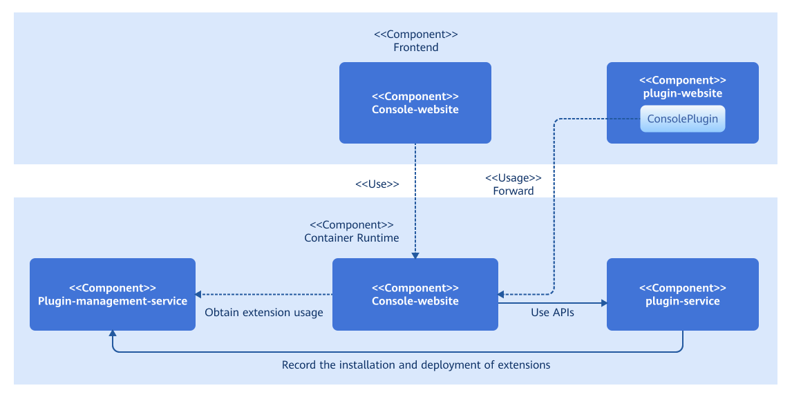
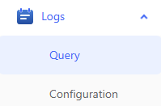

# Extension Development Guide

## Feature Overview

The openFuyao computing container platform (openFuyao for short) provides pluggable extension capabilities and allows users to independently develop extensions to enhance both the backend capabilities and the frontend interface of openFuyao. This delivers a more efficient, flexible, and customizable cloud-native experience. openFuyao provides corresponding APIs and templates for users to integrate or develop third-party extensions. For details, see [Extension Management](../management_plane_operations/extension_management.md#feature-overview).

## Restrictions

- To develop an extension or integrate an extension developed by yourself, modify the frontend code and edit related configuration files based on the openFuyao extension standards. For details, see [Development Procedure](#development-procedure).
- To use third-party extensions from non-official sources, openFuyao cannot prevent risks caused by issues inherent in those extensions.
- If too many extensions are enabled or too many resources are required by the extension UI, network requests may be delayed, affecting the overall loading performance of the interface.

## Environment Preparation

### Environment Requirements

1. The openFuyao cluster environment is available. For details, see [Installation Guide](https://gitcode.com/openFuyao/sig-installation/blob/master/docs/en/cluster_installation_guide/read_before_installation/installation_process.md).
2. The following development tools required for developing extensions are ready:

- Frontend development: Node.js 18+
- Image building: Docker 18+
- Software packaging: Helm 3.8+

### Setting up the Environment

According to the [Environment Requirements](#environment-requirements), install the required development tools by visiting the official websites of the corresponding software.

### Verifying the Environment Setup

1. Run the following command to check whether all pods in the openFuyao system are in the **Running** state:
   
   ```
   kubectl get pod -n openfuyao-system
   ```

2. Run the following commands to check the versions of the development tools and confirm that they are installed successfully:
   
   ```
   node -v
   docker version
   helm version
   ```

## Using Extensions

### Usage Scenario Overview

An existing frontend interface can be mounted to the openFuyao frontend as an extension UI. After developing the frontend interface of an extension, developers must perform certain adaptations and edit configuration files so that it can be detected and loaded by the openFuyao frontend.

### System Architecture

Extensions can be configured with customizable backend and frontend services, including their quantity and names. Each extension also includes a ConsolePlugin resource, which provides frontend rendering configurations and backend routing rules. Within the openFuyao platform, the console-service module queries the plugin-management-service APIs to determine whether the extension frontend is enabled in the cluster, and then returns the result to the frontend. In addition, the console-service module forwards frontend resource requests or backend API calls of the extension to the corresponding services based on the configurations in the ConsolePlugin resource.



### API Description

None.

### Development Procedure

1. Develop or modify the frontend.
   
   openFuyao's pluggable architecture allows you to mount independent frontend interfaces onto the openFuyao frontend management plane without making extensive modifications to the source code. To do so, you must first provide a unique extension name and create an `extension.js` file in the project directory with the following content:
   
   ```js
   const config = {
     menu: {
       pluginName: <Extension name>,
     },
   };
   export default config;
   ```
   
   The openFuyao frontend creates a unique mount point for the extension based on its name. The HTML label ID is `<Extension name>_root`. Therefore, the rendering mount point needs to be changed for the entry function of the extension frontend. The following uses the extension frontend developed using openInula as an example to describe how to modify the entry function:
   
   ```js
   // Before: index.html
   <div id="root"></div>
   // After: index.html
   <div id="xxxx_root"></div>  // xxxx indicates the extension name.
   
   // Before: index.jsx
   Inula.render(<App />, document.querySelector('#root'));
   // After: index.jsx
   Inula.render(<App />, document.querySelector(`#${extensionConfig.menu.pluginName}_root`));
   ```
   
   The extension UI is dynamically introduced to the openFuyao frontend management plane as a JavaScript ES module and must be packaged based on the following configuration.
   
   - Install a CSS-style plugin (using Vite as an example).
     
     ```bash
     npm install vite-plugin-css-injected-by-js postcss-prefix-selector
     ```
   
   - Add build configuration items to `vite.config.js`. In the following example, a `{pluginName}.mjs` file is built in the `dist/{pluginName}` path, and a style sheet dedicated to the extension is generated to prevent style conflicts that may occur after mounting.
     
     ```js
     import cssInjectedByJsPlugin from 'vite-plugin-css-injected-by-js';
     import postcssPrefixSelector from 'postcss-prefix-selector';
     import extension from './src/extension.js';
     
     const { pluginName } = extension.menu;
     
     // vite.config.js
     export default {
       // Add plugins.
       plugins: [
         cssInjectedByJsPlugin(),
         // Other plugins
         ...
       ],
       // Add the following build configuration.
       build: {
         lib: {
           entry: path.resolve(__dirname, 'index.html'),
           name: pluginName,
           formats: ['es'],
         },
         rollupOptions: {
           output: {
             entryFileNames: `${pluginName}/${pluginName}.mjs`,
           },
         },
       },
       // Plugin style configuration
       css: {
         postcss: {
           plugins: [
             postcssPrefixSelector({
               prefix: `#${pluginName}_root`,
               transform(prefix, selector, prefixedSelector) {
                 // Skip body and html styles.
                 if (selector.startsWith('body') || selector.startsWith('html')) {
                   return selector;
                 }
                 return prefixedSelector;
               },
             }),
           ],
         },
       },
       define: {
         'process.env': 'new Object({ NODE_ENV: "production" })',
       },
       // Other configurations
       ...
     };
     ```

2. Build image modules.
   
   An extension may include several frontend extension interfaces and backend extension services. You must build images for each service, deploy them in the cluster (for example, using Deployment), and expose them through Services.
   
   > **Note:** <br />The frontend and backend design of openFuyao extensions must adhere to the following specifications:
   > 
   > 1. Extension backend APIs must start with `/rest/{pluginName}` so that extension-related modules of the openFuyao platform can identify the corresponding extension. `pluginName` is the extension name, which must be the same as that in `extension.js`.
   > 2. The name of the extension frontend interface module must be `{pluginName}.mjs`. `pluginName` must be the same as that in `extension.js`. (If it is built and configured using Vite in step 1, the default ES module file name is `{pluginName}.mjs`.)
   > 3. When obtaining the frontend interface module from the frontend service container, ensure that the path for obtaining the file is `/dist/{pluginName}.mjs`. (You are advised to use NGINX and store the ES module file under `html/dist/` in the NGINX container. For details, see the log component Dockerfile.)

3. Configure resources.
   
   In the openFuyao pluggable architecture, the ConsolePlugin custom resource is used to discover and load frontend extensions and define the configuration files for declaring backend API forwarding rules of extensions. To ensure the proper operation of extensions, you need to provide the ConsolePlugin resource.
   
   Take the log component as an example. The component name is `logging`. It provides an extension frontend interface and exposes a set of backend APIs prefixed with `/rest/logging`.
   
   ```yaml
   apiVersion: console.openfuyao.com/v1beta1
   kind: ConsolePlugin
   metadata:
    name: logging
   spec:
     pluginName: logging
     displayName: "Logging"
     entrypoint: /container_platform
     subPages:
       - pageName: logSearch
         displayName: "Log Query"
       - pageName: logSet
         displayName: "Log Configuration"
     backend:
       type: Service
       service:
         name: logging-operator
         namespace: logging-ns
         port: 8080
         scheme: https
         insecureSkipVerify: false
         caBundle: xxxxx     # base64-encoded CA certificate of the extension component
     enabled: true
   ```
   
   **Table 1** Parameters in the configuration file
   
   | Parameter| Type| Required| Description|
   |----------|----------|----------|----------|
   | pluginName| string| Yes| Unique name of an extension.|
   | displayName| string| Yes| Name of the extension displayed on the menu.|
   | entrypoint| string| Yes| Position of the navigation button on the page. Currently, `/` and `/container_platform` are supported.|
   | order| string| No| Sequence of the extension on the menu.|
   | subPages| subPage\[]| No| Submenu of the extension displayed on the menu.|
   | subPages\[].pageName| string| Yes| Name of the extension subpage.|
   | subPages\[].displayName| string| Yes| Name of the extension subpage displayed on the menu.|
   | backend.type| string| Yes| Access method for the extension backend. Currently, only `Service` is supported.|
   | backend.service.name| string| Yes| Name of the Service for the extension backend.|
   | backend.service.namespace| string| Yes| Namespace of the Service for the extension backend.|
   | backend.service.port| int32| No. Default value: **80**| Port of the Service for the extension backend.|
   | backend.service.basePath| string| No. Default value: /| Path suffix of the Service for the extension backend, which is appended to `name.namespace.svc:port`.|
   | backend.service.scheme| string| No. Default value: **http**| Protocol of the extension backend Service. Options are `http` and `https`.|
   | backend.service.caBundle| string| No| CA certificate used by the openFuyao console-service component to verify the extension backend.|
   | backend.service.insecureSkipVerify| boolean| No. Default value: **false**| Whether certificate authentication is enabled when the openFuyao console-service component accesses the extension backend.|
   | enable| boolean| No. Default value: **true**| Whether the extension is enabled.|

   **Additional Notes on Parameters**
   
   - `pluginName` must be a **unique** resource name that can contain digits, letters, underscores (\_), and hyphens (-). It must be the same as the name of the JavaScript file (`{name}`) built earlier.
   - The `order` field defaults to **null** if not specified. In this case, the extension is rendered at the end of the menu.
   - `entrypoint` specifies the routing prefix for the page on which the extension is mounted. Currently, `/` (navigation bar) and `/container_platform` (left navigation pane of the openFuyao platform) are supported.
   - `subPages` are generated only when the extension frontend is mounted to the left navigation pane of the openFuyao platform (`entrypoint: /container_platform`). If the parameter is empty, the `displayName` navigation button is rendered. If the parameter is not empty, a drop-down button is rendered, expanding into multiple navigation buttons.
   - `enabled` indicates whether the extension frontend interface is enabled. It does not affect the running state of other extension modules.
   - The `backend.service.scheme`, `backend.service.caBundle`, and `backend.service.insecureSkipVerify` parameters provide a secure access protocol for extension component integration. By setting `caBundle` and `insecureSkipVerify`, and configuring the service certificate on the extension backend service, the `console-service` component can perform one-way `TLS` verification when routing extension components, ensuring access data security.

4. Integrate the authentication and authorization module.
   
   Extensions can integrate with the openFuyao authentication and authorization module to enjoy the same authentication and authorization capabilities as the openFuyao system. The integration does not require modifying the extension's backend services. Instead, only the openFuyao OAuth-Proxy module is introduced to proxy requests to the extension. For details about the principles and modification process, see [Authentication and Authorization Development Guide](./authentication_and_authorization_development_guide.md).

5. Package and build the extension.
   
   After the preceding steps are complete and related resources are installed, open or refresh the openFuyao frontend management plane. Verify that the extension's button is mounted in the expected location. Clicking it will display the extension frontend page within the openFuyao frontend management plane.
   
   You are advised to package the extension into a Helm chart based on the following specifications and upload the chart to the local repository of openFuyao to achieve better lifecycle management of the extension. When packaging the extension into a Helm chart, add the `openfuyao-extension` keyword to the `Chart.yaml` file. Take the log component as an example. The `Chart.yaml` file in the chart package is as follows:
   
   ```yaml
   apiVersion: v2
   name: logging
   description: A Helm chart for openFuyao logging extension. It includes the logging operator, Loki stack, and proxy frontend to deliver a complete logging solution.
   type: application
   appVersion: "latest"
   version: 0.0.0-latest
   keywords: ["openfuyao-extension", "log"]
   ```

### Debugging and Verification

1. Mount the extension frontend interface.
   
   Build and deploy the extension frontend service. After the ConsolePlugin resource is provided, access or refresh the openFuyao frontend management plane. The button or collapse menu for opening the extension is displayed in the corresponding position. Based on the configuration of the `entrypoint` field, the expected effect is as follows:
   
   - A button in the top navigation bar (`entrypoint: /`)
     
     **Figure 1** Top navigation bar
     
     
   
   - A button in the left navigation pane of the openFuyao platform (`entrypoint: /container_platform`, `subPage` empty)
     
     **Figure 2** Left navigation pane
     
     
   
   - A submenu in the left navigation pane of the openFuyao platform (`entrypoint: /container_platform`, with `subPage` not empty)
     
     **Figure 3** Left submenu
     
     
   
   Click the button to switch to the extension frontend page. If the page content is loaded normally, the extension is mounted successfully. If the page is blank, use browser development tools to check network requests and analyze logs of components such as openFuyao ingress-controller and console-service to troubleshoot the issue.

2. Package the extension.
   
   Package the extension into a Helm chart based on the openFuyao extension packaging specifications and upload it to any Helm repository that has been added to the openFuyao platform. On the openFuyao platform, choose **Application Market** > **Repository Configuration** to synchronize the repository. Then, you can search for the extension in **Application Market** > **Applications**. The application card and details page will display the **Extension** label, and you can filter extensions by selecting **Extension** on the left side of the list.
   
   Lifecycle management of installed extensions in the cluster is performed through the **Extension Management** page instead of the **Application Management** page. On the **Extension Management** page, you can upgrade, roll back, and uninstall extensions, and enable or disable the extension UI. For details, see [Extension Management User Guide](../management_plane_operations/extension_management.md).
