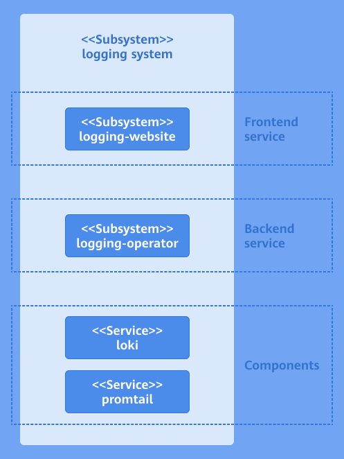

# Log Extension Component Development Guide

## Feature Introduction

As a pluggable extension component, the logging system is independently deployed on the openFuyao platform and provides log filtering, search, query, and alerting capabilities for both the platform and users.

## Constraints

None.

## Environment Preparation

For detailed installation steps, see [Installation Guide](https://gitcode.com/openFuyao/sig-installation/blob/master/docs/en/cluster_installation_guide/read_before_installation/installation_process.md).

## Usage Scenarios

### Scenario Overview

Developers need to install the log extension on the openFuyao cluster management plane. During installation, several options can be configured so that the logging system better matches service requirements:

- Configure the time limit for collected logs and the log retention update policy.
- Configure log collection sources.
- Configure custom alerting rules for logs.

### System Architecture

The service layer of the logging system consists of the UI layer, backend layer, and component layer.

- UI layer: Users perform log operations on the console website.
- Backend layer: `logging-operator` is deployed as a microservice to provide core capabilities such as log filtering, search, query, configuration, and alerting.
- Component layer: Provides key capabilities for log collection, storage, and processing, and integrates with the backend layer to support efficient log operations.

**Figure 1** Architecture of the log extension

### Interface Description

Main APIs are listed in the following table.

**Table 1** Main Interface Description

| API | Description |
| :--- | :--- |
| PATCH /rest/logging/v1/update-config | Add new collection jobs or modify existing collection jobs. |
| GET /rest/logging/v1/configmap | List collection source paths for all workflows of the current log collection component. |

### Development Steps

After the log extension is installed successfully, for detailed steps see [Logs](../management_plane_operations/observability_center/logs.md#installation).

### Verification

When the configured collection job name and collection source path match the listed paths in workflows of the current logging system, the configuration takes effect. The API for viewing the collection source paths of all workflows of the current log collection component is shown in the following table.

**Table 2** Verification API

| API | Description |
| :--- | :--- |
| GET /rest/logging/v1/configmap | List collection source paths for all workflows of the current log collection component. |