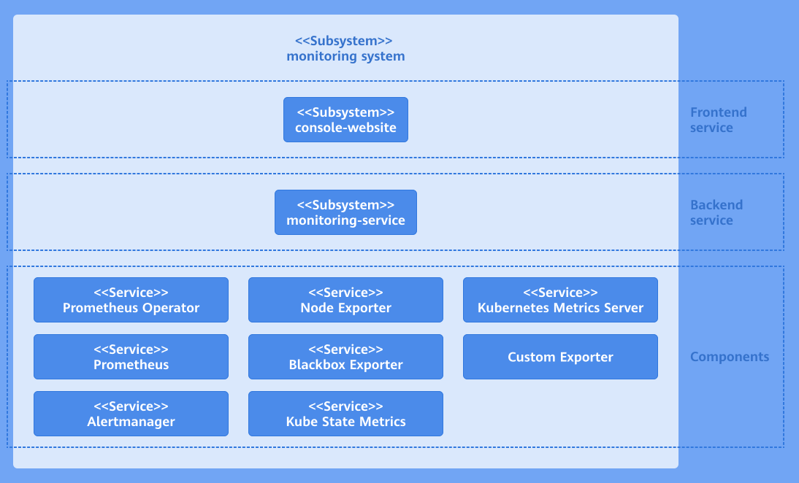

# Monitoring Development Guide

## Feature Overview

The monitoring system is a set of tools designed for real-time monitoring, collection, and analysis of the operating status of various resources and applications in a cluster. It provides detailed performance metrics of nodes, containers, applications, and networks, helping you understand the overall health status of the cluster. In addition, the monitoring system can be adjusted and extended based on different service requirements to adapt to changing environments and requirements.

- High availability and system stability: By monitoring cluster metrics in real time, the system can quickly respond to and handle problems, preventing system crashes caused by single points of failure (SPOFs) or insufficient resources.
- Proactive problem detection and resolution: Through continuous data collection and analysis, the monitoring system can identify potential performance bottlenecks and faults, provide early warnings, and take measures to prevent problems from escalating.
- Flexibility and extensibility: A cluster environment is highly dynamic and complex. The monitoring system must adapt to changes in the cluster environment, automatically discover and monitor newly deployed services and applications, and support on-demand extension. For details, see [Monitoring User Guide](../management_plane_operations/observability_center/monitoring.md).

## Restrictions

None.

## Environment Preparation

The monitoring system is installed together with the platform. For details, see [Installation Guide](https://gitcode.com/openFuyao/sig-installation/blob/master/docs/en/cluster_installation_guide/read_before_installation/installation_process.md).

## Task Scenario

This section describes how to deploy your own collector and configure ServiceMonitor to collect data.

### Scenario Overview

You need to deploy a custom data collector (exporter) in a Kubernetes environment and configure a ServiceMonitor so that Prometheus can discover and collect the monitoring data. The specific tasks include deploying the exporter, creating and applying the ServiceMonitor, and performing verification. The ultimate goal is to ensure that Prometheus can correctly collect data from the collector.

### System Architecture

The monitoring system consists of the user interface (UI) layer, backend layer, and component layer. The following figure shows the system architecture.

**Figure 1** Monitoring system architecture



- UI layer
  
  You can perform monitoring operations through the console website.

- Backend layer
  
  The monitoring-service is deployed as a microservice to provide core capabilities, including metric query, monitored object configuration, and alert rule configuration.

- Component layer
  
  The component layer provides key data support for the monitoring layer. It monitors different targets and collects various measurement metrics of the entire cluster system for subsequent query, analysis, and alerting.

### Development Process

1. Deploy a custom exporter: Ensure that the custom exporter has been deployed and that it exposes an endpoint for Prometheus to scrape the metrics.
2. Create a Kubernetes Service: Create a Kubernetes Service for the custom exporter so that Prometheus can discover and scrape its metrics.
3. Configure a ServiceMonitor: Edit and apply the ServiceMonitor to monitor the custom exporter.
4. Verify the monitoring data. In the left navigation pane of the openFuyao platform, choose **Monitoring**, click **Monitored Objects**, and check whether the monitored object exists and whether its health status is up.

### API Description

**Table 1** Main APIs

| API| Description|
|:----------|:----------|
| GET /rest/monitoring/v1/targets| Obtains monitored objects.|

### Development Procedure

1. Deploy a custom exporter.
   
   1.1 Create a YAML file for exporter (using Deployment as an example). Edit the YAML file for the custom exporter and select a proper Kubernetes resource type based on the features of the exporter. Create a YAML file named exporter-deployment.yaml with the following content:
   
    ```yaml
      apiVersion: apps/v1
      kind: Deployment
      metadata:
        labels:
          app: my-exporter
        name: my-exporter
        namespace: my-exporter-namespace
        spec:
        replicas: 3
        selector:
          matchLabels:
            app: my-exporter
        template:
          metadata:
            labels:
              app: my-exporter
          spec:
            containers:
              - name: my-exporter
                image: my-exporter-image:latest
                ports:
                  - containerPort: 9100
    ```
   
   1.2 Apply the YAML file of the exporter (using Deployment as an example). Apply the exporter to the Kubernetes cluster to run it.
   
      Run the following kubectl command to apply Deployment resources to the Kubernetes cluster:
       
      ```
      kubectl apply -f exporter-deployment.yaml
      ```

2. Create a Kubernetes Service.
   
   2.1 Edit a Service for the exporter so that Prometheus can discover and scrape its metrics.
   
      Create a YAML file named exporter-service.yaml with the following content:
      
      ```yaml
        apiVersion: v1
        kind: Service
        metadata:
          labels:
            app: my-exporter
          name: my-exporter
          namespace: my-exporter-namespace
        spec:
          ports:
          - port: 9100
            targetPort: 9100
          selector:
            app: my-exporter
      ```
      
      > **Note:**<br />
      > 
      > -  The **app:my-exporter** label must match the Deployment label of the exporter.
      > - The port number **9100** must be the same as that used by the exporter.
   
   2.2 Apply the Service of the exporter to the cluster so that Prometheus can discover the exporter and scrape its metrics.
   
      Run the following kubectl command to apply Service resources to the Kubernetes cluster:
      
      ```
      kubectl apply -f exporter-service.yaml
      ```

3. Configure a ServiceMonitor to monitor the custom exporter.
   
   3.1 Define the ServiceMonitor resource and edit the YAML file of the ServiceMonitor to define monitored objects.
   
      Create a YAML file named service-monitor.yaml with the following content:
      
      ```yaml
        apiVersion: monitoring.coreos.com/v1
        kind: ServiceMonitor
        metadata:
          name: my-exporter-servicemonitor
          namespace: my-exporter-servicemonitor-namespace
        spec:
          endpoints:
            - interval: 30s
              port: 9100
              path: /metrics
          selector:
          matchLabels:
              app: my-exporter
          namespaceSelector:
            matchNames:
            - my-exporter-namespace
      ```
   
      > **Note:**<br />
      > 
      > - Ensure that the **app:my-exporter** label must match the Service label of the exporter.
      > - Ensure that the port number **9100** is the same as that used by the exporter.
   
   3.2 Apply the ServiceMonitor resource so that Prometheus can discover the exporter and scrape monitoring data.
   
      Run the following kubectl command to apply ServiceMonitor resources to the Kubernetes cluster:
      
      ```
      kubectl apply -f service-monitor.yaml
      ```

### Debugging and Verification

In the left navigation pane of the openFuyao platform, choose **Observation Center** > **Monitoring** > **Monitored Objects**. The **Monitored Objects** page is displayed. On this page, find the monitored object name. If the status is up, the monitored object is configured successfully.
