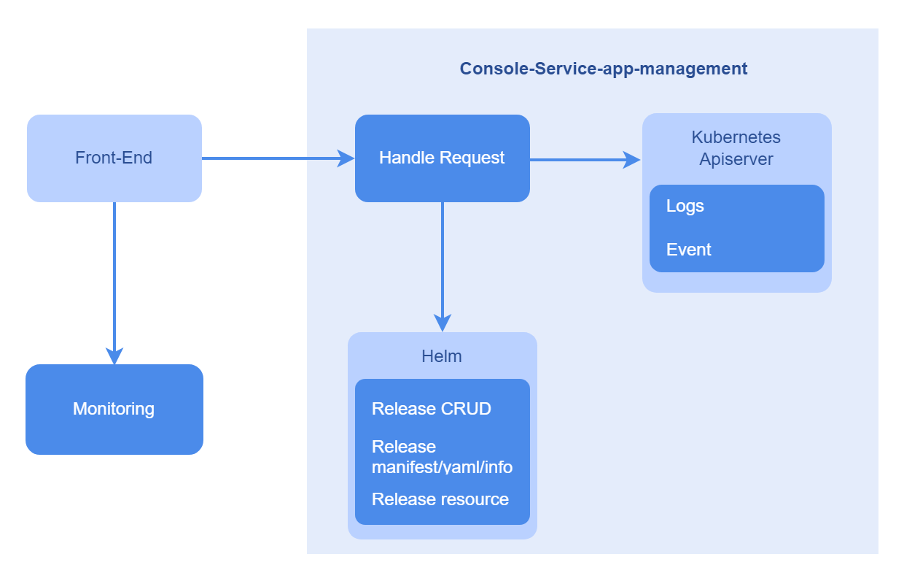

# Application Management

## Feature Overview

Application Management is a tool for managing applications in the openFuyao platform. It provides complete functions of deploying, updating, and uninstalling programs. In the current version, applications can be installed using Helm charts. The entire application list is displayed on the **Application Management** page and O\&M management operations can be performed in the application list.

### Applicable Scenarios

Application Management supports complete O\&M operations on released applications in Helm format.

- Application information acquisition: You can obtain a list of applications, displaying the application name, status, and update time for each application, and filter and sort the applications. In addition, more information such as YAML, resource list, events, and monitoring is displayed on the details page.

- Application lifecycle management: You can install, uninstall, upgrade, and roll back applications installed in a cluster.

- Application installation using Helm charts: You can upload Helm charts of various types for application installation. You can also modify application parameters.

### Supported Capabilities

- Basic information display: Basic information is displayed, including the application name, status, creation time, application template, template version, and update time. On the application list page, applications can be sorted by name or update time, and can be filtered by installation status.
- O\&M management: Users can perform application upgrades, rollback, and uninstallation. The upgrade function applies only to applications installed from the openFuyao application market. Users can view application resources (such as logs and events) and modify configurations (in YAML format).

### Highlights

Application Management supports lifecycle management of applications. You can install, deploy, upgrade, uninstall, and roll back applications through simple and intuitive operations. In addition, you can view application resources and logs, and monitor and observe applications.

### Implementation Principles

**Figure 1** Implementation principles

### Related Features

The monitoring data in Application Management comes from the monitoring components of the openFuyao platform. Before using the application monitoring function, ensure that the monitoring components of the platform are running properly. For details, see [Monitoring](./observability_center/monitoring.md).

## Using the Application Management Function

In the left navigation pane, choose **Application Management**. The **Application Management** page is displayed. On this page, you can view the deployed application instances, including the application name, status, and update time.

Click an application name. On the application details page that is displayed, view the application details, including details, YAML, resources, logs, events, and monitoring information.

### Upgrading an Application

#### Prerequisites

- Kubernetes 1.28 and Helm 3.14.2 have been installed in the cluster.
- The marketplace-service in the cluster is running properly.

#### Context

Helm is a package manager in a Kubernetes cluster. Similar to apt used in Ubuntu and yum used in CentOS, Helm helps you quickly install applications.

#### Restrictions

The format of the software to be installed is Helm chart. Currently, only software uploaded to the repository can be installed.

#### Procedure

1. Method 1: On the **Application Management** page, click  in the table and select **Upgrade**. The **Upgrade** page is displayed.
   
   Method 2: On the **Application Details** page, click **Operation** and select **Upgrade**. The **Application Upgrade** page is displayed.

2. Select the target version for the upgrade from the **Version** drop-down list.

3. Click **OK**.

#### Related Operations

You can roll back or uninstall an application by clicking  in the **Operation** column on the list page or **Operation** in the upper-right corner on the details page and then selecting the desired option.

**Table 1** Related operations

| Operation| Description|
|:----------|:----------|
| Roll back| The application can be rolled back to an earlier version, which is identified by the version number and serial number. Currently, data rollback is not supported.|
| Uninstall| Due to Kubernetes' mechanisms, after an application is uninstalled, the files or data generated on the host's storage device or distributed storage device during the running of the application will not be forcibly removed. You need to manually remove the files or data to free up the storage space.|

