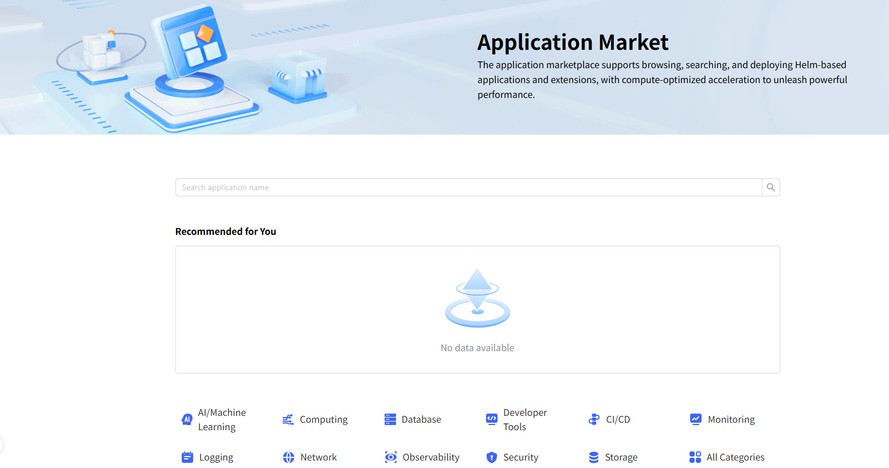
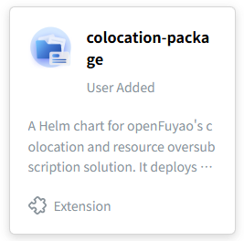
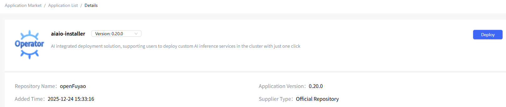
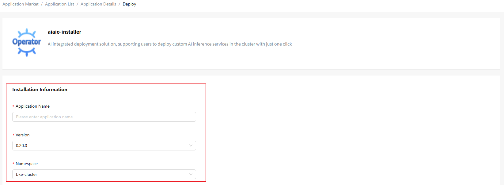
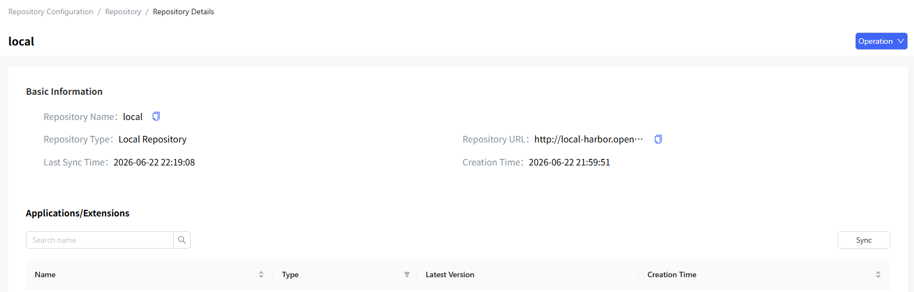
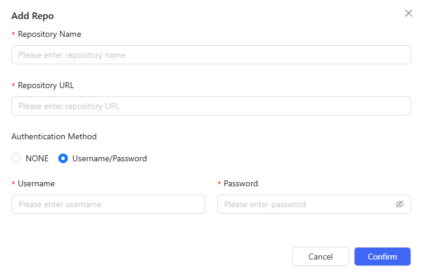
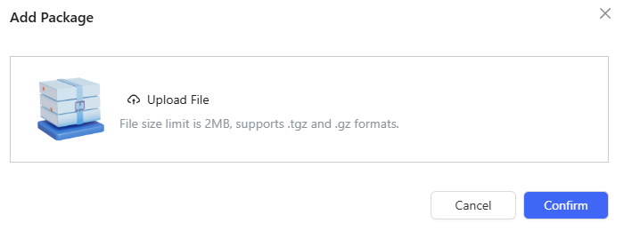

# Application Market

## Feature Overview

The openFuyao application market displays applications. In this module, you can manage application repositories and conveniently deploy components on the openFuyao platform and expand the platform's capabilities.

### Applicable Scenarios

The openFuyao application market is widely used by users and administrators for repository management and application deployment. It applies to multiple scenarios:

- Platform capability expansion: You can deploy openFuyao extensions to significantly enhance the overall functionality of the platform.

- Quick deployment: You can upload Helm packages to the openFuyao platform to implement quick deployment and testing.

### Supported Capabilities

- Application deployment: You can select and deploy required applications in the application market and check the deployment status during subsequent management.

- Extension deployment: You can select extensions from the application market to enhance platform functions and performance.

- Repository management: You can add, remove, and manage application repositories for quick access to new repositories and flexible application deployment.

- Local repositories: You can upload multiple applications and versions to the desired local repository.

### Highlights

- Helm package support: Helm packages are supported to facilitate the management and deployment of containerized applications.

- Local repository management: No external dependencies are required. Applications of multiple versions can be uploaded and managed locally.

- Flexible deployment: You can select different application versions and extensions as required to quickly deploy services and expand the platform's capabilities.

- Separation of applications and extensions: The application market differentiates between standard application deployment and extension deployment, clarifying functional boundaries.

### Implementation Principles

The application market leverages Helm package management and repository management mechanisms to achieve fast application deployment and extension selection. Helm packages offer a standard application deployment mode. Repository management enables flexible switching and use of different versions and applications.

### Related Features

- The application market initiates RPC services and sends Helm packages.
- The RPC services for application management respond to Helm packages sent by the application market.

## Overview

In the left navigation pane, choose **Application Market** > **Overview**. The **Overview** page is displayed. On this page, you can filter applications by type or enter a keyword in the search box to perform fuzzy search. Click **More** to view the complete application list.

**Figure 1** Application market overview page

## Using the Application List

### Viewing an Application

#### Prerequisites

- Kubernetes 1.28 and Helm 3.14.2 have been installed in the cluster.
- The marketplace-service in the cluster is running properly.

#### Context

Helm is a package manager in a Kubernetes cluster. Similar to apt used in Ubuntu and yum used in CentOS, Helm helps you quickly install applications.

#### Restrictions

Currently, only installed software can be viewed.

#### Procedure

1. Click **More** on the **Overview** page, or choose **Application Market** > **Applications** in the left navigation pane to view the complete application list.

2. Click an application card to go to the **Details** page and view the application version and details.
   
   **Figure 2** Application card
   
   

3. On the application details page, click **Version** and select an application version.

4. Click the **Details** tab to view the detailed information about the application.

5. Click the **Default Parameters** tab to view the application information in YAML format. You can export the YAML file.

### Deploying an Application

#### Prerequisites

- Kubernetes 1.28 and Helm 3.14.2 have been installed in the cluster.
- The marketplace-service in the cluster is running properly.

#### Context

This feature is used to deploy applications or extensions on the openFuyao platform through the application market. You can use Helm charts in Kubernetes clusters to deploy applications.

#### Restrictions

During deployment, you must correctly set the Helm chart parameters in the **Values.yaml** file. Incorrect configurations may result in deployment failures or malfunctioning applications.

#### Procedure

1. In the left navigation pane, choose **Application Market** > **Applications**. The **Applications** page is displayed.

2. Click an application card. The application details page is displayed.

3. Click **Deploy**. The **Deploy** page is displayed.
   
   **Figure 3** Deploying an application
   
   
   
   > **Note:** 
   > 
   > - The openFuyao platform does not verify the security of applications uploaded by users or added through third-party repositories. You need to ensure the security of applications.
   > - You must ensure the secure use and storage of sensitive information in applications. openFuyao does not scan, identify, or shield such sensitive information. You are advised to use Kubernetes Secrets for storing such sensitive information and configure Kubernetes by referring to the Kubernetes guidelines for encrypting confidential data at rest. This prevents secrets from being stored in plaintext in the etcd database.

4. On the **Installation Information** page, enter the application name, and select the application version and namespace.
   
   > **Note:** 
   > 
   > - An extension can be installed only once on the platform. After the installation is complete, the **Deploy** button of the extension on the application details page changes to **Manage**. You can click **Manage** to go to the **Extension Management** page.
   > - If the name of an application starts with a number, an error may occur during deployment. For details, see the logs.
   
   **Figure 4** Application deployment page
   
   

5. Enter the values of **helm-charts** in **Values.yaml**.

6. Click **Deploy**.

7. Choose **Application Management** or **Extension Management** in the left navigation pane to manage the deployed applications or extensions.

> **Note:** 
> 
> 1. An extension can be installed only once on the platform. After the installation is complete, the **Deploy** button of the extension on the application details page changes to **Manage**. You can click **Manage** to go to the **Extension Management** page.
> 2. The number of pods that can run on each node in a Kubernetes cluster is limited. The default value is **110**. If the number of pods on all nodes reaches the limit, new pods to be created cannot be scheduled and will remain in the pending state. Please clear unwanted pods or add nodes in a timely manner. Kubernetes does not limit the number of pods in the pending state. Therefore, you need to pay attention to the number of pods in this state in a timely manner to prevent the unlimited accumulation of such pods. Excessive pending pods consume CPU and memory resources, ultimately affecting cluster responsiveness.

## Using the Repository Configuration

In the left navigation pane, choose **Application Market** > **Repository Configuration**. The **Repository Configuration** page is displayed by default.

> **Note:** When openFuyao is fully installed, two default repositories are preconfigured: **local**, which serves as the user's local repository, and **openFuyao**, which serves as the official repository. You can obtain the latest official applications and extensions by synchronizing the official repository in a timely manner.

### Viewing a Repository

#### Prerequisites

- Kubernetes 1.28 and Helm 3.14.2 have been installed in the cluster.
- The marketplace-service in the cluster is running properly.

#### Context

A repository is used to store and manage applications and extensions, and provides a centralized resource management entry. On the **Repository Details** page, you can view basic information (such as the name, type, and address) about a repository and resources (such as applications and extensions) contained in the repository.

#### Restrictions

You can view only the added repositories and their resources, and manage the added repositories (such as adding, removing, and synchronizing).

#### Procedure

1. On the **Repository Configuration** tab, click a **Repository Name**. On the **Repository Details** page that is displayed, you can view the basic information about the repository and the applications or extensions in the repository.
   
   **Figure 5** Repository details
   
   

### Synchronizing a Repository

#### Prerequisites

- The repository has been properly configured.
- The repository address and authentication information have been correctly configured.

#### Context

This feature is used to update the information about applications or extensions in the repository, ensuring that resource information remains up to date.

#### Restrictions

The repository has been added and is in the normal state. If the repository address is unavailable or the authentication information is incorrect, the synchronization may fail.

#### Procedure

Synchronizing a repository updates the applications or extensions.

Method 1: On the **Repository Configuration** tab, click  in the **Operation** column and choose Synchronize Repository.

Method 2: On the repository **Details** page, click **Synchronize**.

### Adding a Repository

#### Prerequisites

- The target repository has been correctly deployed and is available.
- The target repository needs to be authenticated. You need to prepare the correct username and password in advance.

#### Context

This feature allows new application or extension repositories to be connected to the openFuyao platform for unified management. Multiple types of resources can also be integrated using this feature.

#### Restrictions

- The repository name must be unique on the platform.
- Authentication requires a valid username and password.

#### Procedure

1. Click **Add Repository**. In the **Add Repository** dialog box that is displayed, enter the repository name and address.

2. Select an authentication mode. The **Username/Password** option is selected by default. Then, enter the username and password. If you select **NONE**, confirm the risk warning.
   
   **Figure 6** Adding a repository
   
   

3. Click **OK**.

#### Related Operations

You can modify or remove a repository by clicking  in the **Operation** column on the list page or **Operation** in the upper-right corner on the details page and then selecting the desired option.

## Using the Package Management Function

On the **Repository Configuration** page, click the **Chart Management** tab.

### Managing Package Versions

#### Prerequisites

None.

#### Context

This feature is used to manage package versions on the openFuyao platform, including adding new versions or removing existing versions.

#### Restrictions

None.

#### Procedure

1. On the **Chart Management** tab, click a card. On the package details page that is displayed, you can view the package version information.
2. Click **Add Version**. The **Add Version** dialog box is displayed.
3. Click **Upload File** and then select the file to be uploaded.

> **Note:**
> 
> - The maximum size for a file to be uploaded is 1 MB. The file can be in .tgz or .tar.gz format.
> - The openFuyao platform does not verify the security of applications uploaded by users. You need to ensure the security of the applications uploaded.

4. Click **OK** to add the version.
5. Click  in the table and select **Delete**. The **Delete** dialog box is displayed. Select **I understand that the deletion operation cannot be undone** and click **Delete**.

### Adding a Package

#### Prerequisites

None.

#### Context

This feature is used to upload new application or component packages to the platform to support subsequent version management and resource deployment.

#### Restrictions

Ensure that the package name is unique.

#### Procedure

1. On the **Chart Management** tab, click **Add Chart**. A dialog box is displayed.
   
   **Figure 7** Adding a package
   
   

2. Click **Upload File** and then select the file to be uploaded.

> **Note:**  The maximum size for a file to be uploaded is 1 MB. The file can be in .tgz or .tar.gz format.

3. Click **OK** to add the package.

#### Related Operations

On the **Chart Management** tab, you can click **Synchronize** on the right to synchronize packages to the local repository as required.

**Table 1** Related operations

| Operation| Description|
|----------|----------|
| Sync| Due to network fluctuations or other factors, package addition and removal operations may not be synchronized in real time. Manual synchronization may be required.|

#### Follow-up Operations

On the **Chart Management** tab, you can click **Delete** of a card to remove packages as required.
