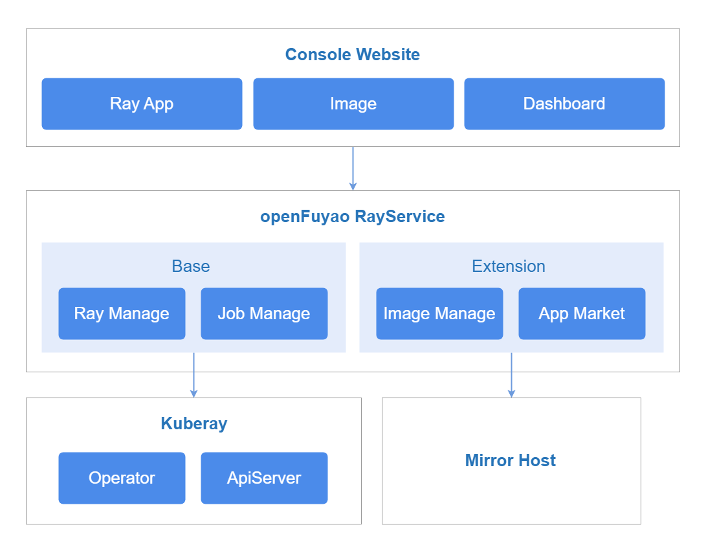
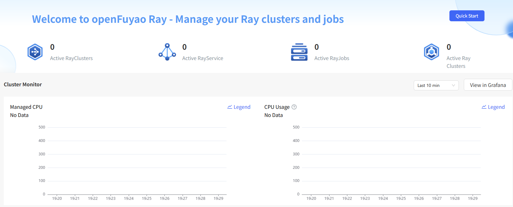
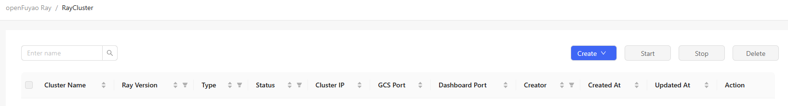
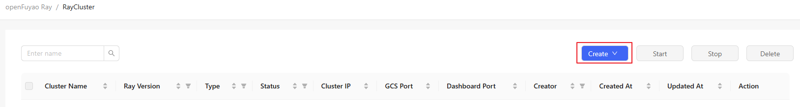

# openFuyao Ray

## Feature Overview

Ray is a distributed computing framework that supports function-level, on-demand scheduling of heterogeneous computing resources. It applies to general-purpose computing, intelligent computing, and hybrid scenarios combining both. It provides efficient and easy-to-use multi-language APIs to improve the duty cycle and optimize the comprehensive utilization of computing power. Ray supports multiple job forms, such as RayCluster, RayJob, and RayService. Multiple RayClusters are deployed in a Kubernetes cluster to process computing jobs of different tenants and applications. openFuyao Ray provides Ray cluster and job management capabilities. They help you reduce O\&M costs and enhance cluster observability, fault diagnosis, and optimization practices. In addition, openFuyao Ray helps you build a computing power management solution based on the cloud-native architecture to improve computing power utilization.

### Applicable Scenarios

Ray is widely used in the following scenarios: machine learning, hyperparameter optimization, big data processing, reinforcement learning, and model deployment.

### Supported Capabilities

- Resource management
  
  - Allows users to create, query, remove, start, and terminate RayCluster, RayJob, and RayService resources, implementing flexible computing resource management.
  - Allows users to create and modify RayCluster, RayJob, and RayService resources in file or text configuration mode to meet different deployment requirements.
  - Displays RayCluster, RayJob, and RayService resource details, YAML files, and logs.

- Global Ray resource monitoring
  
  - Displays the numbers of active RayClusters, RayJobs, and RayServices and the total number of active Ray clusters.
  - Displays the total physical and logical resources occupied by all Ray clusters, which are calculated based on the pod request values.
  - Displays the statistics on the total physical and logical resources used by the Ray clusters, which are calculated based on both physical resource monitoring data and Ray-specific logical resource data.

### Highlights

openFuyao Ray provides simple and efficient Ray resource management and global monitoring capabilities, supports convenient configuration and flexible scheduling of RayClusters, RayJobs, and RayServices, simplifies the computing resource management process, and improves cluster observability and computing power utilization.

### Related Features

This feature depends on the monitoring capabilities provided by Prometheus.

### Implementation Principles

**Figure 1** Implementation principles



openFuyao Ray is structured into three service layers: frontend service, backend service, and component service.

**Frontend Service**

The ray-website provides visualized interfaces for management of RayCluster, RayJob, and RayService resources. This facilitates large-scale cluster management, and improves the visualized management capability for Ray computing tasks. It also integrates data visualization, and displays key monitoring information such as task execution status, resource usage, and scheduling logs.

**Backend Service**

The ray-service is deployed as a microservice to provide some core capabilities, including metric query as well as creation, query, deletion, start, and termination of RayCluster, RayJob, and RayService resources.

**Component Service**

- KubeRay: KubeRay is an operator provided by the Ray community for Kubernetes. It manages Ray clusters through custom resource definitions (CRDs) of Kubernetes.

- Prometheus: It collects monitoring data of Ray clusters, including key metrics such as the numbers of RayClusters, RayJobs, and RayServices as well as resource usage (CPU, GPU, and memory). It also stores the data for query and analysis.

- Grafana: It provides visualized dashboards for the Ray cluster running state, computing resource usage, and task execution status based on the data collected by Prometheus.

## Installation

### Prerequisites

- Kubernetes 1.21 or later has been deployed.
- MindX DL 5.0.1 or later has been deployed.

### Procedure

#### Deployment on the openFuyao Platform

1. In the left navigation pane of the openFuyao platform, choose **Application Market** > **Applications**. The **Applications** page is displayed.
2. Select **Extension** in the **Type** filter on the left to view all extensions. Alternatively, enter **ray-package** in the search box to search for the component.
3. Click the **ray-package** card. The details page of the Ray extension is displayed.
4. Click **Deploy**. The **Deploy** page is displayed.
5. Enter the application name and select the desired installation version and namespace.
6. Enter the values to be deployed in **Values.yaml**.
7. Click **OK**.
8. In the left navigation pane, click **Extension Management** to manage the Ray component.

#### Standalone Deployment

1. Obtain the Ray Helm package.

   ```bash
   helm pull oci://helm.openfuyao.cn/charts/ray-package --version xxx
   ```

   Replace `xxx` with the helm image version to pull, for example: `0.0.0-latest`.

2. Enter the values to be deployed in **Values.yaml**.
   - Configure `ray-service.grafana.grafana.ini.server.domain` to specify the domain name or IP address for users to access Grafana.
   - Set `ray-service.grafana.service.type` to `NodePort` to expose the service on all nodes through a specified port.
   - Set `ray-service.grafana.service.nodePort` to a port number within the `30000-32767` range.
   - Set `ray-service.grafana.openFuyao` and `ray-website.openFuyao` to `false`.
   - Set `ray-website.enableOAuth` to `false`.
   - Set `ray-website.service.type` to `NodePort` to expose the service on all nodes through a specified port.
   - Set `ray-website.service.nodePort` to a port number within the `30000-32767` range.
   - Configure `ray-website.backend.monitoring` to point to the `Prometheus` address.

     ```text
     http://<prometheus-service-name>.<namespace>.svc:<port>
     ```

3. Deploy the component using Helm.

   ```bash
   tar -zxf ray-package-xxx.tgz
   helm install openFuyao-ray -n default ./ray-package
   ```

4. Verify the installation and access.
   - Ensure that openFuyao Ray has been successfully deployed.
     
     ```bash
     kubectl get pods -n vcjob
     kubectl get pods -n default
     ```
   
   - Ensure that the service is exposed.
     
     ```bash
     kubectl get svc -n default | grep ray-website
     ```
   
   - Access the **ray-website** page.
     
     ```text
     http://<Node_IP>:<ray-website.service.nodePort>
     ```
   
   > **Note:** <br />When accessing Grafana for the first time, use the default username `admin` and password `admin`. After the login, change the password promptly to ensure security.

## Viewing the Overview

### Prerequisites

The ray-package extension has been deployed in the application market.

### Context

The **Overview** page displays information about all Ray applications, including:

- Numbers of active RayClusters, RayJobs, and RayServices, and the total number of all active Ray clusters.
- Total physical and logical resources of all Ray clusters, which are calculated based on the pod request values.
- The actual physical and logical resource usage of all Ray clusters, which are calculated based on both physical resource monitoring data and Ray-specific logical resource data.

### Restrictions

None.

### Procedure

1. In the left navigation pane of the openFuyao platform, choose **Computing Power Optimization Center** > **openFuyao Ray** > **Overview**. The **Overview** page is displayed.
   
   **Figure 2** Overview
   
   
   
   - (Optional) Select a time range: On the **Overview** page, you can filter Ray computing resources by time to view the status and usage of Ray computing resources in the last 10 minutes, 30 minutes, or 1 hour.
   - View Ray resource monitoring data: The **Overview** page displays the numbers of active RayClusters, RayJobs, and RayServices, as well as the computing resource allocation and usage.

2. (Optional) Go to Grafana: On the **Overview** page, click **View in Grafana** on the right of the **Cluster Monitoring** section. On the Grafana monitoring panel that is displayed, you can view the detailed monitoring data of Ray computing clusters.

## Using RayCluster

In the left navigation pane of the openFuyao platform, choose **Computing Power Optimization Center** > **openFuyao Ray** > **RayCluster**. The **RayCluster** page is displayed.

**Figure 3** RayCluster



The **RayCluster** page supports the following functions:

- Fuzzy search by RayCluster name: Enter a partial or complete RayCluster name in the search box. The system automatically filters the matched RayCluster instances.
- List sorting: The RayCluster list can be sorted in ascending or descending order.
- Filtering: You can filter data by Ray version, resource type (template and instance), status, and creator.
- Resource management: You can create, query, remove, start, and terminate RayCluster resources.

### Viewing RayCluster Details

#### Prerequisites

The ray-package extension has been deployed in the application market.

#### Context

You can view the basic information, YAML configuration, operation logs, and monitoring details of the current RayCluster.

#### Restrictions

None.

#### Procedure

1. On the **RayCluster** page, click any RayCluster in the **Cluster name** column. The **RayCluster** details page is displayed. This page supports the following functions:
   
   - On the **Details** page, you can view the basic information, algorithm framework, head node specifications and configurations, and worker node specifications of the RayCluster.
   
   - In the **YAML** tab, you can view and export the YAML configuration of RayCluster.
   
   - In the **Logs** tab, you can view RayCluster operation logs for debugging and troubleshooting.
   
   - In the **Cluster Health Information** tab, you can view the health status of the RayCluster to learn about the cluster load.
     
     - GCS event pressure: Reflects the task queue pressure of gcs_server. gcs_server is the scheduling center of the Ray cluster. Excessive delays may cause cluster timeouts or stalling.
     - Node health check: There are two types of health checks for Ray clusters: raylet and GCS. If a health check fails, the faulty node will be restarted after a certain period of time.
     - Job event pressure: Indicates the latency of GET, DELETE, and POST operations for jobs and logs. Frequent event requests may cause a high load. You are advised to adjust the request frequency to alleviate cluster load.
     - Dashboard API pressure: Reflects the pressure of the head node network, gcs_server process, and dashboard process. Pay attention to this metric if the frontend page freezes.

2. Click **Ray Dashboard**. On the **Ray Dashboard** page that is displayed, you can view the task execution status, resource usage, and scheduling information of the cluster.

3. Click the drop-down list in the **Operation** column on the right. You can start, terminate, or remove a RayCluster as required.

### Creating a RayCluster

#### Prerequisites

The ray-package extension has been deployed in the application market.

#### Context

When you need to run a Ray computing task, you need to create a RayCluster to automatically schedule computing resources in the cluster.

#### Restrictions

You must have the platform admin or cluster admin role.

#### Procedure

1. On the **RayCluster** list page, click **Create** on the right.
   
   **Figure 4** Creating a RayCluster
   
   

2. Select a creation method as required.
   
   **Table 1** Creation methods
   
   | Method| Procedure|
   |:----------|:----------|
   | Method 1| 1. Select **Create Configuration** from the drop-down list.<br/> 2. Switch to the **Form-based** or **YAML-based** tab.|
   | Method 2| 1. Select **Upload Configuration** from the drop-down list.<br/> 2. In the displayed **Upload Configuration** dialog box, click **Select File** to upload the YAML file that contains the RayCluster configuration.<br/> 3. Click **Upload and Deploy**. The RayCluster is created.|

   - Form-based: The underlying configuration is the same as that of the native YAML file of KubeRay. You can configure RayCluster parameters (such as the cluster name, image version, computing resource allocation, and number of worker replicas) in a visualized form. With this method, you do not need to manually edit YAML files.
     
     1. You can specify an open-source Ray image (for example, `docker.io/library/ray`) in the image address.
     2. You can specify an openFuyao-Ray image in the image address.
     3. You can specify a custom image in the image address. If additional dependencies (such as custom Python, VLLM, or specific hardware drivers) are required, you are advised to build a custom image based on the preceding images.
   
   - YAML-based: You can directly edit the YAML configuration file. This method applies to users who are familiar with RayCluster CRD specifications, allowing customization of advanced parameters.

3. Click **Create** or **Create and Start** to complete the creation. For a sample YAML, see [Example YAML for Creating a RayCluster](#example-yaml-for-creating-a-raycluster).
   
   To enable the health observability function, use the following configuration:
   
   Currently, health observability is only supported when the cluster is created through YAML. You need to manually create a [ConfigMap Configuration](#configuration-file-for-enabling-health-observability) and then create a RayCluster that references it. Note that RayCluster and ConfigMap must be in the same namespace. Otherwise, the configuration does not take effect.

### Removing a RayCluster

#### Prerequisites

The ray-package extension has been deployed in the application market.

#### Context

If a RayCluster is no longer needed or you want to free up computing resources, you can remove the RayCluster and clear its head and worker nodes as well as related resources to prevent unnecessary resource occupation.

#### Restrictions

- You must have the platform admin or cluster admin role.

- Removal is allowed for RayClusters in states other than **Running**.

#### Procedure

- Removing RayClusters in batch
  
  1. In the **RayCluster** list, select the RayClusters to be removed.
  2. Click **Delete** on the right of the list.
  3. In the displayed dialog box, click **OK**. The selected RayClusters are removed.

- Removing a single RayCluster
  
  1. Method 1: On the **RayCluster** list page, click  in the **Operation** column.
     
     Method 2: On the **RayCluster** details page, click **Operation** on the right.
  
  2. Select **Delete** from the drop-down list.
  
  3. In the displayed dialog box, click **OK**.

#### Related Operations

You can click **Start** or **Terminate** on the right of the list page, or click  and select **Start** or **Terminate** in the **Operation** column on the details page to perform RayCluster-related operations as required.

**Table 1** Related operations

| Operation| Description|
|:----------|:----------|
| Start| If a RayCluster is in a terminated or unstarted state, you can start it to restore the computing capability so that it can run RayJob and RayService tasks again and schedule resources in the cluster.|
| Stop| When computing tasks are completed or no longer needed, you can terminate the RayCluster to free up computing resources and optimize cluster utilization, preventing unnecessary resource occupation.|

#### Follow-up Operations

To create, query, remove, start, and terminate RayServices and RayJobs, refer to the procedure of RayCluster-related operations.

## Appendixes

### Configuration File for Enabling Health Observability

```yaml
apiVersion: v1
kind: ConfigMap
metadata:
  name: fluentbit-config
  namespace: default                                  # ConfigMap must be deployed in the RayCluster under all namespaces.
data:
  script.lua: |-
    function process_log(tag, timestamp, record)
      local filename = record["filename"]
      local cache_path = "/tmp/last_value.dat"

      local function load_last_value()
        local file = io.open(cache_path, "r")
        if not file then return 0 end
        local content = file:read("*a")
        file:close()
        return tonumber(content) or 0
      end

      local function save_last_value(value)
        local file = io.open(cache_path, "w")
        if file then
            file:write(tostring(value))
            file:close()
        end
      end
      
      if filename == "/tmp/ray/session_latest/logs/gcs_server.out" then
        local log_msg = record.log
        local current_str_1 = log_msg:match("Main%sservice%sEvent%sstats:")

        if current_str_1 then
          local current_str_2, current_str_3 = log_msg:match("Global%sstats:%s+(%d+)%s+total%s+%((%d+)%s+active%)")
          if current_str_2 and current_str_3 then
            local last_value = load_last_value()
            local current_value = tonumber(current_str_2)

            record["result"] = current_value - last_value
            save_last_value(current_value)
            record["result1"] = current_str_3
          end
          local value, unit = log_msg:match("Queueing%stime:%smean%s=%s([%d%.]+)%s([mun]?s)")
          if value and unit then
            local num = tonumber(value)
            local conversion = {
                ["ns"] = 0.001,
                ["us"] = 0.001,
                ["ms"] = 1,
                ["s"]  = 1000
            }
            unit = unit:gsub("μs", "us"):lower()
            record["result2"] = num * (conversion[unit] or 1)
          end
        end

        if record["result"] or record["result2"] then
          return 2, timestamp, record
        else
          return -1, nil, nil
        end
      end

      if filename == "/tmp/ray/session_latest/logs/dashboard.log" or 
          filename == "/tmp/ray/session_latest/logs/dashboard_agent.log" then
        local log_msg = record.log
        local value_str, unit = log_msg:match("bytes%s+(%d+)%s+(%a+)")
        if value_str and unit then
            local value = tonumber(value_str)
            local new_value, new_unit
            if unit == "us" then
                new_value = value / 1000
                new_unit = "ms"
            elseif unit == "ms" then
                new_value = value
                new_unit = "ms"
            elseif unit == "s" then
                new_value = value * 1000
                new_unit = "ms"
            else
                return 1, timestamp, record
            end

            local formatted_value = string.format("%.3f", new_value):gsub("0+$", ""):gsub("%.$", "")

            local new_log, count = log_msg:gsub(
                "bytes%s+"..value_str.."%s+"..unit,
                "bytes "..formatted_value.." "..new_unit,
                1
            )
            if count > 0 then
                record.log = new_log
                if record["filename"] == "/tmp/ray/session_latest/logs/dashboard_agent.log" then
                    record[host] = tonumber(new_value) * 1.0
                end
                return 2, timestamp, record
            end
        end
      end

      return 1, timestamp, record
    end
  parsers.conf: |
    [MULTILINE_PARSER]
      Name          multiline_log
      Type          regex
      Rule          "start_state" "/^\[.*?Main service Event stats:\s*$/" "cont"
      Rule          "cont"        "/^(?!\[).*(?<!Main service Event stats:)$/" "cont"
      #Rule          "start_state" "/^$[0-9]{4}-[0-9]{2}-[0-9]{2}\s[0-9]{2}:[0-9]{2}:[0-9]{2},[0-9]{3}\sI\s[0-9]+\s[0-9]+$\s$gcs_server$\sgcs_server\.cc:[0-9]+:\sMain\sservice\sEvent\sstats:/" "cont"
      #Rule          "cont"        "/^(?!$[0-9]{4}-[0-9]{2}-[0-9]{2}\s[0-9]{2}:[0-9]{2}:[0-9]{2},[0-9]{3}\sI\s[0-9]+\s[0-9]+$\s$gcs_server$)/" "cont"

  fluent-bit.conf: |
    [SERVICE]
      Log_Level      info
      Parsers_File   /etc/fluent-bit/conf/parsers.conf

    [INPUT]
      Name              tail
      Path              /tmp/ray/session_latest/logs/*.*
      Path_Key          filename
      Buffer_Max_Size   50MB
      Skip_Long_Lines   On
      Refresh_Interval  10
      Read_from_Head    true
      #Multiline         On
      #Multiline.Parser  multiline_gcs
      #Parser_Firstline  gcs_docker_parser
      Tag               all_log

    [INPUT]
      Name              tail
      Path              /tmp/ray/session_latest/logs/gcs_server.out
      Path_Key          filename
      Refresh_Interval  10
      Read_from_Head    true
      Tag               gcs_log
    [INPUT]
      Name              tail
      Path              /tmp/ray/session_latest/logs/raylet.out
      Path_Key          filename
      Refresh_Interval  10
      Read_from_Head    true
      Tag               raylet_log

    [FILTER]
      name                  multiline
      match                 gcs_log
      multiline.key_content log
      multiline.parser      multiline_log
    [FILTER]
      name                  multiline
      match                 raylet_log
      multiline.key_content log
      multiline.parser      multiline_log

    [FILTER]
      name lua
      Match *
      Script /etc/fluent-bit/scripts/script.lua
      Call process_log

    [OUTPUT]
      name        loki
      match       *
      host        ray-loki.monitoring
      port        3100            
      labels      job=${RAY_JOB_NAME}       # RAY_JOB_NAME corresponds to the RAY_JOB_NAME environment variable of the fluentbit container in the RayCluster.
      Label_Keys  $filename
```

### Example YAML for Creating a RayCluster

The following is an example YAML file for creating a RayCluster.

```yaml
apiVersion: ray.io/v1
kind: RayCluster
metadata:
  name: raycluster-kuberay-test-x86
spec:
  rayVersion: '2.41.0'
  headGroupSpec:
    serviceType: NodePort
    rayStartParams:
      num-cpus: "0" # not allowed
    template:
      spec:
        volumes:
        - name: ray-logs
          emptyDir: {}
        - name: parsers
          configMap:
            name: fluentbit-config
            items:
              - key: parsers.conf
                path: parsers.conf
        - name: fluentbit-config
          configMap:
            name: fluentbit-config
            items:
              - key: fluent-bit.conf
                path: fluent-bit.conf
        - name: scripts-volume
          configMap:
            name: fluentbit-config
            items:
              - key: script.lua
                path: script.lua
        containers:
        - name: ray-head
          image: docker.io/rayproject/ray:2.41.0 #  In the Arm architecture, the tag is 2.41.0-aarch64.
          resources:
            requests:
              cpu: "500m"
              memory: "500Mi"
            limits:
              cpu: "1000m"
              memory: "2000Mi"
          ports:
          - containerPort: 6379
            name: gcs-server
          - containerPort: 8265
            name: dashboard
          - containerPort: 10001
            name: client
          volumeMounts:
          - mountPath: /tmp/ray
            name: ray-logs
        - name: fluentbit                             # To enable Loki, this container must be added.
          image: docker.io/fluent/fluent-bit:2.0.5
          imagePullPolicy: IfNotPresent
          resources:
            requests:
              cpu: "100m"
              memory: "1G"
            limits:
              cpu: "100m"
              memory: "1G"
          volumeMounts:
          - mountPath: /tmp/ray
            name: ray-logs
          - mountPath: /etc/fluent-bit/conf/parsers.conf
            subPath: parsers.conf
            name: parsers
          - mountPath: /fluent-bit/etc/fluent-bit.conf
            subPath: fluent-bit.conf
            name: fluentbit-config
          - name: scripts-volume
            mountPath: /etc/fluent-bit/scripts/
          env:
          - name: RAY_JOB_NAME
            value: raycluster-kuberay-test-x86        # The value must correspond to the name of the RayCluster, which is the value of metadata.name.
  workerGroupSpecs:
    - replicas: 1
      minReplicas: 0
      maxReplicas: 2
      groupName: workergroup
      rayStartParams: {}
      template:
        spec:
          volumes:
          - name: ray-logs
            emptyDir: {}
          - name: parsers
            configMap:
              name: fluentbit-config
              items:
                - key: parsers.conf
                  path: parsers.conf
          - name: fluentbit-config
            configMap:
              name: fluentbit-config
              items:
                - key: fluent-bit.conf
                  path: fluent-bit.conf
          - name: scripts-volume
            configMap:
              name: fluentbit-config
              items:
                - key: script.lua
                  path: script.lua
          containers:
            - name: ray-worker
              image: docker.io/rayproject/ray:2.41.0 # In the Arm architecture, the tag is 2.41.0-aarch64.
              resources:
                requests:
                  cpu: "500m"
                  memory: "500Mi"
                limits:
                  cpu: "1000m"
                  memory: "2000Mi"
              volumeMounts:
              - mountPath: /tmp/ray
                name: ray-logs
            - name: fluentbit
              image: docker.io/fluent/fluent-bit:2.0.5
              imagePullPolicy: IfNotPresent
              resources:
                requests:
                  cpu: "100m"
                  memory: "1G"
                limits:
                  cpu: "100m"
                  memory: "1G"
              volumeMounts:
              - mountPath: /tmp/ray
                name: ray-logs
              - mountPath: /etc/fluent-bit/conf/parsers.conf
                subPath: parsers.conf
                name: parsers
              - mountPath: /fluent-bit/etc/fluent-bit.conf
                subPath: fluent-bit.conf
                name: fluentbit-config
              - name: scripts-volume
                mountPath: /etc/fluent-bit/scripts/
              env:
              - name: RAY_JOB_NAME
                value: raycluster-kuberay-test-x86    # The value must correspond to the name of the RayCluster, which is the value of metadata.name.
```
