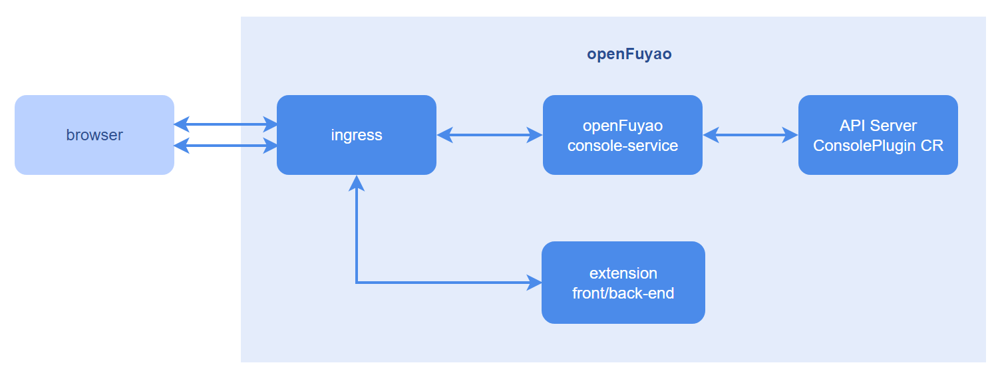
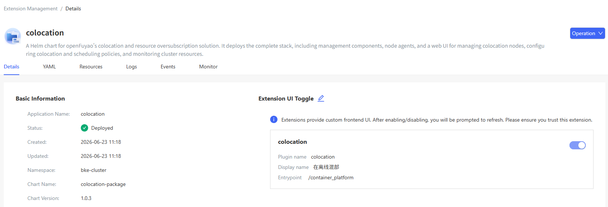
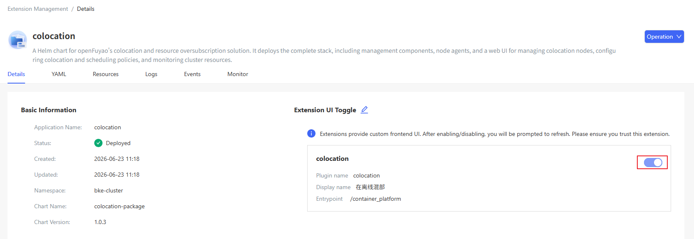

# Extension Management

## Feature Overview

To support cloud-native usage scenarios with growing diversity, openFuyao allows you to extend the capabilities of the openFuyao frontend management plane through extensions. You can enjoy more efficient, flexible, and customized cloud-native experience. You can install, uninstall, start, or stop extensions as required to manage the frontend and backend extension functions of openFuyao. In addition, openFuyao provides corresponding APIs and templates for users to integrate or develop third-party extensions.

### Applicable Scenarios

Extension Management is built on Application Management. The following extension O\&M scenarios are supported:

- Extension information acquisition: You can obtain a list of extensions, displaying the extension name, status, number of enabled or disabled interfaces, and update time, and filter and sort the extensions. In addition, more information such as YAML, resource list, events, and monitoring is displayed on the details page.

- Extension lifecycle management: You can install, uninstall, upgrade, and roll back extensions installed in a cluster.

- Enable/Disable Extension UIs: You can dynamically configure whether to mount the extension UI of a component to the openFuyao frontend management plane.

### Supported Capabilities

Extension Management provides frontend extension management interfaces and extended backend capabilities for the openFuyao frontend management plane. This feature allows you to dynamically load, unload, enable, and disable extensions based on your requirements. In addition, it provides APIs and templates for you to develop extensions.

### Highlights

openFuyao's pluggable architecture offers a standard extension discovery and mounting mechanism. This allows developers to extend both frontend and backend platform capabilities in the form of extensions without modifying openFuyao's core code. Installed extensions can be upgraded, rolled back, enabled, or disabled as required.

### Implementation Principles

**Extension Composition**

Extensions are implemented as Helm-based applications. Compared with standard Helm-based applications, extensions need to contain the custom resource ConsolePlugin of openFuyao. This resource defines frontend rendering configurations, such as component name, routing, and mount location, along with rules for forwarding requests through backend APIs. For details about how to configure the ConsolePlugin resource, see [development procedure](../developer_guide/extension_development_guide.md#development-procedure).

**Frontend Discovery**

When a browser loads the openFuyao frontend management plane, the management plane requests all ConsolePlugin resources from the openFuyao extension management service (plugin-management-service). Based on the frontend configuration of each ConsolePlugin instance, the management plane dynamically adds or mounts frontend elements of extensions and configures frontend routes.

**Frontend Loading**

The frontend modules of extensions are packaged into unified ES modules. The frontend obtains the request path based on the frontend information in ConsolePlugin, and dynamically loads the modules to the openFuyao frontend management plane.

**Distributing Extension Requests**

Requests related to extensions are classified into two types: requests for obtaining frontend resources and requests for calling backend extension APIs. When a browser sends a request related to an extension, the Ingress component of the management plane matches the request with the corresponding extension based on the prefix of the request path and forwards the request to the corresponding extension service.

**Figure 1** Implementation principles

### Related Features

Application Management: Extensions can be installed, uninstalled, upgraded, and rolled back using the Application Management feature. In addition, O\&M personnel can enable or disable the frontend extension UI based on the ConsolePlugin CRD fields.

### Instances

One example instance is the openFuyao log extension.

- For details, see [log component backend](https://gitcode.com/openfuyao/logging-operator).
- For details, see [log component frontend](https://gitcode.com/openfuyao/logging-website).

After the installation, the **Logs** menu is displayed in the left navigation pane of the openFuyao platform. You can access the log page to use the log function.

## Using the Extension Management Feature

In the left navigation pane, click **Extension Management**. The **Extension Management** page is displayed. You can view the deployed extension instances, including the application name, status, number of enabled or disabled interfaces, and update time. You can sort the instances by name or update time, and filter the instances by installation status.

Click the name of an extension. On the details page that is displayed, you can view details about the extension, including details, YAML, resources, events, and monitoring information.

**Figure 2** Extension details

### Enabling or Disabling an Extension UI

#### Prerequisites

- Kubernetes 1.28 and Helm 3.14.2 have been installed in the cluster.
- The plugin-management-service in the cluster is running properly.

#### Context

The openFuyao main UI discovers extensions through the custom resources of ConsolePlugin in the cluster. The extension UIs are introduced as ES modules. All related requests are obtained during the initialization of the openFuyao main UI. When an extension is installed, uninstalled, upgraded, rolled back, or its interface is enabled or disabled, you need to refresh the page to obtain the status of the extension again in order to display the corresponding frontend updates.

#### Restrictions

The format of the software to be installed is Helm chart. Currently, only software uploaded to the repository can be installed.

#### Procedure

1. Method 1: On the **Extension Application Details** page, select the **Details** tab, click **Operation**, and select **Enable/Disable Extension UIs**. The **Enable/Disable Extension UIs** setting button is displayed.
   
   Method 2: On the **Extension Application Details** page, click  next to **Enable/Disable Extension UIs**. The **Enable/Disable Extension UIs** setting button is displayed.

2. Turn on or off the switch to switch between the enabled and disabled states of the extension UI.
   
   **Figure 3** Enabling or disabling an extension UI
   
   

3. Click **Save**.

#### Related Operations

You can upgrade, roll back, or uninstall an extension by clicking  in the **Operation** column on the list page or **Operation** in the upper-right corner on the details page and then selecting the desired option.

**Table 1** Related operations

| Operation| Description|
|:----------|:----------|
| Upgrade| After an upgrade, you need to refresh the openFuyao management plane to update the extension UI.|
| Roll back| After a rollback, you need to refresh the openFuyao management plane to update the extension UI.|
| Uninstall| After an extension is uninstalled, if the extension UI is enabled for the extension, you need to refresh the openFuyao management plane to remove the extension UI.|
