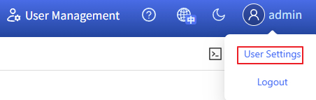
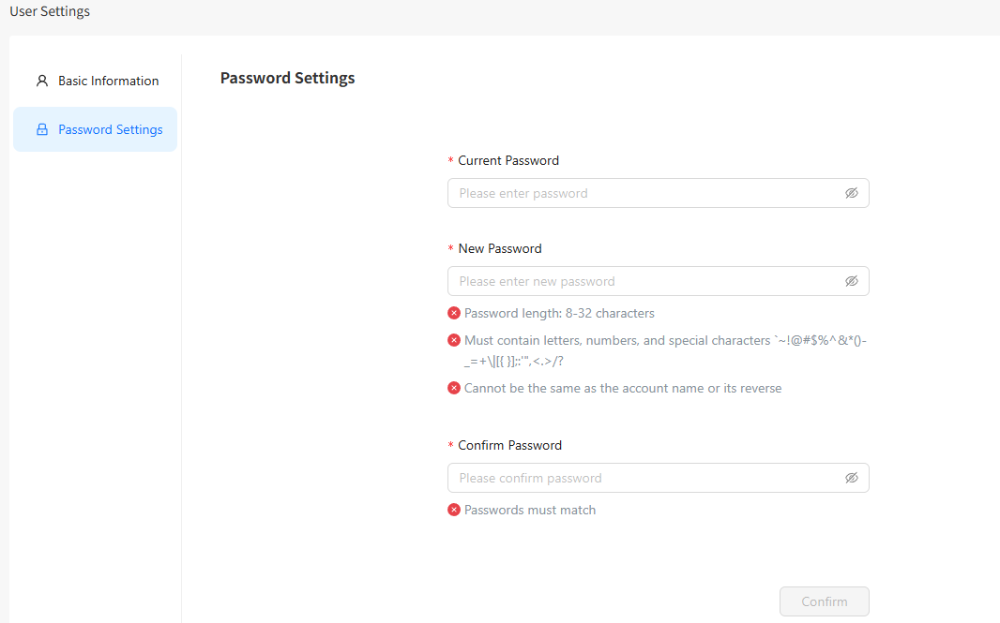

# Getting Started

## Functions in the Top Bar

The buttons on the right of the top bar provide quick access to various functions.

**Table 1** Functions in the top bar

| Icon| Description|
|:----------|:----------|
| | Click this icon to enter the YAML page to quickly deploy an application.|
| | Click this icon to view current alert statistics and the latest five alerts.|
| | Click this icon to switch between light and dark theme modes.|
| | Click this icon to access the help documentation of the openFuyao platform.|
| | Click this icon to access **User Settings** or **log out** of the platform.|
| | Click this icon to use the web terminal tool.|

## Setting a User

### Basic Information

Click the username and select **User Settings**. Choose **Basic Information** on the **User Settings** page that is displayed. Then, you can view the user avatar and username.

### Changing a Password

1. Click the **Password Settings** tab. The **Password Settings** tab is displayed.
2. Enter the current password and new password, and click **OK**. The password must meet complexity requirements.

> **Note:**  To improve system security, change the password periodically (for example, every six months) to prevent security risks such as brute-force password cracking.

### Homepage

After logging in to the openFuyao platform, you can click the openFuyao logo in the upper-left corner to switch to the homepage. The homepage displays cards for quick access to three modules.

- Easy Installation and Deployment: quick entries to **Application Market** and **Zero-Cost Application Migration**.
- Intelligent O&M Interaction: quick access to **Pluggable Architecture** and **Application Management**.
- Ultimate Observability: quick access to **Monitoring Dashboard** and **Cluster Overview**.
