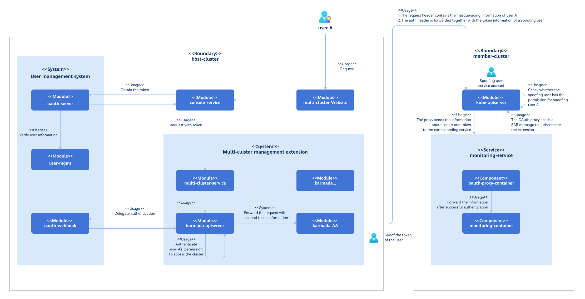
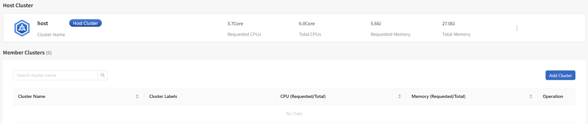
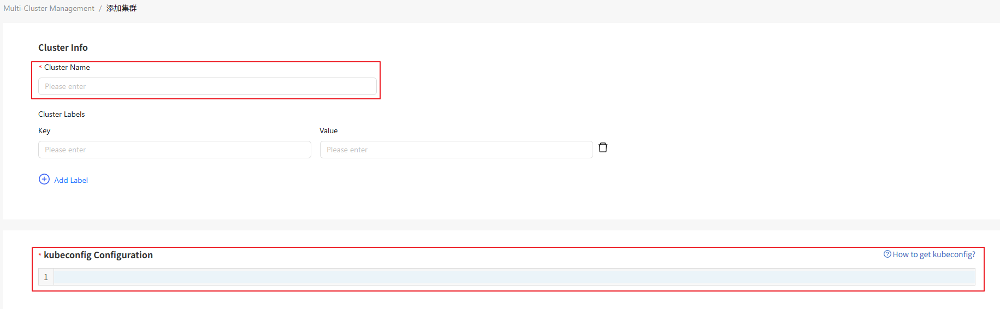

# Multi-Cluster Management

## Feature Overview

With the development and popularization of cloud native technologies, more and more enterprises use Kubernetes as their container orchestration and management platform. To meet more complex service requirements and improve system reliability and elasticity, enterprises have to transform from a single cluster to a multi-cluster environment. This transformation brings a series of challenges, including cluster management, monitoring, security, compliance, and optimized allocation of cross-cluster resources. The emergence of multi-cluster management extensions is a strategic response for modern enterprises to cope with the rapid development of technologies and service requirements, leveraging technological innovation to reduce O\&M complexity, control costs, and strengthen security and compliance.

As an extension, openFuyao multi-cluster management aims to provide efficient and flexible cross-environment management of Kubernetes clusters. It can be installed on the openFuyao platform through the application market. This component supports the following capabilities:

- Cluster list: You can view and manage the status and basic information of all clusters on the cluster list page.
- Cluster lifecycle management: It simplifies cluster scale-up and destruction and allows you to manage new clusters, adjust the scale of existing clusters, update cluster configurations, and safely cancel the management of unwanted clusters.
- Viewing cluster credentials: You can use cluster credentials to quickly access a cluster.
- Cluster label management: You can quickly edit cluster labels.
- Cross-cluster access: It provides functions such as secure cross-cluster access.

### Applicable Scenarios

- Multi-cloud management: openFuyao multi-cluster management is a platform for centrally managing all Kubernetes clusters.
- Agile development and testing: Development teams can quickly iterate and test applications in multiple isolated clusters without affecting the production environment.

### Supported Capabilities

+ Cluster management and unmanagement: You can manage a member cluster by adding a kubeconfig file to the host cluster, provided that the host cluster has direct access to the member cluster's Kubernetes API server. You can also unmanage a member cluster from the host cluster when it is no longer required.
+ Adding cluster labels: You can add labels to a cluster to facilitate cluster management.
+ Viewing cluster credentials: Cluster credentials of the managed clusters are provided to facilitate quick access to the clusters.
+ Basic monitoring metrics: Basic cluster monitoring metrics are provided, including the CPU and memory usage of each cluster.
+ Cluster access permission control: Unified user authentication is performed on the karmada-apiserver of the host cluster. Only users who have been invited to a cluster have permissions to access the container platform of the cluster.
+ Access to a cluster container platform using the unified entry of the host cluster: You can use the Karmada multi-cluster management component to access any openFuyao member cluster on the management page of the host cluster. This has the same user experience as directly accessing the ports exposed by member clusters.

### Implementation Principles

+ Cluster management and unmanagement

The logic of managing and unmanaging a cluster is controlled by the multi-cluster-service module. This module performs access control based on whether the current user has permissions to manage clusters.

The multi-cluster-service module collects necessary cluster information and registers it with the central control plane of Karmada. Once managed, member clusters periodically synchronize cluster status information, such as health status and resource usage, with the central control plane of Karmada, ensuring that the control plane can accurately obtain the real-time data of each cluster. Unmanagement is a reverse process. If the management of a cluster is no longer required, the multi-cluster-service module removes all records of the cluster from the central control plane of Karmada and clears the configurations related to the cluster to ensure that the cluster is no longer managed by Karmada.

+ Cluster access route

After the multi-cluster extension is installed, the access route to clusters changes. Instead of being forwarded directly from the console-service to each service, requests are now routed through the karmada-apiserver. The karmada-apiserver first forwards them to the kube-apiserver of the member cluster and then to the specific services within that member cluster.

**Figure 1** Implementation principles of multi-cluster management

### Related Features

Multi-cluster management is deployed in openFuyao as an extension. It needs to communicate with the user management system to assign different cluster operation permissions to users based on their roles.

### Instances

Code links:

+ Frontend: [openFuyao/multi-cluster-website (gitcode.com)](https://gitcode.com/openfuyao/multi-cluster-website)

+ Backend: [openFuyao/multi-cluster-service (gitcode.com)](https://gitcode.com/openfuyao/multi-cluster-service)

## Installation

### Prerequisites

The multi-cluster management component is installed on the openFuyao platform as an extension. The hardware, software, and network requirements for installation of this component are the same as those for installation of the openFuyao platform.

### Procedure

1. Log in to the management plane of the openFuyao platform.
2. In the left navigation pane of the openFuyao platform, choose **Application Market** > **Applications**. The **Applications** page is displayed.
3. Select **Extension** in the **Type** filter on the left to view all extensions. Alternatively, enter **multi-cluster-service** in the search box to search for the extension.
4. Click the **multi-cluster-service** card to go to the details page of the extension.
5. Click **Deploy**. The **Deploy** page is displayed.
6. Enter the application name and select the desired installation version and namespace.
7. Enter the values to be deployed in the **Values.yaml** file.
8. Click **Deploy**.
9. In the left navigation pane, click **Extension Management** to manage the multi-cluster management extension.

> **Notice:**
> 
> - Restarting cluster nodes may cause the Karmada service to become unavailable. Exercise caution when restarting nodes.
> - If the Karmada service becomes unavailable due to a node restart, uninstall the multi-cluster management component and reinstall it.

## Viewing the Cluster List

### Prerequisites

None.

### Context

None.

### Restrictions

You can view only the cluster information within your permissions.

### Procedure

1. On the top navigation bar of the openFuyao platform, click **Multi-Cluster Management**. The Cluster List page is displayed.
   
   **Figure 2** Cluster list page
   
   

2. Click a cluster name to view the details of the cluster.

### Related Operations

You can click  in the **Operation** column and choose **View Credentials** to view the cluster credential information as required.

## Managing a Cluster

### Prerequisites

You must have the platform admin role.

### Context

With the widespread adoption of Kubernetes, most enterprises need to manage multiple clusters. Integrating existing Kubernetes clusters into a unified management platform enables centralized multi-cluster management. This simplifies cluster monitoring and management.

### Restrictions

The openFuyao platform only supports managing openFuyao clusters in accessible network segments.

### Procedure

1. On the **Cluster List** page, click **Add Cluster**. The **Add Cluster** page is displayed.

2. Enter the information about the cluster to be managed as prompted. The information marked with a red asterisk (\*) is mandatory.

**Figure 3** Adding a cluster

3. Click **OK**.

4. The managed cluster is displayed in the member cluster list.

## Modifying a Cluster Label

### Prerequisites

You must have the platform admin role.

### Context

To provide a simple way of specifying clusters, labels (key-value pairs) can be attached to cluster resources. This enables users to manage resources more efficiently.

### Restrictions

Cluster labels must comply with the [Kubernetes label specifications](https://kubernetes.io/docs/concepts/overview/working-with-objects/labels/).

### Procedure

1. On the **Cluster List** page, click  in the **Operation** column and select **Change Label**. The **Edit Label** dialog box is displayed.
2. Enter the cluster label information as prompted.
3. Click **OK**.

### Related Operations

You can click  in the **Operation** column on the list page to unmanage a cluster as required.

### Follow-up Operations

On the **Cluster List** page, click a cluster name to go to the cluster management platform. The **Cluster Overview** page is displayed by default. You can also navigate to the page from the left navigation pane to manage clusters.
