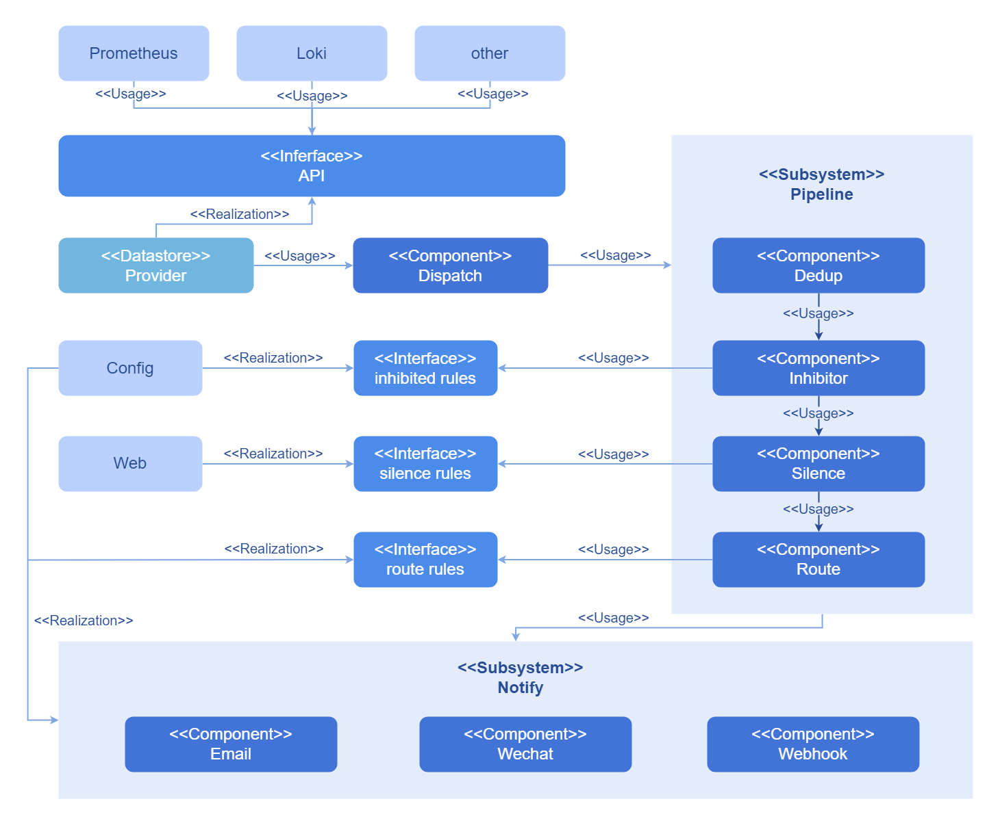
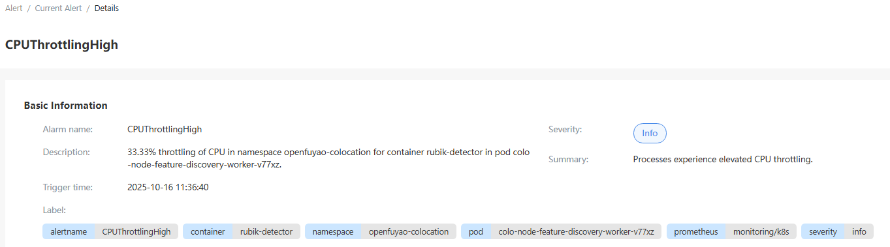
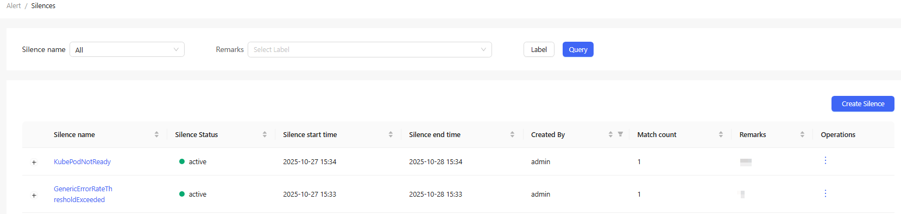

# Alerts

The alerting system can quickly send alert notifications based on preset alert rules for connected alert sources. You can filter alerts by name, severity, duration, and label, and mask specified alerts by configuring silence rules.

## Feature Overview

The openFuyao alerting system is responsible for processing and scheduling various alerts of the platform, which effectively simplifies management and improves processing efficiency.

The alerting system provides the following functions:

- Alert viewing: Based on the rules configured for different alert sources, alerts on the platform are displayed in groups by name, severity, and duration.
- Alert silencing: You can temporarily mask relevant alerts by configuring silence rules.
- High availability (HA): The alerting system can be deployed in HA mode, running multiple instances to prevent single points of failure.
- Alert details: Alert details help quickly locate the problem that triggers the alert.

### Applicable Scenarios

The openFuyao alerting system is used to manage faults of the container platform infrastructure to ensure that all important system alerts can be responded to and handled in a timely manner. Typical application scenarios are as follows:

- System performance monitoring: Alerts are triggered when the usage of system resources, such as CPU, memory, and disk space, exceeds the preset thresholds. This helps system O\&M personnel detect and resolve problems that may cause performance deterioration in a timely manner.
- Service health check: The availability and response time of key application components such as infrastructure services are monitored. Once a service is abnormal, an alert is triggered immediately.
- Log analysis: The system identifies abnormal modes or error messages based on log content and triggers alerts, helping O\&M personnel quickly rectify problems or take optimization measures.

### Supported Capabilities

- Real-time alert display: You can view the real-time alert information.
- Basic silence configuration: You can configure the alert silence mode.
- Alert source display: You can view the configured alert sources.

### Highlights

- Multi-label filtering: The alerting system of openFuyao provides the multi-label filtering capability for alerts. Alerts can be quickly filtered by different dimensions, such as the severity, name, duration, alert source, and alert label.
- Silence: You can temporarily suppress alert notifications by configuring silence rules.
- HA: The alerting system is deployed in HA mode on multiple instances to prevent single points of failure.

### Implementation Principles

- The alerting component consists of a series of pipelines that together deliver the required functionality of the alerting system.

- The alerting system receives alerts from various alert sources. The alerts are regrouped internally, and the repeated ones in a group are deleted. Based on the configured suppression and silence rules for alerts, the system discards the alerts that meet specific conditions and retains the remaining alerts. Finally, these alerts are pushed to corresponding receivers in different push modes based on the configured alert routes, as shown in [Figure 1](#figure000123).

- On the openFuyao platform, alerts are classified into three levels: critical, warning, and information. The number of alerts of each level is collected and displayed separately.

**Figure 1** Implementation principles

### Related Features

Currently, the alert sources configured in the cluster include the monitoring component and the log component (optional). The collaboration of the two components greatly enhances the infrastructure monitoring and log management capabilities, thereby maintaining system stability and reliability.

- Monitoring: Key performance metrics are continuously monitored. Once an abnormal behavior is detected or a performance metric exceeds the preset threshold, the system immediately sends a notification.
- Logs: The system continuously collects logs and triggers notifications based on predefined alert rules, sending the alerts to the alerting component.

## Using Current Alerts

In the left navigation pane of the openFuyao platform, choose **Observation Center** > **Alerts** > **Current Alerts**. The **Current Alerts** page is displayed.

- Query current alerts by name, severity, duration, alert source, and label.

- Click an alert name. On the alert details page, you can view the basic information about the alert.
  
  **Figure 2** Alert details
  
  

### Setting Silent Alerts

You can set an alert as a silent alert. After the setting, the alert is displayed in **Silent Alerts** within the silence duration.

#### Prerequisites

The silence rule is set only for a specific alert.

#### Context

You can quickly set a silence rule for an alert to suppress notifications for the alert.

#### Restrictions

None.

#### Procedure

1. Click  in the **Operation** column. The **Set Silence** dialog box is displayed.

2. Set the silence start time, silence duration, and remarks.

3. Click **OK**.

## Using Silent Alerts

In the left navigation pane of the openFuyao platform, choose **Observation Center** > **Alerts** > **Silence**. The **Silence** page is displayed.

**Figure 3** Silent alerts

### Creating a Silent Alert

#### Prerequisites

Ensure that the labels you add match those already associated with alerts.

#### Context

Alert silencing is used to temporarily suppress notifications for known issues or during maintenance periods. It is particularly useful during system maintenance or upgrades when you do not want to receive notifications for specific alerts.

#### Restrictions

- Time synchronization: The effectiveness of a silence rule relies heavily on accurate synchronization of system time. If the time of an alerting component instance is not synchronized with that of other system components, the silence rule may be activated or deactivated at the wrong time.
- Silence rule management: In a large-scale environment, a large number of silence rules complicate management. Outdated or unrelated silence rules need to be periodically cleared in the backend.

#### Procedure

1. Click **Create Silent Rule**. The **Create Silent Rule** dialog box is displayed.

2. Set the silence start time, silence duration, label, creator, and remarks.

3. Click **OK** to complete the silence rule configuration.

#### Related Operations

- Viewing silent alerts: You can click the  icon on the left of a silence name to change it to  and view silent alerts as required. You can click a silence name to view basic information and silent alerts.

- Modifying or deleting silent alerts: You can also modify or remove a silent alert by clicking  in the **Operation** column on the list page or **Operation** in the upper-right corner on the details page and then selecting the desired option.
