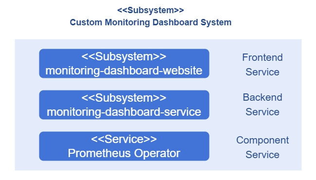
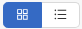
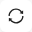
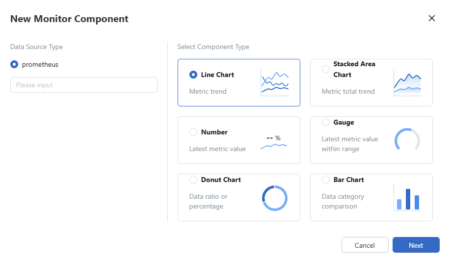
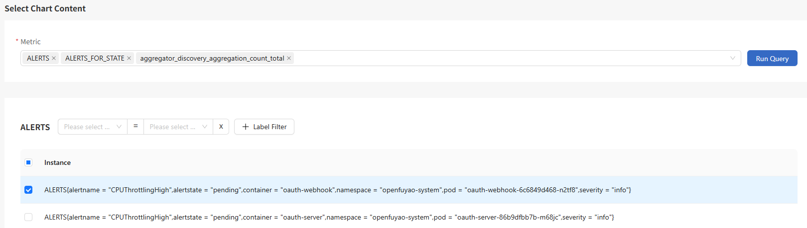

# Custom Monitoring Dashboard

## Feature Overview

A custom monitoring dashboard is designed to meet enterprises' requirements for highly customizable and scalable monitoring systems. It provides a comprehensive solution for you to monitor various performance metrics and allows you to customize monitoring metrics based on service requirements, enabling accurate data observation and analysis. A monitoring dashboard is a collection of monitoring components. You can combine monitoring components for different monitoring purposes as required.

### Applicable Scenarios

A custom monitoring dashboard allows you to perform fine-grained monitoring of your Kubernetes environment based on your service needs. You can create monitoring components that cover multiple monitoring instances and view the components on monitoring dashboards in a unified manner, thus focusing on metrics that matter most. Typical application scenarios are as follows:

- Cluster status monitoring: You can monitor key performance metrics of each node, such as those related to the CPU, memory, disk, and network performance, helping you gain insights into the cluster health status and performance bottlenecks.
- Pod and container monitoring: You can monitor key metrics such as the actual memory request utilization and network request volume for pods and containers, helping you quickly confirm their statuses.
- Service monitoring: You can monitor key service metrics such as response time, throughput, and error rate of services in Kubernetes, providing a visual overview of service statuses.
- Custom monitoring metrics: Custom monitoring dashboards can obtain and display custom metrics exposed to data collectors (such as Prometheus), further meeting your personalized monitoring requirements.

### Supported Capabilities

A custom monitoring dashboard provides the monitoring page and backend capabilities for the frontend management of openFuyao. You can customize the monitoring content based on service requirements. The key capabilities are as follows:

- Custom data charts: Six types of data charts are supported: line chart, stacked area chart, dashboard, single-value chart, histogram, and donut chart, providing you with various metric visualization options.
- Custom time range: Dashboard data can be automatically updated, and data in a specified time range can be queried, providing various options for visualizing metrics.
- Custom monitoring metrics: You can filter monitoring metrics efficiently and display metrics of different types in the same chart, providing more flexibility for you to customize metrics and meeting more complex monitoring requirements.
- Custom monitoring dashboards: You can manage multiple custom monitoring dashboards and flexibly combine monitoring components in a single monitoring dashboard, building a monitoring interface that best fits your service requirements.

### Highlights

- High customization: In terms of system management, you can customize a routine system O\&M dashboard to assist you in quickly identifying system issues. In terms of data analysis, you can customize an application data dashboard to help optimize decision-making.
- High scalability: In terms of system management, you can freely adjust the system monitoring scope to quickly adapt to service content changes. In terms of data analysis, you can expand the monitoring content for key services, gaining deeper and broader service insights.

### Implementation Principles

A custom monitoring dashboard is classified into three layers by service types: frontend service, backend service, and component service. The implementation principles of each layer are as follows:

**Figure 1** Implementation principles



**Frontend service**: The monitoring-dashboard-website service provides a visualized monitoring interface for you to flexibly combine monitoring components.

**Backend service**: As a microservice, the monitoring-dashboard-service service supports monitoring services, including creating and managing monitoring dashboards and monitoring components, and filtering and querying monitoring metrics. The backend service obtains raw metric data from an external data collector. Currently, it collects cluster and system data through Prometheus, and can be integrated with other data collectors.

**Component service**: Prometheus Operator is a data collector that collects raw metric data from the system and provides APIs for external query and data acquisition.

### Related Features

A custom monitoring dashboard is relatively independent and does not depend on other features.

## Installation

### Prerequisites

- Kubernetes 1.21 or later has been deployed.
- Prometheus has been deployed.

### Procedure

#### Deployment on the openFuyao Platform

1. Log in to the openFuyao management plane.
2. In the left navigation pane, choose **Application Market** > **Applications**. The **Applications** page is displayed.
3. Select **Extension** in the **Type** filter on the left to view all extensions. Alternatively, enter **monitoring-dashboard** in the search box to search for the extension.
4. Click the **monitoring-dashboard** card. The details page of the custom monitoring dashboard extension is displayed.
5. Click **Deploy**.
6. Set the application name, version information, and namespace.
7. Enter the values to be deployed in the **Values.yaml** file.
8. Click **OK**.

In the left navigation pane, click **Extension Management**. On the page that is displayed, you can manage the deployed custom monitoring dashboard extensions.

#### Standalone Deployment

In addition to the installation and deployment of the Custom Dashboards on the openFuyao platform, this extension also provides the standalone deployment function in either of the following ways:

- Obtaining the project installation package from the official image repository of openFuyao:

1. Pull the project installation package.
   
   ```
   helm pull oci://harbor.openfuyao.com/openfuyao-catalog/charts/monitoring-dashboard --version xxx
   ```
   
   Replace `xxx` with the actual project installation package version, for example, `0.0.0-latest`. The obtained installation package is a compressed package.

2. Decompress the installation package.
   
   ```bash
   tar -zxvf monitoring-dashboard
   ```

3. Install and deploy the extension.
   
   Run the following command in the directory where monitoring-dashboard is located:
   
   ```
   helm install --generate-name ./monitoring-dashboard
   ```

- Obtaining the project installation package from the GitCode repository of openFuyao:

1. Pull the package from the repository.
   
   ```
   git clone https://gitcode.com/openFuyao/monitoring-dashboard-website.git
   ```

2. Install and deploy the extension. Run the following command in the directory where monitoring-dashboard-website is located:
   
   ```
   helm install --generate monitoring-dashboard-website/charts/monitoring-dashboard
   ```

After the deployment is complete, you can also click **Extension Management** in the left navigation pane of the openFuyao management plane and perform operations on the custom monitoring dashboards.

## Using a Custom Monitoring Dashboard

In the left navigation pane, choose **Observation Center** > **Custom Monitoring Dashboard**. The **Custom Monitoring Dashboard** page is displayed. On this page, all monitoring dashboards created by you are displayed. You can view, create, modify, and remove monitoring dashboards. By default, the monitoring dashboards are displayed as cards. You can click  to switch the display mode. In the upper part of the **Monitoring Dashboard** page, you can select filter criteria to view monitoring data as required. The following table describes the filter criteria.

**Table 1** Filter criteria description

| Filter Criteria| Description|
|:----------|:----------|
| Time Range| Filter the monitoring data within the specified time range.|
| End Time| Specify the end time of the monitoring data.|
| Auto Refresh Interval| Specify the time interval for refreshing monitoring data. The monitoring data is automatically refreshed after the specified time interval.|
| | Manually refresh the monitoring data.|

### Creating a Monitoring Dashboard

#### Prerequisites

You must have the platform admin or cluster admin role.

#### Context

You can create a monitoring dashboard from a macro perspective, such as services. A dashboard is permanently stored once created.

#### Restrictions

None.

#### Procedure

1. On the **Custom Monitoring Dashboard** page, click **Create Monitoring Dashboard**. The **Create Monitoring Dashboard** dialog box is displayed.

2. Enter a monitoring dashboard name in the **Dashboard name** text box.

3. Click **OK**.

#### Related Operations

You can modify or remove a monitoring dashboard by clicking  in the **Operation** column on the list page or **Operation** in the upper-right corner on the details page and then selecting the desired option.

## Using a Monitoring Component

- Each monitoring dashboard can include multiple monitoring components to meet diversified monitoring requirements.

- A monitoring component displays monitoring data in chart form and can monitor up to eight monitoring instances simultaneously. (A monitoring component of the stacked area chart type supports the monitoring of up to three monitoring instances.) A monitoring instance represents the smallest monitorable object in Kubernetes. Each monitoring instance is uniquely identified by a metric key-value pair.

### Viewing a Monitoring Component

#### Prerequisites

You must at least have the platform viewer role.

#### Context

You can view monitoring components in the monitoring dashboards.

#### Restrictions

- Monitoring components depend on the monitoring dashboards. Therefore, you can view monitoring components only on the monitoring dashboards.
- The monitoring instances in a monitoring component may become invalid. Invalid monitoring instances are not displayed.

#### Precautions

There may be time discrepancies between the client and server, which can lead to inaccurate query results for the monitoring metrics.

- If the server time is behind the client time, your query results shift into the future. As a result, no data can be found for the requested timestamps, causing the page to display a value of **0**.
- If the server time is ahead of the client time, your queries shift into the past.

#### Procedure

On the **Monitoring Dashboard** page, you can view all monitoring components on the current monitoring dashboards. Monitoring components are displayed as cards. Each monitoring component contains the monitoring component name and chart.

### Creating a Monitoring Component

#### Prerequisites

You must have the platform admin or cluster admin role.

#### Context

You can combine monitoring metrics as required. After a monitoring component is created, the monitoring component and its monitoring metrics are stored persistently.

#### Restrictions

- A dashboard must already exist before you can create a monitoring component. Deleting a monitoring component does not affect the monitoring dashboard. However, if you remove a monitoring dashboard, all monitoring components created under it are also removed.
- When creating a monitoring component, you need to enter a valid data collector URL. Currently, only Prometheus Operator can be used as the data collector.
- When creating a monitoring component, you can select up to eight monitoring instances for each monitoring component. If the chart is a stacked area chart, you can select up to three monitoring instances.

#### Procedure

1. On the *xx* monitoring dashboard details page, click **Create Monitoring Component**. The **Create Monitoring Component** dialog box is displayed.
   
   **Figure 2** Creating a component
   
   

2. In the **Create Monitoring Component** dialog box, enter the basic information about the component.
   
   2.1 Select a data source type from the **Data source type** drop-down box, and enter the resource request path of the data source in the **Enter a URL.** text box.
   
   2.2 Select the chart type for displaying data.
   
   2.3 Click **Next**. The **Add Monitoring Component** page is displayed.

3. On this page, enter the monitoring component name in the **Component name** text box.

4. Click the **Metric** drop-down list and select the metric to be monitored. Fuzzy match of character strings is supported. After you select a metric, a metric card is displayed in the lower part.
   
   > **Note:** <br />A maximum of eight metrics can be selected. (A monitoring component of the stacked area chart type supports the monitoring of up to three metrics.) The selected metrics are displayed as cards under the **Metric** drop-down list.

5. Select the monitoring instance to be monitored. Each metric card displays all monitoring instances contained in it.
   
   5.1 Monitoring instances can be filtered on metric cards. You can click the **Select a key** drop-down list to display all keys for the current metric. After you select the target key, the metric card displays the monitoring instances that include this key. Fuzzy match of character strings is supported for keys.
   
   5.2 Click the **Select a value** drop-down list to display all values contained in the target key. After you select a value, the metric card displays only the monitoring instances where the key equals the selected value. Fuzzy match of character strings is supported for values.
   
   5.3 Multiple labels can be used for filtering. You can click **Label Filter** to add filter criteria.
   
   5.4 Click the check box on the left of the monitoring instance to select the monitoring instance to be monitored. Up to eight monitoring instances can be selected at a time. (A monitoring component of the stacked area chart type supports the monitoring of up to three monitoring instances.)
   
   **Figure 3** Creating a component instance
   
       

6. At the top of the page, select the time range for the query.

7. Click **Query**. The chart preview of the selected monitoring instance is displayed in the upper part of the page.

8. Click **Create**.

#### Related Operations

You can click  in the **Operation** column on the list page to modify or remove a monitoring component as required.
