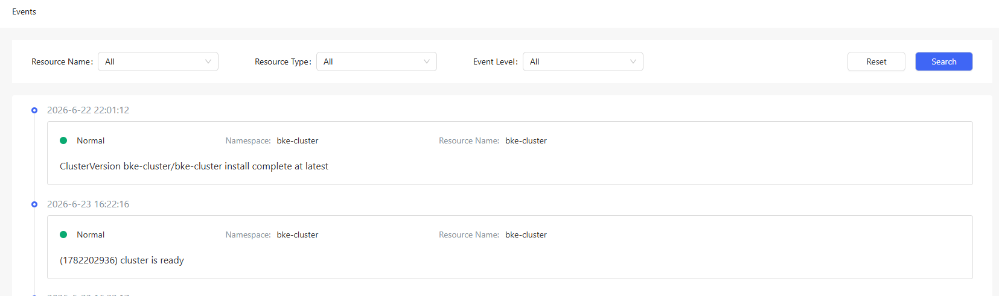

# Events

## Feature Overview

Events reflect the changes in native Kubernetes resources, such as pods, Deployments, and StatefulSets.

### Applicable Scenarios

This feature is used to query the events about a resource.

### Supported Capabilities

The openFuyao platform records events corresponding to various state changes of resources and provides query and visualization capabilities. When anomalies occur with resources such as clusters, nodes, and pods, you can analyze the cause based on the events.

### Highlights

Resource status change events are generated in real time and can be viewed and analyzed using `kubectl get events` or other tools.

### Implementation Principles

When the status of a resource object in the Kubernetes cluster changes, the controller (such as kube-scheduler and kubelet) generates an event and stores the event in the etcd database through the API server.

### Related Features

Integrated with monitoring systems such as Prometheus, events can be exposed through kube-state-metrics to track their status and frequency, enabling cluster status monitoring and alerting.

## Viewing Events

### Prerequisites

Access permission: You must have the get and list permissions to view events in Kubernetes, which are typically granted through role-based access control (RBAC).

kubectl configuration: Ensure that kubectl has been properly configured and can access the target cluster.

### Context

Events in Kubernetes are used to record log information about resource status changes in a cluster. They help you understand the status changes, error messages, and scheduling statuses of resources (such as pods and nodes) in a cluster. During debugging and troubleshooting, you can quickly locate anomalies that occur during resource creation, scheduling, and running.

### Restrictions

- Non-persistent storage: Event data is stored in the etcd database, but is not stored persistently. For important events or events that need to be stored as logs for a long time, you are advised to export the events to the log management system.

- Namespace isolation: Events are namespace-scoped resources. You can view only events in namespaces on which you have permissions. Cross-namespace event operations require additional permissions.

### Procedure

In the left navigation pane, choose **Observation Center** > **Events**. The **Events** page is displayed.

On this page, you can view events about native Kubernetes resources, such as pods, Deployments, and StatefulSets. You can query events by resource name, resource type, and severity.

**Figure 1** Viewing events

