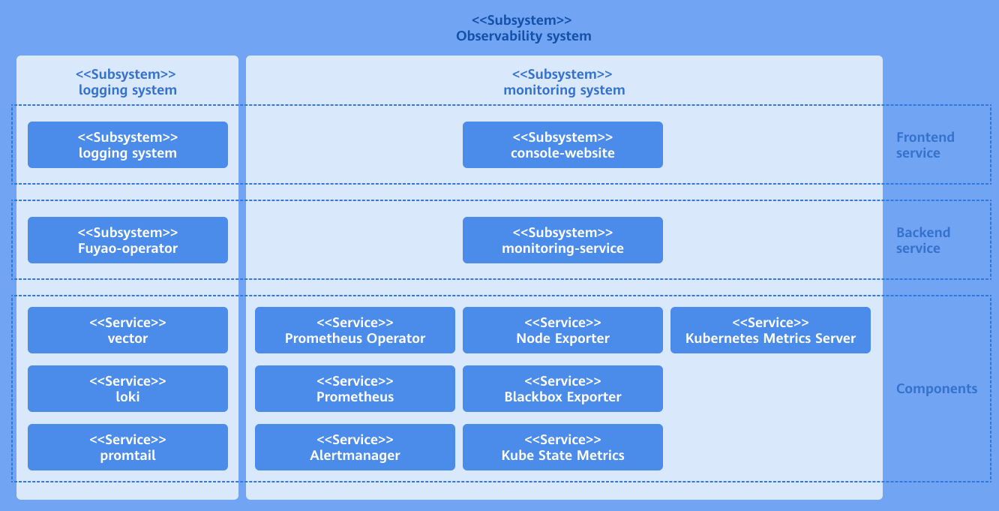
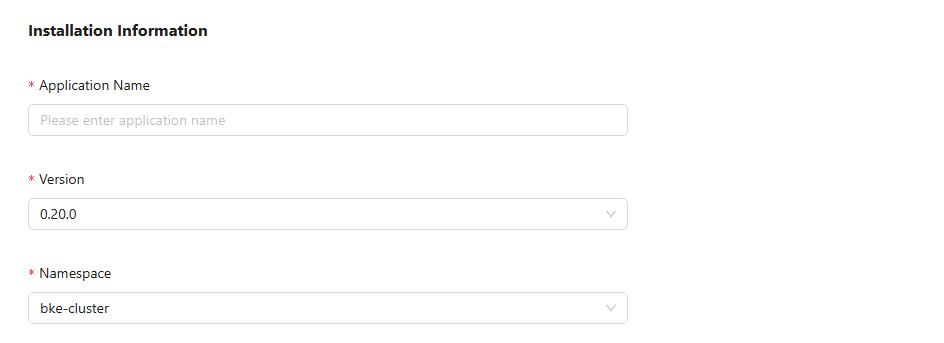
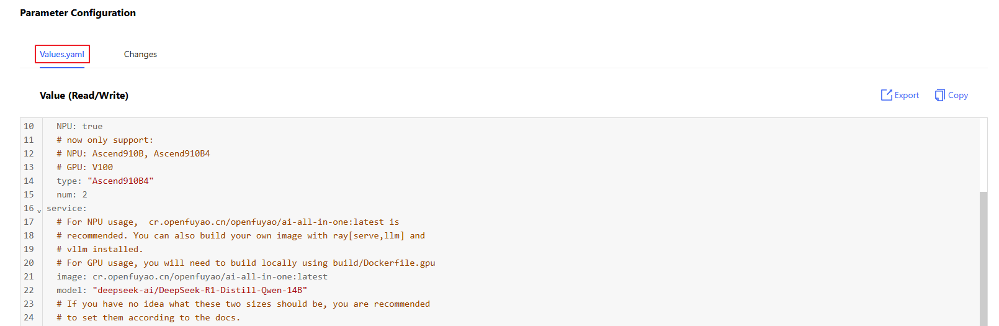
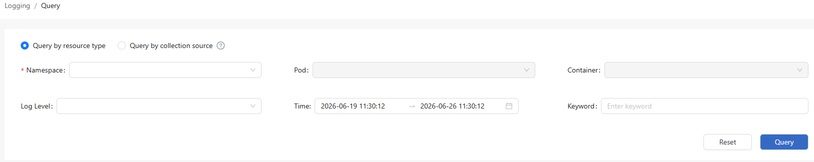
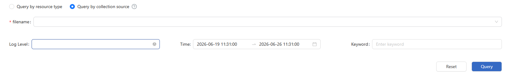
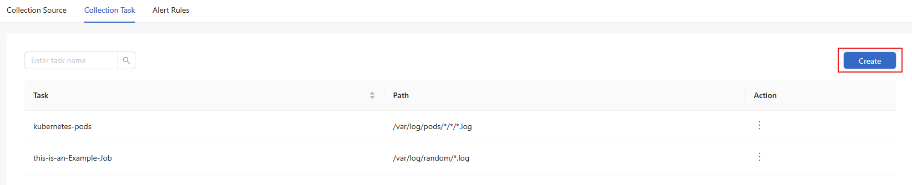
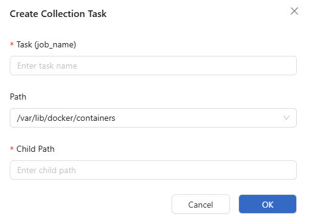
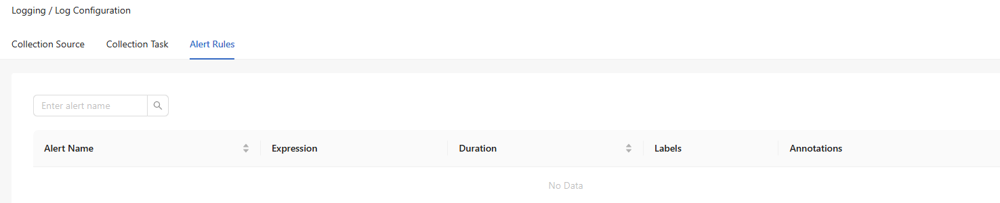

# Logs

## Feature Overview

The logging feature can be implemented using an extension, which can be installed through the openFuyao application market. You can view logs of pods and containers, and configure log collection sources, collection tasks, and alerting rules. The openFuyao logging system can effectively improve the error identification efficiency and enhance the monitoring capability of the entire platform.

### Applicable Scenarios

The openFuyao logging system is used for log management of the container platform infrastructure. O\&M personnel can query, analyze, and quickly locate issues through the logging system. The application scenarios are as follows:

- Querying faulty applications and tracing causes: When an error occurs in an application or service on the container platform, O\&M personnel can query the time and container name to locate the specific error log information to quickly locate the root cause and rectify the fault in a timely manner.
- Custom querying and filtering logs of applications: If the application you created is not a native Kubernetes application, it is difficult to obtain the logs using command-line instructions. This can be addressed by customizing the log collection source path. The logging system will automatically collect logs from the custom path.
- Log analysis: The system identifies abnormal modes or error messages based on log content and triggers alerts, helping O\&M personnel quickly rectify problems or take optimization measures.

### Supported Capabilities

- Viewing logs: You can view logs based on basic filtering criteria, such as the namespace, container name, and log collection path.

- Log alerting: When logs in the cluster meet the conditions defined in log alerting rules, the logging system sends corresponding alert information to the alerting component.

- High availability (HA): The logging system can be deployed in HA mode, running multiple instances to prevent single points of failure.

- Custom log collection sources: You can add or remove log collection sources to allow the platform to flexibly collect logs of various applications.

- Custom query range and keyword filtering: You can quickly query the expected filtering results through various methods, including searching keywords, customizing time range restrictions, and filtering logs based on log levels.

### Highlights

**Efficient Log Collection and Management**

You can collect and query logs of various services and containers in real time based on custom filter criteria. The custom filter criteria include, but are not limited to, the namespace, service name, container name, keyword, time range, log collection path, file name, and log type and level. You can combine multiple criteria to achieve precise queries.

**Precise Fault Locating**

After selecting a log source (for example, a specific container or log path), you can accurately locate all logs with a fine-grained time span. The system also supports contextual log queries by custom time range. After locating a key log, you can query contextual logs as required.

**Diversified Log Collection Capabilities**

You can set log collection paths to collect logs generated by user-defined applications. You can add a log collection source without changing the default configuration. In addition, you can customize the log collection task, allowing the log collection component to collect logs in the specified path. You can view the logs of the application on the query page using the "path+file name" format.

**Sensitive Log Alerting**

The system allows users to create log alerting rules when installing log components, and provides log alerting rule templates and preset log alerting rules. When collected logs match alert rules, the system pushes an alert to the alerting component, delivering a one-stop fault detection flow that covers log monitoring, alerting, and root-cause localization.

**Log Export and Download**

You can export any log content you want to retain from the log component. In the current version, you can filter and export logs. You can filter the logs of a single container by time on the log details page.

### Implementation Principles

As an ecosystem extension of openFuyao, the log component consists of three parts: log backend layer, log UI layer, and open-source software layer.

**Log backend layer**

The logging-operator backend is deployed in the cluster as a microservice. It provides core capabilities for the log extension, such as APIs for log query and filtering, APIs for querying log collection sources, APIs for querying log alerting rules, APIs for adding, deleting, modifying, and querying log collection tasks, and APIs for querying contextual log details.

The backend processing logic of the logging-operator is as follows: After receiving a call request from the frontend, it generates a LogQL query statement used by the Loki component based on the specific request content. It assembles this LogQL into a query request for calling the Loki HTTP API to obtain the query and filtering results in the Loki component. Then, it assembles the response based on the specific return logic and returns it to the original calling API. The collection source configuration function calls the **client-go** API of Kubernetes to add, delete, modify, and query Kubernetes cluster resources.

**Log UI layer**

The frontend UI part of the log component is independently deployed on the openFuyao platform as a scalable, pluggable component. After the UI part is installed and deployed on the openFuyao platform, the log UI is automatically integrated into the left navigation pane of the console-website. You can use the log component directly from the left navigation pane of the openFuyao management plane. If the openFuyao platform is not installed in the cluster, the log UI can be deployed together with the log backend and the log open-source software as an independent log application. In this case, the log UI layer is an independent interface.

**Log Open-source Software Layer**

The open-source log software provides underlying support capabilities for the logging system. It consists of the log collection component (promtail) and the log storage component (Loki). The log collection component is deployed on each node as a DaemonSet and forwards logs from collection sources to the log storage component based on collection rules. Loki receives the HTTP requests, queries logs in the log database, and returns the results.

**Figure 1** Implementation principles



### Related Features

The alerting system triggers notifications based on configured alert sources (such as Prometheus and Loki) and associated alert rules.

## Installation

### openFuyao Platform

1. Log in to the openFuyao platform. The **Summary** page is displayed by default. In the left navigation pane, choose **Application Market** > **Applications**. The **Applications** page is displayed.

2. Select **Extension** under **Type** on the left.

3. Click the **logging-package** application card. The application details page is displayed.

4. On the details page, click **Deploy** in the upper-right corner.

5. In the **Installation Information** area on the deployment page, set the application name, version information, and namespace. Set the namespace to **default**.
   
   **Figure 2** Installation information
   
   

6. In the **Parameter Configuration** area, you can view the configuration of each configurable field on the preview page of **Values.yaml**.
   
   **Figure 3** YAML configuration
   
   

7. Click **OK**.

### Independent Deployment

1. Installation

   1.1 Obtain the logging-package Helm package.
    ```
    wget https://harbor.openfuyao.com/chartrepo/openfuyao-catalog/charts/logging-package-0.13.0.tgz
    ```
   1.2 In **Values.yaml** under **Parameter Configuration**, enter the values information to be deployed.

   1.3 Deploy using Helm.
    ```
    tar -zxf logging-package-0.13.0.tgz
    helm install logging -n default ./logging-package
    ```
   1.4 Verify the installation and access.
   - Confirm that the logging package has been successfully deployed.
     ```
     kubectl get pods -n default
     kubectl get pods -n openfuyao-system
     kubectl get pods -n loki
     ```

   - Confirm that the service has been exposed.
     ```
     kubectl get svc -n default | grep logging
     ```

   - Access the logging-website page.
     ```
     http://<Node_IP>:<logging.service.nodePort>
     ```

2. Configure the log collection time range limit and log storage retention policy.
   - reject_old_samples_max_age: This field specifies the maximum time range supported by the log collector, which is 168 hours by default. It indicates the maximum duration from the creation time of a log to the current time. When the default configuration is used, logs of a container that were created more than 7 days ago will not be collected by the collection component.

   - retention_deletes_enabled: This field specifies whether to enable the automatic deletion of old log data. The default value is **false**. When the default configuration is used, collected logs are permanently retained and the old log deletion policy is not applied.

   - retention_period: This field takes effect only when **retention_deletes_enabled** is enabled. It defines the retention period after which collected logs are automatically deleted from storage.

    ```yaml
    loki-stack:
      loki:
        config:
          limits_config:
            reject_old_samples_max_age: 168h
          table_manager:
            retention_deletes_enabled: false
            retention_period: 0s
    ```

3. Configure log collection sources.

   This configuration defines the detailed settings of log collection sources, specifying the root directory path for the collector to work. When configuring, you need to set both **defaultVolumes** and **defaultVolumeMounts** simultaneously, and ensure that the **path** and **mountPath** values are consistent. The collection source path must be a readable path. If the path is not readable, the configuration will not take effect.
    > **Note:**<br />Once the collection source configuration takes effect, it cannot be changed.

   The following content needs to be configured:

    ```yaml
    loki-stack:
      namespace: loki
      promtail:
        defaultVolumes:
          - name: containers
            hostPath:
              path: /var/lib/docker/containers
          - name: pods
            hostPath:
              path: /var/log/pods
          - name: random
            hostPath:
              path: /var/log/random

        defaultVolumeMounts:
          - name: containers
            mountPath: /var/lib/docker/containers
            readOnly: true
          - name: pods
            mountPath: /var/log/pods
            readOnly: true
          - name: random
            mountPath: /var/log/random
            readOnly: true
    ```

   The following example demonstrates adding a new collection source named **new_example** and removing the existing **random** collection source:

    ```yaml
    loki-stack:
      namespace: loki
      promtail:
        defaultVolumes:
          - name: containers
            hostPath:
              path: /var/lib/docker/containers
          - name: pods
            hostPath:
              path: /var/log/pods
          - name: new_example
            hostPath:
              path: /var/tem/my-application

        defaultVolumeMounts:
          - name: containers
            mountPath: /var/lib/docker/containers
            readOnly: true
          - name: pods
            mountPath: /var/log/pods
            readOnly: true
          - name: new_example
            mountPath: /var/tem/my-application
            readOnly: true
    ```

4. Configure custom log alerting rules.

   When configuring log alerting rules, follow the format in the example for the configuration to take effect. If the configuration format is incorrect, the component cannot detect the rules, and the alerting rules will not be displayed in the log configuration page. To create a new alerting rule, you need to fully configure a sub-item of **alerting_groups**. When creating alerting details, follow the indentation structure below. The configuration items include:

- name: The name of the alerting rule.
- rules: The detailed alerting rule information.
   - alerts: The rule name, which must be consistent with **name**.
   - expr: The alerting rule expression. If invalid, the configuration will not take effect. For the alerting rule expression specification, see [the official alerting rules configuration documentation](https://prometheus.io/docs/prometheus/latest/configuration/alerting_rules/).
   - for: The alert duration.
   - labels: The labels of the alerting rule, in the **key:value** format.
   - annotations: The annotations of the alerting rule, in the **key:value** format. The value must be a string.

    ```yaml
    loki-stack:
      loki:
        alerting_groups:
          - name: GenericHighErrorRate
            rules:
              - alert: GenericHighErrorRate
                expr: |
                  sum by (job, instance) (rate({job=~".+"} |= "error" [5m])) > 0
                for: 5m
                labels:
                  severity: critical
                  loki: logging/k8s.io
                annotations:
                  summary: "High error rate detected in {{ $labels.job }} instance {{ $labels.instance }}"
                  description: "Job {{ $labels.job }} on instance {{ $labels.instance }} has a high rate of error logs."

          - name: GenericExceptionDetected
            rules:
              - alert: GenericExceptionDetected
                expr: |
                  sum by (job, instance) (rate({job=~".+"} |= "Exception" [5m])) > 0
                for: 5m
                labels:
                  severity: warning
                  loki: logging/k8s.io
                annotations:
                  summary: "Exception detected in {{ $labels.job }} instance {{ $labels.instance }}"
                  description: "Job {{ $labels.job }} on instance {{ $labels.instance }} has logs containing 'Exception'."

          - name: GenericLogVolumeSpike
            rules:
              - alert: GenericLogVolumeSpike
                expr: |
                  sum by (job, instance) (rate({job=~".+"}[5m])) > 1
                for: 5m
                labels:
                  severity: warning
                  loki: logging/k8s.io
                annotations:
                  summary: "Log volume spike detected in {{ $labels.job }} instance {{ $labels.instance }}"
                  description: "Job {{ $labels.job }} on instance {{ $labels.instance }} has a spike in log volume."

          - name: GenericErrorRateThresholdExceeded
            rules:
           - alert: GenericErrorRateThresholdExceeded
             expr: |
               (sum by (job, instance) (rate({job=~".+"} |= "error" [5m])) / sum by (job, instance) (rate({job=~".+"}[5m]))) > 0.05
                for: 5m
                labels:
                  severity: critical
                  loki: logging/k8s.io
                annotations:
                  summary: "High error rate threshold exceeded in {{ $labels.job }} instance {{ $labels.instance }}"
                  description: "Job {{ $labels.job }} on instance {{ $labels.instance }} has an error rate exceeding the threshold."
          - name: GenericServiceUnavailable
            rules:
              - alert: GenericServiceUnavailable
                expr: |
                  sum by (job, instance) (rate({job=~".+"} |= "service unavailable" [5m])) > 0
                for: 5m
                labels:
                  severity: critical
                  loki: logging/k8s.io
                annotations:
                  summary: "Service unavailable detected in {{ $labels.job }} instance {{ $labels.instance }}"
                  description: "Job {{ $labels.job }} on instance {{ $labels.instance }} has logs indicating 'service unavailable'."
          - name: GenericApplicationStartupFailure
            rules:
              - alert: GenericApplicationStartupFailure
                expr: |
                  sum by (job, instance) (rate({job=~".+"} |= "startup failure" [5m])) > 0
                for: 5m
                labels:
                  severity: critical
                  loki: logging/k8s.io
                annotations:
                  summary: "Application startup failure detected in {{ $labels.job }} instance {{ $labels.instance }}"
                  description: "Job {{ $labels.job }} on instance {{ $labels.instance }} has logs indicating 'startup failure'."
    ```

5. How to configure your application.

   5.1 Kubernetes native applications.

   When Kubernetes native applications print logs in a containerd container runtime environment, the logs are printed to the default path: `/var/log/pods/{namespace}_{pod_name}_{pod_id}/{container_name}/0.log`. In this case, you do not need to modify any log printing settings. The log collection system automatically captures the logs in this path and stores them in the log storage component.

   5.2 User-defined applications.

   User-defined applications print logs inside their containers with a specific log path. You need to map the in-container path to a hostPath on the host machine. This hostPath represents the location where the user-defined application prints logs. Configure this hostPath in the log collection source configuration in step 3 to enable log collection for this path. After the installation and deployment are complete, configure the file name and application task name in the collection job configuration.

       ```
        volumeMounts:
        - name: log-volume
          mountPath: /var/log
        volumes:
        - name: log-volume
         hostPath:
           path: /var/log/xxxx/xxxx
       ```

## Using the Log Query Function

### Prerequisites

Loki and Loki-Promtail have been deployed and configured, and the log collection and storage services are running properly.

### Context

The log query system can help you quickly locate issues, monitor the system running state, and rectify faults. By filtering logs with labels, keywords, time ranges, and other criteria, you can extract the desired content from massive log data, accelerating issue identification and analysis.

### Restrictions

The log query system may restrict the query complexity and data volume to prevent excessive occupation of system resources. Frequent or complex queries may be restricted.

### Procedure

1. In the left navigation pane of the openFuyao platform, choose **Observation Center** > **Logs** > **Log Query**. The **Log Query** page is displayed.
   
   **Figure 3** Log query
   
   

2. Query logs by resource type:
   
   > **Note:**<br />The Loki component in the log component has a limit on the number of concurrent requests to prevent excessive concurrent requests to the query API.
   
   2.1 On the **Log Query** page, select **Query by resource type**. You can query logs by the namespace (mandatory), pod, or container.
   
   2.2 Select a log level from the **Log level** drop-down list. The options include **error**, **warning**, **info**, **debug**, and **critical**.
   
   2.3 Click the **Time** selector to select the time range.
   
   2.4 Click the **Keyword** text box and enter a keyword for fuzzy search.
   
   2.5 Click **Query** to query the logs of a specified resource type.

3. Query logs by collection source:
   
   3.1 On the **Log Query** page, select **Query by collection source**. Enter a file name (mandatory) for the query.
   
   **Figure 3** Query by collection source
   
   
   
   3.2 Click **Log level** to select the log level. The options include **error**, **warning**, **info**, **debug**, and **critical**.
   
   3.3 Click the **Time** selector to select the time range.
   
   3.4 Click the **Keyword** text box and enter a keyword for fuzzy search.
   
   3.5 Click **Query** to query the logs of a specified resource type.

## Using the Log Configuration Function

In the left navigation pane of the openFuyao platform, choose **Observation Center** > **Logs** > **Log Configuration**. On the **Log Configuration** page that is displayed, you can select different tabs to view the collection sources, collection tasks, and alert rules.

### Creating a Collection Task

#### Prerequisites

- Loki and Loki-Promtail have been deployed and configured, and the log collection and storage services are running properly.
- The directory for logs to be collected has been created on the host machine, and Promtail must have permission to read the logs.

#### Context

A log collection task uses Loki-Promtail to collect logs and push them to Loki for real-time monitoring, storage, and analysis. After a collection task is created, log files in different paths can be monitored for subsequent queries and alerting.

#### Restrictions

- The collection path must be a specific file or directory to prevent a large number of irrelevant files from being collected, which could impact system performance.
- Large-scale collection tasks may consume significant resources. You are advised to assign appropriate priorities and frequencies to collection tasks.

#### Procedure

1. In the **Collection Jobs** tab, click **Create**. The **Create Collection Job** dialog box is displayed.

**Figure 4** Collection task creation page



2. Enter the collection task name.

3. Select the collection source path.
   
   **Figure 5** Creating a collection task
   
   

4. Click **OK**.

#### Related Operations

You can click  in the **Operation** column on the list page to modify or remove a collection task as required.

#### Follow-up Operations

In the **Alert Rules** tab, view details about the alert rules.

**Figure 6** Alert rules


