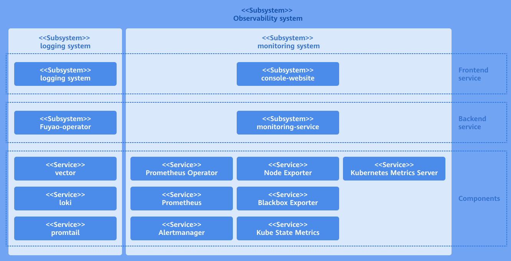
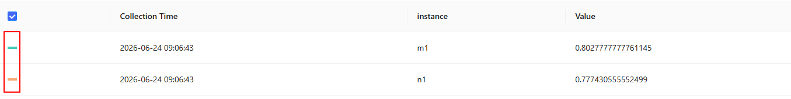
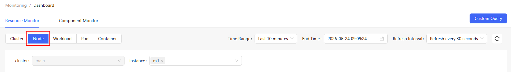
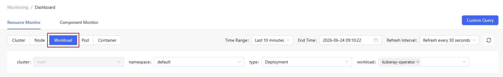
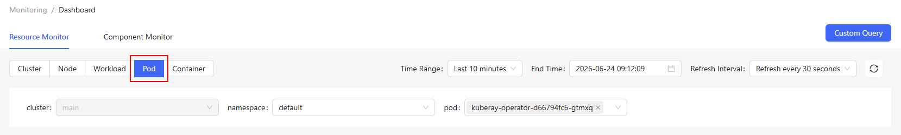
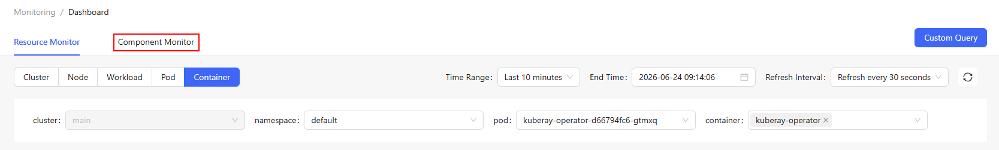
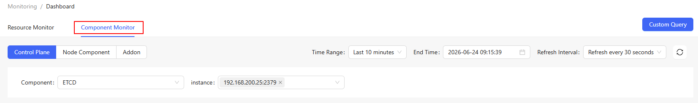
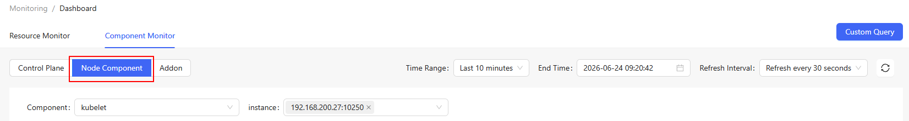
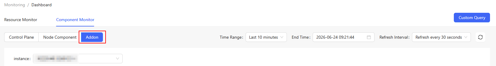

# Monitoring

## Feature Overview

openFuyao is preconfigured with Prometheus as the default monitoring component. It can monitor different components and resources in real time, and allows you to view monitored objects and alert rules.

### Applicable Scenarios

The openFuyao monitoring system is used for container platform management, improving system stability and performance. The typical application scenarios are as follows:

- Resource monitoring and capacity management: The system traces the CPU and memory usage of clusters and nodes in real time to prevent resource bottlenecks and facilitate capacity planning and optimization.
- Service health monitoring: The openFuyao monitoring system monitors the availability and response time of key services or application components, helping you detect and rectify anomalies in a timely manner.
- Performance tuning: You can perform custom queries to analyze resource usage, thus identifying performance bottlenecks and optimizing configurations.
- Monitored object customization: You can flexibly configure monitored objects to ensure that the statuses of important resources can be continuously monitored and analyzed in different scenarios.
- Troubleshooting and alerting: You can configure monitoring metrics and alerts so that the system can quickly detect anomalies or potential faults, enabling a timely response to anomalies and reducing the risk of unexpected crashes.

### Supported Capabilities

The openFuyao monitoring system provides multi-layer resource monitoring, flexible querying, monitored object configuration, and alert rule management, enabling real-time visibility into the system running state. The key capabilities are as follows:

- Real-time monitoring: The system displays the real-time status of various resources, including CPU, memory, disk, and network.
- Custom query: PromQL query is supported. This allows in-depth analysis tailored to specific requirements, helping identify and locate performance bottlenecks or anomalies.
- Flexible configuration: Configuration options such as the monitoring time range and refresh frequency are provided to meet diversified requirements.
- Monitored object configuration: ServiceMonitor allows you to flexibly configure monitored objects to ensure that all resources can be monitored, such as cluster services, application services, and control plane components.
- Alert configuration: You can flexibly configure alert rules and customize triggering conditions to quickly receive alert notifications about system anomalies.

### Implementation Principles

The monitoring system consists of the user interface (UI) layer, backend layer, and component layer.

- UI layer
  
  - You can perform monitoring operations through the console website.

- Backend layer
  
  - The monitoring-service is deployed as a microservice to provide core capabilities, including metric query, monitored object configuration, and alert rule configuration.
  - The monitoring-service contains predefined PromQL query statements with built-in key metrics. When the frontend sends a request to the backend, it transfers the name of the metric to be queried and other related parameters. After receiving the request, the backend selects the corresponding predefined PromQL query statement based on the provided metric name. Then, it integrates the provided parameters into the query statement. Finally, it queries data through the native Prometheus API.
  
  The reason why key metrics are built in predefined PromQL query statements is that native Prometheus data cannot meet our requirements, and extra processing or conversion is required to obtain the expected content. This may involve operations such as filtering and aggregation, which can be provided by the predefined PromQL query APIs.

- Component layer
  
  - The component layer provides key data support for the monitoring layer. It monitors different targets and collects various measurement metrics of the entire cluster system for subsequent query, analysis, and alerting.

**Figure 1** Implementation principles

### Related Features

The alerting system triggers notifications based on configured alert sources (such as Prometheus and Loki) and associated alert rules.

## Using the Monitoring Dashboard

In the left navigation pane of the openFuyao platform, choose **Observation Center** > **Monitoring** > **Monitoring Dashboard**. The **Monitoring Dashboard** page is displayed. In the upper part of the **Monitoring Dashboard** page, you can select filter criteria to view monitoring data as required. [Table 1](#table123456) describes the filter criteria.

**Table 1** Filter criteria description

| Filter Criteria| Description|
|:----------|:----------|
| Time Range| Filter the monitoring data within the specified time range.|
| End Time| Specify the end time of the monitoring data.|
| Auto Refresh Interval| Specify the time interval for refreshing monitoring data. The monitoring data is automatically refreshed after the specified time interval.|
| | Manually refresh the monitoring data.|

### Customizing Queries

#### Prerequisites

- You must have basic knowledge of Prometheus query expressions to edit correct query statements.
- Monitoring components have been installed and properly configured to ensure that monitoring data can be properly collected and updated.

#### Context

The openFuyao monitoring system offers a custom query function that allows you to deeply analyze monitoring data based on specific requirements. You can customize a monitoring data trend chart by inputting Prometheus query expressions to obtain and analyze metric data more accurately.

#### Restrictions

- The complexity of query expressions may affect system performance. You are advised not to use long-running or high-frequency queries unless necessary.
- Setting an excessively high refresh frequency for monitoring data may lead to increased system resource consumption. You are advised to adjust the refresh frequency appropriately.

#### Procedure

1. Click **Custom Query**. The **Custom Query** page is displayed.

2. Enter the Prometheus expression in the input box.

3. Click **Query** to view the monitoring information graph.

4. Click a legend to determine whether to display the related data in the monitoring graph.

**Figure 2** Custom data query

5. Click **Add Query** to add multiple query statements to view the monitoring information graph.

### Viewing Cluster Resource Monitoring Information

#### Prerequisites

Monitoring components have been installed and properly configured to ensure that monitoring data can be properly collected and updated.

#### Context

The openFuyao monitoring system provides built-in monitoring dashboards to show information about various resources, including core Kubernetes components, clusters, nodes, workloads, pods, and containers. Monitoring data at each layer is collected and displayed in real time, helping you gain insights into cluster health, resource consumption, and performance.

#### Restrictions

Setting an excessively high refresh frequency for monitoring data may lead to increased system resource consumption. You are advised to adjust the refresh frequency appropriately.

#### Procedure

In the **Resource Monitoring** tab, click **Cluster**.

The monitoring dashboard displays information about the selected cluster, including the cluster node statistics, CPU usage, memory usage, packet rate, and packet loss rate.

### Viewing Node Resource Monitoring Information

In the **Resource Monitoring** tab, click **Node**.

- You can select the specific instance.

- The monitoring dashboard displays information about the selected node, including the cluster-specific CPU, memory, and disk usage information.

**Figure 3** Node resource monitoring

### Viewing Workload Resource Monitoring

In the **Resource Monitoring** tab, click **Workload**.

- You can select the specific namespace, type, or workload.

- The monitoring dashboard displays information about the selected workload, including the CPU usage, memory usage, packet rate, and packet loss rate.

**Figure 4** Workload resource monitoring

### Viewing Pod Monitoring Information

In the **Resource Monitoring** tab, click **Container Group**.

- You can select the specific namespace and pod.
- The monitoring dashboard displays information about the selected pod, including the CPU usage, memory usage, packet rate, packet loss rate, and storage read/write.

**Figure 5** Pod monitoring

### Viewing Container Monitoring Information

In the **Resource Monitoring** tab, click **Container**.

- You can select the specific namespace, pod, and container.
- The monitoring dashboard displays information about the selected container, including the CPU usage, memory usage, packet rate, packet loss rate, and storage read/write.

**Figure 6** Container monitoring

### Viewing Control Plane Component Monitoring Information

In the **Component Monitoring** tab, click **Control Plane Component**.

- Select the component to be viewed in the **Component** drop-down list.
- For the etcd component, you can select the specific instance. The monitoring dashboard displays information about the selected instance, including the etcd leader status, survival status, resource analysis, and disk size.
- For the kube-apiserver component, you can select the specific resource and verb. The monitoring dashboard displays the information about the selected instance, including QPS, latency, and resource analysis.
- For the kube-scheduler component, you can select the specific instance. The monitoring dashboard displays information about the selected instance, including the overview, Kube API request QPS, and resource analysis.
- For the kube-controller-manager component, you can select the specific instance. The monitoring dashboard displays the information about the selected instance, including the Kube API request QPS and resource analysis.

**Figure 7** Control plane component monitoring

### Viewing Node Component Monitoring Information

In the **Component Monitoring** tab, click **Node Component**.

- For the kubelet component, you can select the specific instance. The monitoring dashboard displays the information about the selected instance, including kubelet_storage_operation, kubelet_pleg_relist_interval, and resource analysis.
- For the kube-proxy component, you can select the specific instance. The monitoring dashboard displays the information about the selected instance, including network_programming_rate, kube_proxy_kube_api_request_rate, and resource analysis.

**Figure 8** Node component monitoring

### Viewing Addon Component Monitoring Information

In the **Component Monitoring** tab, click **Addon Component**.

You can select the specific instance. The monitoring dashboard displays the information about the selected instance, including requests, response, and coredns_cache.

**Figure 9** Addon component monitoring

## Using Monitored Objects

In the left navigation pane of the openFuyao platform, choose **Observation Center** > **Monitoring** > **Monitored Objects**. The **Monitored Objects** page is displayed.

### Creating a ServiceMonitor

#### Prerequisites

- The Prometheus Operator has been installed and configured to support ServiceMonitor resources.
- The target service has been created and configured as a Kubernetes service resource.
- The service endpoint has been configured to ensure that the target service exposes metrics in Prometheus format on a specific port.

#### Context

The ServiceMonitor is a custom resource provided by Prometheus Operator. It defines how Prometheus discovers and monitors services in Kubernetes. ServiceMonitors allow you to flexibly set the services to be monitored, metric endpoints, filtering labels, and scrape intervals, enabling automatic monitoring configuration.

#### Restrictions

- ServiceMonitors depend on the Prometheus Operator.
- ServiceMonitors depend on Kubernetes service discovery. Therefore, the DNS and network configurations of the cluster must be correct to ensure that Prometheus can access the defined service endpoints.

#### Procedure

1. On the **Monitored Objects** page, click **ServiceMonitor Instance**. The **ServiceMonitor Instance** page is displayed.

2. Click **Create Instance**. The **YAML-based** page is displayed.

3. Edit the YAML file.

4. Click **OK**.

#### Related Operations

On the **Monitored Objects** page, click a ServiceMonitor instance or ServiceMonitor name to view the basic information and details of the ServiceMonitor.

## Alert Rules

The alerting system triggers notifications based on configured alert sources (such as Prometheus and Loki) and associated alert rules.

In the left navigation pane of the openFuyao platform, choose **Observation Center** > **Monitoring** > **Alert Rules**. You can query alert rules by alert group, alert severity, and alert status. You can also click an alert group name to view the alert rule information.
