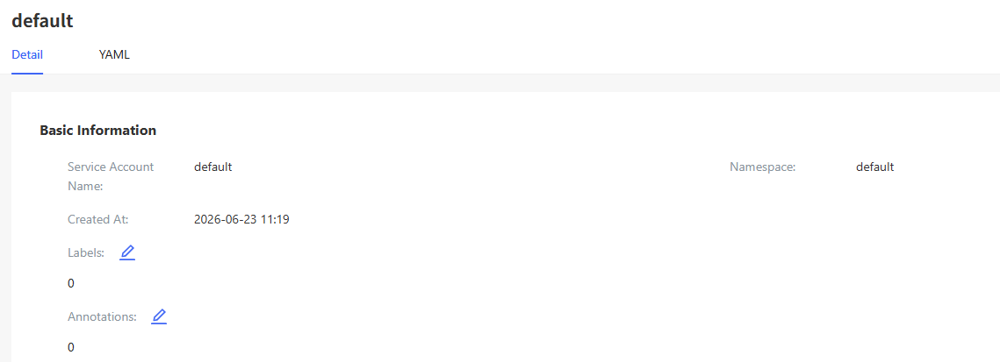
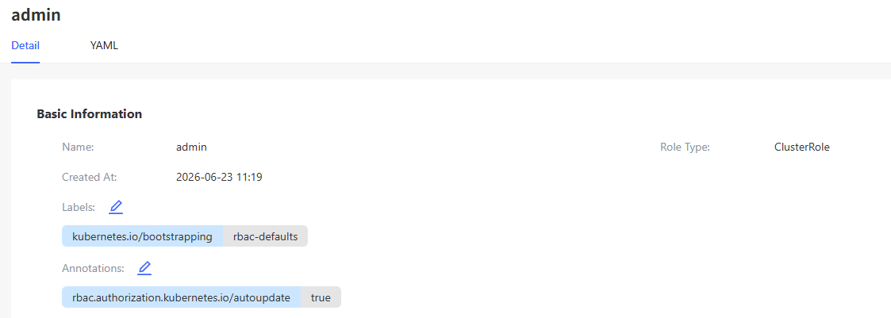
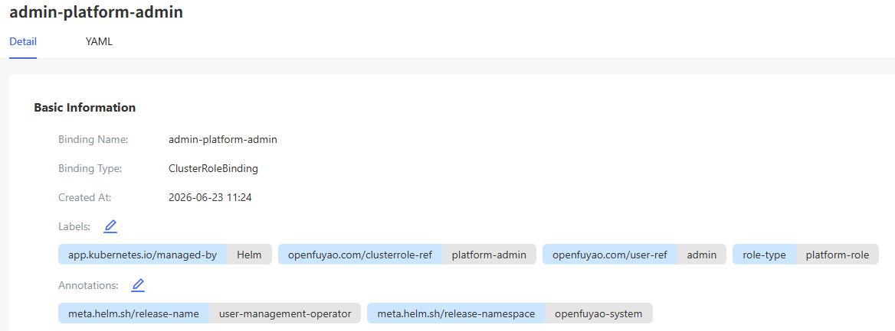

# RBAC Management

## Feature Overview

The RBAC management of openFuyao is based on the role-based access control (RBAC) in Kubernetes. Users set service accounts, roles, and role bindings to implement permission control on cluster resources.

### Applicable Scenarios

RBAC is used to manage access permissions within a Kubernetes cluster. Typical application scenarios are as follows:

- Multi-tenant environments: Access permissions of different teams or projects are isolated in the same cluster to prevent resource conflicts.

- Fine-grained permission management: Administrators can set specific permissions based on user roles to control access to resources, mitigating security issues due to unauthorized operations.

- Security compliance requirements: RBAC meets the security audit requirements of clusters and ensures that different users or services can access only authorized resources, improving cluster security.

### Supported Capabilities

User and service account management: Permissions can be set based on users and service accounts.

- Resource-level control: Permissions on resources such as pods, services, and deployments can be controlled.

- Operation-level control: The specific operation permissions (such as viewing, creating, and deleting) of users on resources can be specified.

- Namespace isolation: RBAC rules can restrict users' access to resources in specific namespaces, realizing resource isolation.

- Permission inheritance and binding: Permissions are assigned and inherited through roles and role bindings.

### Highlights

- Flexible permission assignment: Permissions can be assigned based on roles to meet the access requirements of different users or applications.

- Namespace-level and cluster-level permissions: Roles can be set at the namespace or cluster level to meet permission requirements at different levels.

- Fine-grained permission control: RBAC enables the setting of fine-grained resource operation permissions to ensure that users can perform only specific operations.

- Dynamic permission management: RBAC configurations can be dynamically updated and take effect without restarting the cluster, facilitating flexible permission adjustment.

- Easy integration: RBAC can be integrated with other security tools (such as OIDC and IAM) to implement unified identity management and access control.

### Implementation Principles

RBAC implements permission control based on the following four core components:

- Role: Defines permissions in a namespace and describes the operations that can be performed on specific resources.

- ClusterRole: Defines cluster-wide permissions, which take effect on all namespaces or cluster-level resources.

- RoleBinding: Binds a ClusterRole to a user, service account, or user group so that the user, service account, or user group has the corresponding permissions in the entire cluster.

- Rule-based model: RBAC uses a rule-based model to control access to API resources. Each role or ClusterRole contains several rules, and each rule specifies the operations that can be performed on specific resources.

### Related Features

- ServiceAccount: A service account is used to authorize pods within the cluster. By binding a service account to RBAC, you can control the resource access permissions of the service account.

- NetworkPolicy: While RBAC controls access to API resources, NetworkPolicy controls network access between pods. Both can work together to provide comprehensive security control.

## Using a Service Account

In the left navigation pane, choose **Permission Management** > **RBAC Management** > **Service Accounts**. The **Service Accounts** page is displayed.

### Viewing a Service Account

#### Prerequisites

You must have permissions to view service accounts, which is typically implemented by configuring a proper role or ClusterRole.

#### Context

A service account is an identity object used to authorize pods to access APIs in Kubernetes. Each service account corresponds to a token. You can use RBAC to assign permissions to service accounts to restrict their access to APIs.

#### Restrictions

- Permission management: The permissions of service accounts must be managed using RBAC. Service accounts that are not configured with RBAC may not be able to access cluster resources.

- Token validity: By default, the token of a service account has no expiration date. Ensure that the cluster security configuration is correct to prevent abuse of service accounts.

#### Procedure

1. Click a service account name. On the service account details page that is displayed, you can view the basic information about the service account.
   
   **Figure 1** Service account details
   
   

2. Click the **YAML** tab. You can view the information about the service account in YAML format. You can export the YAML file.

### Creating a Service Account

#### Prerequisites

You can create a service account only in an existing namespace.

#### Context

A service account provides authentication identities for applications running in pods. After creating a service account, you can associate it with pods so that applications can access Kubernetes APIs under the service account's identity.

#### Restrictions

- Access control: The permissions of a service account need to be set through RBAC. By default, new service accounts have no permissions.

- Security: Service account permissions should be periodically checked and updated to prevent excessive or unnecessary permissions.

#### Procedure

1. Click **Create**. The **Create** page of the service account is displayed.

2. Edit the YAML file.

3. Click **OK**.

#### Related Operations

You can modify or remove a service account by clicking  in the **Operation** column on the list page or **Operation** in the upper-right corner on the details page and then selecting the desired option.

## Using a Role

In the left navigation pane, choose **Permission Management** > **RBAC Management** > **Roles**. The **Roles** page is displayed.

### Viewing a Role

#### Prerequisites

- kubectl configuration: Ensure that kubectl has been properly configured and can access the target cluster.

- Permission requirement: You must have the permission to view roles.

#### Context

Roles and ClusterRoles are basic units for defining permissions through RBAC in Kubernetes. By viewing roles, you can gain insights into the permission scope of users or service accounts and ensure that the permission configuration meets security requirements.

#### Restrictions

- Namespace restriction: A role is a namespace-scoped object and applies only to resources in a specific namespace.

- Permission check: Viewing roles does not change the permission configuration. However, you must have the get and list permissions to view resources in Kubernetes.

#### Procedure

1. Click a role name. On the role details page that is displayed, you can view the basic information about the role.
   
   **Figure 2** Role details
   
   

2. Click the **YAML** tab. You can view the information about the role in YAML format. You can export the YAML file.

### Creating a Role

#### Prerequisites

- The created role takes effect only in the specified namespace.

- The resources to be accessed and the operation permissions must be clearly defined.

#### Context

A role defines the permissions for a user or service account to perform operations in a namespace. After creating a role and binding it to a user or service account, you can control the resource operation permissions of the role to prevent excessive permissions.

#### Restrictions

- Namespace restriction: A role takes effect only in a specific namespace and cannot be used across namespaces.

- Permission configuration: Role permissions must be properly configured to prevent insufficient or excessive permissions due to incorrect configurations.

#### Procedure

1. Click the **Create** drop-down list and select either **Create Role** or **Create ClusterRole** as required.

2. Edit the YAML file.

3. Click **OK**.
   
   > **Note:**  The procedure for creating a role is the same as that for creating a ClusterRole. The only difference lies in the resource type.

#### Related Operations

You can modify or remove a role by clicking  in the **Operation** column on the list page or **Operation** in the upper-right corner on the details page and then selecting the desired option.

## Using Role Bindings

In the left navigation pane, choose **Permission Management** > **RBAC Management** > **Role Binding**. The **Role Binding** page is displayed.

### Viewing a Role Binding

#### Prerequisites

- Access permission: You must have the get and list permissions to view resources. These permissions can be granted through RBAC, so that you can view role bindings in a specified namespace or the entire cluster.

- kubectl configuration: Ensure that kubectl has been properly configured and can access the target cluster.

#### Context

A RoleBinding or ClusterRoleBinding grants the permissions defined in a role (Role or ClusterRole) to a specific user, group, or service account. A RoleBinding restricts roles to a specific namespace, while ClusterRoleBinding applies ClusterRole to the entire cluster. Through role binding, you can flexibly control the access permissions of users and service accounts on Kubernetes resources.

#### Restrictions

- Namespace restriction: A RoleBinding takes effect only in the bound namespace. You need to ensure that the bound roles and permissions are used only in the specified namespace.

- Permission control: When viewing role bindings, ensure that you have sufficient permissions. Otherwise, you may fail to view the binding details.

- Permission inheritance: A ClusterRoleBinding grants cluster-wide permissions. Exercise caution when using it in a multi-tenant environment to prevent excessive permissions.

#### Procedure

1. Click a binding name. On the role binding details page that is displayed, you can view the basic information about the role binding.
   
   **Figure 3** Role binding details
   
   

2. Click the **YAML** tab. You can view the information about the role binding in YAML format. You can export the YAML file.

### Creating a Role Binding

#### Prerequisites

- Permission requirement: You must have the create permission to create resources. Typically, only cluster administrators or users with appropriate permissions can create role bindings.

- Namespace availability: To create a RoleBinding, ensure that the target namespace exists. ClusterRoleBindings are not limited to specific namespaces.

#### Context

A role binding grants the permissions defined in a role (Role or ClusterRole) to a user, group, or service account. In the Kubernetes RBAC model, RoleBinding and ClusterRoleBinding are core components in controlling access to resources. RoleBindings are bound to namespace-level permissions and take effect in specific namespaces. ClusterRoleBindings are bound to cluster-level permissions and take effect in cross-namespace or cluster-wide scenarios.

#### Restrictions

- Least privilege: Follow the least privilege principle when creating role bindings.

- Namespace isolation: A RoleBinding is valid only in a specific namespace and cannot be used across namespaces. A ClusterRoleBinding takes effect in the entire cluster.

- Sensitive permission control: During ClusterRoleBinding creation, high-privilege roles should not be assigned to non-administrative users to prevent potential security risks.

#### Procedure

1. Click the **Create** drop-down list and select either **Create RoleBinding** or **Create ClusterRoleBinding** as required.

2. Edit the YAML file.

3. Click **OK**.

#### Related Operations

You can modify or remove a role binding by clicking  in the **Operation** column on the list page or **Operation** in the upper-right corner on the details page and then selecting the desired option.
