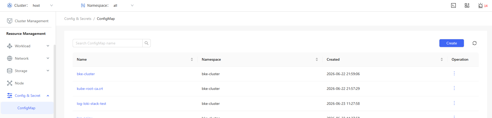
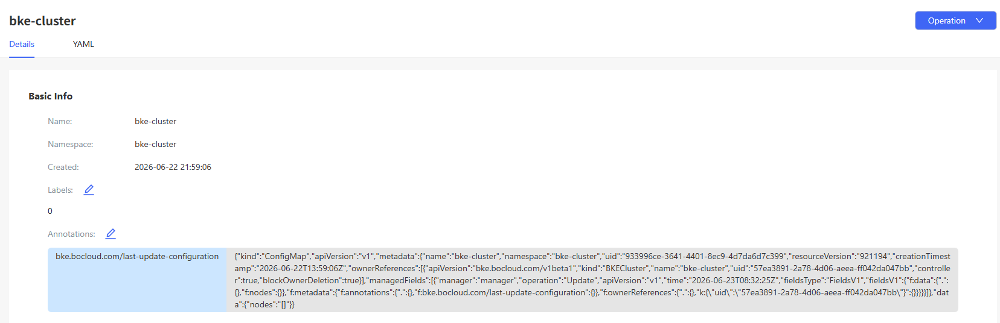
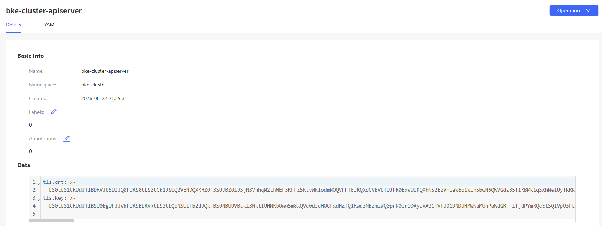

# ConfigMaps and Secrets

## Feature Overview

A ConfigMap stores data in key-value pairs. Pods can consume ConfigMaps as environment variables, command-line arguments, or as configuration files in a volume.

### Applicable Scenarios

A ConfigMap is a type of resource used in Kubernetes to store non-sensitive configuration information. It can store configuration data in key-value pairs, allowing applications to dynamically load such data at runtime.

- Environment configuration management: Different configuration data can be used across different environments without changing the application code.

- Application configuration management: Application configurations are separated from images. Configurations can be dynamically updated, preventing hard-coded configurations.

- Shared configuration: A ConfigMap can be used to share the same configuration across multiple pods for unified management.

### Supported Capabilities

- Configuration data storage: A ConfigMap supports storing simple key-value pairs, JSON configurations, YAML configurations, or file content, which is suitable for managing non-sensitive configurations.

- Dynamic configuration mounting: A ConfigMap can be mounted to a pod as a file or environment variable, allowing applications to read the configuration data.

- Centralized configuration management: A ConfigMap allows multiple applications to share the same file, enabling unified management of configuration information.

- Namespace-based isolation: As namespace-scoped resources, ConfigMaps in different namespaces remain isolated from each other.

### Highlights

Flexibility: As a native Kubernetes API resource, ConfigMaps are stored in the etcd database. You can define configurations by creating ConfigMap YAML files or running the **kubectl create configmap** command. ConfigMaps can be dynamically updated through Kubernetes APIs or kubectl commands. Pods load these configurations during startup and provide them to applications as environment variables or mounted volumes as required.

### Implementation Principles

A ConfigMap stores non-sensitive configuration data of applications in key-value pairs. Such data includes environment variables and configuration file paths. Secrets are similar to ConfigMaps but are used to store sensitive information (such as passwords, API keys, and certificates). Secret data is Base64 encoded and stored in etcd to prevent sensitive data from being exposed.

### Related Features

- Secret: ConfigMaps are intended for non-sensitive configuration data, while Secrets are intended for sensitive data. Both share a similar structure but serve different application scenarios.

- Volume: A ConfigMap can be mounted to a pod's file system as a volume, allowing applications to read configuration information from files.

- Environment variable: A ConfigMap can be mounted to a container as an environment variable, enabling applications to directly use the environment variable to read configurations.

- Deployment and pod: A ConfigMap is usually used together with a Deployment or pod to allow applications to dynamically load configurations, thereby implementing environment adaptation.

## Using a ConfigMap

A ConfigMap is used to store non-sensitive data in key-value pairs. Pods can consume ConfigMaps as environment variables, command-line arguments, or as configuration files in a volume.

In the left navigation pane, choose **Resource Management** > **Configuration and Keys** > **ConfigMap**. The **ConfigMap** page is displayed.

**Figure 1** ConfigMap list page

### Viewing a ConfigMap

#### Prerequisites

- Access permissions: You must have the get and list permissions for ConfigMap resources, which are typically granted using RBAC authorization.

- kubectl configuration: kubectl has been properly configured and can access the target cluster.

#### Context

A ConfigMap is an object used in Kubernetes to store non-sensitive configuration information. It can be used to separate configurations from applications, enabling applications to dynamically load configurations. ConfigMaps can be viewed using kubectl commands, allowing users to verify the correctness of configuration data.

#### Restrictions

- Non-sensitive data only: ConfigMaps are designed for storing non-sensitive data and are not suitable for storing sensitive information such as passwords or keys. Sensitive data should be stored in Secrets.

- Namespace restrictions: ConfigMaps are namespace-scoped resources and can only be used within the namespaces where they were created.

- Data size limit: Each ConfigMap is limited to 1 MB in size, which is not suitable for storing large configuration files.

#### Procedure

1. Click a ConfigMap name. On the ConfigMap details page that is displayed, you can view the basic information and data of the ConfigMap.
   
   **Figure 2** ConfigMap details page
   
   

2. Choose the **YAML** tab to view the information about the ConfigMap in YAML format. You can export the YAML file.

### Creating a ConfigMap

#### Prerequisites

- Namespace availability: To create a ConfigMap in a specified namespace, ensure that the namespace exists.

- Permission requirements: You must have permissions to create ConfigMaps, which are typically granted through RBAC.

#### Context

A ConfigMap is a configuration management tool in Kubernetes. It is used to separate configuration information from container images of applications. It enables administrators to update application configurations without modifying container images, realizing dynamic configuration management.

#### Restrictions

- Non-sensitive data only: ConfigMaps are not suitable for storing sensitive information. Sensitive data should be stored using Secret resources.

- Data size limit: Each ConfigMap is limited to 1 MB in size. For larger configurations, you are advised to store data in blocks or mounted files.

- Application updates: After a ConfigMap is updated, applications may need to be restarted to load the new configuration (unless the application supports real-time reading of configuration file updates).

#### Procedure

1. On the **ConfigMap** page, click **Create** in the upper-right corner. The **YAML-based** page is displayed.

2. Edit the YAML file.

3. Click **OK** to complete creation.

#### Related Operations

You can modify or remove a ConfigMap by clicking  in the **Operation** column on the list page or **Operation** in the upper-right corner on the details page and then selecting the desired option.

> **Note:** On the **YAML** tab of the ConfigMap details page, you can also click  to modify the ConfigMap.

## Using a Secret

### Viewing a Secret

#### Prerequisites

- Access permissions: You must have the get and list permissions for Secret resources, which are typically granted through RBAC. For example, you can create a Role or ClusterRole and grant these permissions.

- kubectl configuration: Ensure that kubectl has been properly configured and can access the target cluster.

#### Context

A Secret is a resource in Kubernetes used to store sensitive data (such as passwords, tokens, and certificates). By storing sensitive information in Secrets, applications can securely read configurations from Kubernetes APIs, preventing sensitive data from being exposed in pod configuration files. Secrets are stored in Base64 format in a cluster and can be used by pods as mounted volumes or environment variables.

#### Restrictions

- Sensitive data protection: Although Secrets are Base64 encoded, they are not encrypted for storage. Therefore, you need to enable the encryption function on the Kubernetes cluster to protect Secret data.

- Permission management: Secrets are sensitive resources. Access to Secrets should be strictly restricted. Only necessary users and service accounts have permissions to view Secrets.

- Namespace-based isolation: Secrets are namespace-scoped resources and can only be used within the namespaces where they were created. Cross-namespace access is not supported.

#### Procedure

1. On the **Secret** page, click a Secret name. On the Secret details page that is displayed, you can view the basic information and data of the Secret.
   
   **Figure 3** Secret list page
   
   

2. Choose the **YAML** tab to view the information about the Secret in YAML format. You can export the YAML file.

### Creating a Secret

#### Prerequisites

- Namespace availability: To create a Secret in a specified namespace, ensure that the namespace exists.

- Permission requirements: You must have permissions to create Secrets, which are typically granted by assigning create and update permissions.

#### Context

Secrets are used to store sensitive configuration information to prevent sensitive data from being directly exposed in application configurations. Multiple types of Secrets are supported, such as Opaque (default type), docker-registry (used for private image repository authentication), and TLS (used for storing TLS certificates). When creating a Secret, you can store data in key-value pairs or directly import it from files.

#### Restrictions

- Security requirements: You are advised to enable encrypted storage of Secrets to enhance security, especially in production environments where sensitive information should never exist in plaintext.

- Size limit: Each Secret is limited to 1 MB in size, which is not suitable for storing large files or large amounts of data.

- Lifecycle management: The lifecycle of a Secret is independent of that of a pod. Regular inspection and updates of expired or invalid Secrets are necessary to ensure system security.

#### Procedure

1. On the **Secret** page, click **Create** in the upper-right corner. The **YAML-based** page is displayed.

2. Edit the YAML file.

3. Click **OK** to complete creation.

#### Related Operations

You can modify or remove a Secret by clicking  in the **Operation** column on the list page or **Operation** in the upper-right corner on the details page and then selecting the desired option.

> **Note:** On the **YAML** tab of the Secret details page, you can also click  to modify the Secret.
