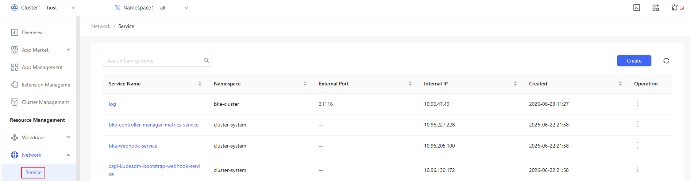
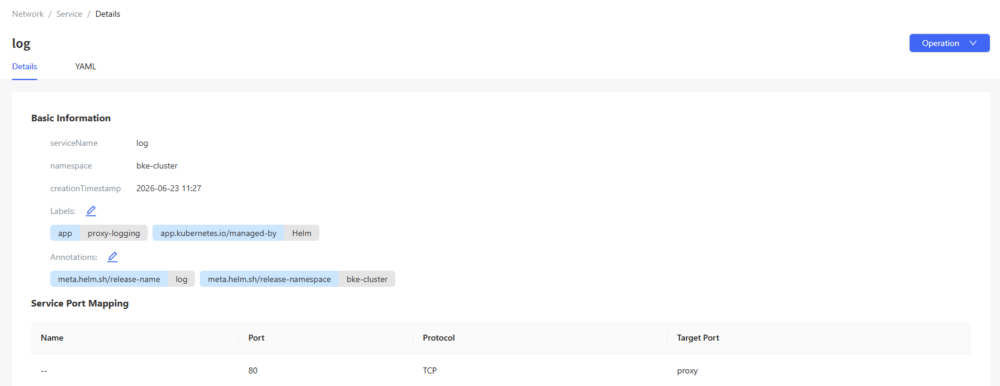
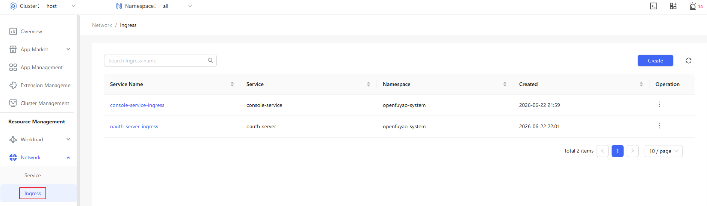
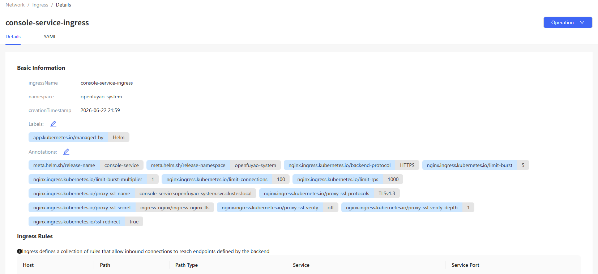

# Network

## Feature Overview

In a Kubernetes cluster, each pod has a unique IP address. Pods can communicate with all other pods on any node, and the agent on each node can communicate with all pods on that node.

Services allow applications running in pods to be exposed to external systems to support access from outside the cluster. Services only reachable from within a cluster can also be released.

Ingress provides additional functions dedicated to exposing HTTP applications, websites, and APIs.

### Applicable Scenarios

The Kubernetes network system is a communication channel between pods and between a cluster and external systems. In the microservice architecture, an application is usually divided into multiple service units, requiring efficient network connectivity management. The networking flexibility and automation features of Kubernetes effectively address the communication demands of large-scale containerized applications.

### Supported Capabilities

- Unified IP addressing and communication mechanism: In Kubernetes, each pod has a unique IP address and can directly communicate with other pods in the cluster without the need for network address translation (NAT).

- Service discovery and domain name system (DNS): Kubernetes provides a built-in DNS resolution service to automate service discovery. Each Service can be accessed using a DNS name.

- Network isolation and access control: NetworkPolicies provide network access control based on IP addresses and ports, allowing users to restrict access between different pods.

- External traffic management: You can configure HTTP and HTTPS routing rules for applications through Ingresses based on domain names and TLS.

### Highlights

Refined control over pod-to-pod communication permissions enhances cluster security. Integration with various network plugins (such as Calico, Flannel, and Weave) and support for custom plugins based on container network interfaces (CNIs) help you meet diverse networking requirements.

### Implementation Principles

In Kubernetes, networking is an abstract resource that combines a group of pods in a cluster into a logical service unit and provides stable access APIs. Networking enables load balancing and service discovery, allowing applications to access services of other applications through DNS names or IP addresses without relying on specific pod IP addresses.

### Related Features

None.

## Using a Service

A Service is a method for exposing a web application that is running as one or more pods in your cluster.

In the left navigation pane, choose **Resource Management** > **Network** > **Service**. The **Service** page is displayed.

**Figure 1** Service list

### Viewing a Service

#### Prerequisites

You must have permissions to view resources.

#### Context

A Service is a key component in Kubernetes and is used to expose a group of pods for continuous access.

#### Restrictions

A NodePort Service needs to open a specific port on a Kubernetes node.

#### Procedure

1. Click a Service name. On the Service details page that is displayed, you can view the basic information and service port mapping of the Service.

   **Figure 2** Service details

   

2. Select the **YAML** tab to view the information about the Service in YAML format. You can export the YAML file.

### Creating a Service

#### Prerequisites

You must have permissions to create resources.

#### Context

A Service is a service discovery and load balancing mechanism provided by Kubernetes. It is used to enable application access from within a cluster or from outside. Service types include ClusterIP, NodePort, and LoadBalancer, meeting different access requirements.

#### Restrictions

The port range of a NodePort Service is limited and may be restricted by firewall rules.

#### Procedure

1. On the Service list page, click **Create** in the upper-right corner. The **YAML-based** page is displayed.

2. Edit the YAML file.

3. Click **OK** to complete creation.

#### Related Operations

You can modify or remove a Service by clicking  in the **Operation** column on the list page or **Operation** in the upper-right corner on the details page and then selecting the desired option.

> **Note:** On the **YAML** tab of the Service details page, you can also click  to modify the Service.

## Using an Ingress

Ingress exposes HTTP and HTTPS routes from outside a cluster to services within the cluster. Traffic routing is controlled by rules defined by the Ingress resource.

In the left navigation pane, choose **Resource Management** > **Network** > **Ingress**. The **Ingress** page is displayed.

**Figure 3** Ingress list

### Viewing an Ingress

#### Prerequisites

An Ingress controller has been deployed in the cluster. Applications are exposed externally through Ingresses.

#### Context

An Ingress is a resource object in Kubernetes used for HTTP and HTTPS traffic management. You can expose application services by configuring routing rules. You can also set domain names, TLS, and load balancing policies.

#### Restrictions

An Ingress depends on Ingress controllers (such as NGINX, Traefik, and HAProxy) to forward traffic.

#### Procedure

1. Click an Ingress name. On the Ingress details page that is displayed, you can view the basic information and rules of the Ingress.

   **Figure 4** Ingress details

   

2. Choose the **YAML** tab to view the information about the Ingress in YAML format. You can export the YAML file.

### Creating an Ingress

#### Prerequisites

An application service that supports Ingresses has been deployed in the cluster, and an Ingress controller is running.

#### Context

Ingresses provide a route-based external access method, which is typically used for managing HTTP and HTTPS traffic to multiple services. Ingresses enable unified domain-based access for applications and support TLS.

#### Restrictions

You must have an Ingress controller to satisfy an Ingress. An Ingress will not work in clusters without an Ingress controller.

#### Procedure

1. On the **Ingress** page, click **Create** in the upper-right corner. The **YAML-based** page is displayed.

2. Edit the YAML file.

3. Click **OK** to complete creation.

#### Related Operations

You can modify or remove an Ingress by clicking  in the **Operation** column on the list page or **Operation** in the upper-right corner on the details page and then selecting the desired option.

> **Note:** On the **YAML** tab of the Ingress details page, you can also click  to modify the Ingress.
