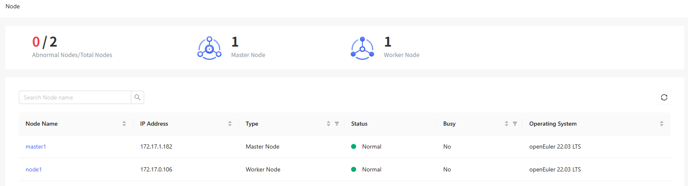
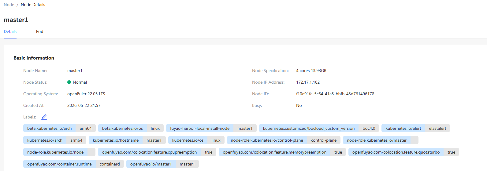

# Nodes

## Feature Overview

A node is a worker node in a Kubernetes cluster. It may be a virtual or physical machine. kubelet, a Kubernetes agent, runs on each node to manage the lifecycle of containers.

### Applicable Scenarios

Containerized applications are running on nodes. You can add or remove nodes to scale up or down computing resources in a cluster.

### Supported Capabilities

A node provides computing and storage resources, enabling it to run containers and deliver services.

### Highlights

Nodes can be categorized and selected using labels and selectors, allowing flexible application deployment and scheduling.

### Implementation Principles

A worker node communicates with the master node to receive management instructions of the cluster and report its status.

### Related Features

Nodes act as computing resource providers in a Kubernetes cluster. They are responsible for running and managing pods, ReplicaSets, Deployments, Services, and resources related to persistent storage. Scheduling and management mechanisms govern the relationship between nodes and these resources, ensuring that they run on suitable nodes and can communicate with each other.

## Viewing a Node

1. In the left navigation pane of the openFuyao platform, choose **Resource Management** > **Nodes**. The **Nodes** page is displayed.
   
   **Figure 1** Node
   
   

2. Click a node name to go to the node details page. You can view the basic information, health status, and resource quota details of the node.
   
   **Figure 2** Node details
   
   

3. Click the **Pod** tab to view information about all pods scheduled on the node.
