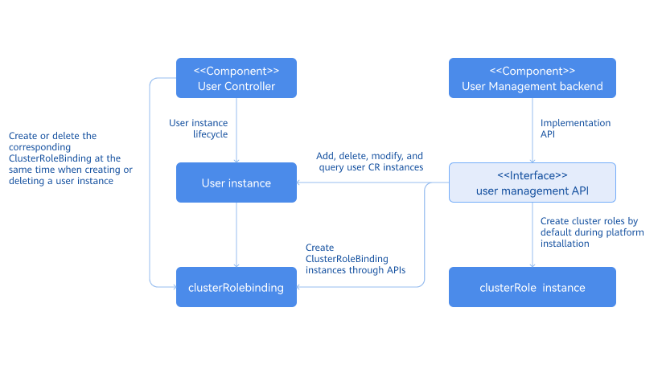
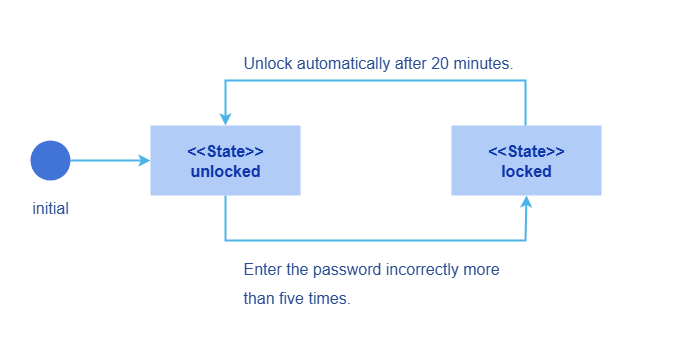
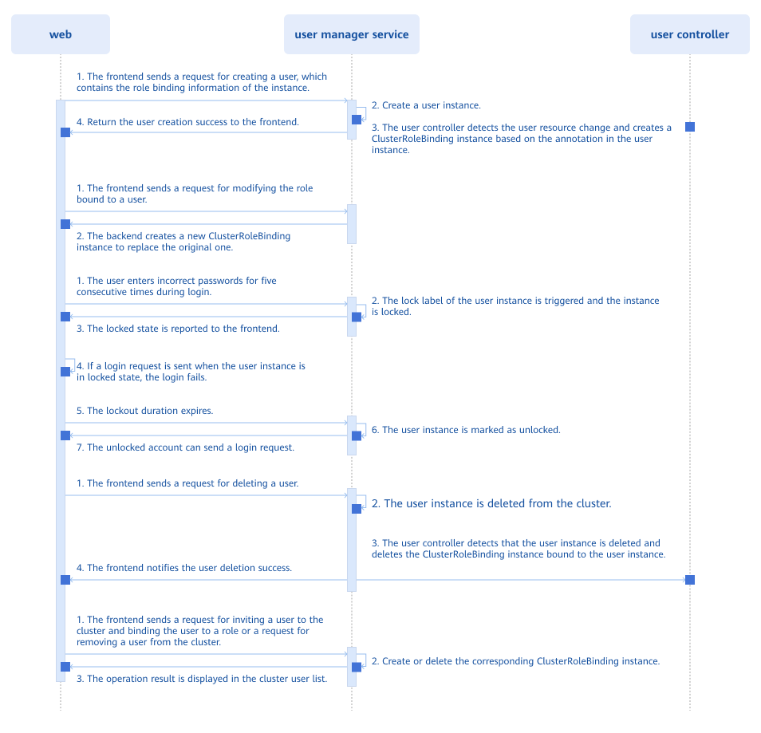
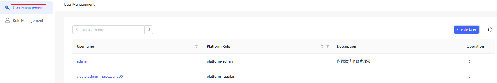
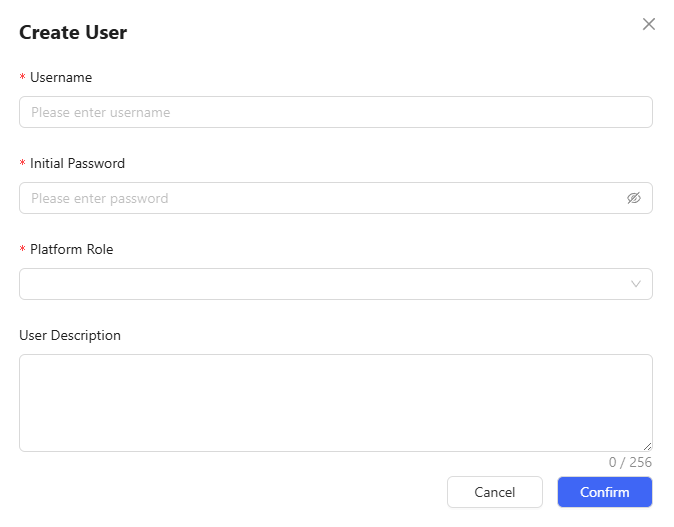
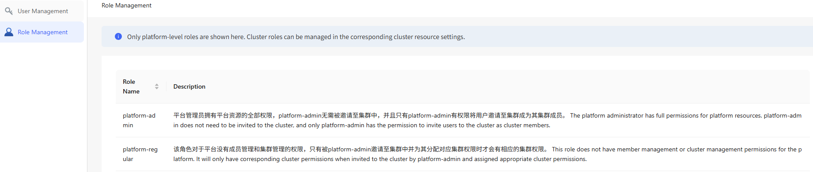
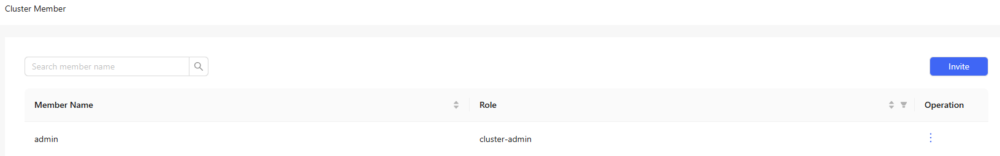

# User Management

## Feature Overview

As the core component of openFuyao, the User Management component provides a set of comprehensive and flexible capabilities for managing users and roles within the container platform. It allows users to add, delete, modify, and query users, as well as assign, view, and unbind roles.

- Administrators can assign proper roles to platform users to implement refined permission control.
- You can invite and remove members in a cluster and bind cluster roles. Administrators can set different permissions for users in different clusters.
- Platform-level and cluster-level role assignment is supported to ensure that users have the correct permissions when performing operations in multi-cluster scenarios. This also guarantees access control in multi-cluster scenarios.

This component improves user management efficiency and security on the openFuyao platform, ensuring proper resource allocation and usage.

### Applicable Scenarios

**Role and Permission Management**

When assigning access permissions to members in different teams, administrators can add, delete, modify, and query users to manage user accounts and use the role assignment function to assign permissions to each user. Users can access only specific resources within their permissions. The openFuyao platform follows the least privilege principle to ensure platform security, ensuring users are granted the minimal permissions required to access the platform and their respective clusters.

**Permission Management in Multi-Cluster Scenarios**

On the openFuyao platform, administrators can assign permissions to users in multiple clusters by using cluster-level and platform-level roles. Cluster-level roles are used to control user permissions in a specific cluster. For example, a user can perform O\&M operations only in a specific cluster and cannot access other clusters. Platform-level roles are used to manage global permissions of users across the entire platform, ensuring consistent permission control for users in cross-cluster scenarios.

**User Password Isolation**

To meet compliance or privacy requirements, the platform employs an encrypted storage mechanism for password management. User passwords are encrypted and stored in the backend of the platform. Platform administrators cannot view the password of a user by any means and do not have permission to read or change user passwords. The entire process of changing a password by a user does not require the manual intervention of administrators. This ensures that only the user knows the new password, enhancing platform security and user privacy.

### Supported Capabilities

**Multi-User Management**

- Platform administrators can create and remove users.

- Platform administrators can view user information.

- Users can modify the user description and password.

- If a user fails to log in too many times, the account will be locked by the multi-user management component.

**Role Management**

- When a user is created, a platform-level role is created for the user by default.

- Platform administrators and cluster administrators can invite users to a cluster and assign cluster roles (cluster-admin, cluster-editor, and cluster-viewer) to them.

- Platform administrators and cluster administrators can remove a user from a cluster.

- During authentication, the system authenticates the user based on the role bound to the user.

### Highlights

- Multi-level role and permission system: Supports platform-level and cluster-level role assignment and fine-grained access permissions of users.
- Intuitive graphical user interface (GUI): Simplifies user management operations.

### Implementation Principles

- Logical architecture of backend components

The multi-cluster user management system consists of the User Controller and User Management backend. The User Controller handles the lifecycle management of user instances, including role binding during user creation and removal, and other related activities. As a backend service, the User Management backend receives call requests from the frontend, including but not limited to creating user instances, viewing user lists, filtering users in the cluster, viewing role lists, and removing users. Default platform-level roles and cluster-level roles are automatically generated during openFuyao platform deployment.

**Figure 1** Logical architecture of backend components

- Mechanism of the user state machine

Each user instance is associated with a state that describes the availability of the user, which can be either **locked** or **unlocked**. Each state is triggered by a specific event. No other conditions can trigger these states. As shown in the following figure, a user has the **unlocked** state when it is created.

If a user enters incorrect passwords five consecutive times during login, the user is locked. In this state, the user is unable to log in to the openFuyao platform. The locked state lasts for 20 minutes, after which the user is automatically unlocked. After the lock period ends, the user can try to log in again using the correct username and password. However, if the user again enters incorrect passwords five consecutive times, the account will re-enter the locked state. This mechanism is designed to prevent brute-force password cracking and applies uniformly to all users.

**Figure 2** Mechanism of the state machine

- Multi-user management workflow

**Figure 3** Multi-user management workflow

- All resource operations (addition, deletion, modification, and query) are implemented through APIs exposed by the User Manager Service. When a user resource instance in the cluster changes, the User CRD Controller detects the resource change and performs corresponding operations. When a user is created, the User CRD Controller detects the fields of the user instance and determines the ClusterRoleBinding to be created. When a user is removed, the User CRD Controller also detects the change and removes the corresponding ClusterRoleBinding.

- Account lockout logic for password-based logins: Each time the user enters an incorrect password, the frontend sends a request to increment the error count. The backend reads the current status of the user and processes the updated error count. When the cumulative error count reaches 5, the user's state changes to **locked**. When in the **locked** state, any login request sent by the frontend includes a timestamp. The backend compares this timestamp with the one stored in the user instance to determine whether the lockout period has expired. If it has, the user's state is updated to **unlocked**.

### Related Features

+ Authentication and authorization module: The user management module stores custom resources (CRs) of user information. During authentication, the authentication and authorization module retrieves user information for password validation. When the RBAC mechanism is used for authorization, permissions of each user depend on the roles assigned by the user management module. These roles (such as platform-level and cluster-level roles) define the operations a user can perform on the platform.

+ Multi-cluster management module: When a user manages a cluster, the multi-cluster management module checks whether the user has the platform administrator privileges. When a user is invited to a cluster, the multi-cluster management module grants the user permissions to access the cluster.

### Instances

Code link: [openFuyao/user-management-operator (gitcode.com)](https://gitcode.com/openfuyao/user-management-operator)

## Managing Users as an Administrator

### Viewing User Information

#### Prerequisites

You must have the platform admin role.

#### Procedure

1. On the main menu bar of the openFuyao platform, click **User Management** on the right. The **User Management** page is displayed. This page displays a list of users, including information such as **Usernames** and **Platform Roles**.

   **Figure 4** User Management

   

2. Click the search box in the upper-left corner of the user list and perform a fuzzy search by entering a keyword.

### Creating a User and Assigning Permissions

#### Prerequisites

To create a user, you must have the platform admin role.

#### Procedure

1. On the main menu bar of the openFuyao platform, click **User Management** on the right. The **User Management** page is displayed.
2. Click **Create User** in the upper-right corner. The **Create User** dialog box is displayed.
3. Enter the **username**, **Initial Password**, and **User Description** in the text boxes and select a **Platform Role**.

   **Figure 5** Creating a user

   

4. Click **OK** to complete creating the new user.

> **Note:** 
> 
> - The password created by the administrator is an initial password. The user must change it immediately after logging in for the first time.
> - The newly created user can be assigned an appropriate platform role. Once invited to a cluster, the user will also be granted a corresponding cluster role.
> - Available platform roles include platform admin.

#### Related Operations

You can modify or remove a user by clicking  in the **Operation** column on the list page or **Operation** in the upper-right corner on the details page and then selecting the desired option.

**Table 1** Related operations

<table>
<thead>
<tr> 
   <th >Operation</th>
   <th  align="left">Description</th>
</tr>
</thead>
<tbody>
<tr>
<td>Modify</td>
<td>
<ul>
<li>Reassigning a role removes the existing role binding and creates a new binding for the selected role.</li><li>The <b>Username</b> field is a unique identifier and cannot be modified.</li></ul>
</td>
</tr>
<tr>
<td>Remove</td>
<td>When a user is removed, the user instance and its associated role bindings are removed and cannot be restored.</td>
</tr>
</tbody>
</table>

### Viewing the List of Platform-Level Roles

#### Prerequisites

You must have the platform admin role.

#### Procedure

1. On the main menu bar of the openFuyao platform, click **User Management** on the right.
2. In the left menu, click **Role Management**. The **Role Management** page is displayed. This page displays a list of roles, including information such as **Role Name** and **Description**.

**Figure 6** Role management

### Inviting a User to a Cluster

#### Prerequisites

To invite a user to a cluster, you must have the platform admin or cluster admin role.

#### Procedure

1. In the left navigation pane, choose **Permission Management** > **Cluster Members**. The **Cluster Members** page is displayed.
2. Click **Invite** in the upper-right corner of the cluster member list. The **Invite Member** dialog box is displayed.
3. In the dialog box, click  in the **Operation** column of a user in the member list to add the user to the cluster.
4. Select the role to be assigned to the user. After the role is selected, it is displayed in the **Role** column.
5. Click **OK** to invite the selected user to the cluster.

### Viewing a Member in a Cluster

#### Prerequisites

You must have the platform admin or cluster admin role.

#### Procedure

1. In the left navigation pane, choose **Permission Management** > **Cluster Members**. The **Cluster Members** page is displayed. This page displays the member list of the cluster, including information such as member names and roles.

**Figure 7** Member list of a cluster

2. Click the search box in the upper-left corner and perform a fuzzy search by entering a keyword.

### Assigning a Cluster Role

#### Prerequisites

To assign a cluster role, you must have the platform admin or cluster admin role.

#### Procedure

1. In the left navigation pane, choose **Permission Management** > **Cluster Members**. The **Cluster Members** page is displayed.
2. Click **Modify Role** in the **Operation** column of the member list. The **Modify Role** dialog box is displayed.
3. Select a role from the **Role** drop-down list. A cluster member must be bound to at least one role. The roles that can be bound are cluster admin, cluster editor, and cluster viewer.
4. Click **OK** to complete the modification.

#### Related Operations

You can click  in the **Operation** column to remove a cluster member as required.

**Table 2** Related operations

| Operation| Description|
|:----------|:----------|
| Remove| After a user is removed, all role bindings of the user in the cluster will be removed and cannot be restored.|

#### Follow-up Operations

In the left navigation pane, choose **Permission Management** > **Cluster Roles**. On the **Cluster Roles** page that is displayed, you can view the cluster role list, including information such as **Role Name** and **Description**.

## Managing Account Information as a User

### Logging In to openFuyao

On the openFuyao login page, enter the correct username and password to log in to the openFuyao platform.

Account lockout rules:

- After a user enters incorrect passwords reaching a certain threshold, the account will be locked.
- After the lockout period ends, the account is automatically unlocked, and the user can try to log in again until the lockout is triggered again or login succeeds.
- Incorrect input rule: If more than five incorrect password attempts occur within 5 consecutive minutes, the account will be locked by the system for 20 minutes.

### Modifying the User Description

#### Procedure

1. Click the user avatar or username in the upper-right corner of the openFuyao platform. The **User Settings** page is displayed.
2. In the left navigation pane, click **Basic Information**. The **Basic Information** page is displayed.
3. Modify the user description in the **Description** text box.
4. Click **OK** to complete modifying the description.

#### Related Operations

On the **User Settings** page, you can click **Password Settings** to change the login password as required.

**Table 3** Related operations

| Operation| Description|
|:----------|:----------|
| Changing a Password| **Password verification rules**:  Length requirement: A password must contain 8 to 32 characters.  Complexity requirement: A password must contain letters, numbers, and at least one special character `~!@#$%\^\&\*()-\_=+\|\[{ }];:'",\<.>/?`.  Username check: The username must not be the same as the account name or the account name in reverse order.  Input check: The password and confirmation password must be the same.|
#### Follow-up Operations

Under the user avatar or username in the upper-right corner of the openFuyao platform, you can click **Log Out** from the drop-down box to log out of the platform.

**Table 4** Related operations

| Operation| Description|
|:----------|:----------|
| Log out| After logout, you need to enter the correct username and password when logging in to the system again.|
