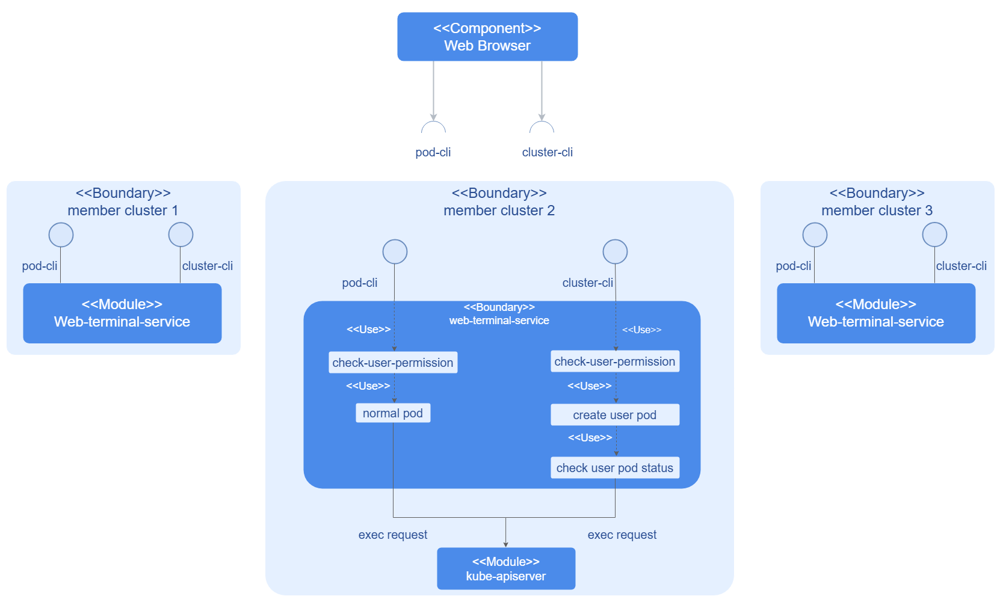
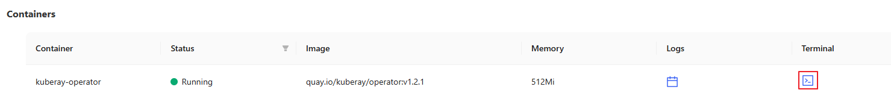
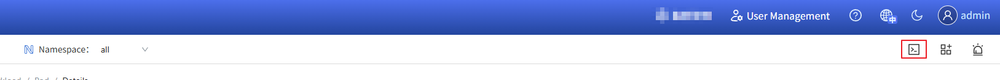

# Web Terminal

## Feature Overview

A web terminal is typically part of a cloud service or web-based service that allows you to access a command-line interface (CLI) directly from a web browser. It acts as a virtual terminal, enabling you to manage containers, services, applications, or databases through the web UI, without requiring local terminal emulation software or a Secure Shell (SSH) client. This feature is often used to manage resource objects in a Kubernetes cluster, reducing reliance on local tools and simplifying cluster operations and maintenance.

On the openFuyao platform, the web terminal provides an interactive CLI for the platform. It currently supports both cluster-level and container-level management operations.

### Applicable Scenarios

- Troubleshooting: The Web Terminal allows you to log directly in to containers and clusters to quickly diagnose application issues. For example, you can view logs in real time, run related commands, or view the system status to quickly locate issues.
- Real-time O\&M: When emergency O\&M is required, the Web Terminal is a convenient tool for performing management tasks directly from the browser, such as clearing temporary files, updating configuration files, and adjusting system settings.
- Development and testing: The Web Terminal provides APIs for interacting with containers and clusters. It can be used by developers for in-cluster or in-container development and testing, without depending on a local development environment.

### Supported Capabilities

+ Container access and management: The Web Terminal allows direct access to and management of containers running in Kubernetes clusters. You can access the container CLI through a browser without using external tools such as kubectl or SSH terminals.
+ Cluster management and monitoring: The Web Terminal provides APIs for interacting with Kubernetes clusters. You can perform cluster-level management and monitoring tasks through a browser, including viewing and managing cluster resources, monitoring cluster status, and managing cluster configurations.

### Implementation Principles

**Figure 1** Implementation principles

The web-terminal-service consists of an API service and controller logic. Each user request is handled by calling different services depending on the request type. For cluster-level requests, the service creates a webterminal-template, which is coordinated and controlled by the controller to manage the lifecycle of the created user-pod or node-pod.

### Instances

Code links:

+ Frontend: [openFuyao/console-website (gitcode.com)](https://gitcode.com/openfuyao/console-website)

+ Backend: [openFuyao/web-terminal-service (gitcode.com)](https://gitcode.com/openfuyao/web-terminal-service)

## Installation

As a core component of the openFuyao platform, the Web Terminal is installed with the platform.

## Logging In to the Container for Interaction

### Prerequisites

- You must have the platform-admin or cluster-admin permission.
- The container to be logged in to supports the kubectl exec function.

### Context

- This feature allows you to access and manage pods in a more intuitive way without the need to install or configure complex CLI tools.
- Using the Web Terminal to log in to containers makes operations more convenient, especially in cloud environments or restricted environments, reducing reliance on external tools and network access.

### Restrictions

None.

### Procedure

1. In the left navigation pane of the openFuyao platform, choose **Workloads** > **Pod**.

2. Click a pod name. The pod details page is displayed.

3. In the **Terminal** column of the **Container** area on the pod details page, click . The interactive command-line interface is displayed.
   
   **Figure 2** Pod details page
   
   

4. Enter the relevant commands to perform interactive operations.

## Logging In to a Cluster for Interaction

### Prerequisites

- You must have the platform-admin or cluster-admin permission.
- The Web Terminal service has been installed in the cluster to be accessed.

### Context

- The Web Terminal provides a browser-based command-line interface (CLI) that enables developers, O\&M personnel, and administrators to execute commands, manage resources, and troubleshoot issues in the cluster.
- It complements the traditional kubectl CLI. It reduces dependency on local environment configurations and enables remote management through the cluster console.

### Restrictions

- You must have the platform-admin or cluster-admin permission to use this feature.
- When the cluster resources are insufficient, the performance of the Web Terminal may be affected. For example, if the load of a node in the cluster is too high, the response of the Web Terminal interface becomes slow or cannot be used properly.
- The Web Terminal relies on the WebSocket protocol to interact with the cluster. Connectivity issues such as network interruptions and connection failures may occur.
- Currently, if no activity is detected on the Web Terminal interface within 25 minutes, the session will time out and close automatically to conserve cluster resources.

### Procedure

1. Click  in the upper-right corner of the openFuyao platform.
   
   **Figure 3** Opening the cluster terminal
   
   

2. On the kubectl CLI, enter commands that comply with the kubectl syntax to perform management operations.
   
   > **Note:** You can click **Learn More** on the right of the page to view the general syntax description of kubectl.
