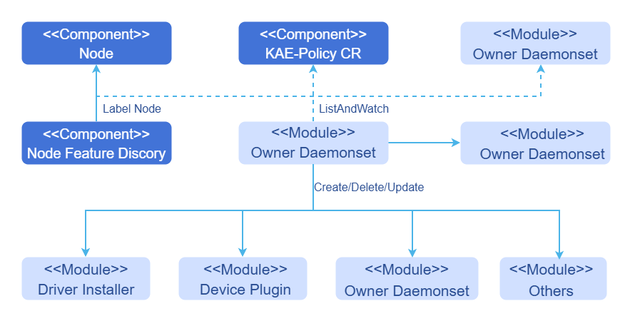

# KAE Operator

## Feature Overview

Kubernetes provides access to special hardware resources (such as Kunpeng Accelerator Engine [KAE], NIC, InfiniBand adapter, and other devices) through [Device Plugins](https://kubernetes.io/docs/concepts/extend-kubernetes/compute-storage-net/device-plugins/).
However, multiple software components (such as drivers, container runtimes, or other libraries) are required to configure and manage a node having these hardware resources. Installation of these components is complex, difficult, and error-prone.
The KAE operator uses the [Operator Framework](https://operatorframework.io/) in Kubernetes to automatically manage all software components required for configuring KAE.
These components include the KAE driver and KAE device plug-in for Kubernetes.

KAE is a capability built into the Kunpeng 920 series processors. For details, see
[KAE Product Overview](https://www.hikunpeng.com/developer/techArticles/20230906-4?envFlag=1).

### Application Scenarios

KAE-powered hardware acceleration: For services in the cluster that require KAE-powered hardware acceleration (such as encryption and decryption), the KAE operator can automatically detect KAE-enabled nodes in the cluster and install and deploy necessary components.

### Supported Capabilities

- Nodes with KAE devices can be automatically discovered.
- All necessary components of KAE can be automatically deployed and configured so that you can efficiently use KAE in Kubernetes clusters.
- When a device on a node is changed, components are automatically adjusted. For example, deployed services are reclaimed when a device goes offline.

### Highlights

The KAE operator automatically manages all software components required for configuring the KAE, making KAE hardware easier to use and improving operational efficiency.

### Implementation Principles

The operator observes changes in three types of resources:

- Custom resource definitions (CRDs) of the operator
- Nodes in the cluster (For example, a node is added to the cluster, or the label of a node in the cluster changes.)
- DaemonSets created by the operator

The operator manages two types of resources:

- Labels: The operator manages labels based on the system, kernel, and hardware devices discovered by the Node Feature Discovery (NFD) service, and assigns deployment-dependent labels to nodes.
- Components: The operator assembles resource files and installs services based on the CRD configuration.

The operator can manage components by:

- Installing or uninstalling components based on labels 
- Upgrading or removing related components 

### Relationship with Related Features

The KAE operator currently manages the following components: 

- KAE Driver Installer
- KAE Device Plug-in

**Figure 1** Implementation principles



## Security Context of the Operator

Certain pods (for example, driver containers) managed by the KAE Operator require elevated privileges as follows:

- `privileged: true`
- `hostPID: true`
- `hostIPC: true`
- `hostNetwork: true`

The reasons for elevating privileges are as follows:

- To access the file system and hardware devices of the host and install driver on the host
- To modify device permissions to enable usage by non-root users

Only Kubernetes cluster administrators need to access or manage the namespace to which the operator belongs. It is a good practice to establish appropriate security policies and prevent any other users from accessing the namespace to which the operator belongs.

## Installation

### Prerequisites

- Ensure that kubectl and Helm CLI are installed on your host, or that a configurable application store or repository is available in the cluster.

- To use the KAE driver container, all worker nodes or node groups running KAE workloads in a Kubernetes cluster must operate in the operating system (OS) of the same version (currently openEuler 22.03 LTS).

  Worker nodes or node groups that run CPU workloads only may operate in any OS because the KAE operator does not perform any configuration or management operation on a node that is not dedicated to KAE workloads. 

- The KAE node must be licensed. For details, see [Obtaining License](https://www.hikunpeng.com/document/detail/zh/kunpengaccel/kae/usermanual/kunpengaccel_06_0008.html).
  In virtual machine (VM) scenarios, hardware partitioning and passthrough must be properly configured. For details, see [Using KAE in Virtual Machine Scenarios](https://www.hikunpeng.com/document/detail/zh/kunpengaccel/kae/bestpractice/kunpengkaepractice_0012.html).

- Since driver installation depends on kernel packages such as `kernel-devel`, each node must be configured with a yum source of the correct version (matching the OS and version requirements). 

  In an offline environment, you can configure the system image as the local image source. **The following settings are for reference only. You need to adjust them based on the actual situation.**

     - Download the OS image from the [openEuler official website](https://www.openeuler.org/en/). Download the standard image (Offline Standard ISO) applicable to the server.
       Ensure that the downloaded image version matches the current system version. After downloading, upload the image file to a Linux environment, such as the `/mnt/iso` path.

     - Create a path used for mounting the image.

       ```shell
       mkdir -p /mnt/openEuler
       ```

     - Mount the image to the `/mnt/openEuler` path.

       ```shell
       mount /mnt/iso/<*OS image name. Eg: openEuler-22.03-LTS-x86_64-dvd.iso*> /mnt/openEuler
       ```

     - Configure the yum source.

       ```shell
       # Back up the existing yum source.
       mv /etc/yum.repos.d/openEuler.repo /etc/yum.repos.d/openEuler.repo.bak
       # Create the **openEuler.repo** file.
       cat << EOF > /etc/yum.repos.d/openEuler.repo
       [openEuler]
       name=openEuler
       baseurl=file:///mnt/openEuler
       enabled=1
       gpgcheck=1
       gpgkey=file:///mnt/openEuler/RPM-GPG-KEY-openEuler
       EOF
       ```
       
     - Update the yum source cache.
  
       ```shell
       yum clean all
       yum makecache
       ```
  
- NFD is a dependency of the operator on each node. By default, the NFD master node and worker nodes are automatically deployed by the operator. If the NFD is already running in the cluster, its deployment must be disabled during operator installation.

  values.yaml

  ```yaml
  nfd:
    enabled: false
  ```

  One way to determine whether the NFD is running in the cluster is to check the NFD label on the node.

  ```sh
  kubectl get nodes -o json | jq '.items[].metadata.labels | keys | any(startswith("feature.node.kubernetes.io"))'
  ```

  If the command output is `true`, the NFD is already running in the cluster. In this case, configure `nodefeaturerules` to install the custom KAE node discovery rules.
    
    ```yaml
    nfd:
      nodefeaturerules: true
    ```

### Procedure

#### Deployment on the openFuyao Platform

Download the KAE operator extension from the openFuyao application market and install it.

1. Log in to the openFuyao platform. In the left navigation pane, choose **Application Market** > **Applications**.
2. Search for **kae operator** in the application list and find the KAE operator extension.
3. Click the **KAE operator** card. The application details page is displayed.
4. On the details page, click **Deploy** in the upper right corner. In the **Installation Information** area on the deployment page, set **Application name**, **Version**, and **Namespace**.
5. Click **OK** to successfully deploy the component.

#### Common Scenarios

##### Procedure

1. Add the openFuyao Helm repository.

   ```shell
   helm repo add openfuyao https://helm.openfuyao.cn \
       && helm repo update
   ```

2. Install the KAE operator.

   - Install the operator using the default configurations.

     ```shell
     $ helm install --wait --generate-name \
         -n kae-operator --create-namespace \
         openfuyao/kae-operator
     ```

   - Install the operator and specify the configuration options.

     ```shell
     $ helm install --wait --generate-name \
         -n kae-operator --create-namespace \
         openfuyao/kae-operator \
         --set <option-name>=<option-value>
     ```

If the operator is installed using the Helm application store or market, add the `https://helm.openfuyao.cn` repository and install it on the user interface (UI).
For details, see [Common Customization Options](#common-customization-options) and [Common Deployment Scenarios](#common-deployment-scenarios).

##### Common Customization Options

The following options are available when you use the Helm chart. These options can be used with `--set` when you install the operator using Helm.

The following table lists the most commonly used options. To view all options, run `helm show values openfuyao/kae-operator`.
**Table 1** Common options

| Option                                        | Description                                                                                                                                                                                                   | Default Value                                            |
|:------------------------------------------|:-----------------------------------------------------------------------------------------------------------------------------------------------------------------------------------------------------|:----------------------------------------------|
| `nfd.enabled`                             | Whether to deploy the NFD service. If the NFD service is already running in the cluster, set this parameter to `false`.<br/><blockquote> **Note:**<br/>If this parameter is set to `true` during installation, do not change it to `false` during use because this may leave residual NFD labels after uninstallation.</blockquote>                                                      | `true`                                        |
| `nfd.nodefeaturerules`                    | If this parameter is set to `true`, a CR containing a rule is installed. This rule enables NFD to discover KAE devices.                                                                                                                                                                         | `false`                                       |
| `node-feature-discovery.image.repository` | Image path of the NFD service.                                                                                                                                                                                           | `registry.k8s.io/nfd/node-feature-discovery`  |
| `node-feature-discovery.image.pullPolicy` | Image pulling policy of the NFD service.                                                                                                                                                                                         | `IfNotPresent`                                |
| `node-feature-discovery.image.tag`        | Image version of the NFD service.                                                                                                                                                                                           | `v0.16.4`                                     |
| `operator.enabledHPRE`                    | Whether to manage KAE HPRE devices. When this function is enabled, HPRE devices are managed. If the management of these devices is not required in the cluster, set this parameter to `false`.                                                                                                                                               | `true`                                        |
| `operator.enabledSEC`                     | Whether to manage KAE SEC devices. When this function is enabled, SEC devices are managed. If the management of these devices is not required in the cluster, set this parameter to `false`. In the current version, the operator only manages HPRE device plug-ins. This parameter is reserved for future use.                                                                                                                | `false`                                       |
| `operator.enabledZIP`                     | Whether to manage KAE ZIP devices. When this function is enabled, ZIP devices are managed. If the management of these devices is not required in the cluster, set this parameter to `false`. In the current version, the operator only manages HPRE device plug-ins. This parameter is reserved for future use.                                                                                                                | `false`                                       |
| `operator.upgradeCRD`                     | Whether the operator upgrades CRDs using the `pre-upgrade` [Helm Hook](https://helm.sh/docs/topics/charts_hooks/#the-available-hooks).                                                                                           | `false`                                       |
| `operator.cleanupCRD`                     | Whether the operator clears CRDs using the `post-delete` [Helm Hook](https://helm.sh/docs/topics/charts_hooks/#the-available-hooks).                                                                                           | `false`                                       |
| `operator.image`                          | Image path of the KAE operator.                                                                                                                                                                                    | `cr.openfuyao.cn/openfuyao/kae-operator` |
| `operator.version`                        | Image version of the KAE operator.                                                                                                                                                                                    | `latest`                                      |
| `operator.pullPolicy`                     | Image pulling policy of the KAE operator.                                                                                                                                                                                  | `IfNotPresent`                                |
| `daemonSets.labels`                       | Custom labels to be added to all pods managed by the KAE operator.                                                                                                                                                                       | `{}`                                          |
| `daemonSets.tolerations`                  | Custom tolerance to be added to all pods managed by the KAE operator.                                                                                                                                                                       | `[]`                                          |
| `driver.enabled`                          | By default, the operator deploys the KAE driver on the system as a container. When the operator is used on a system where the driver is pre-installed, set this parameter to `false`. The operator will uninstall the installed Driver DaemonSet (if any).<br/><blockquote> **Note:**<br/>If this parameter is set to `false`, other parameters that are set at the same time do not take effect.</blockquote>      | `true`                                        |
| `driver.enabledCleanup`                   | Whether to uninstall the driver on the host machine when the operator is uninstalled or the Driver DaemonSet is destroyed. By default, the driver on the host machine is not uninstalled. If you want to uninstall the driver on the host machine at the same time, set the value to `true`.                                                                                                                  | `false`                                       |
| `driver.repository`                       | Image repository of the driver. Specify another image repository if using a custom driver image.                                                                                                                                                                   | `cr.openfuyao.cn/openfuyao`              |
| `driver.image`                            | Name of the driver image. If both `driver.repository` and `driver.version` are empty, set this parameter to the full image path.                                                                                                                                       | `kae-driver-installer`                        |
| `driver.version`                          | Driver version.                                                                                                                                                                                              | `latest`                                      |
| `driver.env`                              | Environment variables of the driver. Currently, the installation policy `INSTALL_POLICY` is configurable. When this parameter is set to `IfNotPresent`, the existing driver on the node is not overwritten. When this parameter is set to `Always`, the existing driver is uninstalled and a new driver is installed.                                                                                                                | `IfNotPresent`                                |
| `devicePlugin.enabled`                    | Whether to enable the operator to uninstall the installed device plug-in DaemonSet (if any). By default, the operator deploys the KAE device plug-in on the system. When the operator is used on the system for which a device plug-in is pre-installed, set this parameter to `false`.<br/><blockquote> **Note:**<br/>If this parameter is set to `false`, other parameters that are set at the same time do not take effect.</blockquote> | `true`                                        |
| `devicePlugin.repository`                 | Image repository of the device plug-in program. Specify another image repository if using a custom driver image.                                                                                                                                                                 | `cr.openfuyao.cn/openfuyao`              |
| `devicePlugin.image`                      | Name of the device plug-in image. If both `driver.repository` and `driver.version` are empty, set this parameter to the full image path.                                                                                                                                     | `kae-device-plugin`                           |
| `devicePlugin.version`                    | Device plug-in version.                                                                                                                                                                                            | `latest`                                      |
| `psa.enabled`                             | If the cluster uses Pod Security Admission (PSA) to restrict the behavior of pods, set this parameter to `true`.                                                                                                                                             | `false`                                       |

##### Common Deployment Scenarios

The following common deployment scenarios and example commands apply to hosts or VMs with KAE passthrough.

###### Specifying the Operator Namespace

The namespace to which the operator belongs is configurable and is specified during installation. For example, run the following command to install KAE Operator in the `openfuyao` namespace:

```shell
helm install --wait --generate-name \
     -n openfuyao --create-namespace \
     openfuyao/kae-operator
```

If no namespace is specified during the installation, all KAE operator components are installed in the `default` namespace.

###### Preventing the KAE Driver from Being Installed on Certain Nodes

By default, the KAE operator deploys the driver on all KAE worker nodes in the cluster. To prevent the driver from being installed on a certain KAE worker node, label the node as follows:

```shell
kubectl label nodes $NODE openfuyao.com/kae.deploy.driver=false
```

>  **Note:**
>
> - You are advised to apply this label before installing the KAE operator.
> - If the node is restarted or the device is uninstalled and you want to add it again, run this command again.
> - If you need to install the driver on the node later, run the `kubectl label nodes $NODE openfuyao.com/kae.deploy.driver=true` command.

###### Pre-Installing the KAE Driver

If the KAE driver has been installed on a KAE worker node, it does not need to be managed by the KAE Operator. In this case, run the following commands:

```shell
helm install --wait --generate-name \
     -n kae-operator --create-namespace \
     openfuyao/kae-operator \
     --set driver.enabled=false
```

###### Running a Custom Image

Specify the new image and repository by overwriting the default values in the `helm install` command. The following is an example:

```shell
helm install --wait --generate-name \
     -n kae-operator --create-namespace \
     openfuyao/kae-operator \
     --set driver.repository=docker.io/your repository \
     --set driver.version="0.1"
```

## Upgrade

The KAE operator supports dynamic updates to existing resources. This ensures that KAE policy settings in the cluster are always kept up to date.

Because Helm [does not support](https://helm.sh/docs/chart_best_practices/custom_resource_definitions/#some-caveats-and-explanations) automatic upgrades of existing CRDs, the KAE operator chart can be upgraded either manually or by enabling the Helm hook.

### Upgrading CRDs Manually

1. Specify the operator release label as an environment variable.

   ```shell
   export RELEASE_TAG=v24.09
   ```

2. Update the CRDs for the KAE policy.

   ```shell
   kubectl apply -f <path>/device.openfuyao.com_kaepolicies_crd.yaml
   ```

   Output example

   ```shell
   customresourcedefinition.apiextensions.k8s.io/kaepolicies.device.openfuyao.com configured
   ```

3. Update the CRDs for the NFD.

   ```shell
   kubectl apply -f <path>/nfd-api-crds.yaml
   ```

   Output example

   ```shell
   customresourcedefinition.apiextensions.k8s.io/nodefeaturerules.nfd.k8s-sigs.io configured
   ```

4. Update information related to the KAE operator chart.

   ```shell
   helm repo update openfuyao
   ```

   Output example

   ```shell
   Hang tight while we grab the latest from your chart repositories...
   ...Successfully got an update from the "openfuyao" chart repository
   Update Complete. ⎈Happy Helming!⎈
   ```

5. Obtain values from the chart.

   ```shell
   helm show values openfuyao/kae-operator --version=$RELEASE_TAG > values-$RELEASE_TAG.yaml
   ```

6. Update the file as required.

7. Upgrade the operator.

   ```shell
   helm upgrade kae-operator openfuyao/kae-operator -n kae-operator -f values-$RELEASE_TAG.yaml
   ```

   Output example

   ```shell
   Release "kae-operator" has been upgraded. Happy Helming!
   NAME: kae-operator
   LAST DEPLOYED: Thu sep 1 15:05:52 2024
   NAMESPACE: kae-operator
   STATUS: kae-operator
   REVISION: 2
   TEST SUITE: None
   ```

### Automatically Upgrading CRDs Using the Helm Hook

The KAE operator supports automatic CRD upgrades using the pre-upgrade [Helm Hook](https://helm.sh/docs/topics/charts_hooks/#the-available-hooks). The `operator.upgradeCRD` parameter is used to control whether triggering this hook when the KAE operator is upgraded using Helm.
This function is disabled by default. To enable it, use the `--set operator.upgradeCRD=true` option when running the upgrade command.

1. Specify the operator release label as an environment variable.

   ```shell
   export RELEASE_TAG=v24.09
   ```

2. Update information related to the KAE operator chart.

   ```shell
   helm repo update openfuyao
   ```

   Output example

   ```shell
   Hang tight while we grab the latest from your chart repositories...
   ...Successfully got an update from the "openfuyao" chart repository
   Update Complete. ⎈Happy Helming!⎈
   ```

3. Obtain values from the chart.

   ```shell
   helm show values openfuyao/kae-operator --version=$RELEASE_TAG > values-$RELEASE_TAG.yaml
   ```

4. Update the file as required.

5. Upgrade the operator.

   ```shell
   helm upgrade kae-operator openfuyao/kae-operator -n kae-operator \
       --set operator.upgradeCRD=true --disable-openapi-validation -f values-$RELEASE_TAG.yaml
   ```

   >  **Note:**<br/>
   >
   > - In this case, you need to set the `--disable-openapi-validation` option so that Helm does not attempt to verify whether the CR instances of the new chart are valid against the existing CRDs. The CR instances of the chart are valid for the upgraded CRDs. Therefore, compatibility is ensured.
   > - Helm hook uses the operator image. If the image cannot be pulled (possibly due to a network error), the hook will fail. In this case, uninstall the chart using the `--no-hooks` option to prevent the chart from being suspended due to hook failures during the uninstallation.

## Updating the CRs for the KAE Policy

The KAE operator supports dynamic updates to custom resources of `KAEPolicy` through `kubectl`.

```shell
kubectl edit kaepolicy kae-policy
```

After the editing is complete, Kubernetes automatically updates the application to the cluster.

## Uninstallation

To uninstall an operator, perform the following steps:

1. Remove the operator using the Helm CLI or through the openFuyao management plane.

   ```shell
   helm delete -n kae-operator $(helm list -n kae-operator | grep kae-operator | awk '{print $1}')
   ```

2. (Optional) List pods in the namespace to which the operator belongs to check whether the pods have been removed or are being removed.

   ```shell
   kubectl get pods -n kae-operator
   ```

   Output example

   ```shell
   No resources found.
   ```

By default, Helm [does not remove existing CRDs when a chart is removed](https://helm.sh/docs/chart_best_practices/custom_resource_definitions/#some-caveats-and-explanations).

```shell
kubectl get crd kaepolicies.device.openfuyao.com
```

To solve this problem, the operator uses the `post-delete` [Helm Hook](https://helm.sh/docs/topics/charts_hooks/#the-available-hooks) to clear CRDs. The `operator.cleanupCRD` parameter controls whether this hook is enabled.
By default, this parameter is disabled. You can enable this hook by specifying `--set operator.cleanupCRD=true` during installation or upgrades so that CRD cleanup is automatically performed when a chart is removed.

Alternatively, the CRDs can be removed manually.

```shell
kubectl delete crd kaepolicies.device.openfuyao.com
```

>  **Note:**<br/>
>
> After the operator is uninstalled, the driver may still exist on the host machine. If you want to remove it, update the `enabledCleanup` parameter in **values.yaml** or kae-policy CR to `true` before uninstallation.  
  
  ```yaml
  driver:
    enabled: true
    enabledCleanup: true
  ```

## Using the HPRE Accelerator in a Cluster

### HPRE Device Resources

HPRE is a KAE device plug-in that reports KAE HPRE devices on nodes to kubelet as `openfuyao.com/kae.hpre` resources. You can run the following command to view the number of devices on nodes in a cluster:

```shell
kubectl describe nodes <nodeName>
```

Output example

```shell
Allocatable:
  cpu:                8
  ephemeral-storage:  35858792389
  hugepages-1Gi:      0
  hugepages-2Mi:      0
  hugepages-32Mi:     0
  hugepages-64Ki:     0
  memory:             16005200Ki
  openfuyao.com/kae.hpre: 2   #check here
  pods:               110
```

The preceding example indicates that there are two HPRE devices on the node.

### Workload Configuration

Currently, KAE HPRE encryption and decryption support OpenSSL 1.1.1*x* asymmetric encryption and decryption. For services that use OpenSSL 1.1.1*x* encryption and decryption in the cluster, perform the following operations:

1. Edit the workloads that use KAE acceleration in the cluster, for example, `nginx_deployment.yaml`.

   ```shell
   kubectl edit deployments nginx_deployment -n <namespace>
   ```

2. Add the `resources` parameter to request KAE resources.

   ```yaml
   resources:
     requests:
       openfuyao.com/kae.hpre: 1
   ```

3. Mount the OpenSSL configuration file to the container image.

   ```yaml
     volumeMounts:
       - name: openssl-conf
         mountPath: /<container_path>/openssl.cnf
   volumes:
     - name: openssl-conf
       hostPath:
       path: /<host_path>/openssl.cnf
   ```

   `/<host_path>` is the path of the host machine where the configuration file is stored, and `/<container_path>` is a path in the container.

   The `openssl.cnf` file content is as follows:

   ```text
   openssl_conf=openssl_def
   [openssl_def]
   engines=engine_section
   [engine_section]
   kae=kae_section
   [kae_section]
   engine_id=kae
   dynamic_path=/usr/local/lib/engines-1.1/kae.so
   KAE_CMD_ENABLE_ASYNC=1
   KAE_CMD_ENABLE_SM3=1
   KAE_CMD_ENABLE_SM4=1
   default_algorithms=ALL
   init=1
   ```

   You can also mount the preceding file to the container using a ConfigMap.

4. Set environment variables.

   ```yaml
   env:
     - name: OPENSSL_CONF
       value: /<container_path>/openssl.cnf
   ```

5. Save the modification. The modification takes effect after the pod is rescheduled.
