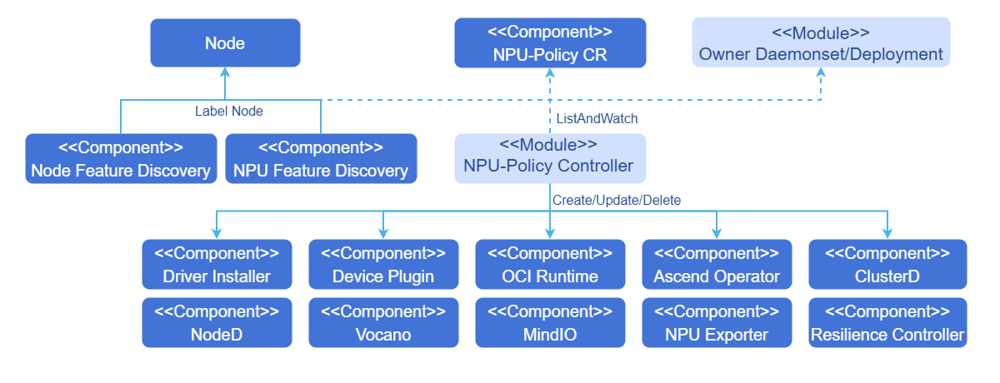

# NPU Operator

## Feature Introduction

Kubernetes provides access to special hardware resources (such as Ascend NPUs) through [Device Plugins](https://kubernetes.io/docs/concepts/extend-kubernetes/compute-storage-net/device-plugins/). However, configuring and managing nodes with these hardware resources requires configuring multiple software components (such as drivers, container runtimes, or other libraries), which are complex and error-prone to install. NPU Operator uses the [Operator Framework](https://operatorframework.io/) in Kubernetes to automatically manage all software components required to configure Ascend devices. These components include Ascend drivers and firmware, enabling the full lifecycle of cluster operation, and supporting MindCluster device plugins for cluster job scheduling, operations monitoring, fault recovery, and other capabilities. By installing the corresponding components, NPU resource management, optimized scheduling of workloads, and containerized support for training and inference tasks can be achieved, enabling AI jobs to be deployed and run on NPU devices in container form.

**Table 1** Currently Supported Installable Components

| Component Name | Deployment Method | Component Function |
| :-------------------- | :--------- | :-------------------------------------------------------------------------------------------------------------------------------------------------------------------------------------------- |
| Ascend driver and firmware | Containerized deployment managed by NPU Operator | Serves as the bridge between hardware devices and the operating system, enabling the OS to recognize and communicate with hardware devices. |
| Ascend Device Plugin | Containerized deployment managed by NPU Operator | Device discovery: Based on the Kubernetes device plugin mechanism, adds device discovery, device allocation, and device health status reporting for Ascend AI processors, enabling Kubernetes to manage Ascend AI processor resources. |
| Ascend Operator | Containerized deployment managed by NPU Operator | Environment configuration: Volcano auxiliary component, responsible for managing acjob-type tasks, injecting environment variables required by AI frameworks (MindSpore/PyTorch/TensorFlow) training tasks into containers, which Volcano then takes over for scheduling. |
| Ascend Docker Runtime | Containerized deployment managed by NPU Operator | Ascend container runtime: Container engine plugin, providing NPU containerization support for all AI jobs, enabling users to run AI jobs smoothly on Ascend devices in Docker container form. |
| NPU Exporter | Containerized deployment managed by NPU Operator | Real-time monitoring of Ascend AI processor resource data: Supports real-time collection of various resource data of Ascend AI processors, including processor utilization, temperature, voltage, and memory usage. Additionally, it can monitor virtual NPUs (vNPUs) of Atlas inference series products, including key metrics such as AI Core utilization, vNPU total memory, and used memory. |
| Resilience Controller | Containerized deployment managed by NPU Operator | Dynamic scaling: When a fault occurs during task training and there are insufficient healthy resources for replacement, this component can use dynamic scale-down to remove faulty resources and continue training. When resources become sufficient, training tasks are restored through dynamic scale-up. |
| ClusterD | Containerized deployment managed by NPU Operator | Collects cluster task information, resource information, and fault information, uniformly determines fault handling levels and strategies, and controls process recomputation of training containers. |
| Volcano | Containerized deployment managed by NPU Operator | Obtains cluster resource information from underlying components, selects optimal scheduling strategies and resource allocation by sensing the network connection methods between Ascend chips, and can perform task rescheduling when task resources fail. |
| NodeD | Containerized deployment managed by NPU Operator | Detects node resource monitoring status and node fault information, reports fault information, and prevents new tasks from being scheduled on faulty nodes. |
| MindIO | Containerized deployment managed by NPU Operator | Generates and saves end-of-life CheckPoints after model training interruptions, repairs on-chip memory UCE faults during model training, provides the ability to restart or replace nodes for fault recovery and model resume training, and optimizes CheckPoint saving and loading. |
| vNPU Device Plugin | Containerized deployment managed by NPU Operator | Supports virtualization resource management of Ascend NPUs through Volcano and vNPU device plugins, reporting `huawei.com/vnpu-number`, `huawei.com/vnpu-cores`, `huawei.com/vnpu-memory.1Gi` and other extended resources to Kubernetes, supporting vNPU soft partitioning and hard partitioning usage scenarios. |
| vNPU Client Update | Containerized deployment managed by NPU Operator | Prepares runtime client dependencies for vNPU scenarios, enabling business containers to use vNPU-related capabilities. |
| XPU Exporter | Containerized deployment managed by NPU Operator | Collects device and virtual device metrics in vNPU scenarios, supporting exposing monitoring metrics through custom ports. |
| DRA Kubelet Plugin | Containerized deployment managed by NPU Operator | Publishes ResourceSlice based on the Kubernetes Dynamic Resource Allocation mechanism, processes ResourceClaim allocation results, and injects Ascend devices, environment variables, and mount information into business containers through CDI. |
| DRA DeviceClass | Containerized deployment managed by NPU Operator | Creates and maintains DeviceClass required for DRA scheduling, supporting whole-card, hard partitioning, and soft partitioning device selection, and also supports user-extended custom DeviceClass through CEL expressions. |
| DRA vCANN-RT Installer | Containerized deployment managed by NPU Operator | Installs and prepares vCANN-RT-related dependencies for DRA soft partitioning scenarios, for the DRA plugin to inject soft partitioning runtime files during container preparation. |

For detailed information about components, please refer to [MindCluster Introduction](https://www.hiascend.com/software/mindcluster).

### Component Version Compatibility

**Table 2** Currently Supported Installable Components and Default Versions

| Component Name | Version |
| --------------------- | ------------------------------- |
| Ascend driver and firmware | 25.5.0 |
| Ascend Device Plugin | 7.3.0 |
| Ascend Operator | 7.3.0 |
| Ascend Docker Runtime | 7.3.0 |
| NPU Exporter | 7.3.0 |
| Resilience Controller | 7.1.RC1 |
| ClusterD | 7.3.0 |
| Volcano | 7.3.0 (based on original Volcano 1.9.0) |
| NodeD | 7.3.0 |
| MindIO | 7.3.0 |
| vNPU | Follows NPU Operator version or image tag configuration |
| DRA | Follows NPU Operator version or image tag configuration |

### Application Scenarios

Building clusters based on Ascend devices, supporting cluster job scheduling, operations monitoring, and fault recovery. NPU Operator can automatically identify Ascend nodes in the cluster and perform corresponding installation and deployment. For training scenarios, it supports NPU resource detection, whole-card scheduling, static vNPU scheduling, checkpoint resume training, and elastic training. For inference scenarios, it supports resource detection, whole-card scheduling, static vNPU scheduling, dynamic vNPU scheduling, inference card fault recovery, and rescheduling.

### Capability Scope

- Automatically discovers Ascend NPU device nodes and labels them.
- Automatically deploys Ascend NPU driver and firmware.
- Automated deployment, installation, and lifecycle management of MindCluster cluster scheduling components.
- Supports one-click installation, configuration update, and uninstallation of vNPU components and vNPU-compatible Volcano resources.
- Supports installation, configuration update, and uninstallation of DRA kubelet plugin, DeviceClass, ResourceSlice publishing pipeline, and DRA soft partitioning dependency components.
- Supports deploying MindCluster, vNPU, and DRA components to different nodes through node selectors, and detects scheduling conflicts of key node components.

### Highlight Features

NPU Operator can automatically identify Ascend nodes and device models in the cluster, installing the corresponding version of AI runtime essential components, greatly simplifying the barrier to configuring Ascend ecosystem components. It provides full lifecycle management and automated configuration deployment for installed components. NPU Operator can detect component installation status and provide detailed logs for debugging.

### Implementation Principle

- The Operator modifies managed component states by monitoring changes in CRD-instantiated CRs.
- The Operator uses labels marked on nodes by NFD and the npu-feature-discovery component to label nodes with node labels suitable for Ascend component scheduling.

**Figure 1** Principle Diagram



### Relationship with Related Features

Please ensure that application-management-service and marketplace-service are running properly to guarantee that this feature can be installed from the application marketplace.

## Operator Security Context

Some Pods managed by NPU Operator (such as driver containers) require elevated permissions as follows.

- `privileged: true`
- `hostPID: true`
- `hostIPC: true`
- `hostNetwork: true`

Reasons for elevated permissions:

- Access host filesystem and hardware devices to install driver firmware and SDK services on the host machine.
- Modify device permissions to accommodate non-root user usage.

## Installation

### openFuyao Platform Deployment

#### Online Installation

##### Prerequisites

- The current computer has kubectl and Helm CLI, or the cluster has a configurable application store or repository.

- Please confirm that the environment contains the bash tool; otherwise, the driver firmware installation script parsing may fail.

- The operating system version of all worker nodes or node groups running NPU workloads in the Kubernetes cluster must satisfy openEuler 22.03 LTS or Ubuntu 22.04 (ARM architecture).

  For worker nodes or node groups that only run CPU workloads, the nodes can run any operating system, as NPU Operator will not perform any configuration or management on nodes without NPU workloads.

  The components installed by the current NPU Operator require the runtime environment to satisfy NPU chip models 910B and 310P. For specific OS and hardware compatibility, please refer to the [MindCluster documentation](https://www.hiascend.com/document/detail/zh/mindcluster/2600/clustersched/dlug/docs/zh/scheduling/introduction/03_supported_product_models_and_os.md).

- Node Feature Discovery (NFD) and NPU Feature Discovery (NPU-Feature-Discovery) are dependencies of the Operator on each node.

  >  **Note:** <br />By default, NFD master and worker nodes are automatically deployed by the Operator. If NFD is already running in the cluster, NFD deployment must be disabled when installing the Operator. Similarly, if NPU-Feature-Discovery has already been deployed in the cluster, NPU-Feature-Discovery deployment must also be disabled when installing the Operator.

  values.yaml

  ```yaml
  nfd:
    enabled: false
  npu-feature-discovery:
    enabled: false
  ```

  Determine whether NFD is already running in the cluster by checking NFD labels on nodes.

  ```sh
  kubectl get nodes -o json | jq '.items[].metadata.labels | keys | any(startswith("feature.node.kubernetes.io"))'
  ```

  If the command outputs `true`, NFD is already running in the cluster. In this case, set `nodefeaturerules` to install NPU custom node discovery rules.
  
    ```yaml
    nfd:
      nodefeaturerules: true
    ```

  By default, nfd is `true`, npu-feature-discovery is `true`, and nodefeaturerules is `false`.

- openFuyao platform has been installed in the cluster. For installation instructions, refer to the [Quick Start](https://docs.openfuyao.cn/zh/docs/v26.03/quick_start.html#%E5%BF%AB%E9%80%9F%E5%AE%89%E8%A3%85) documentation.

##### Installation Steps

NPU Operator extension component can be downloaded and installed from the openFuyao application marketplace.

1. Refer to the openFuyao [platform documentation](https://docs.openfuyao.cn/zh/docs/v26.03/quick_start.html#%E5%BF%AB%E9%80%9F%E5%AE%89%E8%A3%85), enter the openFuyao platform, and select "Application Market > Application List" from the left navigation bar.

2. Search for "npu-operator" in the application list to find the NPU Operator extension component.

3. Click the NPU Operator card to enter the application detail page.

4. On the detail page, click "Deploy" in the upper right corner, and enter the "Application Name", "Version Information", and "Namespace" in the "Installation Information" section of the deployment interface.

5. Click **OK** to successfully deploy the component.

   >  **Note:** <br />Currently, the online installation feature supports driver firmware installation for 910B and 310P series models. Driver firmware online installation for 910C models is not yet supported. If you need to install 910C model driver firmware, please refer to the [Offline Installation](#offline-installation) section. When installing and deploying npu-operator components through the application marketplace, you can modify the corresponding values.yaml parameters; for details, see [Table 4](#table12454324567857465342).

#### Offline Installation

<span id="openfuyao-platform-offline-prerequisites"></span>

##### Prerequisites

- The current computer has kubectl and Helm CLI, or the cluster has a configurable application store or repository.

- Please confirm that the environment contains the bash tool; otherwise, the driver firmware installation script parsing may fail.

- The operating system version of all worker nodes or node groups running NPU workloads in the Kubernetes cluster must satisfy openEuler 22.03 LTS or Ubuntu 22.04 (ARM architecture).

  For worker nodes or node groups that only run CPU workloads, the nodes can run any operating system, as NPU Operator will not perform any configuration or management on nodes without NPU workloads.

  The components installed by the current NPU Operator require the runtime environment to satisfy NPU chip models 910B and 310P. For specific OS and hardware compatibility, please refer to the [MindCluster documentation](https://www.hiascend.com/document/detail/zh/mindcluster/2600/clustersched/dlug/docs/zh/scheduling/introduction/03_supported_product_models_and_os.md).

- openFuyao platform has been installed in the cluster. For installation instructions, refer to the [Quick Start](https://docs.openfuyao.cn/zh/docs/v26.03/quick_start.html#%E5%BF%AB%E9%80%9F%E5%AE%89%E8%A3%85) documentation.

- Download offline images: Download all images used by the components to be installed to the local machine and import them into the cluster container runtime. For details, see [Table 3](#table20260614).

- Prepare driver firmware zip package and MindIO component zip package:
  - **Download driver firmware zip package**: Go to the `npu-driver-installer` repository, check the `downloader/NPU/25.3.RC1/config.json` file, and click the corresponding link to download the driver firmware zip package according to the node's NPU model and OS architecture. 910C model NPU supports offline driver firmware installation; you need to download it yourself from [Ascend Community - Firmware and Driver Downloads](https://www.hiascend.com/hardware/firmware-drivers/community?product=1&model=30&cann=8.5.0.alpha002&driver=Ascend+HDK+25.3.RC1). Driver firmware zip packages for other models can also be downloaded from the above link.
  - **Download MindIO component zip package**: Go to the `npu-node-provision` repository, check the `downloader/software/6.0.0/config.json` file, and click the corresponding link to download the SDK zip package according to the node's NPU model and OS architecture.

- Place the driver firmware zip file on the path of the nodes requiring offline installation: `/tmp/driver_pkg/`. This path can be customized; for the modification method, refer to the `driver.env` field in [Table 4](#table12454324567857465342).

- Place the MindIO component zip package on the path of the nodes requiring offline installation: `/opt/openFuyao/mindio/`

- Check whether the following tools are present on the nodes to be installed:
  - If using yum as the package manager, the required pkgs are: **"jq wget unzip which initscripts coreutils findutils gawk e2fsprogs util-linux net-tools pciutils gcc make automake autoconf libtool git patch kernel-devel-$(uname -r) kernel-headers-$(uname -r) dkms"**<br/>
    Use the following command for detection.
    ```bash
    pkgs=(jq wget unzip which initscripts coreutils findutils gawk e2fsprogs util-linux net-tools pciutils gcc make automake autoconf libtool git patch kernel-devel-$(uname -r) kernel-headers-$(uname -r) dkms); rpm -q "${pkgs[@]}" >/dev/null || rpm -q "${pkgs[@]}" | grep "is not installed"
    ```
  - If using apt-get as the package manager, the required pkgs are: **"jq wget unzip debianutils coreutils findutils gawk e2fsprogs util-linux net-tools pciutils gcc make automake autoconf libtool git patch dkms linux-headers-$(uname -r)"**<br/>
    Use the following command for detection.
    ```bash
    pkgs=(jq wget unzip debianutils coreutils findutils gawk e2fsprogs util-linux net-tools pciutils gcc make automake autoconf libtool git patch dkms linux-headers-$(uname -r)); dpkg-query -W -f='${Package}\t${Status}\n' "${pkgs[@]}" 2>&1 | grep -Ev "install ok installed"
    ```

  - If using dnf as the package manager, the required pkgs are: **"jq wget unzip which initscripts coreutils findutils gawk e2fsprogs util-linux net-tools pciutils gcc make automake autoconf libtool git patch kernel-devel-$(uname -r) kernel-headers-$(uname -r) dkms"**<br/>
    Use the following command for detection.
    ```bash
    pkgs=(jq wget unzip which initscripts coreutils findutils gawk e2fsprogs util-linux net-tools pciutils gcc make automake autoconf libtool git patch kernel-devel-$(uname -r) kernel-headers-$(uname -r) dkms); rpm -q "${pkgs[@]}" >/dev/null || rpm -q "${pkgs[@]}" | grep "is not installed"
    ```

**Table 3** Component Image List<span id="table20260614"></span>

| Component | Image |
| -------------- | -------------------- |
| Ascend driver and firmware | cr.openfuyao.cn/openfuyao/npu-driver-installer:latest |
| ascend-docker-runtime | cr.openfuyao.cn/openfuyao/ascend-docker-runtime:v7.3.0<br/>cr.openfuyao.cn/openfuyao/npu-container-toolkit:latest |
| clusterd | hub.oepkgs.net/openfuyao/ascendhub/clusterd:v7.3.0 |
| device-plugin | hub.oepkgs.net/openfuyao/ascendhub/ascend-k8sdeviceplugin:v7.3.0<br/>hub.oepkgs.net/openfuyao/busybox:1.36.1 |
| mindio | cr.openfuyao.cn/openfuyao/npu-node-provision:latest |
| noded | hub.oepkgs.net/openfuyao/ascendhub/noded:v7.3.0 |
| npu-exporter | hub.oepkgs.net/openfuyao/ascendhub/npu-exporter:v7.3.0 |
| resilience-controller | hub.oepkgs.net/openfuyao/ascendhub/resilience-controller:v7.1.RC1 |
| ascend-operator | hub.oepkgs.net/openfuyao/ascendhub/ascend-operator:v7.3.0<br/>hub.oepkgs.net/openfuyao/busybox:1.36.1 |
| volcano | hub.oepkgs.net/openfuyao/ascendhub/vc-controller-manager:v1.9.0-v7.3.0<br/>hub.oepkgs.net/openfuyao/ascendhub/vc-scheduler:v1.9.0-v7.3.0<br/>hub.oepkgs.net/openfuyao/busybox:1.36.1 |
| vNPU Volcano | cr.openfuyao.cn/openfuyao/vnpu/vc-controller-manager:latest<br/>cr.openfuyao.cn/openfuyao/vnpu/vc-scheduler:latest<br/>cr.openfuyao.cn/openfuyao/vnpu/vc-webhook-manager:latest<br/>hub.oepkgs.net/openfuyao/busybox:1.36.1 |
| vNPU | cr.openfuyao.cn/openfuyao/vnpu/acl-client-update-910b:latest<br/>cr.openfuyao.cn/openfuyao/vnpu/npu-device-plugin:latest<br/>cr.openfuyao.cn/openfuyao/vnpu/xpu-exporter:latest |
| DRA | cr.openfuyao.cn/openfuyao/npu-dra-plugin:latest<br/>cr.openfuyao.cn/openfuyao/vnpu/acl-client-update-910b:latest |
| npu-operator | cr.openfuyao.cn/openfuyao/npu-operator:latest |
| node-feature-discovery | hub.oepkgs.net/openfuyao/nfd/node-feature-discovery:v0.16.4 |
| npu-feature-discovery | cr.openfuyao.cn/openfuyao/npu-feature-discovery:latest |

>  **Note:** <br />The acl-client-update related images in the Helm chart use the 910B model by default. If you are using another NPU model, specify the corresponding image name with `--set` or modify the corresponding field in the YAML file:
   > 
   > | NPU model | value of `images.draVCANNRTInstaller.repository`  | value of `images.vnpuClientUpdate.repository`  |
   > |---------|-----------------------------------|-----------------------------------|
   > | 910B    | `cr.openfuyao.cn/openfuyao/vnpu/acl-client-update-910b`（default）   | `cr.openfuyao.cn/openfuyao/vnpu/acl-client-update-910b`  |
   > | 310P    | `cr.openfuyao.cn/openfuyao/vnpu/acl-client-update-310p`          | `cr.openfuyao.cn/openfuyao/vnpu/acl-client-update-310p`  |
   > | 910C    | `cr.openfuyao.cn/openfuyao/vnpu/acl-client-update-910c`          | `cr.openfuyao.cn/openfuyao/vnpu/acl-client-update-910c`  |
   > 
   > For example, when deploying the component on 310P NPU:
   > ```shell
   > helm install npu-operator oci://cr.openfuyao.cn/charts/npu-operator --version 0.0.0-latest --set images.draVCANNRTInstaller.repository=cr.openfuyao.cn/openfuyao/vnpu/acl-client-update-310p
   > ```

##### Installation Steps

Please refer to [Installation Steps](#installation-steps).

### Standalone Deployment

#### Online Installation

##### Prerequisites

- The current computer has kubectl and Helm CLI, or the cluster has a configurable application store or repository.

- Please confirm that the environment contains the bash tool; otherwise, the driver firmware installation script parsing may fail.

- The operating system version of all worker nodes or node groups running NPU workloads in the Kubernetes cluster must satisfy openEuler 22.03 LTS or Ubuntu 22.04 (ARM architecture).

- For worker nodes or node groups that only run CPU workloads, the nodes can run any operating system, as NPU Operator will not perform any configuration or management on nodes without NPU workloads.

- The components installed by the current NPU Operator require the runtime environment to satisfy NPU chip models 910B and 310P. For specific OS and hardware compatibility, please refer to the [MindCluster documentation](https://www.hiascend.com/document/detail/zh/mindcluster/2600/clustersched/dlug/docs/zh/scheduling/introduction/03_supported_product_models_and_os.md).

##### Binary Installation

1. Add the openFuyao Helm repository.

   ```shell
   helm repo add openfuyao https://helm.openfuyao.cn && helm repo update
   ```

2. Pull the project package.

   ```bash
   helm pull oci://cr.openfuyao.cn/charts/npu-operator --version xxx
   ```

   Where `xxx` needs to be replaced with the specific project installation package version, such as `0.0.0-latest`. The obtained installation package is in compressed package form.

3. Install NPU Operator.

   Install the Operator with default configuration:

   ```shell
   helm install --wait --generate-name \
   -n default --create-namespace \
   npu-operator-xxx.tgz
   ```

   If you need to modify installation parameters, see [Common Customization Options](#common-customization-options) for details.

   >  **Note:** <br />
   >
   > - After installing NPU Operator, node labels related to NPU resources will be applied based on different node environments. These labels are related to cluster scheduling components. The accelerate-type label requires the node's hardware server to fully match the NPU card; for specific matching relationships, refer to the MindCluster documentation [Creating Node Labels](https://www.hiascend.com/document/detail/zh/mindcluster/2600/clustersched/dlug/docs/zh/scheduling/installation_guide/03_installation/manual_installation/01_preparing_for_installation.md).
   > - For A800I A2 inference servers, automatic addition of the server-usage=infer label is not yet supported. Users need to manually add it using the following command.
   > ```bash
   > kubectl label nodes <node-name> server-usage=infer
   > ```

##### Source Code Installation

1. Pull the project from the npu-operator repository.

   ```bash
   git clone -b xxx https://gitcode.com/openfuyao/npu-operator.git
   ```

   Where `xxx` refers to the branch of the code.

2. Install and deploy.

   Taking namespace `default` and release name `npu-operator` as an example, execute the following command in the same directory as `npu-operator`.

   ```bash
   cd npu-operator/charts/npu-operator
   helm install -n default npu-operator .
   ```

   If you need to modify installation parameters, see [Common Customization Options](#common-customization-options) for details.

##### Common Customization Options

When using Helm Chart, the following options can be modified. These options are used during Helm installation via `--set` or `--set-json` (used when modifying component environment variables, volumes, and other list structures). Due to the large number of configuration items, it is recommended to directly modify the corresponding fields in the values.yaml in the chart package.

[Table 4](#table12454324567857465342) lists the most commonly used fields. For other fields, see the `charts/npu-operator/values.yaml` file in the `npu-operator` repository.

**Table 4** Common Options<span id="table12454324567857465342"></span>

| Scope | Description | Default |
|:------------------------------------------|:-------------------------------------------------------------|:----------------------------------------------|
| `nfd.enabled` | Deploy Node Feature Discovery (NFD). If NFD is already running in the cluster, set this variable to `false`.<br /> <blockquote> **Note:** <br />If `true` during installation, try not to modify this field to `false` afterwards; otherwise, NFD residual labels may remain during uninstallation.</blockquote> | `true` |
| `nfd.nodefeaturerules` | When set to `true`, install NFD discovery rules for NPU device CRs. | `true` |
| `node-feature-discovery.image.repository` | NFD service image address. | `registry.k8s.io/nfd/node-feature-discovery` |
| `node-feature-discovery.image.pullPolicy` | NFD service image pull policy. | `Always` |
| `node-feature-discovery.image.tag` | NFD service image version. | `v0.16.4` |
| `npu-feature-discovery.images.core.repository` | NPU-Feature-Discovery image address. | `cr.openfuyao.cn/openfuyao/npu-feature-discovery` |
| `npu-feature-discovery.images.core.pullPolicy` | NPU-Feature-Discovery image pull policy. | `Always` |
| `npu-feature-discovery.images.core.tag` | NPU-Feature-Discovery image version. | `latest` |
| `npu-feature-discovery.enabled` | Switch for deploying NPU-Feature-Discovery. If NPU-Feature-Discovery is already running in the cluster, set this variable to false. | `true` |
| `images.operator.repository` | NPU Operator image address. | `cr.openfuyao.cn/openfuyao/npu-operator` |
| `images.operator.tag` | NPU Operator image version. | `latest` |
| `images.operator.pullPolicy` | NPU Operator image pull policy. | `Always` |
| `daemonSets.labels` | Custom labels to add to all NPU Operator managed Pods. | `{}` |
| `daemonSets.tolerations` | Custom tolerations to add to all NPU Operator managed Pods. | `[]` |
| `driver.enabled` | By default, the Operator deploys the NPU driver firmware program as a container on the system. | `true` |
| `images.driver.repository` | Driver firmware program image storage address. | `cr.openfuyao.cn/openfuyao/npu-driver-installer` |
| `images.driver.tag` | Driver firmware installation service image version. | `latest` |
| `driver.env` | Environment variables related to the driver firmware installation service<br>1. name: HOST_DRIVER_SOURCE_PATH<br>    value: "/tmp/driver_pkg"<br>2. name: DRIVER_VERSION<br/>    value: "25.3.RC1" | 1. This environment variable specifies the placement path of the driver firmware zip package<br>2. This environment variable specifies the online download installation version of the driver firmware zip package. |
| `devicePlugin.enabled` | By default, the Operator deploys the NPU device plugin program on the system. When using the Operator on a system with pre-installed device plugins, set this value to `false`.<br /> <blockquote> **Note:** <br />When modifying this field to `false`, other simultaneously set fields will not take effect.</blockquote> | `true` |
| `images.devicePlugin.repository` | Device plugin program image address. | `hub.oepkgs.net/openfuyao/ascendhub/ascend-k8sdeviceplugin` |
| `images.devicePlugin.tag` | Device plugin service image version. | `v7.3.0` |
| `trainer.enabled` | By default, the Operator installs Ascend operator. If not needed, set this value to `false`. | `true` |
| `images.trainer.repository` | Ascend operator image address. | `hub.oepkgs.net/openfuyao/ascendhub/ascend-operator` |
| `images.trainer.tag` | Ascend operator image version. | `v7.3.0` |
| `ociRuntime.enabled` | By default, the Operator installs Ascend Docker Runtime. If not needed, set this value to `false`. | `true` |
| `images.ociRuntime.repository` | Ascend Docker Runtime image address. | `cr.openfuyao.cn/openfuyao/npu-container-toolkit` |
| `images.ociRuntime.tag` | Ascend Docker Runtime image version. | `latest` |
| `nodeD.enabled` | By default, the Operator installs nodeD. If not needed, set this value to `false`. | `true` |
| `images.nodeD.repository` | nodeD image address. | `hub.oepkgs.net/openfuyao/ascendhub/noded` |
| `images.nodeD.tag` | nodeD image version. | `v7.3.0` |
| `clusterd.enabled` | By default, the Operator installs the clusterD component. If not needed, set this value to `false`. | `true` |
| `images.clusterd.repository` | clusterD image address. | `hub.oepkgs.net/openfuyao/ascendhub/clusterd` |
| `images.clusterd.tag` | clusterD image version. | `v7.3.0` |
| `rscontroller.enabled` | By default, the Operator installs the resilience controller component. If not needed, set this value to `false`. | `true` |
| `images.rscontroller.repository` | resilience controller image address. | `hub.oepkgs.net/openfuyao/ascendhub/resilience-controller` |
| `images.rscontroller.tag` | resilience controller image version. | `v7.1.RC1` |
| `exporter.enabled` | By default, the Operator installs the NPU Exporter component. If not needed, set this value to `false`. | `true` |
| `images.exporter.repository` | NPU Exporter image address. | `cr.openfuyao.cn/openfuyao/npu-exporter` |
| `images.exporter.tag` | NPU Exporter image version. | `v7.3.0` |
| `mindiotft.enabled` | By default, the Operator installs MindIO Training Fault Tolerance. If not needed, set this value to `false`. | `true` |
| `images.mindiotft.repository` | MindIO Training Fault Tolerance image address. | `cr.openfuyao.cn/openfuyao/npu-node-provision` |
| `images.mindiotft.tag` | MindIO Training Fault Tolerance image version. | `latest` |
| `mindioacp.enabled` | By default, the Operator installs MindIO Async Checkpoint Persistence. If not needed, set this value to `false`. | `true` |
| `images.mindioacp.repository` | MindIO Async Checkpoint Persistence service image address. | `cr.openfuyao.cn/openfuyao/npu-node-provision` |
| `images.mindioacp.tag` | MindIO Async Checkpoint Persistence service image version. | `latest` |
| `mindioacp.version` | MindIO Async Checkpoint Persistence version. | `7.3.0` |
| `vccontroller.enabled` | By default, the Operator installs volcano-controller. If not needed, set this value to `false`. | `true` |
| `images.vccontroller.repository` | volcano-controller service image address. | `hub.oepkgs.net/openfuyao/ascendhub/vc-controller-manager` |
| `images.vccontroller.tag` | volcano-controller service image version. | `v1.9.0-v7.3.0` |
| `vcscheduler.enabled` | By default, the Operator installs volcano-scheduler. If not needed, set this value to `false`. | `true` |
| `images.vcscheduler.repository` | volcano-scheduler service image address. | `hub.oepkgs.net/openfuyao/ascendhub/vc-scheduler` |
| `images.vcscheduler.tag` | volcano-scheduler service image version. | `v1.9.0-v7.3.0` |
| `volcano.flavor` | Volcano component type, supports `mindcluster`, `vnpu`, `external`. When set to `mindcluster`, the Operator uses MindCluster-compatible Volcano resources; when set to `vnpu`, the Operator uses vNPU-compatible Volcano scheduler, controller, admission, and other resources; when set to `external`, the Operator does not manage MindCluster or vNPU Volcano workloads. | `mindcluster` |
| `vnpu.enabled` | Whether to enable vNPU component management. When enabled, the Operator manages the vNPU namespace, client-update, vNPU device plugin, and optional XPU Exporter. | `false` |
| `vnpu.nodeSelector` | vNPU component shared node selector; component-level `nodeSelector` overrides shared configuration when non-empty. Default configuration is `huawei.com/vnpu: ready`, equivalent to selecting NPU nodes with the `huawei.com/vnpu=ready` label. | `huawei.com/vnpu: ready` |
| `vnpu.clientUpdate.enabled` | Whether to deploy the vNPU Client Update component. | `true` |
| `vnpu.devicePlugin.enabled` | Whether to deploy the vNPU Device Plugin component. | `true` |
| `vnpu.devicePlugin.deviceSplitCount` | vNPU Device Plugin startup parameter, indicating the maximum number of virtual devices that can be split from a single physical card. | `20` |
| `vnpu.devicePlugin.loggingConsole` | Whether to output vNPU Device Plugin logs to the console. | `true` |
| `vnpu.exporter.enabled` | Whether to deploy XPU Exporter. | `false` |
| `vnpu.exporter.port` | XPU Exporter metrics service listening port; the Operator will synchronously update container startup parameters and Service targetPort. | `8082` |
| `dra.enabled` | Whether to enable DRA component management. When enabled, the Operator can manage DRA kubelet plugin, DeviceClass, soft partitioning configuration, and optional webhook. | `false` |
| `dra.nodeSelector` | DRA component shared node selector; component-level `nodeSelector` overrides shared configuration when non-empty. | `{}` |
| `dra.driverName` | DRA driver name, must be consistent with the `device.driver` expression in DeviceClass and the DeviceClass used by business ResourceClaims. | `npu.huawei.com` |
| `dra.deviceProfile` | DRA plugin device profile type; `npu` is used for NPU scenarios. | `npu` |
| `dra.cdiRoot` | CDI specification file output directory, must be consistent with the directory where the node container runtime reads CDI files. | `/var/run/cdi` |
| `dra.kubeletPlugin.enabled` | Whether to deploy DRA kubelet plugin DaemonSet. | `true` |
| `dra.deviceClasses.enabled` | Whether to create and maintain DRA DeviceClass by the Operator. When disabled, users need to create DeviceClass referenced by ResourceClaims themselves. | `false` |
| `dra.deviceClasses.templates` | Custom DeviceClass template list, each containing `name` and `selectorCEL`. Adding a new template creates a DeviceClass with the same name; removing a template from the list causes the Operator to clean up the corresponding DeviceClass. | `[]` |
| `dra.softVNPU.enabled` | Whether to enable DRA soft partitioning configuration and related components. When enabled, the DRA kubelet plugin loads soft partitioning configuration and can deploy vCANN-RT Installer. | `false` |
| `dra.softVNPU.shareCount` | Maximum number of shares allowed for a single physical NPU in DRA soft partitioning scenarios. | `16` |
| `dra.softVNPU.npuProfileConfigPath` | Path to the soft partitioning configuration file read inside the DRA kubelet plugin container. | `/etc/dra/dra.config` |
| `dra.softVNPU.chipCapabilitiesConfigMap` | DRA partitioning capability template ConfigMap name, used to describe different chips' AI Core, AI CPU, total memory, and available partitioning templates. | `vnpu-template-config` |
| `dra.softVNPU.chipCapabilitiesNamespace` | Namespace of the DRA partitioning capability template ConfigMap. Uses the DRA component namespace when left empty. | `""` |
| `dra.softVNPU.profileConfig` | Contents of `dra.config` read by the DRA plugin, can configure `vnpuMode`, `schedulingPolicy`, and soft partitioning mount information per node and physical card. | `""` |
| `dra.softVNPU.chipCapabilities` | DRA partitioning capability template configuration, describing different chips' AI Core, AI CPU, total memory, and available partitioning templates. | See values.yaml |
| `dra.softVNPU.vcannrtInstaller.enabled` | Whether to deploy the vCANN-RT Installer component required by DRA soft partitioning. | `true` |
| `dra.webhook.enabled` | Whether to deploy DRA validation webhook. Currently disabled by default; if using a webhook image that supports NPU profile, it can be enabled by overriding startup parameters via `commandSpec`. | `false` |

#### Offline Installation

##### Prerequisites

Please refer to [openFuyao Platform Deployment - Offline Installation - Prerequisites](#openfuyao-platform-offline-prerequisites) to prepare driver firmware zip packages, offline images, and related tools. When using binary or source code installation, there is no need to install the openFuyao platform.

##### Installation Steps

For installation steps, refer to [Binary Installation](#binary-installation) and [Source Code Installation](#source-code-installation) sections. For common customization options, see [Table 4](#table12454324567857465342).

## vNPU and DRA Scenario Configuration

NPU Operator now supports unified management of vNPU and DRA-related components. Users can complete component installation, upgrade, uninstallation, and parameter adjustment through Helm values or by directly modifying the `NPUClusterPolicy` CR.

>  **Note:** <br />vNPU, DRA, and MindCluster Device Plugin all manage the NPU device allocation pipeline. If these components are scheduled to the same node, device allocation conflicts may occur. NPU Operator detects whether `nodeSelector` of key DaemonSets overlaps during Reconcile, and upon detecting a conflict, sets NPUClusterPolicy to not-ready and prevents conflicting components from continuing to deploy. When enabling multiple capabilities simultaneously in the same cluster, please schedule different capabilities to different nodes via `nodeSelector`.

Applicable scenarios for vNPU and DRA are shown in Table 5.

**Table 5** vNPU and DRA Applicable Scenarios

| Scenario | Resource Request Method | Applicable Scenario | Coexistence Notes |
|------|--------------|----------|----------|
| vNPU | Based on Device Plugin reporting `huawei.com/vnpu-*` extended resources, requested by business Pods in `resources.requests/limits`. | Clusters already using vNPU Device Plugin and vNPU-compatible Volcano resources, or businesses that need to follow the traditional Device Plugin resource request method. | Cannot be scheduled to the same node as MindCluster Device Plugin or DRA Kubelet Plugin. |
| DRA | Based on Kubernetes Dynamic Resource Allocation, requesting devices declaratively through DeviceClass, ResourceClaim, or ResourceClaimTemplate. | Businesses that require fine-grained scheduling by device attributes, NUMA, whole-card, hard partitioning, or soft partitioning capacity. | Cannot be scheduled to the same node as vNPU Device Plugin or MindCluster Device Plugin. |

>  **Note:** <br />vNPU and DRA can coexist in the same cluster but cannot jointly manage NPU devices on the same node. When coexisting, mutually exclusive labels must be configured for different nodes, and `vnpu.nodeSelector`, `dra.nodeSelector`, or `devicePlugin.nodeSelector` must be set separately for isolation.

### vNPU Scenario

The vNPU scenario is applicable to managing virtual NPU resources through vNPU Device Plugin and vNPU-compatible Volcano scheduler. When enabling this scenario, set `volcano.flavor` to `vnpu` and enable `vnpu.enabled`. If MindCluster device plugin is not needed, simultaneously disable `devicePlugin.enabled` to avoid running two sets of device plugins on the same node.

Example values.yaml:

```yaml
volcano:
  flavor: vnpu

devicePlugin:
  enabled: false

vnpu:
  enabled: true
  nodeSelector:
    huawei.com/vnpu: ready
  clientUpdate:
    enabled: true
  devicePlugin:
    enabled: true
    deviceSplitCount: 20
    loggingConsole: true
  exporter:
    enabled: true
    port: 8082
    https: false
```

Update configuration using Helm.

```bash
helm upgrade npu charts/npu-operator -f vnpu-values.yaml
```

>  **Note:** <br />The `charts/npu-operator` in the above command is a local Chart path example. If using an OCI repository for installation, replace it with the corresponding Chart reference.

After installation, check vNPU components and node extended resources.

```bash
kubectl get pod -n xpu
kubectl get daemonset -n xpu
kubectl get node -o json | jq '.items[].status.allocatable | with_entries(select(.key | test("huawei.com/vnpu")))'
```

>  **Note:** <br />The above commands depend on the `jq` tool. If `jq` is not pre-installed in the runtime environment, please install it through the OS package manager first.

Business Pods can request vNPU through the following extended resources.

```yaml
apiVersion: v1
kind: Pod
metadata:
  name: vnpu-demo
spec:
  schedulerName: volcano
  nodeSelector:
    huawei.com/vnpu: ready
  containers:
  - name: app
    image: docker.io/library/ubuntu:22.04
    command: ["/bin/bash", "-c"]
    args: ["sleep 3600"]
    resources:
      limits:
        huawei.com/vnpu-number: 1
        huawei.com/vnpu-cores: 5
        huawei.com/vnpu-memory.1Gi: 8
      requests:
        huawei.com/vnpu-number: 1
        huawei.com/vnpu-cores: 5
        huawei.com/vnpu-memory.1Gi: 8
```

vNPU resource types are shown in Table 6.

**Table 6** vNPU Resource Types

| Resource Name | Description | Value Range | Example |
|--------|------|----------|------|
| `huawei.com/vnpu-number` | Number of vNPU instances requested. | Positive integer, cannot exceed the allocatable vNPU count reported by the node. | `1` |
| `huawei.com/vnpu-cores` | Number of vNPU AI Cores requested. | Positive integer, actual available value depends on node-reported resources and `vnpu.devicePlugin.deviceSplitCount` configuration. | `5` |
| `huawei.com/vnpu-memory.1Gi` | vNPU memory capacity requested, in Gi. | Positive integer, actual available value depends on physical NPU memory and partitioning specifications. | `8` |

>  **Note:** <br />`volcano.flavor` is used to select the type of Volcano resources managed by the Operator. MindCluster-compatible Volcano and vNPU-compatible Volcano may have different image versions and CRD scopes, and both use resource names such as `volcano-scheduler` and `volcano-controllers` in the `volcano-system` namespace, so they cannot be simultaneously deployed by NPU Operator in the same cluster. When set to `vnpu`, the Operator uses vNPU-compatible Volcano scheduler, controller, and admission resources; when set back to `mindcluster`, the Operator switches back to MindCluster-compatible Volcano resources. Switching `volcano.flavor` may interrupt currently scheduling tasks; it is recommended to execute when there are no running business Pods or when business rescheduling is acceptable.

### DRA Scenario Prerequisites

Before using DRA whole-card, hard partitioning, or soft partitioning capabilities, please confirm the cluster meets the following conditions.

- Kubernetes version uses the openFuyao community recommended version v1.34.3, or a Kubernetes version that supports DRA capabilities.
- kube-apiserver, kube-scheduler, and kubelet have the `DynamicResourceAllocation` feature gate enabled.
- When using soft partitioning or hard partitioning capacity requests, kube-apiserver, kube-scheduler, and kubelet must have the `DRAConsumableCapacity` feature gate enabled; otherwise, capacity fields such as `memCapacity`, `coreCapacity`, `aiCore`, `aiCPU` may not take effect.
- containerd version 1.7.0 or above; `dra.cdiRoot` must be consistent with the directory where the node container runtime reads CDI files.
- Before using hard partitioning, the node must have `ascend-docker-runtime` installed and configured.
- Before using soft partitioning, deploy the vCANN-RT Installer via `dra.softVNPU.vcannrtInstaller.enabled: true`, or ensure the node has the vCANN-RT hijack library pre-installed, and synchronously modify the soft partitioning mount path in `dra.softVNPU.profileConfig`.

For more DRA capabilities, constraints, and usage examples, please refer to the `npu-dra-plugin` repository.

DRA resource request fields are shown in Table 7.

**Table 7** DRA Resource Request Fields

| Field or Resource | Description | Value Range | Example |
|------------|------|----------|------|
| `full.npu.huawei.com` | Whole-card DeviceClass, requesting a complete NPU device. | No need to configure capacity; request by `count`. | `deviceClassName: full.npu.huawei.com` |
| `hard.npu.huawei.com` | Hard partitioning DeviceClass, requesting vNPU devices by fixed template. | `aiCore`, `aiCPU` values must match templates in `dra.softVNPU.chipCapabilities`. | `aiCore: 4`, `aiCPU: 2` |
| `elastic.npu.huawei.com` | Soft partitioning elastic scheduling DeviceClass. | `memCapacity` is memory quota, `coreCapacity` is AI Core computing quota percentage, range 1-100; total requests from multiple Pods cannot exceed physical NPU available capacity. | `memCapacity: 4Gi`, `coreCapacity: 50` (representing 50%) |
| `fixed.npu.huawei.com` | Soft partitioning fixed-share scheduling DeviceClass. | Request soft partitioning capacity using `memCapacity` and `coreCapacity`, suitable for fixed-share resource requests. | `deviceClassName: fixed.npu.huawei.com` |
| `best-effort.npu.huawei.com` | Soft partitioning best-effort scheduling DeviceClass. | Request soft partitioning capacity using `memCapacity` and `coreCapacity`, suitable for scenarios that can accept resource competition. | `deviceClassName: best-effort.npu.huawei.com` |

### DRA Whole-Card Scenario

The DRA whole-card scenario is applicable to requesting whole NPU cards using the Kubernetes Dynamic Resource Allocation mechanism. When enabling this scenario, [DRA Scenario Prerequisites](#dra-scenario-prerequisites) must be met, and DRA kubelet plugin and DeviceClass management must be enabled.

Example values.yaml:

```yaml
devicePlugin:
  enabled: false

dra:
  enabled: true
  driverName: npu.huawei.com
  deviceProfile: npu
  cdiRoot: /var/run/cdi
  kubeletPlugin:
    enabled: true
  deviceClasses:
    enabled: true
  softVNPU:
    enabled: false
  webhook:
    enabled: false
```

After installation, check DRA components and DeviceClass.

```bash
kubectl get pod -A | grep npu-dra-kubeletplugin
kubectl get deviceclass
kubectl get resourceslice -o yaml
```

Create whole-card ResourceClaim and Pod.

```yaml
apiVersion: resource.k8s.io/v1
kind: ResourceClaim
metadata:
  name: dra-full-claim
  namespace: default
spec:
  devices:
    requests:
    - name: npu
      exactly:
        deviceClassName: full.npu.huawei.com
        count: 1
---
apiVersion: v1
kind: Pod
metadata:
  name: dra-full-pod
  namespace: default
spec:
  resourceClaims:
  - name: npu
    resourceClaimName: dra-full-claim
  containers:
  - name: app
    image: docker.io/library/ubuntu:22.04
    command: ["/bin/bash", "-c"]
    args: ["env | grep -E 'DRA|NPU|ASCEND|VISIBLE' | sort; sleep 3600"]
    resources:
      claims:
      - name: npu
```

Check ResourceClaim allocation and Pod running status.

```bash
kubectl get resourceclaim dra-full-claim -o yaml
kubectl get pod dra-full-pod -o wide
```

### DRA CEL Selector Scenario

Both DRA DeviceClass and ResourceClaim support filtering device attributes through CEL expressions. The following example uses `full.npu.huawei.com` and filters devices by `numaNode` in the ResourceClaim.

First, check the NUMA attributes in existing ResourceSlice.

```bash
kubectl get resourceslice -o yaml | grep -E 'numaNode|vnpuMode' -A3 -B3
```

Create a ResourceClaim and Pod that matches an existing NUMA node.

```yaml
apiVersion: resource.k8s.io/v1
kind: ResourceClaim
metadata:
  name: dra-cel-hit-claim
  namespace: default
spec:
  devices:
    requests:
    - name: npu
      exactly:
        deviceClassName: full.npu.huawei.com
        count: 1
        selectors:
        - cel:
            expression: device.attributes["npu.huawei.com"].numaNode == 0
---
apiVersion: v1
kind: Pod
metadata:
  name: dra-cel-hit-pod
  namespace: default
spec:
  resourceClaims:
  - name: npu
    resourceClaimName: dra-cel-hit-claim
  containers:
  - name: app
    image: docker.io/library/ubuntu:22.04
    command: ["/bin/bash", "-c"]
    args: ["sleep 3600"]
    resources:
      claims:
      - name: npu
```

If the expression is changed to a non-existent NUMA node value, such as `numaNode == 999`, the ResourceClaim will not be able to complete allocation, and Pods referencing that ResourceClaim will remain Pending.

### DRA Soft Partitioning Scenario

The DRA soft partitioning scenario is applicable to requesting soft partitioning NPU capabilities through ResourceClaim. When enabling this scenario, enable `dra.softVNPU.enabled` and configure `profileConfig` based on actual cluster node names, or configure runtime mode through node labels.

Execute the following command to check cluster node names; the `worker-1` in subsequent examples must be replaced with the actual Kubernetes node name.

```bash
kubectl get nodes
```

Example values.yaml:

```yaml
devicePlugin:
  enabled: false

dra:
  enabled: true
  driverName: npu.huawei.com
  deviceProfile: npu
  kubeletPlugin:
    enabled: true
  deviceClasses:
    enabled: true
  softVNPU:
    enabled: true
    shareCount: 16
    npuProfileConfigPath: /etc/dra/dra.config
    chipCapabilitiesConfigMap: vnpu-template-config
    profileConfig: |
      softShareMounts:
        - hostPath: /opt/xpu/bin/enpu-monitor
          containerPath: /opt/enpu/vcann-rt/tools/enpu-monitor
          options:
            - ro
            - rbind
        - hostPath: /opt/xpu/bin/systemd-detect-virt
          containerPath: /usr/bin/systemd-detect-virt
          options:
            - ro
            - rbind
      nodes:
        worker-1:
          - physicalId: 0
            vnpuMode: soft
            schedulingPolicy: elastic
    vcannrtInstaller:
      enabled: true
```

Alternatively, switch the node to soft partitioning mode via node labels.

```bash
kubectl label node worker-1 vnpu-mode=soft schedulingPolicy=elastic --overwrite
kubectl rollout restart daemonset npu-dra-kubeletplugin
```

>  **Note:** <br />The node runtime mode label recognized by the DRA plugin is `vnpu-mode`, which can be set to `full`, `soft`, or `hard`; soft partitioning scenarios can be used with `schedulingPolicy=elastic`, `fixed-share`, or `best-effort`. Node names in `profileConfig` must match the actual Kubernetes node names returned by `kubectl get nodes`. If the environment has the vCANN-RT hijack library pre-installed through other means, modify the `hostPath` in `softShareMounts` to the actual file path on the host, and keep `containerPath` unchanged.

Soft partitioning mount items are shown in Table 8.

**Table 8** DRA Soft Partitioning Mount Items

| Host Path | Container Path | Description |
|------------|------------|------|
| `/opt/xpu/bin/enpu-monitor` | `/opt/enpu/vcann-rt/tools/enpu-monitor` | Soft partitioning monitoring tool, installed on the host by vCANN-RT Installer. |
| `/opt/xpu/bin/systemd-detect-virt` | `/usr/bin/systemd-detect-virt` | Container environment detection tool required by the soft partitioning runtime, installed on the host by vCANN-RT Installer. |

Create soft partitioning ResourceClaimTemplate and Pod.

```yaml
apiVersion: resource.k8s.io/v1
kind: ResourceClaimTemplate
metadata:
  name: npu-soft-vnpu
  namespace: default
spec:
  spec:
    devices:
      requests:
      - name: npu
        exactly:
          deviceClassName: elastic.npu.huawei.com
          capacity:
            requests:
              memCapacity: 4Gi
              # coreCapacity unit is percentage; 50 means requesting 50% AI Core computing quota.
              coreCapacity: 50
---
apiVersion: v1
kind: Pod
metadata:
  name: npu-soft-demo
  namespace: default
spec:
  resourceClaims:
  - name: npu
    resourceClaimTemplateName: npu-soft-vnpu
  containers:
  - name: app
    image: docker.io/library/ubuntu:22.04
    command: ["sleep", "3600"]
    resources:
      claims:
      - name: npu
```

Check ResourceClaim, ResourceSlice, and Pod status.

```bash
kubectl get resourceclaim -A
kubectl get resourceslice -o yaml | grep -E 'vnpuMode|schedulingPolicy|memCapacity|coreCapacity' -A3 -B3
kubectl get pod npu-soft-demo -o wide
```

>  **Note:** <br />Consumable capacity fields such as `memCapacity`, `coreCapacity`, `aiCore`, and `aiCPU` depend on the Kubernetes cluster enabling the `DRAConsumableCapacity` feature gate. If the API Server, Scheduler, or Kubelet does not enable this feature, the relevant capacity fields may be discarded, and soft partitioning or hard partitioning capacity requests will not take effect as expected.

### DRA Hard Partitioning Scenario

The DRA hard partitioning scenario selects devices with `vnpuMode=hard` through the `hard.npu.huawei.com` DeviceClass. Hard partitioning mode must be configured for the node, and hard partitioning capacity must be requested in the ResourceClaim.

```bash
kubectl label node worker-1 vnpu-mode=hard --overwrite
# The "-" at the end of the command removes the schedulingPolicy label from the node.
kubectl label node worker-1 schedulingPolicy-
kubectl rollout restart daemonset npu-dra-kubeletplugin
```

ResourceClaim and Pod examples:

```yaml
apiVersion: resource.k8s.io/v1
kind: ResourceClaim
metadata:
  name: dra-hard-claim
  namespace: default
spec:
  devices:
    requests:
    - name: npu
      exactly:
        deviceClassName: hard.npu.huawei.com
        count: 1
        capacity:
          requests:
            aiCore: 4
            aiCPU: 2
---
apiVersion: v1
kind: Pod
metadata:
  name: dra-hard-pod
  namespace: default
spec:
  runtimeClassName: ascend
  resourceClaims:
  - name: npu
    resourceClaimName: dra-hard-claim
  containers:
  - name: app
    image: docker.io/library/ubuntu:22.04
    command: ["/bin/bash", "-c"]
    args: ["sleep 3600"]
    securityContext:
      capabilities:
        add: ["SYS_ADMIN"]
    resources:
      claims:
      - name: npu
```

### Custom DRA DeviceClass

When the default DeviceClass cannot meet filtering requirements, custom DeviceClass can be added through `dra.deviceClasses.templates`. The following example adds a DeviceClass named `test-soft-share`.

```yaml
dra:
  enabled: true
  deviceClasses:
    enabled: true
    templates:
      - name: test-soft-share
        selectorCEL: |
          device.driver == "npu.huawei.com" &&
          device.attributes["npu.huawei.com"].vnpuMode == "soft" &&
          device.attributes["npu.huawei.com"].schedulingPolicy == "fixed-share"
```

After applying, check the DeviceClass.

```bash
kubectl get deviceclass test-soft-share -o yaml
```

If the template is removed from `dra.deviceClasses.templates` and the configuration is re-applied, the Operator automatically deletes the corresponding DeviceClass. Re-applying the configuration means re-executing `helm upgrade ... -f values.yaml`, or directly modifying the corresponding field in the `NPUClusterPolicy` CR. Note that DeviceClass deletion may affect new ResourceClaims that are referencing the DeviceClass.

### Component Conflict Detection

NPU Operator detects whether the scheduling scope of key node components — MindCluster Device Plugin, vNPU Device Plugin, DRA Kubelet Plugin, vNPU Client Update, and DRA vCANN-RT Installer — overlaps. Detection rules are as follows.

- If two components' `nodeSelector` are statically mutually exclusive, they are considered non-conflicting.
- If neither component has a `nodeSelector` configured, both are considered to select all nodes, and a conflict is determined.
- If one component has no `nodeSelector` configured and the other does, a conflict is determined when there are nodes in the cluster matching that `nodeSelector`.
- If both components have `nodeSelector` configured and static mutual exclusivity cannot be determined, the Operator queries nodes to determine whether there are nodes satisfying both selectors simultaneously.

Component conflict detection examples are shown in Table 9.

**Table 9** Component Conflict Detection Examples

| Component A | Component B | Node Label Example | Detection Result |
|-------|-------|--------------|----------|
| MindCluster Device Plugin without `nodeSelector` | DRA Kubelet Plugin without `nodeSelector` | Any NPU node | Conflict; both components select all nodes. |
| vNPU Device Plugin configured with `stack=vnpu` | DRA Kubelet Plugin configured with `stack=dra` | `worker-vnpu` has `stack=vnpu`, `worker-dra` has `stack=dra` | No conflict; the node sets selected by the two components are mutually exclusive. |
| vNPU Device Plugin configured with `accelerator=npu` | DRA Kubelet Plugin configured with `stack=dra` | Node exists with both `accelerator=npu` and `stack=dra` labels | Conflict; the two selectors have node overlap. |

When a conflict occurs, status and logs can be viewed with the following commands.

```bash
kubectl get npuclusterpolicy cluster -o yaml
kubectl logs deployment/npu-operator --tail=200 | grep -Ei 'conflict|overlapping'
```

When using multiple capabilities simultaneously in the same cluster, it is recommended to partition nodes with mutually exclusive labels. For example, use some nodes for vNPU and some for DRA.

```bash
kubectl label node worker-vnpu stack=vnpu --overwrite
kubectl label node worker-dra stack=dra --overwrite
```

Corresponding configuration:

```yaml
vnpu:
  enabled: true
  nodeSelector:
    stack: vnpu

dra:
  enabled: true
  nodeSelector:
    stack: dra
```

If the conflict comes from version inconsistency between MindCluster-compatible Volcano and vNPU-compatible Volcano, you must first determine which set of Volcano resources the cluster will uniformly use; it is not recommended to keep two sets of Volcano simultaneously via node labels. Handle as follows.

- When vNPU scheduling capabilities are needed, set `volcano.flavor` to `vnpu` and switch to vNPU-compatible Volcano resources via `helm upgrade` within a maintenance window.
- When continuing to use MindCluster training scheduling capabilities is needed, keep `volcano.flavor` as `mindcluster` and disable `vnpu.enabled` or migrate vNPU business to avoid installing vNPU-compatible Volcano resources.
- When the cluster already has a validated external Volcano, set `volcano.flavor` to `external` and have the cluster administrator uniformly maintain the Volcano version; in this case, you need to confirm that the external Volcano is compatible with the CRDs, scheduling plugins, and webhook capabilities required by MindCluster or vNPU business.

Before switching, it is recommended to stop or migrate business Pods using the `volcano` scheduler, and confirm no new tasks are submitted before executing the upgrade. After switching, the actual Volcano image in effect can be confirmed with the following command.

```bash
kubectl get deployment -n volcano-system volcano-scheduler volcano-controllers -o jsonpath='{range .items[*]}{.metadata.name}{"\t"}{.spec.template.spec.containers[0].image}{"\n"}{end}'
```

### vNPU and DRA Scenario Uninstallation

If you need to uninstall only vNPU or DRA-related components while retaining NPU Operator, modify values.yaml or `NPUClusterPolicy` CR to disable the corresponding management switches and re-apply the configuration. Example values.yaml:

```yaml
volcano:
  flavor: mindcluster

vnpu:
  enabled: false

dra:
  enabled: false
  deviceClasses:
    enabled: false
  softVNPU:
    enabled: false
```

Update configuration using Helm.

```bash
helm upgrade npu charts/npu-operator -f disable-vnpu-dra-values.yaml
```

>  **Note:** <br />The `charts/npu-operator` in the above command is a local Chart path example. If using an OCI repository for installation, replace it with the corresponding Chart reference. Before uninstalling DRA-related components, please confirm that no business Pods continue to reference the corresponding DeviceClass, ResourceClaim, or ResourceClaimTemplate.

## Upgrade

NPU Operator supports dynamic updates to existing resources. This feature enables NPU Operator to ensure that NPU Policy settings in the cluster are always up to date.

Since Helm does not support automatic upgrades of existing CRDs, you can manually upgrade NPU Operator Chart or enable Helm Hooks.

## NPU Policy CR Update

NPU Operator supports dynamic updates to the `npuclusterpolicy` CustomResource using `kubectl`.

```shell
kubectl get npuclusterpolicy -A
# If the default npuclusterpolicy has not been modified, the default name of npuclusterpolicy is cluster.
kubectl edit npuclusterpolicy cluster
```

After editing, Kubernetes automatically applies the update to the cluster. All components managed by NPU Operator will also be updated to the expected state.

## Installation Status Verification

### View Component Status via CustomResource

View component status through the CustomResource `npuclusterpolicies.npu.openfuyao.com`. Specifically, confirm the current status of each component by checking the `state` field of each component in the `status` field. The following is an example of the driver installer running normally.

```yaml
status:
  componentStatuses:
    - name: /var/lib/npu-operator/components/driver
      prevState:
        reason: Reconciling
        type: deploying
      state:
        reason: Reconciled
        type: running
```

- View CustomResource

```bash
$ kubectl get npuclusterpolicies.npu.openfuyao.com cluster -o yaml
apiVersion: npu.openfuyao.com/v1
kind: NPUClusterPolicy
metadata:
  annotations:
    meta.helm.sh/release-name: npu
    meta.helm.sh/release-namespace: default
  creationTimestamp: "2025-03-11T13:22:39Z"
  generation: 2
  labels:
    app.kubernetes.io/managed-by: Helm
    app.kubernetes.io/name: npu-operator
  name: cluster
  resourceVersion: "2240086"
  uid: 0d1498c5-143a-4e05-a5dc-376d2e6c96ea
spec:
  clusterd:
    imageSpec:
      imagePullPolicy: Always
      imagePullSecrets: []
      registry: cr.openfuyao.cn
      repository: openfuyao/ascend-image/clusterd
      tag: v6.0.0
    logRotate:
      compress: false
      logFile: /var/log/mindx-dl/clusterd/clusterd.log
      logLevel: info
      maxAge: 7
      rotate: 30
    managed: true
  daemonsets:
    imageSpec:
      imagePullPolicy: IfNotPresent
      imagePullSecrets: []
    labels:
      app.kubernetes.io/managed-by: npu-operator
      helm.sh/chart: npu-operator-0.0.0-latest
    tolerations:
    - effect: NoSchedule
      key: node-role.kubernetes.io/master
      operator: Equal
      value: ""
    - effect: NoSchedule
      key: node-role.kubernetes.io/control-plane
      operator: Equal
      value: ""
  devicePlugin:
    imageSpec:
      imagePullPolicy: Always
      imagePullSecrets: []
      registry: cr.openfuyao.cn
      repository: openfuyao/ascend-image/ascend-k8sdeviceplugin
      tag: v6.0.0
    initImageSpec:
      imagePullPolicy: Always
      imagePullSecrets: []
      registry: ""
      repository: hub.oepkgs.net/busybox:latest
      tag: ""
    logRotate:
      compress: false
      logFile: /var/log/mindx-dl/devicePlugin/devicePlugin.log
      logLevel: info
      maxAge: 7
      rotate: 30
    managed: true
  driver:
    imageSpec:
      imagePullPolicy: Always
      imagePullSecrets: []
      registry: cr.openfuyao.cn
      repository: openfuyao/npu-driver-installer
      tag: latest
    initImageSpec:
      imagePullPolicy: Always
      imagePullSecrets: []
      registry: ""
      repository: cr.openfuyao.cn/openfuyao/npu-driver-installer:latest
      tag: ""
    logRotate:
      compress: false
      logFile: /var/log/mindx-dl/driver/driver.log
      logLevel: info
      maxAge: 7
      rotate: 30
    managed: true
    version: 24.1.RC3
  exporter:
    imageSpec:
      imagePullPolicy: Always
      imagePullSecrets: []
      registry: cr.openfuyao.cn
      repository: openfuyao/ascend-image/npu-exporter
      tag: v6.0.0
    logRotate:
      compress: false
      logFile: /var/log/mindx-dl/npu-exporter/npu-exporter.log
      logLevel: info
      maxAge: 7
      rotate: 30
    managed: true
  mindioacp:
    imageSpec:
      imagePullPolicy: Always
      imagePullSecrets: []
      registry: cr.openfuyao.cn
      repository: openfuyao/npu-node-provision
      tag: latest
    managed: false
    version: 6.0.0
  mindiotft:
    imageSpec:
      imagePullPolicy: Always
      imagePullSecrets: []
      registry: cr.openfuyao.cn
      repository: openfuyao/npu-node-provision
      tag: latest
    managed: false
  nodeD:
    heartbeatInterval: 5
    imageSpec:
      imagePullPolicy: Always
      imagePullSecrets: []
      registry: cr.openfuyao.cn
      repository: openfuyao/ascend-image/noded
      tag: v6.0.0
    logRotate:
      compress: false
      logFile: /var/log/mindx-dl/noded/noded.log
      logLevel: info
      maxAge: 7
      rotate: 30
    managed: true
    pollInterval: 60
  ociRuntime:
    imageSpec:
      imagePullPolicy: Always
      imagePullSecrets: []
      registry: cr.openfuyao.cn
      repository: openfuyao/npu-container-toolkit
      tag: latest
    initConfigImageSpec:
      imagePullPolicy: Always
      imagePullSecrets: []
      registry: ""
      repository: cr.openfuyao.cn/openfuyao/npu-container-toolkit:latest
      tag: ""
    initRuntimeImageSpec:
      imagePullPolicy: Always
      imagePullSecrets: []
      registry: ""
      repository: cr.openfuyao.cn/openfuyao/ascend-image/ascend-docker-runtime:latest
      tag: ""
    interval: 300
    managed: true
  operator:
    imageSpec:
      imagePullPolicy: IfNotPresent
      imagePullSecrets: []
    runtimeClass: ascend
  rscontroller:
    imageSpec:
      imagePullPolicy: Always
      imagePullSecrets: []
      registry: cr.openfuyao.cn
      repository: openfuyao/ascend-image/resilience-controller
      tag: v6.0.0
    logRotate:
      compress: false
      logFile: /var/log/mindx-dl/resilience-controller/run.log
      logLevel: info
      maxAge: 7
      rotate: 30
    managed: true
  trainer:
    imageSpec:
      imagePullPolicy: Always
      imagePullSecrets: []
      registry: cr.openfuyao.cn
      repository: openfuyao/ascend-image/ascend-operator
      tag: v6.0.0
    initImageSpec:
      imagePullPolicy: Always
      imagePullSecrets: []
      registry: ""
      repository: hub.oepkgs.net/library/busybox:latest
      tag: ""
    logRotate:
      compress: false
      logFile: /var/log/mindx-dl/ascend-operator/ascend-operator.log
      logLevel: info
      maxAge: 7
      rotate: 30
    managed: true
  vccontroller:
    controllerResources:
      limits:
        cpu: 1000m
        memory: 1Gi
      requests:
        cpu: 1000m
        memory: 1Gi
    imageSpec:
      imagePullPolicy: Always
      imagePullSecrets: []
      registry: cr.openfuyao.cn
      repository: openfuyao/ascend-image/vc-controller-manager
      tag: v1.9.0-v6.0.0
    managed: true
  vcscheduler:
    imageSpec:
      imagePullPolicy: Always
      imagePullSecrets: []
      registry: cr.openfuyao.cn
      repository: openfuyao/ascend-image/vc-scheduler
      tag: v1.9.0-v6.0.0
    managed: true
    schedulerResources:
      limits:
        cpu: 200m
        memory: 1Gi
      requests:
        cpu: 200m
        memory: 1Gi
status:
  componentStatuses:
  - name: /var/lib/npu-operator/components/driver
    prevState:
      reason: Reconciling
      type: deploying
    state:
      reason: Reconciled
      type: running
  - name: /var/lib/npu-operator/components/oci-runtime
    prevState:
      reason: Reconciling
      type: deploying
    state:
      reason: Reconciled
      type: running
  - name: /var/lib/npu-operator/components/device-plugin
    prevState:
      reason: Reconciling
      type: deploying
    state:
      reason: Reconciled
      type: running
  - name: /var/lib/npu-operator/components/trainer
    prevState:
      reason: Reconciling
      type: deploying
    state:
      reason: Reconciled
      type: running
  - name: /var/lib/npu-operator/components/noded
    prevState:
      reason: Reconciling
      type: deploying
    state:
      reason: Reconciled
      type: running
  - name: /var/lib/npu-operator/components/volcano/volcano-controller
    prevState:
      reason: Reconciling
      type: deploying
    state:
      reason: Reconciled
      type: running
  - name: /var/lib/npu-operator/components/volcano/volcano-scheduler
    prevState:
      reason: Reconciling
      type: deploying
    state:
      reason: Reconciled
      type: running
  - name: /var/lib/npu-operator/components/clusterd
    prevState:
      reason: Reconciling
      type: deploying
    state:
      reason: Reconciled
      type: running
  - name: /var/lib/npu-operator/components/resilience-controller
    prevState:
      reason: Reconciling
      type: deploying
    state:
      reason: Reconciled
      type: running
  - name: /var/lib/npu-operator/components/npu-exporter
    prevState:
      reason: Reconciling
      type: deploying
    state:
      reason: Reconciled
      type: running
  - name: /var/lib/npu-operator/components/mindio/mindiotft
    prevState:
      reason: Reconciling
      type: deploying
    state:
      reason: ComponentUnmanaged
      type: unmanaged
  - name: /var/lib/npu-operator/components/mindio/mindioacp
    prevState:
      reason: Reconciling
      type: deploying
    state:
      reason: ComponentUnmanaged
      type: unmanaged
  conditions:
  - lastTransitionTime: "2025-03-11T13:25:41Z"
    message: ""
    reason: Ready
    status: "False"
    type: Error
  - lastTransitionTime: "2025-03-11T13:25:41Z"
    message: all components have been successfully reconciled
    reason: Reconciled
    status: "True"
    type: Ready
  namespace: default
  phase: Ready

```

### Manually Verify Component Installation Status and Running Results

- Driver installation status verification

   To verify driver firmware installation, use a command such as `npu-smi info`. If the output is similar to the following, the driver has been installed.

  ```shell

   +------------------------------------------------------------------------------------------------+
  | npu-smi 24.1.rc2                 Version: 24.1.rc2                                             |
  +---------------------------+---------------+----------------------------------------------------+
  | NPU   Name                | Health        | Power(W)    Temp(C)           Hugepages-Usage(page)|
  | Chip                      | Bus-Id        | AICore(%)   Memory-Usage(MB)  HBM-Usage(MB)        |
  +===========================+===============+====================================================+
  | 0     910B3               | OK            | 99.1        55                0    / 0             |
  | 0                         | 0000:C1:00.0  | 0           0    / 0          3162 / 65536         |
  +===========================+===============+====================================================+
  | 1     910B3               | OK            | 91.7        53                0    / 0             |
  | 0                         | 0000:C2:00.0  | 0           0    / 0          3162 / 65536         |
  +===========================+===============+====================================================+
  | 2     910B3               | OK            | 98.2        51                0    / 0             |
  | 0                         | 0000:81:00.0  | 0           0    / 0          3162 / 65536         |
  +===========================+===============+====================================================+
  | 3     910B3               | OK            | 93.2        49                0    / 0             |
  | 0                         | 0000:82:00.0  | 0           0    / 0          3162 / 65536         |
  +===========================+===============+====================================================+
  | 4     910B3               | OK            | 98.8        55                0    / 0             |
  | 0                         | 0000:01:00.0  | 0           0    / 0          3163 / 65536         |
  +===========================+===============+====================================================+
  | 5     910B3               | OK            | 96.2        56                0    / 0             |
  | 0                         | 0000:02:00.0  | 0           0    / 0          3163 / 65536         |
  +===========================+===============+====================================================+
  | 6     910B3               | OK            | 96.9        53                0    / 0             |
  | 0                         | 0000:41:00.0  | 0           0    / 0          3162 / 65536         |
  +===========================+===============+====================================================+
  | 7     910B3               | OK            | 97.6        55                0    / 0             |
  | 0                         | 0000:42:00.0  | 0           0    / 0          3163 / 65536         |
  +===========================+===============+====================================================+
  +---------------------------+---------------+----------------------------------------------------+
  | NPU     Chip              | Process id    | Process name             | Process memory(MB)      |
  +===========================+===============+====================================================+
  | No running processes found in NPU 0                                                            |
  +===========================+===============+====================================================+
  | No running processes found in NPU 1                                                            |
  +===========================+===============+====================================================+
  | No running processes found in NPU 2                                                            |
  +===========================+===============+====================================================+
  | No running processes found in NPU 3                                                            |
  +===========================+===============+====================================================+
  | No running processes found in NPU 4                                                            |
  +===========================+===============+====================================================+
  | No running processes found in NPU 5                                                            |
  +===========================+===============+====================================================+
  | No running processes found in NPU 6                                                            |
  +===========================+===============+====================================================+
  | No running processes found in NPU 7                                                            |
  +===========================+===============+====================================================+

  ```

- MindCluster component installation status verification

  Use `kubectl get pod -A` to check all Pods. If all are in Running state, the components have started successfully. For more detailed verification of each component's functional status, please refer to the [MindCluster official documentation](https://www.hiascend.com/document).

  ```bash

  NAMESPACE                NAME                                                      READY   STATUS    RESTARTS         AGE
  default                  ascend-runtime-containerd-7lg85                           1/1     Running   0                6m31s
  default                  npu-driver-c4744                                          1/1     Running   0                6m31s
  default                  npu-operator-77f56c9f6c-fhx8m                             1/1     Running   0                6m32s
  default                  npu-feature-discovery-zqgt9                               1/1     Running   0                7m12s
  default                  mindio-acp-43f64g63d2v                                    1/1     Running   0                7m21s
  default                  mindio-tft-2cc35gs3c2u                                    1/1     Running   0                6m32s
  kube-system              ascend-device-plugin-fm4h9                                1/1     Running   0                6m35s
  mindx-dl                 ascend-operator-manager-6ff7468bd9-47d7s                  1/1     Running   0                6m50s
  mindx-dl                 clusterd-5ffb8f6787-n5m82                                 1/1     Running   0                6m48s
  mindx-dl                 noded-kmv8d                                               1/1     Running   0                7m11s 
  mindx-dl                 resilience-controller-6727f36c28-wjn3s                    1/1     Running   0                7m20s  
  npu-exporter             npu-exporter-b6txl                                        1/1     Running   0                7m22s
  volcano-system           volcano-controllers-373749bg23c-mc9cq                     1/1     Running   0                7m31s 
  volcano-system           volcano-scheduler-d585db88f-nkxch                         1/1     Running   0                7m40s 
  ```

>  **Note:** <br />
>
> ascend-docker-runtime is installed as a plugin and registered with containerd. If you need to use this feature, specify the runtime as ascend docker runtime when starting containers, or specify runtimeClassName as ascend when creating Kubernetes resources. Example:
>
> `ctr run --runtime io.containerd.runc.v2 --runc-binary /var/lib/npu-container-toolkit/runtime/ascend-docker-runtime -t \`
>
> `--env ASCEND_VISIBLE_DEVICES=0 ubuntu:22.04 <container_id>`

## Uninstallation

Execute the following steps to uninstall the Operator.

- Execute the following command to delete the Operator via Helm CLI or the application management interface.

   ```shell
   helm delete <npu-operator release name>
   ```

By default, Helm [does not support deleting existing CRDs when deleting Charts](https://helm.sh/docs/chart_best_practices/custom_resource_definitions/#some-caveats-and-explanations).

```shell
kubectl get crd npuclusterpolicies.npu.openfuyao.com
```

- Execute the following command to manually delete the CRD.

```shell
kubectl delete crd npuclusterpolicies.npu.openfuyao.com
```

>  **Note:** <br />After uninstalling the Operator, the driver program may still exist on the host machine.

## Component Installation and Uninstallation Instructions

### Component Installation and Uninstallation Fields

- When installing NPU Operator for the first time, if the `enabled` field of the corresponding component in values.yaml is set to `true`, regardless of whether the component resource previously existed in the cluster, it will be replaced by the component resource managed by NPU Operator.

- If the component already exists in the cluster environment (e.g., volcano-controller) and the component's `enabled` field is set to `false` in values.yaml during the first installation of NPU Operator, the existing component resource in the cluster will not be deleted.

- After NPU Operator installation is complete, modifying the corresponding field of the CR instance can complete operations such as component image address, resource configuration, and lifecycle management.

### MindIO Installation Dependencies

- If users need to install MindIO-related components, they must pre-install the Python environment (including the pip3 tool) in the node environment. The supported Python version is 3.7-3.11; otherwise, the installation cannot proceed normally. Users can mount the installed corresponding SDK into the training container for use.

- The installation path of the MindIO TFT (Training Fault Tolerance) component is /opt/sdk/tft, and we provide whl packages for different Python versions in /opt/tft-whl-package to meet users' customized needs. For usage, please refer to the "Fault Recovery Acceleration" section in the [MindCluster documentation](https://www.hiascend.com/document).
- The installation path of the MindIO ACP (Async Checkpoint Persistence) component is /opt/mindio and /opt/sdk/acp, and we provide whl packages for different Python versions in /opt/acp-whl-package for users to install according to their needs. For usage instructions, please refer to the "Checkpoint Saving and Loading Optimization" section in the [MindCluster documentation](https://www.hiascend.com/document).
- When uninstalling MindIO components, the SDK folders and other files related to MindIO components will be cleared, which may cause task containers using the service to malfunction. Please operate with caution.

### Special Field Descriptions in Helm Chart values.yaml

- The `driver.env` field adds container environment variables for npu-driver-installer. The environment variable corresponding to "HOST_DRIVER_SOURCE_PATH" is the path where the zip package needs to be placed for offline driver firmware zip installation; the current default path is "/tmp/driver_pkg". The environment variable corresponding to "DRIVER_VERSION" is the version number of the driver firmware, with a default value of "25.3.RC1".
- The `trainer.commandSpec` field, taking the ascend-operator component as an example, the `commandSpec` field provides startup command configuration for component containers, which can be self-modified, such as setting log levels, log paths, component startup parameters, etc.; for details, please refer to the parameter descriptions of each component in the [MindCluster documentation](https://www.hiascend.com/document). Components such as ascend-device-plugin, npu-exporter, volcano, clusterd, and noded all contain this field, allowing configuration of different startup parameters.
- The `trainer.resources` field, taking the ascend-operator component as an example, the `resources` field provides resource request configuration for component containers. Unless there are special needs, use the default configuration, and dynamically adjust based on specific business and cluster resource conditions. Components such as ascend-device-plugin, npu-exporter, volcano, clusterd, and noded all contain this field.
