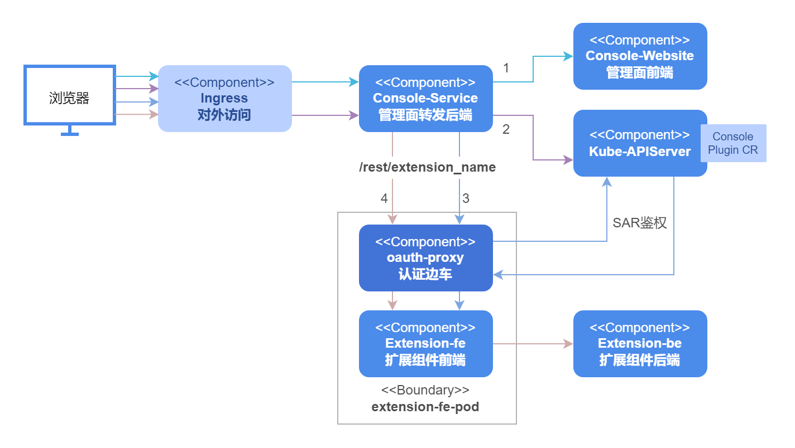

# 认证鉴权开发指南

## 特性介绍

openFuyao平台提供统一的用户登录认证服务，支持标准的OAuth2.0登录流程。当前版本使用内部的账户密码身份提供者来进行用户认证授权，未来版本会引入第三方认证提供者实现用户自动接入。登录openFuyao平台后，用户对Kubernetes的APIServer的具体资源访问以及openFuyao系统内组件的访问依赖Kubernetes的RBAC鉴权机制。

此外openFuyao通过通用易扩展的架构可以方便集成开发者自己开发的前后端应用，如果开发者想把自己开发的应用接入openFuyao的整个认证鉴权系统，可以借助oauth-proxy组件来实现，它作为边车容器会首先截获发送到用户前端应用的请求，在成功进行OAuth2.0（Open Authorization 2.0）认证和RBAC（Role-Based Access Control）鉴权后才会放行访问用户的前端应用，从而完成扩展组件的认证鉴权。

- 用户基本登录认证

  - 一键式安装部署后生成初始密码。
  - 首次登录需要修改密码。
  - 用户修改密码，用户登出。

- 用户鉴权

  - 访问Kubernetes的资源通过委派给Kubernetes的APIServer进行RBAC鉴权。
  - 访问组件的权限通过oauth-proxy代理给Kubernetes的APIServer进行RBAC鉴权。

- 安全校验

  - 用户多次登录失败时进行用户锁定防止爆破攻击。
  - OAuth2.0认证中用户授权步骤使用csrf_token校验防止跨站点请求伪造攻击。

- 扩展组件

  - 可接入openFuyao的OAuth2.0认证流程。
  - 可根据抽象出的使用该组件的用户的Role来接入Kubernetes的RBAC鉴权中。

## 约束与限制

当前版本不支持其他身份提供者（GitHub）接入到OAuth2.0的认证环节中，只能使用内置的fuyaoPasswordProvider身份提供者。

## 环境准备

认证鉴权系统随平台一起安装，详细步骤请参见[《安装指导》](https://gitcode.com/openFuyao/sig-installation/blob/master/docs/zh/cluster_installation_guide/read_before_installation/installation_process.md)。

## 将扩展组件接入openFuyao认证系统

### 任务场景概述

当用户自己开发了一个扩展组件的前端和后端之后，会通过openFuyao的扩展框架集成到openFuyao管理界面，如果用户此时希望访问该扩展组件的用户需要有特定的权限，需要通过引入认证鉴权组件oauth-proxy来帮助扩展前端接入openFuyao的认证鉴权体系中，以此过滤掉无权限的用户，做到保护用户的上游应用。

### 系统架构

从部署角度来看，为了将扩展组件的前端接入到认证鉴权系统，我们会在原有扩展组件前端的pod中加入oauth-proxy边车容器，将访问扩展组件前端的请求截获并进行认证校验，认证通过后还会通过SubjectAccessReview委派KubeAPIserver进行鉴权，通过之后才会将请求转发给pod内的扩展组件前端。

**图 1** 扩展组件接入openFuyao认证鉴权系统流程图<a id="figure12000" href="#" ></a>



[图1](#figure12000)所示的整个接入过程可以从以下四个步骤进行分解。

1. 线条1代表浏览器访问openFuyao管理面的前台展示界面基本信息，界面上的javascript会请求当前集群中挂载的ConsolePlugin CRD。
2. 线条2代表请求ConsolePlugin CRD的处理过程，Console-Service会转发到APIServer上获取所有CR并返回给浏览器。
3. 线条3代表浏览器获取挂载信息和扩展前缀后，通过Console-Service的扩展路由转发请求到扩展组件前端pod中的oauth-proxy边车上，oauth-proxy会解析用户token获得用户信息，然后委派给kube-apiserver通过鉴权后方可访问扩展组件前台页面，返回给浏览器。
4. 线条4代表前台通过JavaScript获取扩展组件的后台，同样通过Console-Service的扩展路由转发分给oauth-proxy边车，认证鉴权通过后转发给扩展组件前台服务，前台服务内部通过配置nginx.conf再转发给后台服务。

### 开发流程

仅需要修改配置文件，无需详细开发流程。

### 接口说明

仅需要修改配置文件，无需引入接口。

### 开发步骤

这里以日志组件为例说明将扩展组件接入openFuyao认证系统的全流程。

> **说明：**<br />以下配置均可以通过oauth-proxy的helm模板里面的values.yaml进行配置，涉及到的配置项如下所示。

 ```yaml
 # values.yaml
 ......
 service:
 containerPort: 9039  # 业务容器的containerPort，即容器内部httpserver开放的端口 
 backend: "http://logging-operator.openfuyao-system.svc" # 扩展组件后端url 
 enableOAuth: true   # 是否开启oauth-proxy
 oauthProxy:
 containerPort: 9093
 image:
  repository: "cr.openfuyao.cn/openfuyao/oauth-proxy"
  pullPolicy: Always
  tag: "v24.09"
 client:
  id: "oauth-proxy"
  secret: "SECRETTS"
 urls:
  host: "/"
  loginURI: "/oauth2/oauth/authorize"
  redeemURI: "/oauth2/oauth/token"
  rootPrefix: "/logging" # 填写扩展组件consolePlugin CR 的 .spec.pluginName
    
 ```

1. 原有部署文件准备。

   扩展组件是由Helm进行安装的，正常会有两个Helm包分别对应扩展组件的前端和后端，而扩展组件的后端的服务都属于集群，所有外部调用都会先经过扩展组件前端的代理发送给扩展组件的后端，所以我们的认证只需要加在扩展组件前端即可在页面上对所有访问扩展组件的请求进行过滤，这里以日志扩展组件为例说明需要准备的文件。

   ```yaml
   # Source: logging/templates/consoleplugin.yaml
   apiVersion: console.openfuyao.com/v1beta1
   kind: ConsolePlugin
   metadata:
     name: logging
   spec:
     pluginName: logging      # 该扩展组件的名称，需要设置，后续配置Ingress时候会用到
     displayName: "日志"
     subPages:
       - pageName: logSearch
         displayName: "日志查询"
       - pageName: logSet
         displayName: "日志配置"
     entrypoint: /container_platform
     backend:
       type: Service
       service:
         name: logging  # {{ .Release.Name }}
         namespace: openfuyao-system   #  {{ .Release.Namespace }}
         port: 80  # {{ .Values.service.httpPort }}
     enabled: true
   ---
   # Source: logging/templates/fe-deployment.yaml
   apiVersion: apps/v1
   kind: Deployment
   metadata:
     name: logging
     namespace: openfuyao-system
     labels:
       app: logging
   spec:
     replicas: 1
     selector:
       matchLabels:
         app: logging
     template:
       metadata:
         labels:
           app: logging
       spec:
         containers:
           - name: frontend
             image: "cr.openfuyao.cn/openfuyao/logging-website:v24.09"
             imagePullPolicy: Always
             ports:
               - name: http
                 containerPort: 80
                 protocol: TCP
             volumeMounts:
               - name: host-time
                 mountPath: /etc/localtime
                 readOnly: true
               - name: nginx-config
                 mountPath: /etc/nginx/nginx.conf
                 subPath: nginx.conf
         volumes:
           - name: host-time
             hostPath:
               path: /etc/localtime
               type: ""
           - name: nginx-config
             configMap:
               defaultMode: 0600
               name: logging-nginx
               items:
               - key: nginx.conf
                 path: nginx.conf
   ---
   # Source: logging/templates/fe-service.yaml
   apiVersion: v1
   kind: Service
   metadata:
     name: logging
     namespace: openfuyao-system
     labels:
       app: logging
   spec:
     type: ClusterIP
     ports:
       - port: 80 # {{ .Values.service.httpPort }}
         targetPort: 8080 # {{ .Values.service.containerPort }}
     selector:
       app: logging
   ---
   # Source: logging/templates/fe-config.yaml
   apiVersion: v1
   kind: ConfigMap
   metadata:
     name: logging-nginx
     namespace: openfuyao-system
   data:
     nginx.conf: |
       worker_processes  auto;

       error_log  /var/log/nginx/error.log notice;
       pid        /tmp/nginx.pid;

       events {
           worker_connections  1024;
       }

       http {
           proxy_temp_path /tmp/proxy_temp;
           client_body_temp_path /tmp/client_temp;
           fastcgi_temp_path /tmp/fastcgi_temp;
           uwsgi_temp_path /tmp/uwsgi_temp;
           scgi_temp_path /tmp/scgi_temp;

           include       /etc/nginx/mime.types;
           default_type  application/octet-stream;

           log_format  main  '$remote_addr - $remote_user [$time_local] "$request" '
                             '$status $body_bytes_sent "$http_referer" '
                             '"$http_user_agent" "$http_x_forwarded_for"';

           access_log  /var/log/nginx/access.log  main;

           sendfile        on;
           #tcp_nopush     on;

           gzip on;
           gzip_min_length 10k;
           gzip_buffers 4 32k;
           gzip_http_version 1.1;
           gzip_comp_level 6;
           gzip_types text/plain text/css text/html text/xml text/javascript application/json application/x-javascript application/xml application/xml+rss application/javascript font/ttf font/woff font/woff2 image/png image/svg+xml video/mp4;
           gzip_vary on;

           client_body_timeout 10;
           client_header_timeout 10;
           keepalive_timeout 5 30;
           send_timeout 10;

           port_in_redirect off;

           limit_conn_zone $binary_remote_addr zone=limitperip:10m;
           limit_req_zone $binary_remote_addr zone=ratelimit:10m rate=5r/s;

           server_tokens off;
           autoindex off;

           server {
               listen 8080 default_server;
               root /usr/share/nginx/html/;
               index index.html index.htm;

               client_header_buffer_size 5k;
               large_client_header_buffers 4 16k;
               client_body_buffer_size 10m;
               client_max_body_size 256m;
            
               add_header Content-Security-Policy "connect-src 'self' https:;frame-ancestors 'none';object-src 'none'" always;
               add_header Cache-Control "no-cache, no-store, must-revalidate" always;
               add_header X-Frame-Options DENY always;
               add_header X-Content-Type-Options nosniff always;
               add_header X-XSS-Protection 1 always;
               add_header Strict-Transport-Security "max-age=31536000" always;

               limit_conn limitperip 10;

               location / {
                   try_files $uri /index.html;
               }

               location ~* ^/logging/.*\.(js|cjs|mjs)$ {
                   default_type text/javascript;
                   rewrite ^ /dist/logging.mjs break;
               }

               location /logging/ {
                   rewrite ^/logging(/.*)$ $1 break;
                   proxy_pass {{ .Values.backend }};
               }

               location ~* \.(js|cjs|mjs)$ {
                   default_type text/javascript;
               }
            
               location /rest/logging {
                   proxy_pass {{ .Values.backend }};
               }
           }
       }
   ```

   上述四个yaml文件是部署扩展组件前端需要的。其中自定义资源ConsolePlugin中的`.spec.pluginName`需要设置成该扩展组件的名称，后续在Console-Service进行转发时候会使用该名称。fe-service.yaml和fe-deployment.yaml分别是扩展组件前端的服务和部署资源，在后续会加入oauth-proxy的资源来完成认证鉴权的接入。fe-config.yaml则包含了扩展组件的前端nginx的配置项，负责将请求转发给扩展组件后端。

2. 配置Service。

   ```yaml
   # Source: proxy-logging/templates/fe-service.yaml
   apiVersion: v1
   kind: Service
   metadata:
     name: logging
     namespace: openfuyao-system
     labels:
       app: logging
   spec:
     type: ClusterIP
     ports:
       - port: 80 # {{ .Values.service.httpPort }}
         targetPort: proxy      # 从http修改为proxy
     selector:
       app: logging

   ```  

   配置Service时，将原有指向扩展组件前端的容器端口8080改为指向oauth-proxy的容器的端口名称proxy，proxy对应的端口号可通过`{{ .Values.oauthProxy.containerPort }}`配置，此后外部访问该扩展组件Pod时就会先被oauth-proxy边车截获，认证通过后再通过Pod内localhost通讯发送给原有扩展组件容器的端口。

3. 配置ServiceAccount以及相关Role/RoleBinding。

   ```yaml
   # Source: proxy-logging/templates/serviceaccount-rolebindings.yaml
   # RBAC authn and authz
   apiVersion: v1
   kind: ServiceAccount
   metadata:
     name: logging-oauth-proxy
     namespace: openfuyao-system
   ---
   # Source: proxy-logging/templates/serviceaccount-rolebindings.yaml
   kind: ClusterRoleBinding
   apiVersion: rbac.authorization.k8s.io/v1
   metadata:
     name: logging-oauth-proxy-webhook-auth
   subjects:
     - kind: ServiceAccount
       name: logging-oauth-proxy
       namespace: openfuyao-system
   roleRef:
     kind: ClusterRole
     name: webhook-auth
     apiGroup: rbac.authorization.k8s.io
    ```

   上面配置文件中：

   - 以上文件对应在helm里面的serviceaccount-rolebindings.yaml可以直接使用，其中包含的模板按照项目需求在values.yaml中配置即可。

   - logging-oauth-proxy：oauth-proxy使用的服务账户，下面会将该服务账户绑定到一些角色上赋予其一定的权限使其可以进行认证API的调用。

   - logging-oauth-proxy-webhook-auth：oauth-proxy的一个集群角色绑定，赋予oauth-proxy调用Kubernetes的APIServer中认证和鉴权的webhook的权限，对应的ClusterRole由于已经在oauth-server安装时创建，此处不需要重复创建。

   如果前端服务对应的Deployment中已经有ServiceAccount进行绑定，则logging-oauth-proxy这个ServiceAccount不必进行创建，在logging-oauth-proxy-webhook-auth该ClusterRoleBinding中的subjects对应的name填写已绑定的ServiceAccount即可。

4. 配置Deployment。

   > **说明：**
   > <br />用户在执行前3个步骤后，步骤4只需要将`{{- if .Values.enableOAuth }}...{{- end }}`之间的内容直接复制粘贴到对应位置即可。

   由于oauth-proxy是通过边车的形式加入到原有的扩展组件前端的Pod中的，此处fe-deployment.yaml我们会额外增加一个oauth-proxy容器部署，具体形式如下。

   ```yaml
   # Source: proxy-logging/templates/fe-deployment.yaml
   apiVersion: apps/v1
   kind: Deployment
   metadata:
     name: logging
     namespace: openfuyao-system
     labels:
       app: logging
   spec:
     replicas: 1
     selector:
       matchLabels:
         app: logging
     template:
       metadata:
         labels:
           app: logging
       spec:
         serviceAccountName: logging-oauth-proxy # 若原本Deployment文件中没有该项，使用步骤2中新建的ServiceAccount
         containers:
           - name: logging
             image: "cr.openfuyao.cn/openfuyao/logging-website:v24.09"  # 扩展组件前端容器
             imagePullPolicy: Always
             ports:
               - name: http
                 containerPort: 80
                 protocol: TCP
           # 加入oauth-proxy镜像
           {{- if .Values.enableOAuth }}
           - name: oauth-proxy
             image: "{{ .Values.oauthProxy.image.repository }}:{{ .Values.oauthProxy.image.tag }}"
             imagePullPolicy: {{ .Values.oauthProxy.image.pullPolicy }}
             ports:
               - containerPort: {{ .Values.oauthProxy.containerPort }}
                 name: proxy
             args:
               - --https-address=
               - '--http-address=:{{ .Values.oauthProxy.containerPort }}'
               - --email-domain=*
               - --provider=openfuyao
               - --client-id={{ .Values.oauthProxy.client.id }}
               - --client-secret={{ .Values.oauthProxy.client.secret }}
               - '--upstream=http://localhost:{{ .Values.service.containerPort }}'
               - '--openfuyao-delegate-urls={"/":{"resource": "services/proxy", "group": ""}}'
               - --redirect-url={{ .Values.oauthProxy.urls.host }}
               - --login-url={{ .Values.oauthProxy.urls.loginURI }}
               - --redeem-url={{ .Values.oauthProxy.urls.redeemURI }}
               - --root-prefix={{ .Values.oauthProxy.urls.rootPrefix }}
               - --cookie-httponly
           {{- end }}
         volumes:
           - name: host-time
             hostPath:
               path: /etc/localtime
               type: ""
           - name: nginx-config
             configMap:
               defaultMode: 0600
               name: logging-nginx
               items:
               - key: nginx.conf
                 path: nginx.conf

   ```

### 调测验证

无。
