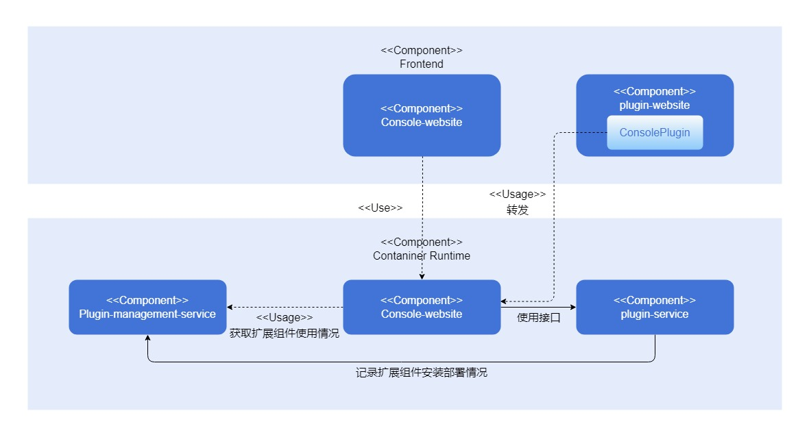
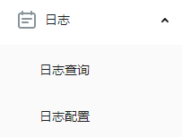

# 扩展组件开发指南

## 特性介绍

openFuyao算力容器平台（以下简称“openFuyao”）提供可插拔扩展能力，允许用户自主开发组件以扩展openFuyao的后端能力与前端界面，为用户提供更高效、灵活、定制化的云原生使用体验。openFuyao还提供相应的接口与模板，支持用户自行接入或开发第三方扩展组件。
详情请参见[《扩展组件管理》](../management_plane_operations/extension_management.md#特性介绍)。

## 约束与限制

- 开发或接入开发的扩展组件时，需按照openFuyao扩展组件标准改造前端代码并编写相关配置文件，具体规则请参见[开发步骤](#开发步骤)。
- 使用非官方来源的第三方扩展组件时，openFuyao无法避免扩展组件自身问题带来的风险。
- 当启用的扩展组件过多或扩展界面资源过大时，可能导致网络请求时间过长，影响页面整体加载时间。

## 环境准备

### 环境要求

1. 已有openFuyao集群环境。详情请参见[《安装指导》](https://gitcode.com/openFuyao/sig-installation/blob/master/docs/zh/cluster_installation_guide/read_before_installation/installation_process.md)。

2. 开发扩展组件所需的开发工具：

  - 前端开发：Node.js v18+
  - 镜像构建：Docker v18+
  - 软件打包：Helm v3.8+

### 搭建环境

访问软件官网安装[环境要求](#环境要求)所需的开发工具。

### 检验环境是否搭建成功

1. 执行以下命令，查看openFuyao组件Pod运行状态是否均为“Running”。

   ```bash
   kubectl get pod -n openfuyao-system
   ```

2. 执行以下命令，查看开发软件版本，确认软件是否安装成功。
   
   ```bash
   node -v
   docker version
   helm version
   ```

## 使用扩展组件

### 使用场景概述

现有的前端界面可以作为扩展界面挂载至openFuyao前端。当开发者完成扩展组件前端页面的开发后，为了能够被openFuyao前端发现并加载，需要进行部分改造与配置文件编写。

### 系统架构

扩展组件可以按需配置前后端服务数量、名称等，同时包含ConsolePlugin资源以提供前端界面渲染配置与后端转发规则。openFuyao平台中console-service模块将通过扩展管理plugin-management-service模块相关接口获取集群中的扩展前端启用情况，并返回给前端，同时console-service也将根据ConsolePlugin资源中的信息，将扩展组件的前端资源请求或后端接口调用转发到对应的服务上。


### 接口说明

无。

### 开发步骤

1. 前端开发/改造。

   openFuyao可插拔结构支持开发者在不对源码进行较大幅度修改的前提下，将独立的前端界面挂载至openFuyao前端管理面。若需接入扩展组件前端，需要先提供唯一的扩展组件名称，并在项目目录编写如下`extension.js`文件:

   ```js
   const config = {
     menu: {
       pluginName: <扩展组件名称>,
     },
   };
   export default config;
   ```

   openFuyao前端基于扩展组件名称为扩展组件创建唯一的挂载点，html标签id为`<扩展组件名称>_root`，因此扩展组件的前端入口函数需要更改渲染挂载点。以使用openInula开发的扩展前端为例，入口函数修改方式如下：

   ```js
   // 修改前 index.html
   <div id="root"></div>
   // 修改后 index.html
   <div id="xxxx_root"></div>  // xxxx为扩展组件名
   
   // 修改前 index.jsx
   Inula.render(<App />, document.querySelector('#root'));
   // 修改后 index.jsx
   Inula.render(<App />, document.querySelector(`#${extensionConfig.menu.pluginName}_root`));
   ```

   扩展界面将以JavaScript ES Module形式动态引入openFuyao前端管理面，需要按以下配置打包。

   - 安装CSS样式插件（以vite为例）。

     ```bash
     npm install vite-plugin-css-injected-by-js postcss-prefix-selector
     ```

   - 添加`vite.config.js`构建配置项。以下文为例，将在`dist/{pluginName}`路径构建`{pluginName}.mjs`文件，并生成扩展组件专用的样式表以避免挂载后可能发生的样式冲突。

     ```js
     import cssInjectedByJsPlugin from 'vite-plugin-css-injected-by-js';
     import postcssPrefixSelector from 'postcss-prefix-selector';
     import extension from './src/extension.js';
     
     const { pluginName } = extension.menu;
     
     // vite.config.js
     export default {
       // 添加插件
       plugins: [
         cssInjectedByJsPlugin(),
         // 其他插件
         ...
       ],
       // 添加以下构建配置
       build: {
         lib: {
           entry: path.resolve(__dirname, 'index.html'),
           name: pluginName,
           formats: ['es'],
         },
         rollupOptions: {
           output: {
             entryFileNames: `${pluginName}/${pluginName}.mjs`,
           },
         },
       },
       // 样式插件配置
       css: {
         postcss: {
           plugins: [
             postcssPrefixSelector({
               prefix: `#${pluginName}_root`,
               transform(prefix, selector, prefixedSelector) {
                 // 跳过body, html样式
                 if (selector.startsWith('body') || selector.startsWith('html')) {
                   return selector;
                 }
                 return prefixedSelector;
               },
             }),
           ],
         },
       },
       define: {
         'process.env': 'new Object({ NODE_ENV: "production" })',
       },
       // 其他配置
       ...
     };
     ```

2. 镜像模块构建。

   扩展组件可包含若干扩展前端界面与扩展后端服务。开发者需要为各服务构建镜像，以Deployment等方式部署在集群中，并以Service方式暴露。

   >  **须知：**<br />
   > 现行的openFuyao扩展组件前、后端设计需要遵守以下规范：
   >
   > 1. 扩展组件后端接口须以`/rest/{pluginName}`开头以允许openFuyao平台扩展组件相关模块识别，其中`pluginName`为扩展组件名称，与`extension.js`中保持一致。
   > 2. 扩展组件前端界面模块名称须为`{pluginName}.mjs`，其中`pluginName`与`extension.js`中保持一致。（若使用步骤1中vite配置构建，ES Module文件名默认即为`{pluginName}.mjs`）。
   > 3. 从前端服务容器中获取前端界面模块时，请保证获取该文件的路径为`/dist/{pluginName}.mjs`。（建议以Nginx提供，并将ES Module文件存放在Nginx容器`html/dist/`路径下，可参考日志组件Dockerfile）

3. 资源配置。

   ConsolePlugin自定义资源是openFuyao可插拔架构用于前端扩展发现与加载，以及声明扩展后端接口转发规则的配置文件。为了扩展组件的正确运行，开发者需要提供ConsolePlugin资源。

   以日志组件为例，该组件名称为`logging`，包含扩展前端界面，并提供`/rest/logging`开头的接口，以下为该扩展组件的ConsolePlugin配置。

      ```yaml
      apiVersion: console.openfuyao.com/v1beta1
      kind: ConsolePlugin
      metadata:
       name: logging
      spec:
        pluginName: logging
        displayName: "日志"
        entrypoint: /container_platform
        subPages:
          - pageName: logSearch
            displayName: "日志查询"
          - pageName: logSet
            displayName: "日志配置"
        backend:
          type: Service
          service:
            name: logging-operator
            namespace: logging-ns
            port: 8080
            scheme: https
            insecureSkipVerify: false
            caBundle: xxxxx     # base64编码之后的扩展组件CA证书
        enabled: true
      ```

   **表 1** 配置文件参数说明

   | 参数                      | 类型      | 是否必需       | 描述                                                         |
   | ------------------------- | --------- | -------------- | ------------------------------------------------------------ |
   | pluginName                | string    | 是             | 扩展组件的唯一名称。                                         |
   | displayName               | string    | 是             | 展示在菜单上的扩展组件名称。                                 |
   | entrypoint                | string    | 是             | 导航按钮在页面上挂载的位置(目前支持`/`, `/container_platform`)。 |
   | order                     | string    | 否             | 扩展组件在菜单上的顺位。                                       |
   | subPages                  | subPage[] | 否             | 展示在菜单上该扩展组件的二级菜单。                           |
   | subPages[].pageName       | string    | 是             | 扩展子页面的名称。                                           |
   | subPages[].displayName    | string    | 是             | 展示在菜单上的扩展子页面名称。                               |
   | backend.type              | string    | 是             | 扩展后端访问方式（目前仅支持`Service`）。                    |
   | backend.service.name      | string    | 是             | 扩展后端Service名称。                                          |
   | backend.service.namespace | string    | 是             | 扩展后端Service命名空间。                                      |
   | backend.service.port      | int32     | 否，默认为80   | 扩展后端Service端口。                                          |
   | backend.service.basePath  | string    | 否，默认为/   | 扩展后端Service路径后缀，将添加在`name.namespace.svc:port`末尾。 |
   | backend.service.scheme | string | 否，默认为http | 扩展后端Service的协议，有`http`和`https`两种选项。 |
   | backend.service.caBundle | string | 否 | openFuyao的console-service组件用于验证扩展后端的CA证书。 |
   | backend.service.insecureSkipVerify | boolean | 否，默认为false | openFuyao的console-service组件访问扩展后端时是否开启证书认证。 |
   | enable                    | boolean   | 否，默认为true | 该扩展是否启用。                                             |

      **参数补充说明：**

      - `pluginName`为由数字、字母、_、-符号组成的**唯一**资源名称字段，且需要与上文构建的JavaScript文件名（`{name}`）相同。
      - `order`字段若不提供则为null，此时扩展组件将渲染在菜单的最后。
      - `entrypoint`为挂载页面的路由前缀，目前支持`/`（导航栏）与`/container_platform`（openFuyao平台左侧菜单）。
      - `subPages`仅当扩展前端挂载在openFuyao平台左侧菜单（`entrypoint: /container_platform`）时生成，若subPage为空，则渲染内容为`displayName`的跳转按钮；若不为空则渲染为下拉按钮，展开后显示若干跳转按钮。
      - `enabled`仅表示扩展前端界面是否启用，不影响扩展组件各模块的运行状态。
      - `backend.service.scheme`、`backend.service.caBundle`和`backend.service.insecureSkipVerify`三个参数作用是为扩展组件的接入提供安全访问协议。用户通过设置`caBundle`和`insecureSkipVerify`，并在扩展后端服务配置好服务证书，便可以使`console-service`组件路由扩展组件时进行单向`TLS`校验，保障访问数据安全。

4. 鉴权接入。

   扩展组件可以接入openFuyao认证鉴权模块，以实现和openFuyao主系统一致的认证鉴权能力。扩展组件的鉴权接入不需要对扩展组件本身服务进行修改，仅通过引入openFuyao OAuth-Proxy模块对扩展请求进行代理。具体原理与改造流程请参见[《认证鉴权开发指南》](./authentication_and_authorization_development_guide.md)。

5. 打包构建。

   完成上面的步骤并安装相关资源后，打开或刷新openFuyao前端管理面，您可以在相应的位置看到扩展组件的按钮已成功挂载，单击后将在openFuyao前端管理面内展示扩展组件的前端页面。

   推荐您将该扩展组件按以下规范打包为Helm Chart，并上传至openFuyao本地仓库内，从而达成更好的扩展组件生命周期管理体验。在打包为Helm Chart时，请在`Chart.yaml`文件中添加`openfuyao-extension`关键词。以日志组件为例，其chart包中的`Chart.yaml`如下所示：

   ```yaml
   apiVersion: v2
   name: logging
   description: A Helm chart for openFuyao logging extension. It includes the logging operator, Loki stack, and proxy frontend to deliver a complete logging solution.
   type: application
   appVersion: "latest"
   version: 0.0.0-latest
   keywords: ["openfuyao-extension", "log"]
   ```

### 调测验证

1. 扩展前端界面挂载。

   构建并部署扩展组件前端服务，提供ConsolePlugin资源后，访问或刷新openFuyao前端管理面，即可在对应位置看到扩展组件入口按钮或折叠菜单。根据`entrypoint`字段配置，预期效果如下。

   - 顶部导航栏按钮（`entrypoint: /`）
     
      **图 1** 顶部导航
     
     

   - openFuyao平台左侧导航栏按钮（`entrypoint: /container_platform`，`subPage`为空）
     
      **图 2** 左侧导航
     
     

   - openFuyao平台左侧菜单折叠菜单（`entrypoint: /container_platform`，`subPage`不为空）
     
      **图 3** 左侧折叠菜单
     
     

   单击按钮，切换至扩展组件前端界面。若正常加载页面内容即说明挂载成功。若页面为空，可通过浏览器开发工具查看网络请求记录、openFuyao ingress-controller以及console-service等组件日志分析问题。

2. 扩展组件打包。

   根据openFuyao扩展组件打包规范打包Helm Chart后，上传至任意已添加到openFuyao平台的Helm仓库。在openFuyao平台“应用市场 > 仓库配置”中同步该仓库，即可在“应用市场 > 应用列表”中搜索查看该扩展组件，且应用卡片与详情界面可见“扩展组件”标记，同时支持列表左侧勾选“扩展组件”进行筛选。

   集群中已安装的扩展组件，将不再通过“应用管理”，而是通过“扩展组件管理”页面进行生命周期管理。该界面除了支持对扩展组件进行应用升级、回退、卸载等操作，还允许对扩展界面进行启用、停用设置。具体使用说明请参见[《扩展组件管理用户指南》](../management_plane_operations/extension_management.md)。
