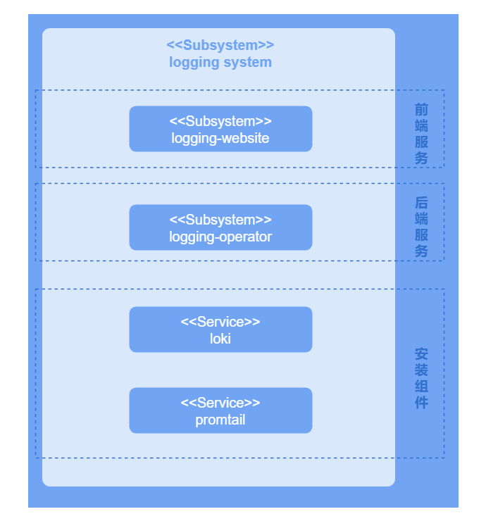

# 日志扩展组件开发指南

## 特性介绍

日志系统作为可插拔扩展组件，独立部署运行在openFuyao平台中，为平台和用户提供了强大的日志筛选、搜索、查询以及告警等功能。

## 约束与限制

无。

## 环境准备

详细安装步骤请参见[《安装指导》](https://gitcode.com/openFuyao/sig-installation/blob/master/docs/zh/cluster_installation_guide/read_before_installation/installation_process.md)。

## 使用场景

### 使用场景概述

开发者需要在openFuyao集群管理面中自行安装日志扩展组件，在安装扩展组件时需要进行若干项的设置从而能够让日志系统更好地适配自身业务场景。可以配置的选项有：

- 配置被采集日志从创建到现在时长限制与日志存储更新时间策略。
- 配置日志的采集源配置。
- 配置日志告警的自定义告警触发规则。

### 系统架构

日志系统业务层分为UI层、后端层和组件层。

UI层：用户可以在console-website上进行日志操作。

后端层：logging-operator以微服务的形式部署提供一些核心能力，包括日志筛选、搜索、查询、配置以及告警等功能。

组件层：组件层为日志系统提供关键的日志采集、存储和处理能力，并支持与后端层进行集成，使用户能够高效地执行日志操作。

**图 1** 日志扩展组件系统架构

### 接口说明

主要的接口说明如下表所示。

**表 1** 主要接口说明

|接口|描述|
|:---|:---|
|PATCH /rest/logging/v1/update-config |添加新采集任务和修改已有的采集任务。|
|GET /rest/logging/v1/configmap|列举出当前日志采集组件全部工作流的采集源路径。|

### 开发步骤

已成功安装日志扩展组件，详细安装步骤请参见[《日志》](../management_plane_operations/observability_center/logs.md#安装)
      
### 调测验证

当配置的采集任务名称和采集源路径与当前日志采集系统的工作流中列出的采集路径匹配时，表明该配置已成功生效。查看当前日志采集组件全部工作流的采集源路径的接口如下表。

**表 2** 调测接口说明

|接口|描述|
|:---|:---|
|GET /rest/logging/v1/configmap |列举出当前日志采集组件全部工作流的采集源路径。|
