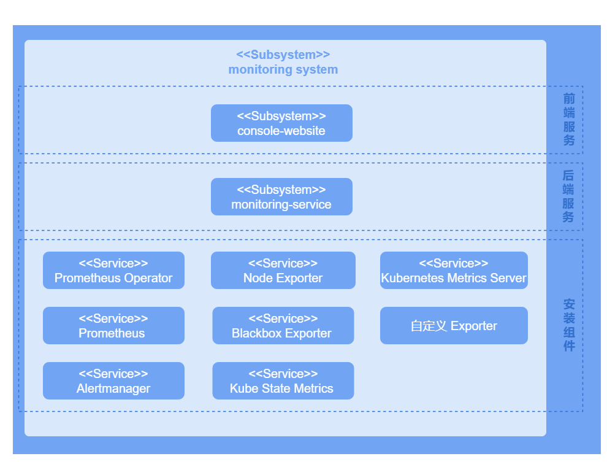

# 监控开发指南

## 特性介绍

监控系统是一套用于实时监控、收集和分析集群内各类资源和应用运行状态的工具。它能够提供关于节点、容器、应用程序和网络的详细性能指标，帮助了解集群的整体健康状况。同时，监控系统能够根据不同的业务需求进行调整和扩展，以适应不断变化的环境和要求。

- 高可用性和系统稳定性：通过实时监控集群中的各项指标，可以确保系统在出现问题时能够迅速响应和处理，避免因为单点故障或资源不足导致的系统崩溃。
- 提前预防和解决潜在问题：通过持续的数据收集和分析，监控系统能够识别潜在的性能瓶颈和故障点，提前预警并采取措施，从而避免问题扩大化。
- 灵活性与可扩展性：集群环境通常具有高度的动态性和复杂性，监控系统需要适应这些变化，能够自动发现和监控新部署的服务和应用，同时支持根据需求进行扩展。
详情请参见[《监控用户指南》](../management_plane_operations/observability_center/monitoring.md)。

## 约束与限制

无。

## 环境准备

监控系统随平台一起安装部署，详细安装步骤请参见[《安装指导》](https://gitcode.com/openFuyao/sig-installation/blob/master/docs/zh/cluster_installation_guide/read_before_installation/installation_process.md)。

## 任务场景

本章节介绍开发者部署自己的采集器并配置ServiceMonitor来收集数据。

### 任务场景概述

开发者需要在Kubernetes环境中部署自定义数据采集器（Exporter），并通过配置ServiceMonitor使Prometheus能够发现和收集这些监控数据。具体任务包括部署Exporter、创建并应用ServiceMonitor以及验证。最终目标是确保Prometheus能够正确收集采集器的数据。

### 系统架构

监控系统按照业务层次分为UI层、后端层、组件层，系统架构如下图所示。

**图 1** 监控系统架构



- UI层

  用户可以在console-website上进行监控操作。

- 后端层

  monitoring-service以微服务的形式部署提供一些核心能力，包括指标查询、监控目标配置和告警规则配置。

- 组件层

  组件层主要为监控层提供关键数据的支持。监控不同的目标，收集关于整个集群系统的各种度量指标，以便于后续的查询、分析和告警。

### 开发流程

1. 部署自定义Exporter：确保自定义Exporter已经部署，并且暴露了一个可以被Prometheus抓取的端点。
2. 创建一个Kubernetes Service：为自定义Exporter创建一个Kubernetes Service，以便Prometheus可以发现并抓取它的指标。
3. 配置ServiceMonitor：编写并应用ServiceMonitor以监控自定义Exporter。
4. 验证监控数据：在openFuyao平台中，左侧导航栏选择“监控”，单击“监控目标”，查看监控目标是否存在以及它的健康状态是否为"up"。

### 接口说明

**表 1** 主要接口说明

|接口名|描述|
|:---|:---|
|GET /rest/monitoring/v1/targets|获取监控目标。|

### 开发步骤

1. 部署自定义Exporter

   1.1 创建Exporter的YAML文件（以Deployment为例）。编写自定义Exporter的YAML文件，根据Exporter的特性选择合适的Kubernetes资源类型。

      创建一个名为“exporter-deployment.yaml”的YAML文件，内容如下：
        
      ```yaml
    apiVersion: apps/v1
    kind: Deployment
    metadata:
      labels:
        app: my-exporter
      name: my-exporter
      namespace: my-exporter-namespace
      spec:
      replicas: 3
      selector:
        matchLabels:
          app: my-exporter
      template:
        metadata:
          labels:
            app: my-exporter
        spec:
          containers:
            - name: my-exporter
              image: my-exporter-image:latest
              ports:
                - containerPort: 9100
      ```

  1.2 应用Exporter的YAML文件（以Deployment为例）。将Exporter应用到Kubernetes集群中，使其开始运行。

  使用kubectl将Deployment资源应用到Kubernetes集群中，执行如下命令：
     
  ```
  kubectl apply -f exporter-deployment.yaml
  ```
    
2. 创建一个Kubernetes Service。
   
   2.1 编写Exporter的Service，以便Prometheus可以发现并抓取它的指标。

      创建一个名为exporter-service.yaml的YAML文件，内容如下：
        
      ```yaml
        apiVersion: v1
        kind: Service
        metadata:
          labels:
            app: my-exporter
          name: my-exporter
          namespace: my-exporter-namespace
        spec:
          ports:
          - port: 9100
            targetPort: 9100
          selector:
            app: my-exporter
      ```
      
      >  **说明：**<br />
      > - app: my-exporter标签与Exporter的Deployment标签匹配。
      > - 端口号9100与Exporter使用的端口一致。

   2.2 将Exporter的Service应用到集群中，使Prometheus可以发现Exporter并抓取它的指标。

      使用kubectl将Service资源应用到Kubernetes集群中，执行如下命令：
      
      ```
      kubectl apply -f exporter-service.yaml
      ```

3. 配置ServiceMonitor以监控自定义Exporter。
   
   3.1 定义ServiceMonitor资源，编写ServiceMonitor的YAML文件来定义监控目标。

      创建一个名为service-monitor.yaml的YAML文件，内容如下：
        
      ```yaml
        apiVersion: monitoring.coreos.com/v1
        kind: ServiceMonitor
        metadata:
          name: my-exporter-servicemonitor
          namespace: my-exporter-servicemonitor-namespace
        spec:
          endpoints:
            - interval: 30s
              port: 9100
              path: /metrics
          selector:
          matchLabels:
              app: my-exporter
          namespaceSelector:
            matchNames:
            - my-exporter-namespace
      ```

      >  **说明：** <br />
      > - 确保app: my-exporter标签与Exporter的Service标签匹配。
      > - 确保端口号9100与Exporter使用的端口一致。

   3.2 应用ServiceMonitor资源，使Prometheus可以发现Exporter并抓取监控数据。

      使用kubectl将ServiceMonitor资源应用到Kubernetes集群中，执行如下命令：
        
      ```
      kubectl apply -f service-monitor.yaml
      ```

### 调测验证

在openFuyao平台界面的左侧导航栏“观测中心”中选择“监控 > 监控目标”，进入“监控目标”界面。在页面中找到对应的监控名称，并且状态显示为“up”，表明该监控目标配置成功。
