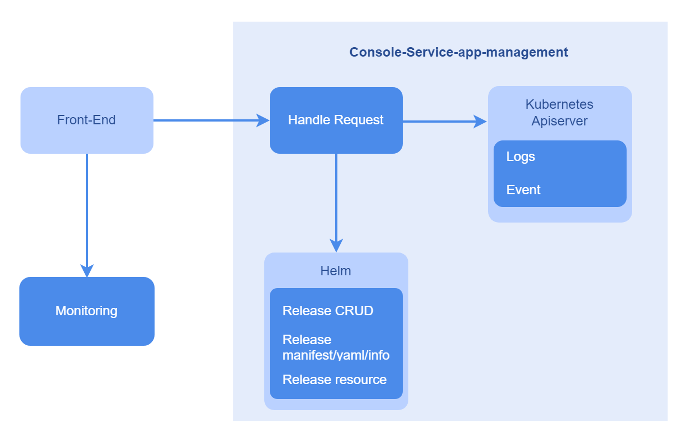

# 应用管理

## 特性介绍

应用管理是openFuyao平台提供的支持应用管理工具，提供了完整的部署、更新和卸载程序功能。当前版本支持的应用安装方式主要通过Chart包使用Helm进行安装，在应用管理中可呈现整个应用列表并进行后续的运维管理操作。

### 应用场景

应用管理当前支持对于Helm格式的release应用进行完整的运维操作。

- 应用信息获取：以列表形式获取应用名称、状态、更新时间信息，并支持筛选与排序，同时详情页提供yaml、资源列表、事件、监控等更多信息。

- 应用生命周期管理：对集群中安装的各应用进行安装、卸载、升级与回退的操作。

- 支持各种形式的Helm Chart包上传后的安装，以及对于应用的相关设置参数进行修改。

### 能力范围

- 基础信息：支持展示应用名称、状态、创建时间、应用模板、模板版本和更新时间。应用列表页面支持按照名称和更新时间排序，支持根据安装状态进行筛选。
- 运维管理：支持应用的升级、回退和卸载。升级功能仅支持通过openFuyao应用市场安装的应用。支持应用的资源展示（如日志、事件等），配置修改（YAML形式）。

### 亮点特征

支持全生命周期的应用管理功能，能够通过简单直观的操作实现对应用的安装、部署、升级、卸载和回退，同时支持应用内资源的查看、日志的查看和监控观测。

### 实现原理

**图 1** 应用管理实现原理

### 与相关特性的关系

应用管理中的监控数据来源于平台的监控组件，使用应用监控功能要确认平台监控组件运行正常，详情请参见[监控](./observability_center/monitoring.md)。

## 使用应用管理

左侧导航栏中单击“应用管理”，进入“应用管理”界面。应用管理界面可查看已部署的应用实例，包含应用的名称、状态、更新时间。

单击“应用名称”，进入应用“详情”界面，查看应用的详细信息，包括详情、YAML、资源、日志、事件、监控。

### 升级应用

#### 前提条件

- 集群已安装Kubernetes 1.28以及Helm 3.14.2。
- 集群中marketplace-service运行正常。

#### 背景信息

Helm是Kubernetes集群中的包管理器。类似在Ubuntu中使用的apt、CentOS中使用的yum，能够方便快捷地安装Helm应用。

#### 使用限制

待安装软件格式为Helm Chart，当前仅支持上传到仓库的软件安装。

#### 操作步骤

1. 入口1：在“应用管理”界面单击表格列图标，选择“升级”，进入应用“升级”界面。

   入口2：在应用“详情”界面单击“操作”，选择“升级”，进入“升级”界面。

2. 单击“版本信息”下拉框，选择要升级的指定版本。

3. 单击“确定”完成升级。

#### 相关操作

您可以在列表页面单击操作列或在详情页面单击右上角的“操作”，按需回退、卸载应用。

**表 1** 相关操作说明

|操作|说明                  |
|:------|:-----|
|回退| 支持回退到历史安装的版本，以版本号和序列号作为标识，暂时不支持历史数据的回退。   |
|卸载|根据Kubernetes自身机制，应用卸载后，该应用运行过程中在主机存储设备/分布式存储设备上创建的文件或数据不会被强制删除，需用户手动删除，避免存储空间浪费。   |
